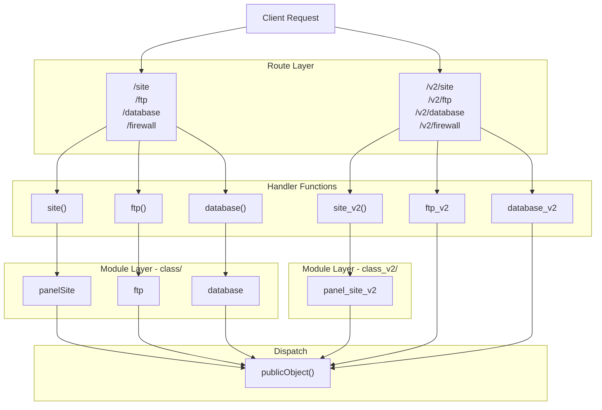
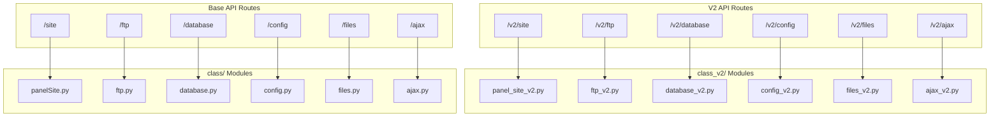
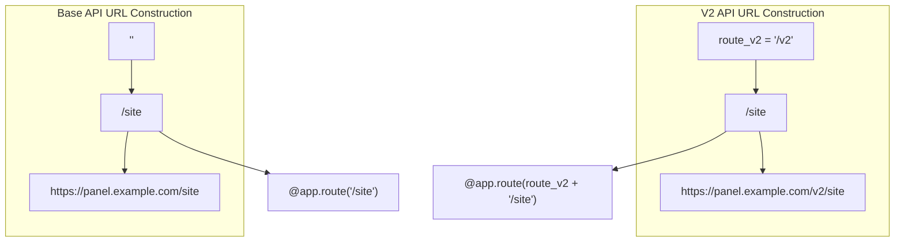

# API Versioning

> **Relevant source files**
> * [BTPanel/__init__.py](https://github.com/aaPanel/aaPanel/blob/b6e4ab8b/BTPanel/__init__.py)

## Overview

aaPanel implements a dual API versioning system to maintain backwards compatibility while introducing new features and improvements. The system supports two parallel API versions:

* **Base API (V1)**: Original routes without version prefix (e.g., `/site`, `/ftp`, `/database`)
* **V2 API**: Modern routes with `/v2` prefix (e.g., `/v2/site`, `/v2/ftp`, `/v2/database`)

Both API versions coexist in the same application, allowing gradual migration of client code and features. For information about the module dispatch mechanism used by both versions, see [Module Dispatch (publicObject)](/aaPanel/aaPanel/4.1-module-dispatch-(publicobject)).

**Sources:** [BTPanel/__init__.py L176](https://github.com/aaPanel/aaPanel/blob/b6e4ab8b/BTPanel/__init__.py#L176-L176)

 [BTPanel/__init__.py L29-L35](https://github.com/aaPanel/aaPanel/blob/b6e4ab8b/BTPanel/__init__.py#L29-L35)

---

## Version Prefix Configuration

The V2 API uses a configurable route prefix defined as a global constant:

```

```

This prefix is prepended to all V2 routes throughout the application. The configuration allows for potential future version changes without modifying individual route definitions.

**Sources:** [BTPanel/__init__.py L176](https://github.com/aaPanel/aaPanel/blob/b6e4ab8b/BTPanel/__init__.py#L176-L176)

---

## Route Registration Comparison

### Base API Route Pattern

Base API routes are registered without a version prefix:

```

```

### V2 API Route Pattern

V2 routes use the `route_v2` prefix and import from `_v2` modules:

```

```

**Sources:** [BTPanel/__init__.py L855-L976](https://github.com/aaPanel/aaPanel/blob/b6e4ab8b/BTPanel/__init__.py#L855-L976)

 [BTPanel/__init__.py L3546-L3767](https://github.com/aaPanel/aaPanel/blob/b6e4ab8b/BTPanel/__init__.py#L3546-L3767)

---

## Dual Version Route Architecture



**Sources:** [BTPanel/__init__.py L855-L1313](https://github.com/aaPanel/aaPanel/blob/b6e4ab8b/BTPanel/__init__.py#L855-L1313)

 [BTPanel/__init__.py L3546-L4339](https://github.com/aaPanel/aaPanel/blob/b6e4ab8b/BTPanel/__init__.py#L3546-L4339)

---

## Module Directory Structure

The versioning system uses separate module directories for each API version:

| Directory | API Version | Added to sys.path |
| --- | --- | --- |
| `class/` | Base API (V1) | Line 32 |
| `class_v2/` | V2 API | Line 34 |

Both directories are added to Python's module search path during initialization:

```

```

This allows the application to import modules from either version by using version-specific module names.

**Sources:** [BTPanel/__init__.py L29-L35](https://github.com/aaPanel/aaPanel/blob/b6e4ab8b/BTPanel/__init__.py#L29-L35)

---

## Module Version Mapping



**Sources:** [BTPanel/__init__.py L855-L1536](https://github.com/aaPanel/aaPanel/blob/b6e4ab8b/BTPanel/__init__.py#L855-L1536)

 [BTPanel/__init__.py L3546-L4574](https://github.com/aaPanel/aaPanel/blob/b6e4ab8b/BTPanel/__init__.py#L3546-L4574)

---

## Supported API Endpoints by Version

### Common Endpoints in Both Versions

The following major endpoints are available in both API versions:

| Feature | Base Route | V2 Route | Base Module | V2 Module |
| --- | --- | --- | --- | --- |
| Website Management | `/site` | `/v2/site` | `panelSite` | `panel_site_v2` |
| FTP Management | `/ftp` | `/v2/ftp` | `ftp` | `ftp_v2` |
| Database Management | `/database` | `/v2/database` | `database` | `database_v2` |
| File Management | `/files` | `/v2/files` | `files` | `files_v2` |
| Configuration | `/config` | `/v2/config` | `config` | `config_v2` |
| Firewall | `/firewall` | `/v2/firewall` | `firewalls` | `firewalls_v2` |
| System Status | `/system` | `/v2/system` | `system` | `system_v2` |
| AJAX Services | `/ajax` | `/v2/ajax` | `ajax` | `ajax_v2` |
| SSL/TLS | `/ssl` | `/v2/ssl` | `panelSSL` | `panel_ssl_v2` |
| Cron Jobs | `/crontab` | `/v2/crontab` | `crontab` | `crontab_v2` |
| Plugins | `/plugin` | `/v2/plugin` | `panelPlugin` | `panel_plugin_v2` |

**Sources:** [BTPanel/__init__.py L855-L1642](https://github.com/aaPanel/aaPanel/blob/b6e4ab8b/BTPanel/__init__.py#L855-L1642)

 [BTPanel/__init__.py L3546-L4833](https://github.com/aaPanel/aaPanel/blob/b6e4ab8b/BTPanel/__init__.py#L3546-L4833)

---

## Request Flow Differences

```mermaid
sequenceDiagram
  participant Client
  participant Flask
  participant Base Route Handler
  participant V2 Route Handler
  participant class/ Module
  participant class_v2/ Module
  participant publicObject()

  note over Client,publicObject(): Base API Flow
  Client->>Flask: POST /site?action=AddSite
  Flask->>Base Route Handler: site(pdata)
  Base Route Handler->>class/ Module: import panelSite
  class/ Module->>publicObject(): publicObject(siteObject, defs, ...)
  publicObject()-->>Client: JSON Response
  note over Client,publicObject(): V2 API Flow
  Client->>Flask: POST /v2/site?action=AddSite
  Flask->>V2 Route Handler: site_v2(pdata)
  V2 Route Handler->>class_v2/ Module: import panel_site_v2
  class_v2/ Module->>publicObject(): publicObject(siteObject, defs, ...)
  publicObject()-->>Client: JSON Response
```

**Sources:** [BTPanel/__init__.py L855-L976](https://github.com/aaPanel/aaPanel/blob/b6e4ab8b/BTPanel/__init__.py#L855-L976)

 [BTPanel/__init__.py L3546-L3767](https://github.com/aaPanel/aaPanel/blob/b6e4ab8b/BTPanel/__init__.py#L3546-L3767)

 [BTPanel/__init__.py L2697-L2731](https://github.com/aaPanel/aaPanel/blob/b6e4ab8b/BTPanel/__init__.py#L2697-L2731)

---

## WebSocket Endpoint Versioning

WebSocket endpoints also follow the dual version pattern:

| Base WebSocket | V2 WebSocket | Purpose |
| --- | --- | --- |
| `/ws_model` | `/v2/ws_model` | Model controller WebSocket |
| N/A | `/v2/ws_modsoc` | New scenario model controller |

### Base WebSocket Route

```

```

### V2 WebSocket Route

```

```

**Sources:** [BTPanel/__init__.py L3012-L3046](https://github.com/aaPanel/aaPanel/blob/b6e4ab8b/BTPanel/__init__.py#L3012-L3046)

 [BTPanel/__init__.py L3420-L3455](https://github.com/aaPanel/aaPanel/blob/b6e4ab8b/BTPanel/__init__.py#L3420-L3455)

 [BTPanel/__init__.py L3458-L3499](https://github.com/aaPanel/aaPanel/blob/b6e4ab8b/BTPanel/__init__.py#L3458-L3499)

---

## Version-Specific Controllers

Certain complex features use specialized controllers that differ between versions:

### Project Controllers

```mermaid
flowchart TD

ProjectController["panelProjectController<br>ProjectController"]
DatabaseController["panelDatabaseController<br>DatabaseController"]
Controller["panelController<br>Controller"]
ProjectControllerV2["panelProjectControllerV2<br>ProjectController"]
DatabaseControllerV2["panelDatabaseControllerV2<br>DatabaseController"]
ControllerV2["panelControllerV2<br>Controller"]
DockerControllerV2["panelDockerControllerV2<br>DockerController"]
SafeControllerV2["panelSafeControllerV2<br>SafeController"]
FirewallControllerV2["panelFireControllerV2<br>FirewallController"]
BaseRoutes["/project//"]
BaseRoutes2["/dbmodel//"]
BaseRoutes3["///"]
V2Routes1["/v2/project//"]
V2Routes2["/v2/dbmodel//"]
V2Routes3["/v2/btdocker//"]

BaseRoutes --> ProjectController
BaseRoutes2 --> DatabaseController
BaseRoutes3 --> Controller
V2Routes1 --> ProjectControllerV2
V2Routes2 --> DatabaseControllerV2
V2Routes3 --> DockerControllerV2

subgraph subGraph1 ["V2 API Controllers"]
    ProjectControllerV2
    DatabaseControllerV2
    ControllerV2
    DockerControllerV2
    SafeControllerV2
    FirewallControllerV2
end

subgraph subGraph0 ["Base API Controllers"]
    ProjectController
    DatabaseController
    Controller
end
```



**Sources:** [BTPanel/__init__.py L1191-L1306](https://github.com/aaPanel/aaPanel/blob/b6e4ab8b/BTPanel/__init__.py#L1191-L1306)

 [BTPanel/__init__.py L4163-L4262](https://github.com/aaPanel/aaPanel/blob/b6e4ab8b/BTPanel/__init__.py#L4163-L4262)

---

## Version Detection and Response Format

### Response Format Enforcement

The V2 API includes enhanced response format validation. Routes prefixed with `/v2` check that handlers use the standardized response format:

```

```

This ensures V2 routes consistently use the `public.return_message()` function for standardized responses.

**Sources:** [BTPanel/__init__.py L460-L493](https://github.com/aaPanel/aaPanel/blob/b6e4ab8b/BTPanel/__init__.py#L460-L493)

---

## Template Differences

Both API versions serve different template files for GET requests:

### Base API Templates

* `index.html` - Main panel interface
* `site.html`, `ftp.html`, `database.html` - Feature-specific pages
* `config.html` - Configuration page

### V2 API Templates

* `index1.html` - Modern panel interface
* Enhanced versions of feature templates with updated UI

**Example:**

```

```

**Sources:** [BTPanel/__init__.py L855-L976](https://github.com/aaPanel/aaPanel/blob/b6e4ab8b/BTPanel/__init__.py#L855-L976)

 [BTPanel/__init__.py L3546-L3767](https://github.com/aaPanel/aaPanel/blob/b6e4ab8b/BTPanel/__init__.py#L3546-L3767)

---

## Database Model Routes

Both versions support database-specific model routes with dynamic module loading:

### Base API Pattern

```
/database/{db_type}/{def_name}
  - /database/mongodb/<def_name>
  - /database/pgsql/<def_name>
  - /database/redis/<def_name>
```

### V2 API Pattern

```
/v2/dbmodel/{mod_name}/{def_name}
```

The V2 version consolidates database models under a single route pattern.

**Sources:** [BTPanel/__init__.py L2241-L2261](https://github.com/aaPanel/aaPanel/blob/b6e4ab8b/BTPanel/__init__.py#L2241-L2261)

 [BTPanel/__init__.py L4250-L4262](https://github.com/aaPanel/aaPanel/blob/b6e4ab8b/BTPanel/__init__.py#L4250-L4262)

---

## Migration Strategy

The dual API system supports gradual migration through several mechanisms:

### 1. Parallel Implementation

* Both versions operate simultaneously
* No breaking changes to existing integrations
* Clients can migrate at their own pace

### 2. Module Isolation

* V1 modules in `class/` directory
* V2 modules in `class_v2/` directory
* No cross-contamination between versions

### 3. Shared Infrastructure

* Both versions use the same `publicObject()` dispatcher
* Common security, authentication, and session management
* Unified CSRF protection and input validation

### 4. Feature Parity

* Core functionality available in both versions
* New features may be V2-exclusive
* Gradual deprecation of V1 features

**Sources:** [BTPanel/__init__.py L29-L35](https://github.com/aaPanel/aaPanel/blob/b6e4ab8b/BTPanel/__init__.py#L29-L35)

 [BTPanel/__init__.py L2697-L2731](https://github.com/aaPanel/aaPanel/blob/b6e4ab8b/BTPanel/__init__.py#L2697-L2731)

---

## Version-Specific Features

### V2-Exclusive Routes

The V2 API includes several routes not present in the base API:

| Route | Purpose | Module |
| --- | --- | --- |
| `/v2/git` | Git tools integration | `git_tools` |
| `/v2/business_ssl` | Enhanced SSL management | `ssl_domainModelV2.business_ssl` |
| `/v2/ssl_domain` | Domain SSL management | `ssl_domainModelV2.api` |
| `/v2/dns_api` | DNS API for sub-panels | `ssl_domainModelV2.external_api` |
| `/v2/adminer_manager` | Adminer database tool | `adminer.api` |
| `/v2/safecloud` | Cloud security features | `projectModelV2.safecloudModel` |
| `/v2/scanning` | Security scanning | `projectModelV2.scanningModel` |
| `/v2/safe_detect` | Safety detection | `projectModelV2.safe_detectModel` |
| `/v2/ws_modsoc` | Modern scenario WebSocket | `mod.modController` |

**Sources:** [BTPanel/__init__.py L3769-L3796](https://github.com/aaPanel/aaPanel/blob/b6e4ab8b/BTPanel/__init__.py#L3769-L3796)

 [BTPanel/__init__.py L4687-L4802](https://github.com/aaPanel/aaPanel/blob/b6e4ab8b/BTPanel/__init__.py#L4687-L4802)

 [BTPanel/__init__.py L4091-L4132](https://github.com/aaPanel/aaPanel/blob/b6e4ab8b/BTPanel/__init__.py#L4091-L4132)

---

## URL Construction Pattern



**Sources:** [BTPanel/__init__.py L176](https://github.com/aaPanel/aaPanel/blob/b6e4ab8b/BTPanel/__init__.py#L176-L176)

 [BTPanel/__init__.py L855](https://github.com/aaPanel/aaPanel/blob/b6e4ab8b/BTPanel/__init__.py#L855-L855)

 [BTPanel/__init__.py L3546](https://github.com/aaPanel/aaPanel/blob/b6e4ab8b/BTPanel/__init__.py#L3546-L3546)

---

## Compatibility Considerations

### Client Implementation

Clients should:

1. Explicitly specify the desired API version in URLs
2. Handle both response formats if migrating
3. Test against both versions during transition
4. Monitor for deprecation notices

### Server Configuration

The panel maintains:

* Identical authentication for both versions
* Shared session state across versions
* Common CSRF tokens
* Unified error handling

### Future Deprecation

While both versions are currently supported:

* New features prioritize V2 implementation
* V1 routes remain for backwards compatibility
* Long-term migration to V2 is recommended
* No immediate deprecation timeline announced

**Sources:** [BTPanel/__init__.py L2697-L2731](https://github.com/aaPanel/aaPanel/blob/b6e4ab8b/BTPanel/__init__.py#L2697-L2731)

 [BTPanel/__init__.py L460-L493](https://github.com/aaPanel/aaPanel/blob/b6e4ab8b/BTPanel/__init__.py#L460-L493)