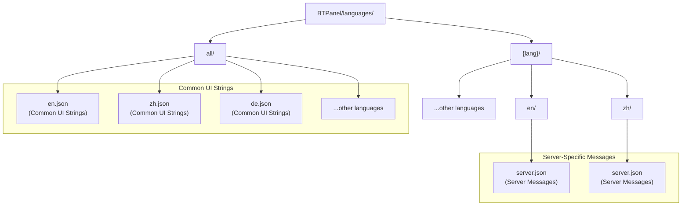
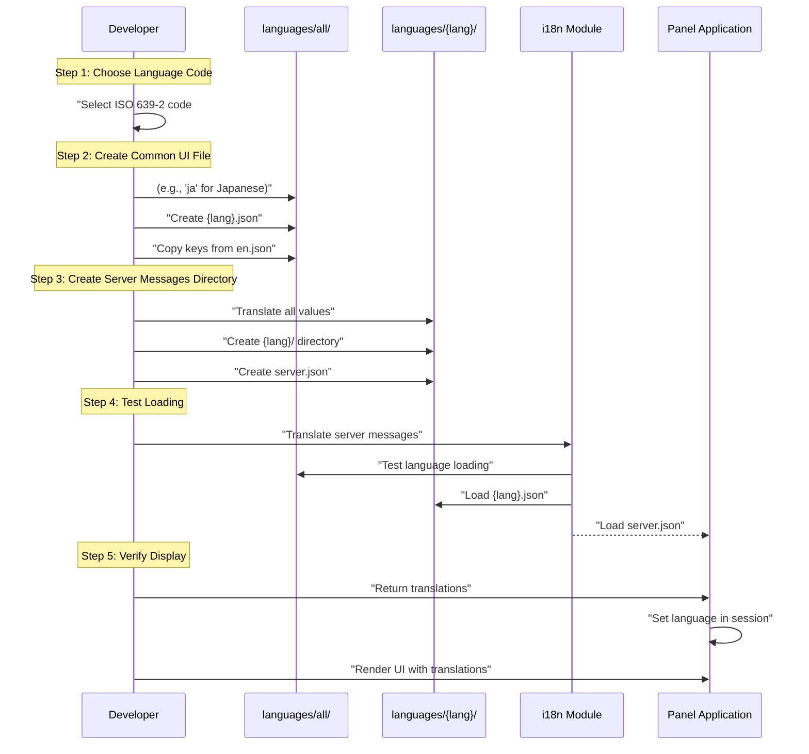
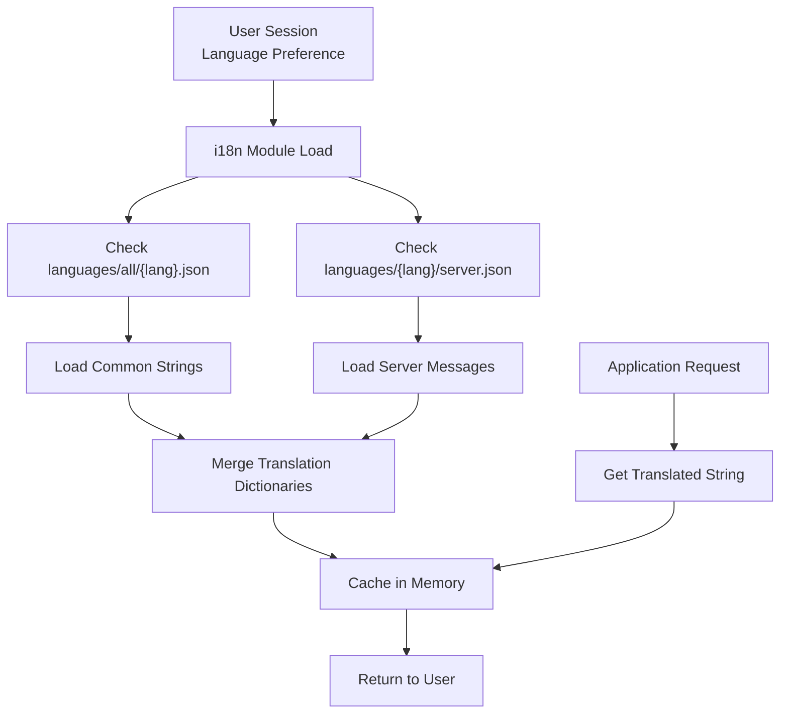
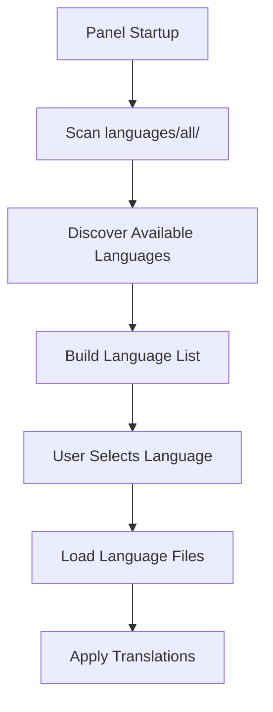

# Adding New Languages

> **Relevant source files**
> * [BTPanel/languages/all/en.json](https://github.com/aaPanel/aaPanel/blob/b6e4ab8b/BTPanel/languages/all/en.json)
> * [BTPanel/languages/en/server.json](https://github.com/aaPanel/aaPanel/blob/b6e4ab8b/BTPanel/languages/en/server.json)

## Purpose and Scope

This document provides a comprehensive guide for adding new language support to aaPanel. It covers the JSON file structure, naming conventions, directory organization, and testing procedures for implementing internationalization (i18n) in the control panel.

For an overview of the existing localization system and supported languages, see [Internationalization and Localization](/aaPanel/aaPanel/8-internationalization-and-localization). For a complete list of currently supported languages, see [Language Support Matrix](/aaPanel/aaPanel/8.1-language-support-matrix).

## Language File Organization

aaPanel's localization system is organized into two distinct directory structures, each serving different purposes:



**Sources:** BTPanel/languages/all/en.json, High-level architecture diagrams

### Directory Structure

| Directory Path | Purpose | File Format |
| --- | --- | --- |
| `BTPanel/languages/all/` | Common UI strings shared across the application | `{lang}.json` |
| `BTPanel/languages/{lang}/` | Language-specific subdirectory for server messages | `server.json` |

## JSON File Structure

Language files in aaPanel use a simple key-value JSON structure. Each key represents a localization identifier, and each value contains the translated text.

### Basic Format

```

```

### Key Naming Conventions

* Use lowercase with underscores for separation
* Be descriptive and consistent with existing keys
* Group related keys using nested objects when appropriate
* Avoid spaces and special characters in keys

**Sources:** BTPanel/languages/all/en.json

## Step-by-Step Guide to Adding a New Language



**Sources:** High-level architecture diagrams

### Step 1: Choose Language Code

Select an appropriate language code following ISO 639 standards. aaPanel uses the following conventions:

| Language | Code | Example File |
| --- | --- | --- |
| Two-letter ISO 639-1 | `en`, `de`, `pt`, `ru` | `en.json`, `de.json` |
| Three-letter variants | `cht`, `fra`, `ind`, `kor`, `spa`, `tur`, `vie`, `uk` | `cht.json`, `fra.json` |

**Note:** Check existing language codes in [Language Support Matrix](/aaPanel/aaPanel/8.1-language-support-matrix) to ensure consistency and avoid conflicts.

### Step 2: Create Common UI File

1. Navigate to `BTPanel/languages/all/`
2. Create a new file named `{lang}.json` where `{lang}` is your chosen language code
3. Copy the structure from `en.json` to ensure all required keys are present
4. Translate all values to the target language while preserving: * JSON structure * Key names (do not translate keys, only values) * Placeholders (e.g., `{0}`, `{1}`, `%s`) * HTML entities if present

**Example structure:**

```

```

### Step 3: Create Server Messages File

1. Navigate to `BTPanel/languages/`
2. Create a new directory named `{lang}/` matching your language code
3. Inside this directory, create `server.json`
4. Translate server-specific messages such as: * System notifications * Error messages * Status messages * Log entries

### Step 4: Validate JSON Syntax

Before deploying, ensure your JSON files are valid:

```

```

Both commands should complete without errors for valid JSON.

**Sources:** BTPanel/languages/all/en.json

## Language Loading Process

Understanding how aaPanel loads language files helps ensure your translations are properly integrated:



**Sources:** High-level architecture diagrams

## Testing Localization

### Manual Testing

1. **Modify Session Language:** * Access the panel settings * Change language preference to your new language code * Verify the session stores the correct language
2. **Verify UI Rendering:** * Navigate through all major sections * Check for untranslated strings (English fallback) * Verify text fits within UI elements (some languages require more space)
3. **Test Special Characters:** * Ensure proper UTF-8 encoding * Verify special characters display correctly * Test right-to-left languages if applicable
4. **Check Server Messages:** * Trigger operations that generate server messages * Verify backend responses use translated strings * Check log entries if applicable

### Automated Validation

Create a validation script to check for missing keys:

```

```

**Sources:** BTPanel/languages/all/en.json

## Best Practices

### Translation Guidelines

| Guideline | Description | Example |
| --- | --- | --- |
| **Consistency** | Use consistent terminology across all strings | "Database" vs "DB" - pick one |
| **Context** | Understand the UI context before translating | Button text vs help text |
| **Placeholders** | Preserve all placeholders in exact format | `{0}` must remain `{0}` |
| **Length** | Consider text expansion/contraction | German often 30% longer than English |
| **Formality** | Match the formality level of the interface | Professional tone for admin panel |

### File Maintenance

1. **Version Control:** Always commit language files with descriptive messages
2. **Backup:** Keep backups before making bulk changes
3. **Documentation:** Document any non-obvious translation choices
4. **Updates:** When adding new features, update all language files simultaneously
5. **Review:** Have native speakers review translations for accuracy

### Common Pitfalls to Avoid

* **Do not translate JSON keys** - Only translate the values
* **Do not modify placeholder syntax** - `{0}`, `%s`, etc. must remain unchanged
* **Do not break JSON structure** - Ensure proper escaping of quotes and special characters
* **Do not hardcode language-specific logic** - Keep translations generic
* **Do not forget server.json** - Both files are required for complete localization

**Sources:** High-level architecture diagrams

## Integration with Panel Application

Once your language files are created, the panel automatically detects them:



The i18n module automatically discovers new language files without requiring code changes or panel restart (in debug mode).

**Sources:** High-level architecture diagrams

## File Path Reference

When adding a new language with code `{lang}`, create these files:

1. **Common UI strings:** `BTPanel/languages/all/{lang}.json`
2. **Language directory:** `BTPanel/languages/{lang}/`
3. **Server messages:** `BTPanel/languages/{lang}/server.json`

Both files must exist for the language to function properly.

**Sources:** BTPanel/languages/all/en.json