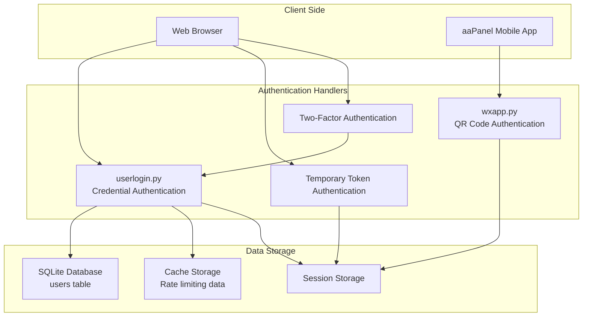
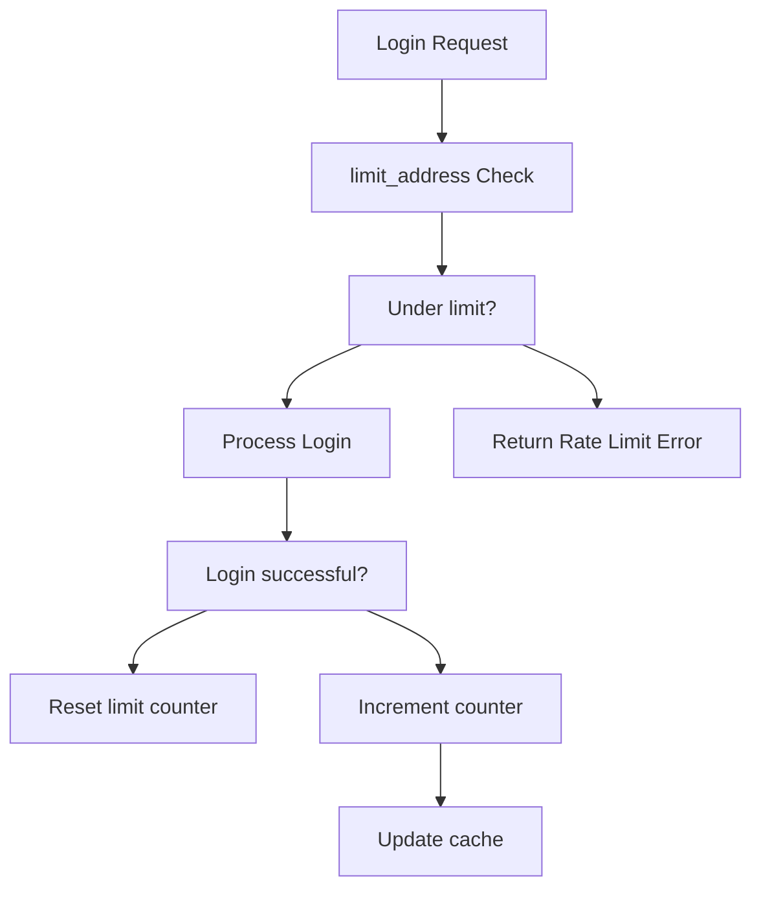

# Authentication System

> **Relevant source files**
> * [BTPanel/__init__.py](https://github.com/aaPanel/aaPanel/blob/b6e4ab8b/BTPanel/__init__.py)
> * [BTPanel/app.py](https://github.com/aaPanel/aaPanel/blob/b6e4ab8b/BTPanel/app.py)

This document details the authentication system in aaPanel, which manages user identity verification, session handling, and access control. The system supports multiple authentication methods including traditional username/password login, two-factor authentication, QR code-based mobile authentication, and temporary token authentication.

## Authentication System Architecture



Sources: [class/userlogin.py](https://github.com/aaPanel/aaPanel/blob/b6e4ab8b/class/userlogin.py)

 [class/wxapp.py](https://github.com/aaPanel/aaPanel/blob/b6e4ab8b/class/wxapp.py)

## Authentication Flow

The following diagram illustrates the standard login process through the `userlogin` class:

```mermaid
sequenceDiagram
  participant Client
  participant userlogin.py
  participant db.Sql()
  participant Flask Session

  Client->>userlogin.py: POST encrypted credentials
  userlogin.py->>userlogin.py: Check rate limiting (limit_address)
  loop [2FA enabled]
    userlogin.py->>userlogin.py: Decrypt credentials (rsa_decrypt)
    userlogin.py->>db.Sql(): Query user record
    userlogin.py->>Client: Request verification code
    Client->>userlogin.py: Submit code
    userlogin.py->>userlogin.py: Verify with pyotp.TOTP
    userlogin.py->>Flask Session: Create session (_set_login_session)
    userlogin.py->>Client: Return success response
    userlogin.py->>userlogin.py: Increment failed attempts
    userlogin.py->>Client: Return error message
    userlogin.py->>Client: Return rate limit error
  end
```

Sources: [class/userlogin.py L17-L176](https://github.com/aaPanel/aaPanel/blob/b6e4ab8b/class/userlogin.py#L17-L176)

## Authentication Methods

aaPanel implements multiple authentication mechanisms to provide flexible and secure access options.

### Username/Password Authentication

The standard authentication method is handled by the `request_post` method in `userlogin.py`:

1. Client encrypts username and password using RSA before transmission
2. Server validates input format and decrypts credentials
3. Server verifies the password hash against the stored hash + salt
4. If successful, a session is created for the user

Security measures:

* RSA encryption for credential transmission
* Salt-based password hashing
* Rate limiting to prevent brute force attacks
* Input validation and format checking

Sources: [class/userlogin.py L17-L176](https://github.com/aaPanel/aaPanel/blob/b6e4ab8b/class/userlogin.py#L17-L176)

 [class/userlogin.py L26-L32](https://github.com/aaPanel/aaPanel/blob/b6e4ab8b/class/userlogin.py#L26-L32)

 [class/userlogin.py L72-L74](https://github.com/aaPanel/aaPanel/blob/b6e4ab8b/class/userlogin.py#L72-L74)

### Two-Factor Authentication (2FA)

Two-factor authentication adds an extra verification layer using Time-based One-Time Passwords (TOTP):

1. User configures 2FA, generating a secret key stored in `/www/server/panel/data/two_step_auth.txt`
2. When logging in, after password verification, user is prompted for a TOTP code
3. System verifies the code using the PyOTP library
4. After successful verification, the IP address is trusted for 24 hours

Implementation details:

* Uses the `pyotp` library for TOTP verification
* Automatic time synchronization on verification failure
* IP-based trusted device tracking

Sources: [class/userlogin.py L92-L105](https://github.com/aaPanel/aaPanel/blob/b6e4ab8b/class/userlogin.py#L92-L105)

 [class/userlogin.py L454-L464](https://github.com/aaPanel/aaPanel/blob/b6e4ab8b/class/userlogin.py#L454-L464)

### QR Code Authentication

For mobile app login, aaPanel provides QR code-based authentication:

1. System generates a QR code containing a unique token and panel URL via `wxapp.login_qrcode`
2. User scans the QR code with the aaPanel mobile app
3. App authenticates the user and authorizes the login
4. Panel verifies the authentication and creates a session

Key components:

* Token generation and validation
* QR code creation
* Mobile app integration
* Secure session establishment

Sources: [class/wxapp.py L46-L53](https://github.com/aaPanel/aaPanel/blob/b6e4ab8b/class/wxapp.py#L46-L53)

 [class/wxapp.py L31-L43](https://github.com/aaPanel/aaPanel/blob/b6e4ab8b/class/wxapp.py#L31-L43)

 [class/wxapp.py L67-L107](https://github.com/aaPanel/aaPanel/blob/b6e4ab8b/class/wxapp.py#L67-L107)

### Temporary Token Authentication

For API access or temporary sessions, token-based authentication is available:

1. System generates a temporary authentication token
2. Token has a limited validity period (typically 120 seconds)
3. Token can be used for authentication without username/password
4. After successful verification, a session is created

This method is primarily used for API access and temporary login scenarios.

Sources: [class/userlogin.py L178-L209](https://github.com/aaPanel/aaPanel/blob/b6e4ab8b/class/userlogin.py#L178-L209)

 [class/userlogin.py L212-L271](https://github.com/aaPanel/aaPanel/blob/b6e4ab8b/class/userlogin.py#L212-L271)

## Security Features

### Rate Limiting

Rate limiting prevents brute force attacks by restricting login attempts:



Implementation details:

* IP-based tracking with separate counters for different auth types
* Default limit of 5 failed attempts before temporary blocking
* Exponential increase in block duration for repeated failures
* Cache-based storage of rate limiting data

Sources: [class/userlogin.py L336-L376](https://github.com/aaPanel/aaPanel/blob/b6e4ab8b/class/userlogin.py#L336-L376)

### Session Management

The system incorporates robust session management to prevent session hijacking:

1. Session tokens are randomly generated for each login
2. Sessions have configurable timeout periods
3. Sessions are bound to user agent and IP address
4. CSRF tokens protect against cross-site request forgery

Key security methods:

* Session creation via `_set_login_session`
* Session timeout control
* Request token generation for CSRF protection

Sources: [class/userlogin.py L381-L440](https://github.com/aaPanel/aaPanel/blob/b6e4ab8b/class/userlogin.py#L381-L440)

 [class/userlogin.py L307-L312](https://github.com/aaPanel/aaPanel/blob/b6e4ab8b/class/userlogin.py#L307-L312)

### Encryption and Data Protection

Sensitive authentication data is protected through:

1. RSA encryption for credential transmission
2. MD5 + salt for password storage
3. Secure token generation
4. Database security measures

The combined approach of encrypted transmission and secure storage mitigates risks of credential theft and unauthorized access.

Sources: [class/userlogin.py L26-L32](https://github.com/aaPanel/aaPanel/blob/b6e4ab8b/class/userlogin.py#L26-L32)

 [class/userlogin.py L72-L74](https://github.com/aaPanel/aaPanel/blob/b6e4ab8b/class/userlogin.py#L72-L74)

## Database Schema and Data Storage

### Users Table Structure

The authentication system primarily uses the following database schema:

| Field | Type | Description |
| --- | --- | --- |
| id | Integer | User ID |
| username | Text | Login username |
| password | Text | MD5 hashed password |
| salt | Text | Unique password salt |

The user data is stored in a SQLite database managed by the `db.Sql()` class, which provides an abstraction layer for database operations.

### Session Structure

Sessions are stored with the following key information:

| Session Key | Description |
| --- | --- |
| login | Boolean indicating login status |
| username | Authenticated username |
| uid | User ID |
| login_user_agent | MD5 hash of user agent for verification |
| session_timeout | Unix timestamp for session expiration |
| request_token_head | CSRF protection token |

Sources: [class/userlogin.py L381-L440](https://github.com/aaPanel/aaPanel/blob/b6e4ab8b/class/userlogin.py#L381-L440)

## Integration Points

The authentication system provides several integration points for extending functionality:

### Key Classes and Methods

| Component | Purpose | Location |
| --- | --- | --- |
| `userlogin` class | Core authentication handler | [class/userlogin.py](https://github.com/aaPanel/aaPanel/blob/b6e4ab8b/class/userlogin.py) |
| `wxapp` class | Mobile app authentication | [class/wxapp.py](https://github.com/aaPanel/aaPanel/blob/b6e4ab8b/class/wxapp.py) |
| `set_request_token` | CSRF token generation | [class/userlogin.py L307-L312](https://github.com/aaPanel/aaPanel/blob/b6e4ab8b/class/userlogin.py#L307-L312) |
| `_set_login_session` | Session initialization | [class/userlogin.py L381-L440](https://github.com/aaPanel/aaPanel/blob/b6e4ab8b/class/userlogin.py#L381-L440) |
| `limit_address` | Rate limiting enforcement | [class/userlogin.py L336-L376](https://github.com/aaPanel/aaPanel/blob/b6e4ab8b/class/userlogin.py#L336-L376) |

These components can be extended or customized to modify authentication behavior or add new authentication methods.

## Troubleshooting

### Common Issues

#### Failed Logins

If users cannot log in despite correct credentials:

1. **Rate limiting blocks**: Check if the IP has been rate-limited due to failed attempts
2. **Encryption issues**: Ensure RSA encryption is functioning correctly
3. **Database corruption**: Verify user records exist and are properly formatted
4. **Session storage issues**: Check for session storage permissions or corruption

#### Session Problems

For unexpected logouts or session issues:

1. **Session timeout**: Verify the timeout configuration (`session_timeout`)
2. **IP changes**: Changes in client IP can invalidate sessions
3. **Browser settings**: Ensure cookies are enabled and not being cleared

#### Two-Factor Authentication Issues

For problems with 2FA:

1. **Time synchronization**: Ensure the authenticator app has the correct time
2. **Secret key issues**: Verify the secret key in `/www/server/panel/data/two_step_auth.txt`
3. **Rate limiting**: Check if 2FA attempts have been rate-limited

### Authentication Logs

Authentication events are logged in several locations:

1. **System logs**: Success and failure events in panel logs
2. **Error logs**: Detailed errors in `/www/server/panel/data/login_err.log`
3. **Rate limiting data**: Tracked in cache storage

Reviewing these logs can help diagnose authentication problems and identify potential security issues.

Sources: [class/userlogin.py L129-L172](https://github.com/aaPanel/aaPanel/blob/b6e4ab8b/class/userlogin.py#L129-L172)

## Authentication-Related Configurations

Several configuration files affect authentication behavior:

1. `/www/server/panel/data/two_step_auth.txt` - Two-factor authentication secret key
2. `/www/server/panel/config/api.json` - API and temporary token settings
3. `/www/server/panel/data/don't_vcode_ip.txt` - Trusted IP addresses for 2FA

These files can be modified to customize authentication behavior, though caution is advised as improper changes may compromise security.

Sources: [class/userlogin.py L96-L98](https://github.com/aaPanel/aaPanel/blob/b6e4ab8b/class/userlogin.py#L96-L98)

 [class/userlogin.py L185-L186](https://github.com/aaPanel/aaPanel/blob/b6e4ab8b/class/userlogin.py#L185-L186)

 [class/userlogin.py L108](https://github.com/aaPanel/aaPanel/blob/b6e4ab8b/class/userlogin.py#L108-L108)