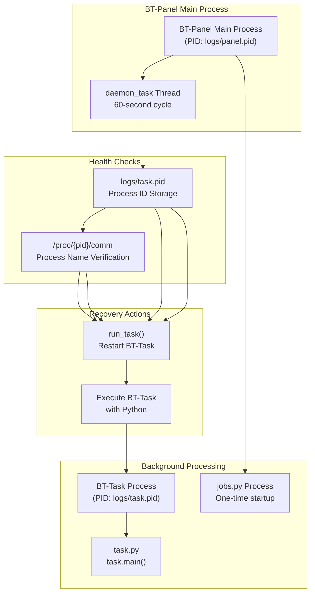
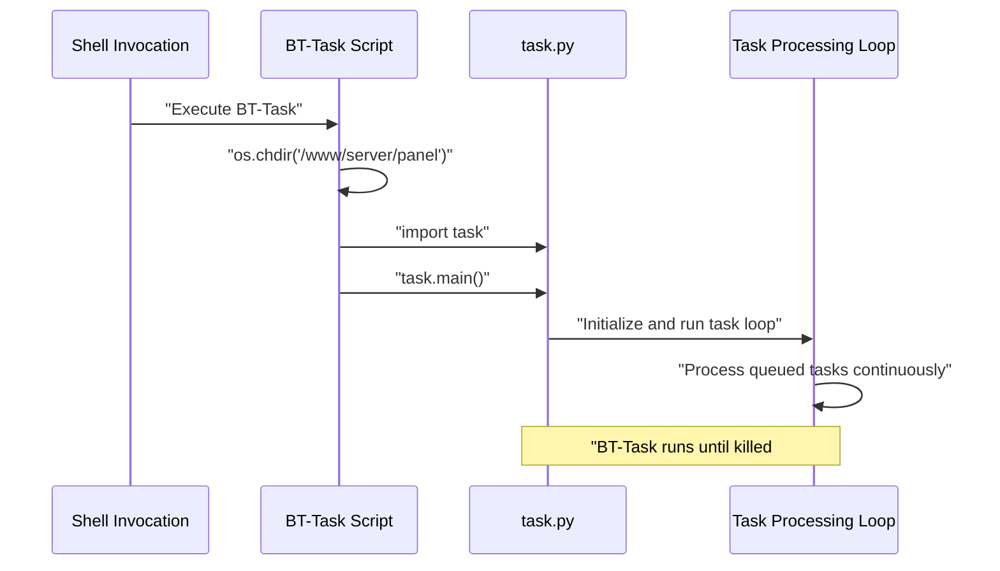
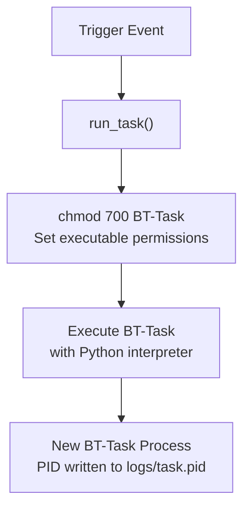
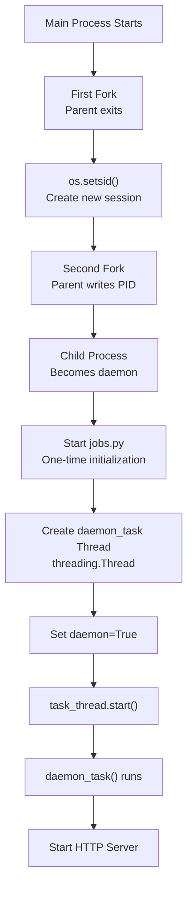
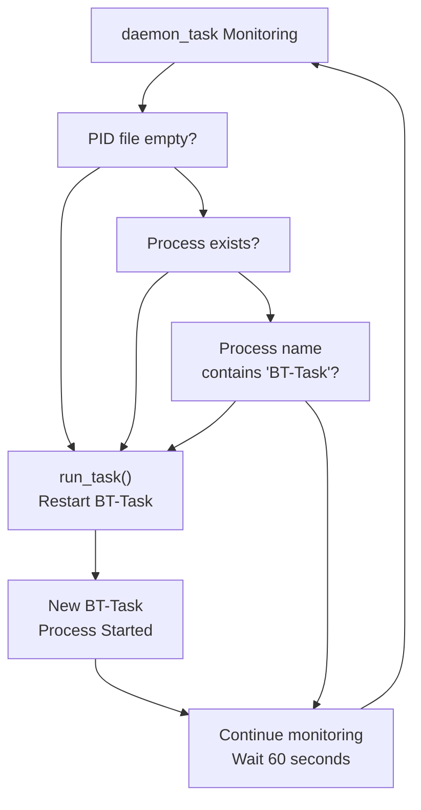
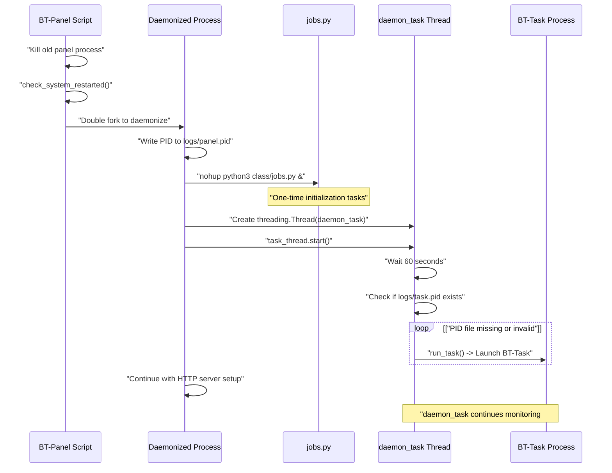
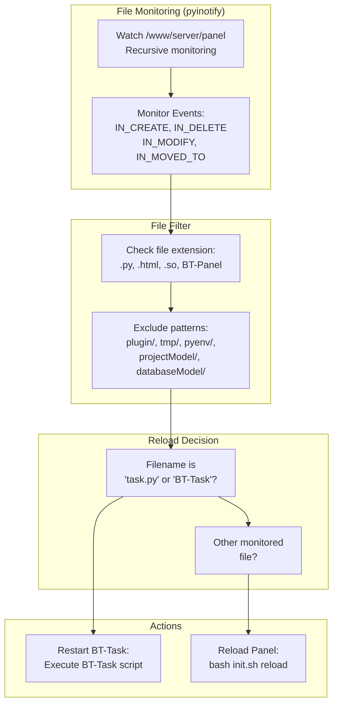

# Background Task System (BT-Task)

> **Relevant source files**
> * [BT-Panel](https://github.com/aaPanel/aaPanel/blob/b6e4ab8b/BT-Panel)
> * [BT-Task](https://github.com/aaPanel/aaPanel/blob/b6e4ab8b/BT-Task)

## Purpose and Scope

The Background Task System (BT-Task) is a dedicated background process responsible for executing asynchronous operations in aaPanel. This system handles long-running tasks such as backups, system updates, plugin installations, and other operations that should not block the web interface.

This document covers:

* The BT-Task background processor and its entry point
* The `daemon_task` monitoring thread that ensures BT-Task remains operational
* Automatic restart mechanisms and health checks
* PID file management and process tracking
* Integration with the main BT-Panel process

For information about one-time startup initialization tasks, see jobs.py (referenced in [2.1](/aaPanel/aaPanel/2.1-web-server-(bt-panel))). For the main web server process, see [2.1](/aaPanel/aaPanel/2.1-web-server-(bt-panel)). For task queuing and management interfaces, see [5](/aaPanel/aaPanel/5-feature-modules).

---

## Architecture Overview

The BT-Task system consists of three key components: the BT-Task process itself, the daemon_task monitoring thread, and the task.py module that contains the actual task execution logic.



**Sources:** [BT-Panel L139-L169](https://github.com/aaPanel/aaPanel/blob/b6e4ab8b/BT-Panel#L139-L169)

 [BT-Task L1-L14](https://github.com/aaPanel/aaPanel/blob/b6e4ab8b/BT-Task#L1-L14)

---

## BT-Task Process

The BT-Task process is a standalone Python script that serves as the entry point for all background task processing.

### Executable Structure

The `BT-Task` executable is a simple wrapper script:

| Component | Description | File Reference |
| --- | --- | --- |
| Shebang | Uses panel's Python environment | [BT-Task L1](https://github.com/aaPanel/aaPanel/blob/b6e4ab8b/BT-Task#L1-L1) |
| Working Directory | Changes to `/www/server/panel` | [BT-Task L12](https://github.com/aaPanel/aaPanel/blob/b6e4ab8b/BT-Task#L12-L12) |
| Module Import | Imports `task` module | [BT-Task L13](https://github.com/aaPanel/aaPanel/blob/b6e4ab8b/BT-Task#L13-L13) |
| Entry Point | Calls `task.main()` | [BT-Task L14](https://github.com/aaPanel/aaPanel/blob/b6e4ab8b/BT-Task#L14-L14) |

The entire BT-Task script delegates to the `task` module, keeping the executable itself minimal and focused solely on bootstrapping.



**Sources:** [BT-Task L1-L14](https://github.com/aaPanel/aaPanel/blob/b6e4ab8b/BT-Task#L1-L14)

### Launch Mechanism

The BT-Task process is launched through the `run_task()` function:



The function performs two operations:

1. Sets executable permissions on the BT-Task file (mode 700)
2. Executes BT-Task using the panel's Python interpreter

**Sources:** [BT-Panel L139-L141](https://github.com/aaPanel/aaPanel/blob/b6e4ab8b/BT-Panel#L139-L141)

---

## Monitoring System (daemon_task)

The `daemon_task` function runs as a daemon thread within the BT-Panel main process, continuously monitoring the health of the BT-Task process.

### Thread Initialization

The daemon thread is started immediately after the main process daemonizes:



**Sources:** [BT-Panel L237-L280](https://github.com/aaPanel/aaPanel/blob/b6e4ab8b/BT-Panel#L237-L280)

### Monitoring Cycle

The `daemon_task` thread performs health checks every 60 seconds:

| Check Phase | Condition | Action |
| --- | --- | --- |
| **1. PID File Existence** | File `logs/task.pid` missing | Continue to next cycle (skip checks) |
| **2. PID File Content** | File empty or unreadable | Call `run_task()` to restart |
| **3. Process Existence** | `/proc/{pid}/comm` doesn't exist | Call `run_task()` to restart |
| **4. Process Name Validation** | `comm` doesn't contain "BT-Task" | Call `run_task()` to restart |
| **5. Success** | All checks pass | Continue to next cycle |

```css
#mermaid-dltt5sgx41g{font-family:ui-sans-serif,-apple-system,system-ui,Segoe UI,Helvetica;font-size:16px;fill:#333;}@keyframes edge-animation-frame{from{stroke-dashoffset:0;}}@keyframes dash{to{stroke-dashoffset:0;}}#mermaid-dltt5sgx41g .edge-animation-slow{stroke-dasharray:9,5!important;stroke-dashoffset:900;animation:dash 50s linear infinite;stroke-linecap:round;}#mermaid-dltt5sgx41g .edge-animation-fast{stroke-dasharray:9,5!important;stroke-dashoffset:900;animation:dash 20s linear infinite;stroke-linecap:round;}#mermaid-dltt5sgx41g .error-icon{fill:#dddddd;}#mermaid-dltt5sgx41g .error-text{fill:#222222;stroke:#222222;}#mermaid-dltt5sgx41g .edge-thickness-normal{stroke-width:1px;}#mermaid-dltt5sgx41g .edge-thickness-thick{stroke-width:3.5px;}#mermaid-dltt5sgx41g .edge-pattern-solid{stroke-dasharray:0;}#mermaid-dltt5sgx41g .edge-thickness-invisible{stroke-width:0;fill:none;}#mermaid-dltt5sgx41g .edge-pattern-dashed{stroke-dasharray:3;}#mermaid-dltt5sgx41g .edge-pattern-dotted{stroke-dasharray:2;}#mermaid-dltt5sgx41g .marker{fill:#999;stroke:#999;}#mermaid-dltt5sgx41g .marker.cross{stroke:#999;}#mermaid-dltt5sgx41g svg{font-family:ui-sans-serif,-apple-system,system-ui,Segoe UI,Helvetica;font-size:16px;}#mermaid-dltt5sgx41g p{margin:0;}#mermaid-dltt5sgx41g defs #statediagram-barbEnd{fill:#999;stroke:#999;}#mermaid-dltt5sgx41g g.stateGroup text{fill:#dddddd;stroke:none;font-size:10px;}#mermaid-dltt5sgx41g g.stateGroup text{fill:#333;stroke:none;font-size:10px;}#mermaid-dltt5sgx41g g.stateGroup .state-title{font-weight:bolder;fill:#333;}#mermaid-dltt5sgx41g g.stateGroup rect{fill:#ffffff;stroke:#dddddd;}#mermaid-dltt5sgx41g g.stateGroup line{stroke:#999;stroke-width:1;}#mermaid-dltt5sgx41g .transition{stroke:#999;stroke-width:1;fill:none;}#mermaid-dltt5sgx41g .stateGroup .composit{fill:#f4f4f4;border-bottom:1px;}#mermaid-dltt5sgx41g .stateGroup .alt-composit{fill:#e0e0e0;border-bottom:1px;}#mermaid-dltt5sgx41g .state-note{stroke:#e6d280;fill:#fff5ad;}#mermaid-dltt5sgx41g .state-note text{fill:#333;stroke:none;font-size:10px;}#mermaid-dltt5sgx41g .stateLabel .box{stroke:none;stroke-width:0;fill:#ffffff;opacity:0.5;}#mermaid-dltt5sgx41g .edgeLabel .label rect{fill:#ffffff;opacity:0.5;}#mermaid-dltt5sgx41g .edgeLabel{background-color:#ffffff;text-align:center;}#mermaid-dltt5sgx41g .edgeLabel p{background-color:#ffffff;}#mermaid-dltt5sgx41g .edgeLabel rect{opacity:0.5;background-color:#ffffff;fill:#ffffff;}#mermaid-dltt5sgx41g .edgeLabel .label text{fill:#333;}#mermaid-dltt5sgx41g .label div .edgeLabel{color:#333;}#mermaid-dltt5sgx41g .stateLabel text{fill:#333;font-size:10px;font-weight:bold;}#mermaid-dltt5sgx41g .node circle.state-start{fill:#999;stroke:#999;}#mermaid-dltt5sgx41g .node .fork-join{fill:#999;stroke:#999;}#mermaid-dltt5sgx41g .node circle.state-end{fill:#dddddd;stroke:#f4f4f4;stroke-width:1.5;}#mermaid-dltt5sgx41g .end-state-inner{fill:#f4f4f4;stroke-width:1.5;}#mermaid-dltt5sgx41g .node rect{fill:#ffffff;stroke:#dddddd;stroke-width:1px;}#mermaid-dltt5sgx41g .node polygon{fill:#ffffff;stroke:#dddddd;stroke-width:1px;}#mermaid-dltt5sgx41g #statediagram-barbEnd{fill:#999;}#mermaid-dltt5sgx41g .statediagram-cluster rect{fill:#ffffff;stroke:#dddddd;stroke-width:1px;}#mermaid-dltt5sgx41g .cluster-label,#mermaid-dltt5sgx41g .nodeLabel{color:#333;}#mermaid-dltt5sgx41g .statediagram-cluster rect.outer{rx:5px;ry:5px;}#mermaid-dltt5sgx41g .statediagram-state .divider{stroke:#dddddd;}#mermaid-dltt5sgx41g .statediagram-state .title-state{rx:5px;ry:5px;}#mermaid-dltt5sgx41g .statediagram-cluster.statediagram-cluster .inner{fill:#f4f4f4;}#mermaid-dltt5sgx41g .statediagram-cluster.statediagram-cluster-alt .inner{fill:#f8f8f8;}#mermaid-dltt5sgx41g .statediagram-cluster .inner{rx:0;ry:0;}#mermaid-dltt5sgx41g .statediagram-state rect.basic{rx:5px;ry:5px;}#mermaid-dltt5sgx41g .statediagram-state rect.divider{stroke-dasharray:10,10;fill:#f8f8f8;}#mermaid-dltt5sgx41g .note-edge{stroke-dasharray:5;}#mermaid-dltt5sgx41g .statediagram-note rect{fill:#fff5ad;stroke:#e6d280;stroke-width:1px;rx:0;ry:0;}#mermaid-dltt5sgx41g .statediagram-note rect{fill:#fff5ad;stroke:#e6d280;stroke-width:1px;rx:0;ry:0;}#mermaid-dltt5sgx41g .statediagram-note text{fill:#333;}#mermaid-dltt5sgx41g .statediagram-note .nodeLabel{color:#333;}#mermaid-dltt5sgx41g .statediagram .edgeLabel{color:red;}#mermaid-dltt5sgx41g #dependencyStart,#mermaid-dltt5sgx41g #dependencyEnd{fill:#999;stroke:#999;stroke-width:1;}#mermaid-dltt5sgx41g .statediagramTitleText{text-anchor:middle;font-size:18px;fill:#333;}#mermaid-dltt5sgx41g :root{--mermaid-font-family:"trebuchet ms",verdana,arial,sans-serif;}"Start monitoring""Wait 60 seconds""File missing (continue)""File exists""Empty or invalid""Valid PID""/proc/{pid}/comm missing""Process exists""'BT-Task' not in comm""Valid BT-Task process""After restart attempt"SleepCheckPIDFileReadPIDRestartTaskCheckProcessValidateCommrun_task() called torestart BT-Task process
```

**Sources:** [BT-Panel L143-L169](https://github.com/aaPanel/aaPanel/blob/b6e4ab8b/BT-Panel#L143-L169)

### Health Check Implementation Details

The monitoring logic uses Linux `/proc` filesystem for process verification:

**PID File Check:**

* Location: `{_PATH}/logs/task.pid`
* If missing, daemon assumes task hasn't started yet
* No restart attempted when file doesn't exist

**Process Existence Check:**

* Verifies `/proc/{pid}/comm` file exists
* This file contains the process name
* Missing file indicates process terminated

**Process Name Verification:**

* Reads content of `/proc/{pid}/comm`
* Searches for substring "BT-Task"
* Prevents restarting wrong processes that reused the PID

**Sources:** [BT-Panel L149-L169](https://github.com/aaPanel/aaPanel/blob/b6e4ab8b/BT-Panel#L149-L169)

---

## Automatic Restart Mechanism

The automatic restart mechanism ensures BT-Task remains operational even when it crashes or is terminated unexpectedly.

### Restart Conditions

The system restarts BT-Task under the following conditions:



**Sources:** [BT-Panel L154-L169](https://github.com/aaPanel/aaPanel/blob/b6e4ab8b/BT-Panel#L154-L169)

### Restart Procedure

The `run_task()` function executes a two-step restart procedure:

1. **Set Permissions:** Ensures BT-Task is executable with `chmod 700`
2. **Execute Process:** Runs BT-Task using `public.ExecShell()`

The execution command format:

```
{python_bin} {_PATH}/BT-Task
```

Where:

* `{python_bin}`: Retrieved via `public.get_python_bin()`
* `{_PATH}`: `/www/server/panel`

**Sources:** [BT-Panel L139-L141](https://github.com/aaPanel/aaPanel/blob/b6e4ab8b/BT-Panel#L139-L141)

---

## Integration with Panel Startup

BT-Task integration occurs during the BT-Panel startup sequence, after the main process daemonizes.

### Startup Sequence



**Sources:** [BT-Panel L229-L280](https://github.com/aaPanel/aaPanel/blob/b6e4ab8b/BT-Panel#L229-L280)

### Launch Timing

| Phase | Action | Purpose |
| --- | --- | --- |
| **Pre-Daemonization** | Kill old panel process | Prevent duplicate processes |
| **Pre-Daemonization** | Check system reboot status | Track system restarts |
| **Post-Daemonization** | Write panel PID file | Enable process management |
| **Post-Daemonization** | Launch jobs.py | Run one-time startup tasks |
| **Post-Daemonization** | Start daemon_task thread | Begin BT-Task monitoring |
| **Post-Daemonization** | Configure HTTP server | Prepare web interface |

The daemon thread starts immediately but waits 60 seconds before the first health check. This delay allows the system to stabilize and ensures BT-Task can be properly launched if needed.

**Sources:** [BT-Panel L230-L280](https://github.com/aaPanel/aaPanel/blob/b6e4ab8b/BT-Panel#L230-L280)

---

## PID File Management

The system uses PID files to track and manage both the BT-Panel and BT-Task processes.

### PID File Locations

| Process | PID File | Written By | Read By |
| --- | --- | --- | --- |
| **BT-Panel** | `logs/panel.pid` | Main process parent fork | External management scripts |
| **BT-Task** | `logs/task.pid` | BT-Task process (via task.py) | daemon_task monitoring thread |

### PID File Lifecycle

```css
#mermaid-f95i4n7xab5{font-family:ui-sans-serif,-apple-system,system-ui,Segoe UI,Helvetica;font-size:16px;fill:#333;}@keyframes edge-animation-frame{from{stroke-dashoffset:0;}}@keyframes dash{to{stroke-dashoffset:0;}}#mermaid-f95i4n7xab5 .edge-animation-slow{stroke-dasharray:9,5!important;stroke-dashoffset:900;animation:dash 50s linear infinite;stroke-linecap:round;}#mermaid-f95i4n7xab5 .edge-animation-fast{stroke-dasharray:9,5!important;stroke-dashoffset:900;animation:dash 20s linear infinite;stroke-linecap:round;}#mermaid-f95i4n7xab5 .error-icon{fill:#dddddd;}#mermaid-f95i4n7xab5 .error-text{fill:#222222;stroke:#222222;}#mermaid-f95i4n7xab5 .edge-thickness-normal{stroke-width:1px;}#mermaid-f95i4n7xab5 .edge-thickness-thick{stroke-width:3.5px;}#mermaid-f95i4n7xab5 .edge-pattern-solid{stroke-dasharray:0;}#mermaid-f95i4n7xab5 .edge-thickness-invisible{stroke-width:0;fill:none;}#mermaid-f95i4n7xab5 .edge-pattern-dashed{stroke-dasharray:3;}#mermaid-f95i4n7xab5 .edge-pattern-dotted{stroke-dasharray:2;}#mermaid-f95i4n7xab5 .marker{fill:#999;stroke:#999;}#mermaid-f95i4n7xab5 .marker.cross{stroke:#999;}#mermaid-f95i4n7xab5 svg{font-family:ui-sans-serif,-apple-system,system-ui,Segoe UI,Helvetica;font-size:16px;}#mermaid-f95i4n7xab5 p{margin:0;}#mermaid-f95i4n7xab5 defs #statediagram-barbEnd{fill:#999;stroke:#999;}#mermaid-f95i4n7xab5 g.stateGroup text{fill:#dddddd;stroke:none;font-size:10px;}#mermaid-f95i4n7xab5 g.stateGroup text{fill:#333;stroke:none;font-size:10px;}#mermaid-f95i4n7xab5 g.stateGroup .state-title{font-weight:bolder;fill:#333;}#mermaid-f95i4n7xab5 g.stateGroup rect{fill:#ffffff;stroke:#dddddd;}#mermaid-f95i4n7xab5 g.stateGroup line{stroke:#999;stroke-width:1;}#mermaid-f95i4n7xab5 .transition{stroke:#999;stroke-width:1;fill:none;}#mermaid-f95i4n7xab5 .stateGroup .composit{fill:#f4f4f4;border-bottom:1px;}#mermaid-f95i4n7xab5 .stateGroup .alt-composit{fill:#e0e0e0;border-bottom:1px;}#mermaid-f95i4n7xab5 .state-note{stroke:#e6d280;fill:#fff5ad;}#mermaid-f95i4n7xab5 .state-note text{fill:#333;stroke:none;font-size:10px;}#mermaid-f95i4n7xab5 .stateLabel .box{stroke:none;stroke-width:0;fill:#ffffff;opacity:0.5;}#mermaid-f95i4n7xab5 .edgeLabel .label rect{fill:#ffffff;opacity:0.5;}#mermaid-f95i4n7xab5 .edgeLabel{background-color:#ffffff;text-align:center;}#mermaid-f95i4n7xab5 .edgeLabel p{background-color:#ffffff;}#mermaid-f95i4n7xab5 .edgeLabel rect{opacity:0.5;background-color:#ffffff;fill:#ffffff;}#mermaid-f95i4n7xab5 .edgeLabel .label text{fill:#333;}#mermaid-f95i4n7xab5 .label div .edgeLabel{color:#333;}#mermaid-f95i4n7xab5 .stateLabel text{fill:#333;font-size:10px;font-weight:bold;}#mermaid-f95i4n7xab5 .node circle.state-start{fill:#999;stroke:#999;}#mermaid-f95i4n7xab5 .node .fork-join{fill:#999;stroke:#999;}#mermaid-f95i4n7xab5 .node circle.state-end{fill:#dddddd;stroke:#f4f4f4;stroke-width:1.5;}#mermaid-f95i4n7xab5 .end-state-inner{fill:#f4f4f4;stroke-width:1.5;}#mermaid-f95i4n7xab5 .node rect{fill:#ffffff;stroke:#dddddd;stroke-width:1px;}#mermaid-f95i4n7xab5 .node polygon{fill:#ffffff;stroke:#dddddd;stroke-width:1px;}#mermaid-f95i4n7xab5 #statediagram-barbEnd{fill:#999;}#mermaid-f95i4n7xab5 .statediagram-cluster rect{fill:#ffffff;stroke:#dddddd;stroke-width:1px;}#mermaid-f95i4n7xab5 .cluster-label,#mermaid-f95i4n7xab5 .nodeLabel{color:#333;}#mermaid-f95i4n7xab5 .statediagram-cluster rect.outer{rx:5px;ry:5px;}#mermaid-f95i4n7xab5 .statediagram-state .divider{stroke:#dddddd;}#mermaid-f95i4n7xab5 .statediagram-state .title-state{rx:5px;ry:5px;}#mermaid-f95i4n7xab5 .statediagram-cluster.statediagram-cluster .inner{fill:#f4f4f4;}#mermaid-f95i4n7xab5 .statediagram-cluster.statediagram-cluster-alt .inner{fill:#f8f8f8;}#mermaid-f95i4n7xab5 .statediagram-cluster .inner{rx:0;ry:0;}#mermaid-f95i4n7xab5 .statediagram-state rect.basic{rx:5px;ry:5px;}#mermaid-f95i4n7xab5 .statediagram-state rect.divider{stroke-dasharray:10,10;fill:#f8f8f8;}#mermaid-f95i4n7xab5 .note-edge{stroke-dasharray:5;}#mermaid-f95i4n7xab5 .statediagram-note rect{fill:#fff5ad;stroke:#e6d280;stroke-width:1px;rx:0;ry:0;}#mermaid-f95i4n7xab5 .statediagram-note rect{fill:#fff5ad;stroke:#e6d280;stroke-width:1px;rx:0;ry:0;}#mermaid-f95i4n7xab5 .statediagram-note text{fill:#333;}#mermaid-f95i4n7xab5 .statediagram-note .nodeLabel{color:#333;}#mermaid-f95i4n7xab5 .statediagram .edgeLabel{color:red;}#mermaid-f95i4n7xab5 #dependencyStart,#mermaid-f95i4n7xab5 #dependencyEnd{fill:#999;stroke:#999;stroke-width:1;}#mermaid-f95i4n7xab5 .statediagramTitleText{text-anchor:middle;font-size:18px;fill:#333;}#mermaid-f95i4n7xab5 :root{--mermaid-font-family:"trebuchet ms",verdana,arial,sans-serif;}"Initial state""Process starts, writes PID""File contains valid PID""Process active""Health checks pass""File emptied/corrupted""Process terminated""daemon_task detects issue""daemon_task detects issue""New process started""Panel shutdown"NoPIDFilePIDWrittenValidPIDProcessRunningEmptyPIDProcessGoneRestartdaemon_task checks:1. File exists2. Contains PID3. /proc/{pid}/comm exists4. comm contains "BT-Task"
```

**Sources:** [BT-Panel L145-L169](https://github.com/aaPanel/aaPanel/blob/b6e4ab8b/BT-Panel#L145-L169)

 [BT-Panel L230-L244](https://github.com/aaPanel/aaPanel/blob/b6e4ab8b/BT-Panel#L230-L244)

### Process Verification Logic

The daemon uses multi-level verification to ensure the PID file points to a valid BT-Task process:

**Level 1 - File Existence:**

```markdown
if not os.path.exists(task_pid_file):
    continue  # Skip this cycle
```

**Level 2 - Content Validation:**

```markdown
task_pid = public.readFile(task_pid_file)
if not task_pid:
    run_task()  # Restart if empty
    continue
```

**Level 3 - Process Existence:**

```css
comm_file = "/proc/{}/comm".format(task_pid)
if not os.path.exists(comm_file):
    run_task()  # Restart if process gone
    continue
```

**Level 4 - Process Name:**

```markdown
comm = public.readFile(comm_file)
if comm.find('BT-Task') == -1:
    run_task()  # Restart if wrong process
    continue
```

**Sources:** [BT-Panel L149-L169](https://github.com/aaPanel/aaPanel/blob/b6e4ab8b/BT-Panel#L149-L169)

---

## Debug Mode Behavior

In debug mode (when `data/debug.pl` exists), BT-Task receives special auto-reload handling for development convenience.

### Debug Mode File Watching



**Sources:** [BT-Panel L68-L123](https://github.com/aaPanel/aaPanel/blob/b6e4ab8b/BT-Panel#L68-L123)

### Auto-Reload Logic

The `PanelEventHandler` class handles file system events and triggers appropriate reloads:

**Monitored File Types:**

* `.py` - Python source files
* `.html` - Template files
* `.so` - Shared objects/compiled extensions
* `BT-Panel` - Main executable

**Excluded Directories:**

* `plugin/` - Plugin directory (plugins manage their own reloading)
* `tmp/`, `temp/` - Temporary files
* `pyenv/` - Python environment
* `class/projectModel/` - Project models
* `class/databaseModel/` - Database models
* `panel/data/mail/in_bulk/content/` - Mail content

**BT-Task Specific Reload:**
When `task.py` or `BT-Task` file changes:

1. Set executable permissions on both BT-Panel and BT-Task
2. Execute BT-Task using Python interpreter
3. Log the reload action

This ensures BT-Task automatically restarts when its code changes during development.

**Sources:** [BT-Panel L73-L110](https://github.com/aaPanel/aaPanel/blob/b6e4ab8b/BT-Panel#L73-L110)

---

## Process Lifecycle

The complete lifecycle of the BT-Task process from panel startup to shutdown.

```css
#mermaid-r03wwlhqlp{font-family:ui-sans-serif,-apple-system,system-ui,Segoe UI,Helvetica;font-size:16px;fill:#333;}@keyframes edge-animation-frame{from{stroke-dashoffset:0;}}@keyframes dash{to{stroke-dashoffset:0;}}#mermaid-r03wwlhqlp .edge-animation-slow{stroke-dasharray:9,5!important;stroke-dashoffset:900;animation:dash 50s linear infinite;stroke-linecap:round;}#mermaid-r03wwlhqlp .edge-animation-fast{stroke-dasharray:9,5!important;stroke-dashoffset:900;animation:dash 20s linear infinite;stroke-linecap:round;}#mermaid-r03wwlhqlp .error-icon{fill:#dddddd;}#mermaid-r03wwlhqlp .error-text{fill:#222222;stroke:#222222;}#mermaid-r03wwlhqlp .edge-thickness-normal{stroke-width:1px;}#mermaid-r03wwlhqlp .edge-thickness-thick{stroke-width:3.5px;}#mermaid-r03wwlhqlp .edge-pattern-solid{stroke-dasharray:0;}#mermaid-r03wwlhqlp .edge-thickness-invisible{stroke-width:0;fill:none;}#mermaid-r03wwlhqlp .edge-pattern-dashed{stroke-dasharray:3;}#mermaid-r03wwlhqlp .edge-pattern-dotted{stroke-dasharray:2;}#mermaid-r03wwlhqlp .marker{fill:#999;stroke:#999;}#mermaid-r03wwlhqlp .marker.cross{stroke:#999;}#mermaid-r03wwlhqlp svg{font-family:ui-sans-serif,-apple-system,system-ui,Segoe UI,Helvetica;font-size:16px;}#mermaid-r03wwlhqlp p{margin:0;}#mermaid-r03wwlhqlp defs #statediagram-barbEnd{fill:#999;stroke:#999;}#mermaid-r03wwlhqlp g.stateGroup text{fill:#dddddd;stroke:none;font-size:10px;}#mermaid-r03wwlhqlp g.stateGroup text{fill:#333;stroke:none;font-size:10px;}#mermaid-r03wwlhqlp g.stateGroup .state-title{font-weight:bolder;fill:#333;}#mermaid-r03wwlhqlp g.stateGroup rect{fill:#ffffff;stroke:#dddddd;}#mermaid-r03wwlhqlp g.stateGroup line{stroke:#999;stroke-width:1;}#mermaid-r03wwlhqlp .transition{stroke:#999;stroke-width:1;fill:none;}#mermaid-r03wwlhqlp .stateGroup .composit{fill:#f4f4f4;border-bottom:1px;}#mermaid-r03wwlhqlp .stateGroup .alt-composit{fill:#e0e0e0;border-bottom:1px;}#mermaid-r03wwlhqlp .state-note{stroke:#e6d280;fill:#fff5ad;}#mermaid-r03wwlhqlp .state-note text{fill:#333;stroke:none;font-size:10px;}#mermaid-r03wwlhqlp .stateLabel .box{stroke:none;stroke-width:0;fill:#ffffff;opacity:0.5;}#mermaid-r03wwlhqlp .edgeLabel .label rect{fill:#ffffff;opacity:0.5;}#mermaid-r03wwlhqlp .edgeLabel{background-color:#ffffff;text-align:center;}#mermaid-r03wwlhqlp .edgeLabel p{background-color:#ffffff;}#mermaid-r03wwlhqlp .edgeLabel rect{opacity:0.5;background-color:#ffffff;fill:#ffffff;}#mermaid-r03wwlhqlp .edgeLabel .label text{fill:#333;}#mermaid-r03wwlhqlp .label div .edgeLabel{color:#333;}#mermaid-r03wwlhqlp .stateLabel text{fill:#333;font-size:10px;font-weight:bold;}#mermaid-r03wwlhqlp .node circle.state-start{fill:#999;stroke:#999;}#mermaid-r03wwlhqlp .node .fork-join{fill:#999;stroke:#999;}#mermaid-r03wwlhqlp .node circle.state-end{fill:#dddddd;stroke:#f4f4f4;stroke-width:1.5;}#mermaid-r03wwlhqlp .end-state-inner{fill:#f4f4f4;stroke-width:1.5;}#mermaid-r03wwlhqlp .node rect{fill:#ffffff;stroke:#dddddd;stroke-width:1px;}#mermaid-r03wwlhqlp .node polygon{fill:#ffffff;stroke:#dddddd;stroke-width:1px;}#mermaid-r03wwlhqlp #statediagram-barbEnd{fill:#999;}#mermaid-r03wwlhqlp .statediagram-cluster rect{fill:#ffffff;stroke:#dddddd;stroke-width:1px;}#mermaid-r03wwlhqlp .cluster-label,#mermaid-r03wwlhqlp .nodeLabel{color:#333;}#mermaid-r03wwlhqlp .statediagram-cluster rect.outer{rx:5px;ry:5px;}#mermaid-r03wwlhqlp .statediagram-state .divider{stroke:#dddddd;}#mermaid-r03wwlhqlp .statediagram-state .title-state{rx:5px;ry:5px;}#mermaid-r03wwlhqlp .statediagram-cluster.statediagram-cluster .inner{fill:#f4f4f4;}#mermaid-r03wwlhqlp .statediagram-cluster.statediagram-cluster-alt .inner{fill:#f8f8f8;}#mermaid-r03wwlhqlp .statediagram-cluster .inner{rx:0;ry:0;}#mermaid-r03wwlhqlp .statediagram-state rect.basic{rx:5px;ry:5px;}#mermaid-r03wwlhqlp .statediagram-state rect.divider{stroke-dasharray:10,10;fill:#f8f8f8;}#mermaid-r03wwlhqlp .note-edge{stroke-dasharray:5;}#mermaid-r03wwlhqlp .statediagram-note rect{fill:#fff5ad;stroke:#e6d280;stroke-width:1px;rx:0;ry:0;}#mermaid-r03wwlhqlp .statediagram-note rect{fill:#fff5ad;stroke:#e6d280;stroke-width:1px;rx:0;ry:0;}#mermaid-r03wwlhqlp .statediagram-note text{fill:#333;}#mermaid-r03wwlhqlp .statediagram-note .nodeLabel{color:#333;}#mermaid-r03wwlhqlp .statediagram .edgeLabel{color:red;}#mermaid-r03wwlhqlp #dependencyStart,#mermaid-r03wwlhqlp #dependencyEnd{fill:#999;stroke:#999;stroke-width:1;}#mermaid-r03wwlhqlp .statediagramTitleText{text-anchor:middle;font-size:18px;fill:#333;}#mermaid-r03wwlhqlp :root{--mermaid-font-family:"trebuchet ms",verdana,arial,sans-serif;}"BT-Panel starts""Launch jobs.py""Start daemon_task thread""Wait 60 seconds""Check BT-Task state""No PID file or invalid""Valid BT-Task process""run_task()""BT-Task started""Continue monitoring""Wait 60 seconds""Perform health checks""All checks pass""Process missing/invalid""Continue monitoring""Restart BT-Task""File change (debug mode)""Reload BT-Task""Panel stops""Panel stops"PanelStartupJobsLaunchDaemonStartFirstCycleCheckStateNoTaskTaskRunningLaunchTaskMonitorCycleWait60HealthCheckTaskHealthyTaskFailedDebugReloadPanelShutdownChecks performed:- PID file exists- PID file not empty- Process exists- Process name is "BT-Task"Monitoring is continuousas long as panel runs
```

**Sources:** [BT-Panel L139-L169](https://github.com/aaPanel/aaPanel/blob/b6e4ab8b/BT-Panel#L139-L169)

 [BT-Panel L278-L280](https://github.com/aaPanel/aaPanel/blob/b6e4ab8b/BT-Panel#L278-L280)

---

## Summary

The Background Task System (BT-Task) provides reliable asynchronous task processing through:

| Component | Function | Key Features |
| --- | --- | --- |
| **BT-Task Process** | Background task execution | Standalone process, simple bootstrap script |
| **daemon_task Thread** | Health monitoring | 60-second cycles, multi-level verification |
| **run_task Function** | Process launcher | Sets permissions, executes BT-Task |
| **PID Management** | Process tracking | PID files, proc filesystem verification |
| **Auto-Restart** | Reliability | Automatic recovery from crashes |
| **Debug Support** | Development aid | Auto-reload on file changes |

The system ensures BT-Task remains operational through continuous monitoring and automatic recovery, while maintaining clean separation between the web server (BT-Panel) and background processing (BT-Task).

**Sources:** [BT-Panel L139-L169](https://github.com/aaPanel/aaPanel/blob/b6e4ab8b/BT-Panel#L139-L169)

 [BT-Panel L278-L280](https://github.com/aaPanel/aaPanel/blob/b6e4ab8b/BT-Panel#L278-L280)

 [BT-Task L1-L14](https://github.com/aaPanel/aaPanel/blob/b6e4ab8b/BT-Task#L1-L14)