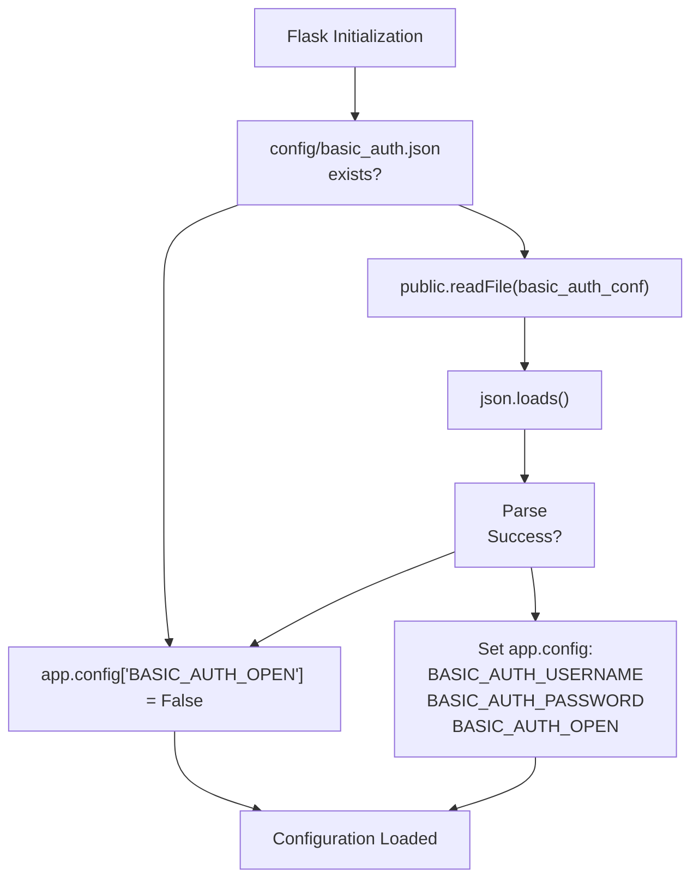
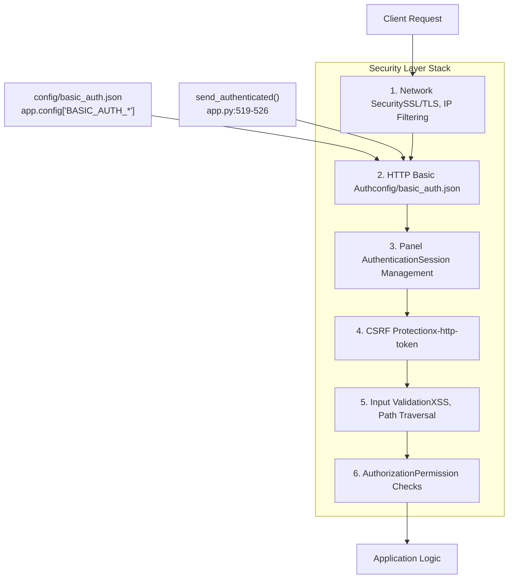
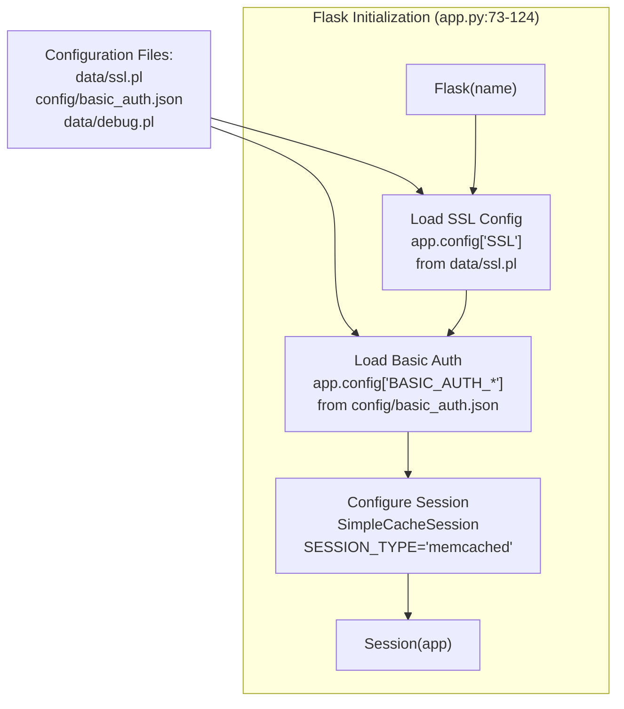

# Basic Authentication Setup

> **Relevant source files**
> * [BTPanel/app.py](https://github.com/aaPanel/aaPanel/blob/b6e4ab8b/BTPanel/app.py)

## Purpose and Scope

This document explains how to configure HTTP Basic Authentication in aaPanel as an additional security layer. Basic Authentication provides a first line of defense by requiring users to authenticate at the HTTP protocol level before they can even access the panel's login page.

Basic Authentication in aaPanel:

* Acts as an optional pre-authentication layer
* Works independently from panel session authentication
* Is configured via the `config/basic_auth.json` file
* Can be enabled or disabled without affecting other security features

For SSL/TLS encryption configuration, see [SSL/TLS Configuration](/aaPanel/aaPanel/10.1-ssltls-configuration). For reverse proxy setup, see [Network Binding Modes](/aaPanel/aaPanel/10.2-network-binding-modes). For comprehensive security architecture, see [Security and Input Validation](/aaPanel/aaPanel/3.2-security-and-input-validation).

---

## Configuration File Structure

Basic Authentication is controlled by the `config/basic_auth.json` file. The Flask application reads this file during initialization to determine if Basic Authentication should be enabled and what credentials to accept.

### File Location and Format

| Property | Value |
| --- | --- |
| File Path | `config/basic_auth.json` |
| Format | JSON |
| Encoding | UTF-8 |
| Required | No (optional security layer) |

### JSON Schema

The configuration file must contain three fields:

```

```

| Field | Type | Description |
| --- | --- | --- |
| `basic_user` | string | Username for HTTP Basic Authentication |
| `basic_pwd` | string | Password for HTTP Basic Authentication (stored in plaintext) |
| `open` | boolean | Enable (`true`) or disable (`false`) Basic Authentication |

**Sources:** [BTPanel/app.py L93-L103](https://github.com/aaPanel/aaPanel/blob/b6e4ab8b/BTPanel/app.py#L93-L103)

---

## Configuration Loading Process

During Flask application initialization, aaPanel loads the Basic Authentication configuration and stores it in the Flask `app.config` object.



### Configuration Variables

After initialization, the following Flask configuration variables are available:

| Config Variable | Source Field | Default Value | Purpose |
| --- | --- | --- | --- |
| `BASIC_AUTH_OPEN` | `open` | `False` | Controls whether Basic Auth is active |
| `BASIC_AUTH_USERNAME` | `basic_user` | N/A | Expected username |
| `BASIC_AUTH_PASSWORD` | `basic_pwd` | N/A | Expected password |

**Sources:** [BTPanel/app.py L93-L103](https://github.com/aaPanel/aaPanel/blob/b6e4ab8b/BTPanel/app.py#L93-L103)

---

## Authentication Flow

When Basic Authentication is enabled, every request must pass through HTTP Basic Authentication before reaching the panel's application-level authentication.

```

```

### Authentication Challenge Function

The `send_authenticated()` function generates the HTTP 401 response with the `WWW-Authenticate` header:

| Component | Value | Purpose |
| --- | --- | --- |
| HTTP Status Code | 401 | Unauthorized - credentials required |
| Response Header | `WWW-Authenticate: Basic realm="<host>"` | Instructs browser to prompt for credentials |
| Realm | Current request host | Identifies the protected area |
| Session Behavior | Clear session if not authenticated | Prevents session hijacking |

**Sources:** [BTPanel/app.py L519-L526](https://github.com/aaPanel/aaPanel/blob/b6e4ab8b/BTPanel/app.py#L519-L526)

---

## Setup Instructions

### Enabling Basic Authentication

1. **Create the configuration file:** ``` ```
2. **Add the configuration:** ``` ```
3. **Restart aaPanel:** ``` ```

### Disabling Basic Authentication

**Option 1: Set `open` to `false`**

Edit `config/basic_auth.json`:

```

```

**Option 2: Remove the configuration file**

```

```

Both options require a panel restart to take effect.

**Sources:** [BTPanel/app.py L93-L103](https://github.com/aaPanel/aaPanel/blob/b6e4ab8b/BTPanel/app.py#L93-L103)

---

## Integration with Security Layers

Basic Authentication operates as the first line of defense in aaPanel's multi-layered security architecture.



### Security Layer Interactions

| Layer | Basic Auth Relationship | Notes |
| --- | --- | --- |
| SSL/TLS | Independent | Can be used with or without SSL |
| IP Filtering | Complementary | Basic Auth applies after IP filtering |
| Panel Login | Sequential | Basic Auth must pass before panel login |
| CSRF Protection | Independent | CSRF checks occur after both authentication layers |
| Session Management | Integrated | `send_authenticated()` clears session on auth failure |

**Sources:** [BTPanel/app.py L519-L526](https://github.com/aaPanel/aaPanel/blob/b6e4ab8b/BTPanel/app.py#L519-L526)

 [BTPanel/app.py L93-L103](https://github.com/aaPanel/aaPanel/blob/b6e4ab8b/BTPanel/app.py#L93-L103)

---

## Security Considerations

### Password Storage

⚠️ **Important:** Passwords in `basic_auth.json` are stored in **plaintext**. This file should be protected with appropriate file system permissions.

**Recommended file permissions:**

```

```

### Best Practices

| Practice | Recommendation | Rationale |
| --- | --- | --- |
| **Use with SSL/TLS** | Always enable SSL when using Basic Auth | Credentials are transmitted in Base64 (easily decoded) |
| **Strong Passwords** | Use complex passwords (16+ characters) | Basic Auth provides no rate limiting by itself |
| **Different Credentials** | Use different credentials than panel login | Limits exposure if one credential set is compromised |
| **File Permissions** | Set to 600 (owner read/write only) | Prevents unauthorized access to plaintext credentials |
| **Regular Rotation** | Change credentials periodically | Reduces impact of credential leakage |

### Limitations

Basic Authentication in aaPanel has the following limitations:

* **No Password Hashing:** Credentials stored in plaintext in configuration file
* **No Rate Limiting:** The Basic Auth layer does not implement login attempt limits
* **Single User:** Only one username/password pair is supported
* **No Audit Logging:** Basic Auth failures are not logged separately
* **Browser Caching:** Browsers cache credentials until browser is closed

**Sources:** [BTPanel/app.py L93-L103](https://github.com/aaPanel/aaPanel/blob/b6e4ab8b/BTPanel/app.py#L93-L103)

 [BTPanel/app.py L519-L526](https://github.com/aaPanel/aaPanel/blob/b6e4ab8b/BTPanel/app.py#L519-L526)

---

## Configuration in Context

The Basic Authentication configuration is loaded during Flask application initialization, alongside other security settings:



### Related Configuration Files

| File | Purpose | Relationship to Basic Auth |
| --- | --- | --- |
| `data/ssl.pl` | Enable/disable SSL/TLS | Basic Auth should be used with SSL |
| `data/admin_path.pl` | Custom admin URL path | Basic Auth applies to all paths |
| `data/port.pl` | Panel listening port | Basic Auth applies regardless of port |
| `data/debug.pl` | Debug mode flag | Does not affect Basic Auth |

**Sources:** [BTPanel/app.py L73-L124](https://github.com/aaPanel/aaPanel/blob/b6e4ab8b/BTPanel/app.py#L73-L124)

 [BTPanel/app.py L90-L103](https://github.com/aaPanel/aaPanel/blob/b6e4ab8b/BTPanel/app.py#L90-L103)

---

## Troubleshooting

### Common Issues

| Issue | Symptom | Solution |
| --- | --- | --- |
| **Basic Auth not working** | No authentication prompt appears | Verify `"open": true` in config file and restart panel |
| **Invalid credentials** | Credentials rejected despite being correct | Check for typos, extra whitespace in JSON file |
| **Parse error** | Basic Auth disabled despite file existing | Validate JSON syntax; check [BTPanel/app.py L96-L103](https://github.com/aaPanel/aaPanel/blob/b6e4ab8b/BTPanel/app.py#L96-L103) <br>  try/catch |
| **Permission denied** | Cannot read config file | Check file permissions: `chmod 600 config/basic_auth.json` |
| **Repeated prompts** | Browser keeps asking for credentials | Verify credentials match exactly; check browser cache |

### Verification Steps

1. **Confirm file exists and is readable:** ``` ```
2. **Validate JSON syntax:** ``` ```
3. **Check Flask configuration:** * Enable debug mode (see [Debug Mode](/aaPanel/aaPanel/11.2-debug-mode)) * Check that `app.config['BASIC_AUTH_OPEN']` is `True` * Verify `app.config['BASIC_AUTH_USERNAME']` and `app.config['BASIC_AUTH_PASSWORD']` are set
4. **Test from command line:** ``` ```

### Debug Logging

When debug mode is enabled, configuration loading can be monitored. The configuration is loaded at application startup in [BTPanel/app.py L93-L103](https://github.com/aaPanel/aaPanel/blob/b6e4ab8b/BTPanel/app.py#L93-L103)

**Sources:** [BTPanel/app.py L93-L103](https://github.com/aaPanel/aaPanel/blob/b6e4ab8b/BTPanel/app.py#L93-L103)

 [BTPanel/app.py L519-L526](https://github.com/aaPanel/aaPanel/blob/b6e4ab8b/BTPanel/app.py#L519-L526)

---

## Implementation Reference

### Key Code Locations

| Component | File Path | Lines | Description |
| --- | --- | --- | --- |
| Configuration Loading | `BTPanel/app.py` | 93-103 | Reads and parses `basic_auth.json` |
| Authentication Challenge | `BTPanel/app.py` | 519-526 | `send_authenticated()` function |
| Config Variable Initialization | `BTPanel/app.py` | 95 | `app.config['BASIC_AUTH_OPEN']` |
| Realm Generation | `BTPanel/app.py` | 521 | Uses `public.GetHost()` for realm |
| Session Clearing | `BTPanel/app.py` | 525 | Clears session on auth failure |

### Function Signature

The `send_authenticated()` function:

```

```

* **Returns:** Flask `Response` object with 401 status
* **Side Effects:** Clears session if user not logged in to panel
* **Used By:** Request processing middleware when Basic Auth is required

**Sources:** [BTPanel/app.py L519-L526](https://github.com/aaPanel/aaPanel/blob/b6e4ab8b/BTPanel/app.py#L519-L526)

 [BTPanel/app.py L93-L103](https://github.com/aaPanel/aaPanel/blob/b6e4ab8b/BTPanel/app.py#L93-L103)