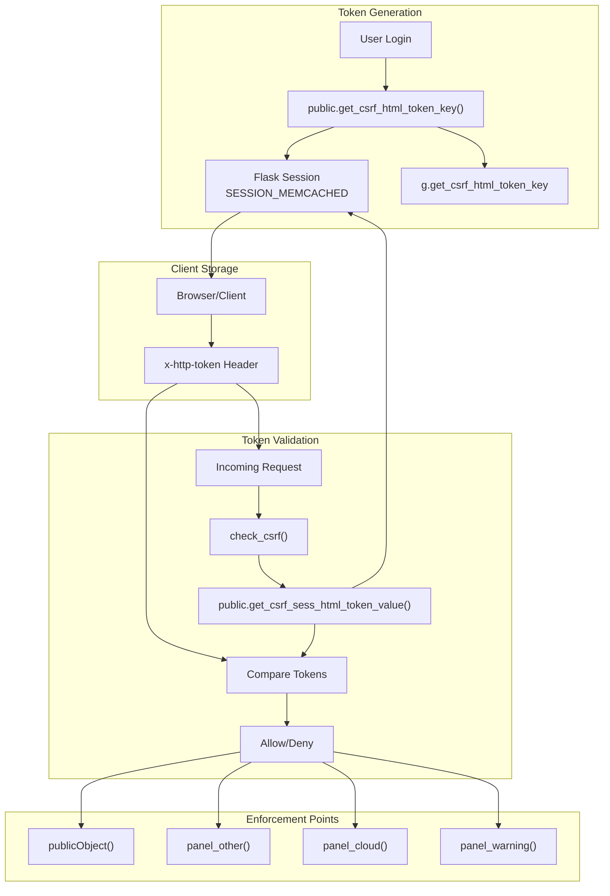
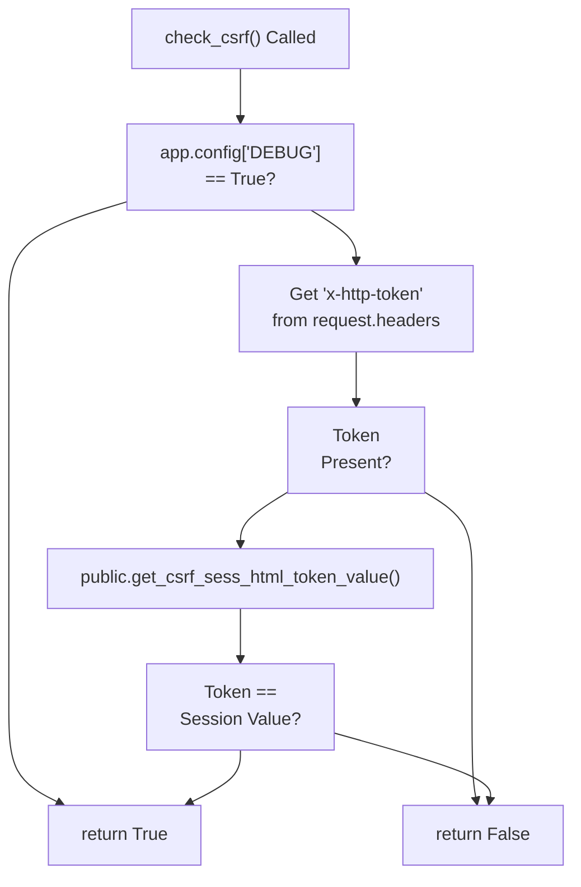
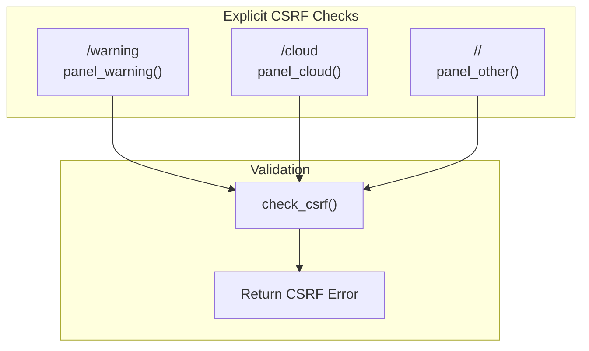
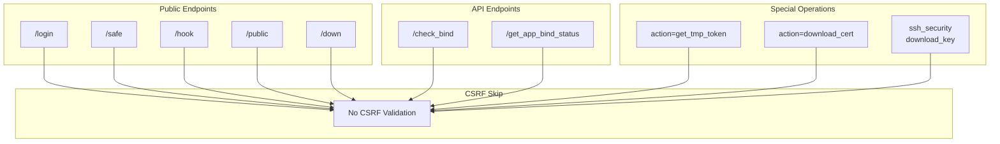

# CSRF Protection

> **Relevant source files**
> * [BTPanel/__init__.py](https://github.com/aaPanel/aaPanel/blob/b6e4ab8b/BTPanel/__init__.py)
> * [BTPanel/app.py](https://github.com/aaPanel/aaPanel/blob/b6e4ab8b/BTPanel/app.py)

This page documents aaPanel's Cross-Site Request Forgery (CSRF) protection system. CSRF protection prevents unauthorized commands from being transmitted from a user that the web application trusts. The system validates that state-changing requests originate from authenticated panel users rather than malicious third-party sites.

For information about authentication and session establishment, see [Authentication and Session Management](/aaPanel/aaPanel/3.1-authentication-and-session-management). For general input validation and security measures, see [Security and Input Validation](/aaPanel/aaPanel/3.2-security-and-input-validation). For the module dispatch system that enforces CSRF checks, see [Module Dispatch (publicObject)](/aaPanel/aaPanel/4.1-module-dispatch-(publicobject)).

---

## Overview

aaPanel implements CSRF protection using a token-based validation system integrated with Flask session management. Each authenticated user receives a unique CSRF token stored in their session. This token must be included in the `x-http-token` HTTP header for all state-changing operations. The system validates tokens before dispatching requests to feature modules.

**Sources:** [BTPanel/__init__.py L333-L355](https://github.com/aaPanel/aaPanel/blob/b6e4ab8b/BTPanel/__init__.py#L333-L355)

 [BTPanel/app.py L333-L349](https://github.com/aaPanel/aaPanel/blob/b6e4ab8b/BTPanel/app.py#L333-L349)

---

## CSRF Token Architecture

The following diagram illustrates the CSRF token lifecycle from generation through validation:



**Sources:** [BTPanel/__init__.py L266-L341](https://github.com/aaPanel/aaPanel/blob/b6e4ab8b/BTPanel/__init__.py#L266-L341)

 [BTPanel/__init__.py L1134-L1136](https://github.com/aaPanel/aaPanel/blob/b6e4ab8b/BTPanel/__init__.py#L1134-L1136)

 [BTPanel/app.py L333-L349](https://github.com/aaPanel/aaPanel/blob/b6e4ab8b/BTPanel/app.py#L333-L349)

---

## Token Generation and Storage

### Session-Based Token Key

During the request preprocessing phase, the system generates a CSRF token key unique to each session:

| Step | Function | Location | Purpose |
| --- | --- | --- | --- |
| 1 | `request_check()` | [BTPanel/__init__.py L266](https://github.com/aaPanel/aaPanel/blob/b6e4ab8b/BTPanel/__init__.py#L266-L266) | Flask before_request hook |
| 2 | `public.get_csrf_html_token_key()` | [BTPanel/__init__.py L341](https://github.com/aaPanel/aaPanel/blob/b6e4ab8b/BTPanel/__init__.py#L341-L341) | Generates token key |
| 3 | `g.get_csrf_html_token_key` | [BTPanel/__init__.py L341](https://github.com/aaPanel/aaPanel/blob/b6e4ab8b/BTPanel/__init__.py#L341-L341) | Stores in request context |
| 4 | Session storage | [BTPanel/__init__.py L88-L102](https://github.com/aaPanel/aaPanel/blob/b6e4ab8b/BTPanel/__init__.py#L88-L102) | Persists in SimpleCacheSession |

The token key is generated once per session and stored in the Flask session using `SimpleCacheSession` with memcached-type storage.

**Sources:** [BTPanel/__init__.py L266-L341](https://github.com/aaPanel/aaPanel/blob/b6e4ab8b/BTPanel/__init__.py#L266-L341)

 [BTPanel/__init__.py L82-L102](https://github.com/aaPanel/aaPanel/blob/b6e4ab8b/BTPanel/__init__.py#L82-L102)

### Session Configuration

The session system that stores CSRF tokens uses the following configuration:

```yaml
SESSION_MEMCACHED: SimpleCacheSession(1000, 86400)
SESSION_TYPE: 'memcached'
SESSION_PERMANENT: True
SESSION_USE_SIGNER: True
SESSION_KEY_PREFIX: 'BT_:'
PERMANENT_SESSION_LIFETIME: 86400 * 30 (30 days)
```

**Sources:** [BTPanel/__init__.py L88-L102](https://github.com/aaPanel/aaPanel/blob/b6e4ab8b/BTPanel/__init__.py#L88-L102)

---

## Token Validation Process

### The check_csrf() Function

The core validation function compares the client-provided token against the session-stored value:



The validation logic is straightforward:

1. **Debug Mode Bypass**: If `app.config['DEBUG']` is `True`, CSRF validation is skipped
2. **Header Extraction**: Retrieves token from `x-http-token` HTTP header
3. **Presence Check**: Returns `False` if header is missing
4. **Value Comparison**: Compares header value against session-stored token
5. **Result**: Returns `True` only if tokens match exactly

**Sources:** [BTPanel/app.py L333-L339](https://github.com/aaPanel/aaPanel/blob/b6e4ab8b/BTPanel/app.py#L333-L339)

---

## Integration with Request Pipeline

The following diagram shows how CSRF protection integrates with the broader request processing flow:

```mermaid
sequenceDiagram
  participant Client
  participant @before_request
  participant request_check()
  participant Session
  participant Route Handler
  participant publicObject()
  participant check_csrf()
  participant Feature Module

  Client->>@before_request: HTTP Request
  @before_request->>Session: get_csrf_html_token_key()
  Session-->>@before_request: token_key
  @before_request->>@before_request: Store in g.get_csrf_html_token_key
  @before_request-->>Route Handler: Continue
  Route Handler->>publicObject(): Dispatch to module
  publicObject()->>publicObject(): Check is_csrf parameter
  loop [Tokens Match]
    publicObject()->>Session: session.get('login')
    Session-->>publicObject(): Logged in
    publicObject()->>check_csrf(): check_csrf()
    check_csrf()->>Client: Get x-http-token header
    Client-->>check_csrf(): token_value
    check_csrf()->>Session: get_csrf_sess_html_token_value()
    Session-->>check_csrf(): stored_token
    check_csrf()->>check_csrf(): Compare tokens
    check_csrf()-->>publicObject(): True
    publicObject()->>Feature Module: Execute method
    Feature Module-->>Client: Response
    check_csrf()-->>publicObject(): False
    publicObject()-->>Client: ReturnJson(False, 'INIT_CSRF_ERR')
    publicObject()->>Feature Module: Execute method
    Feature Module-->>Client: Response
  end
```

**Sources:** [BTPanel/__init__.py L266-L341](https://github.com/aaPanel/aaPanel/blob/b6e4ab8b/BTPanel/__init__.py#L266-L341)

 [BTPanel/app.py L342-L376](https://github.com/aaPanel/aaPanel/blob/b6e4ab8b/BTPanel/app.py#L342-L376)

---

## The publicObject() Dispatcher

The `publicObject()` function serves as the universal dispatcher for all feature modules and enforces CSRF protection at the entry point:

### CSRF Enforcement Logic

```python
def publicObject(toObject, defs, action=None, get=None, is_csrf=True):
    # Module access pre-check
    if is_csrf and public.get_csrf_sess_html_token_value() and session.get('login', None):
        if not check_csrf():
            return public.ReturnJson(False, 'INIT_CSRF_ERR'), json_header
```

### Enforcement Conditions

The CSRF check is performed when **all** of the following conditions are true:

| Condition | Check | Purpose |
| --- | --- | --- |
| `is_csrf=True` | Function parameter | Allows selective bypass |
| `public.get_csrf_sess_html_token_value()` | Token exists | User has valid token |
| `session.get('login', None)` | User authenticated | Session is active |

If any condition is false, CSRF validation is skipped. This design allows for public endpoints and handles edge cases gracefully.

**Sources:** [BTPanel/app.py L342-L376](https://github.com/aaPanel/aaPanel/blob/b6e4ab8b/BTPanel/app.py#L342-L376)

---

## Enforcement Points in Routing

### Module Routes with CSRF

The following table lists routes that enforce CSRF protection through `publicObject()`:

| Route | Function | Line | is_csrf Parameter |
| --- | --- | --- | --- |
| `/site` | `site()` | [BTPanel/__init__.py L855-L976](https://github.com/aaPanel/aaPanel/blob/b6e4ab8b/BTPanel/__init__.py#L855-L976) | Default (True) |
| `/ftp` | `ftp()` | [BTPanel/__init__.py L979-L989](https://github.com/aaPanel/aaPanel/blob/b6e4ab8b/BTPanel/__init__.py#L979-L989) | Default (True) |
| `/database` | `database()` | [BTPanel/__init__.py L992-L1009](https://github.com/aaPanel/aaPanel/blob/b6e4ab8b/BTPanel/__init__.py#L992-L1009) | Default (True) |
| `/acme` | `acme()` | [BTPanel/__init__.py L1012-L1024](https://github.com/aaPanel/aaPanel/blob/b6e4ab8b/BTPanel/__init__.py#L1012-L1024) | Default (True) |
| `/firewall` | `firewall()` | [BTPanel/__init__.py L1054-L1065](https://github.com/aaPanel/aaPanel/blob/b6e4ab8b/BTPanel/__init__.py#L1054-L1065) | Default (True) |
| `/ssh_security` | `ssh_security()` | [BTPanel/__init__.py L1069-L1088](https://github.com/aaPanel/aaPanel/blob/b6e4ab8b/BTPanel/__init__.py#L1069-L1088) | Conditional (line 1080) |
| `/files` | `files()` | [BTPanel/__init__.py L1265-L1300](https://github.com/aaPanel/aaPanel/blob/b6e4ab8b/BTPanel/__init__.py#L1265-L1300) | Default (True) |
| `/crontab` | `crontab()` | [BTPanel/__init__.py L1303-L1313](https://github.com/aaPanel/aaPanel/blob/b6e4ab8b/BTPanel/__init__.py#L1303-L1313) | Default (True) |
| `/config` | `config()` | [BTPanel/__init__.py L1316-L1471](https://github.com/aaPanel/aaPanel/blob/b6e4ab8b/BTPanel/__init__.py#L1316-L1471) | Default (True) |
| `/plugin` | `plugin()` | [BTPanel/__init__.py L1626-L1642](https://github.com/aaPanel/aaPanel/blob/b6e4ab8b/BTPanel/__init__.py#L1626-L1642) | Default (True) |

**Sources:** [BTPanel/__init__.py L855-L1642](https://github.com/aaPanel/aaPanel/blob/b6e4ab8b/BTPanel/__init__.py#L855-L1642)

### Additional Enforcement Points

Beyond `publicObject()`, CSRF validation is explicitly called in these routes:



1. **`/warning` route** ([BTPanel/__init__.py L1134-L1136](https://github.com/aaPanel/aaPanel/blob/b6e4ab8b/BTPanel/__init__.py#L1134-L1136) ): Checks CSRF when `public.get_csrf_html_token_key()` is in session
2. **`/cloud` route** ([BTPanel/__init__.py L1723-L1725](https://github.com/aaPanel/aaPanel/blob/b6e4ab8b/BTPanel/__init__.py#L1723-L1725) ): Validates CSRF with `is_csrf` parameter (default True)
3. **`panel_other()` plugin handler** ([BTPanel/__init__.py L2406-L2412](https://github.com/aaPanel/aaPanel/blob/b6e4ab8b/BTPanel/__init__.py#L2406-L2412) ): Checks CSRF for plugin requests except specific cases

**Sources:** [BTPanel/__init__.py L1129-L1160](https://github.com/aaPanel/aaPanel/blob/b6e4ab8b/BTPanel/__init__.py#L1129-L1160)

 [BTPanel/__init__.py L1718-L1784](https://github.com/aaPanel/aaPanel/blob/b6e4ab8b/BTPanel/__init__.py#L1718-L1784)

 [BTPanel/__init__.py L2372-L2528](https://github.com/aaPanel/aaPanel/blob/b6e4ab8b/BTPanel/__init__.py#L2372-L2528)

---

## CSRF Exemptions

### Routes Excluded from CSRF Protection

Certain routes and operations are explicitly exempted from CSRF validation:



### Exemption Categories

| Category | Routes/Actions | Reason |
| --- | --- | --- |
| **Authentication** | `/login`, `/userRegister` | Pre-authentication endpoints |
| **Public APIs** | `/safe`, `/hook`, `/public`, `/down` | Stateless or publicly accessible |
| **App Binding** | `/check_bind`, `/get_app_bind_status` | Mobile app authentication |
| **File Downloads** | `action=download_cert`, `download_key` | Read-only operations |
| **Token Retrieval** | `action=get_tmp_token` | Token generation endpoint |

### Conditional Exemption - SSH Security

The `/ssh_security` route conditionally disables CSRF for specific actions:

```
if request.args.get('action', '') in ['download_key']: 
    is_csrf = False
```

This allows key file downloads without CSRF validation since they require prior authentication.

**Sources:** [BTPanel/__init__.py L1069-L1088](https://github.com/aaPanel/aaPanel/blob/b6e4ab8b/BTPanel/__init__.py#L1069-L1088)

 [BTPanel/__init__.py L382-L386](https://github.com/aaPanel/aaPanel/blob/b6e4ab8b/BTPanel/__init__.py#L382-L386)

---

## Debug Mode Behavior

### Development Bypass

When debug mode is enabled, CSRF protection is completely disabled:

```python
def check_csrf():
    if app.config['DEBUG']: return True
    # ... validation logic
```

Debug mode is controlled by the presence of the `data/debug.pl` file:

```
app.config['DEBUG'] = os.path.exists('data/debug.pl')
```

### Security Implications

| Mode | CSRF Protection | Use Case |
| --- | --- | --- |
| Production | Enabled | Normal operation |
| Debug | **Disabled** | Development only |

**⚠️ Warning**: Debug mode should **never** be enabled in production environments as it completely bypasses CSRF protection and other security measures.

**Sources:** [BTPanel/app.py L333-L339](https://github.com/aaPanel/aaPanel/blob/b6e4ab8b/BTPanel/app.py#L333-L339)

 [BTPanel/__init__.py L67](https://github.com/aaPanel/aaPanel/blob/b6e4ab8b/BTPanel/__init__.py#L67-L67)

 [BTPanel/app.py L90](https://github.com/aaPanel/aaPanel/blob/b6e4ab8b/BTPanel/app.py#L90-L90)

---

## Error Handling

### CSRF Validation Failure

When CSRF validation fails, the system returns a standardized error response:

```yaml
Response: public.ReturnJson(False, 'INIT_CSRF_ERR')
Headers: {'Content-Type': 'application/json; charset=utf-8'}
```

The error message `'INIT_CSRF_ERR'` indicates the CSRF token was missing or invalid.

### User Experience

1. **Client receives error**: CSRF validation failure response
2. **Typical causes**: * Missing `x-http-token` header * Token mismatch (stale session) * Session expired
3. **Client action**: Re-authenticate to obtain fresh token

**Sources:** [BTPanel/app.py L342-L348](https://github.com/aaPanel/aaPanel/blob/b6e4ab8b/BTPanel/app.py#L342-L348)

---

## Implementation Summary

### Key Functions

| Function | Location | Purpose |
| --- | --- | --- |
| `check_csrf()` | [BTPanel/app.py L333-L339](https://github.com/aaPanel/aaPanel/blob/b6e4ab8b/BTPanel/app.py#L333-L339) | Core validation logic |
| `publicObject()` | [BTPanel/app.py L342-L376](https://github.com/aaPanel/aaPanel/blob/b6e4ab8b/BTPanel/app.py#L342-L376) | Universal dispatcher with CSRF enforcement |
| `public.get_csrf_html_token_key()` | [BTPanel/__init__.py L341](https://github.com/aaPanel/aaPanel/blob/b6e4ab8b/BTPanel/__init__.py#L341-L341) | Generate token key |
| `public.get_csrf_sess_html_token_value()` | Referenced in app.py | Retrieve token from session |

### HTTP Headers

| Header Name | Direction | Purpose |
| --- | --- | --- |
| `x-http-token` | Client → Server | Contains CSRF token value |

### Session Keys

The CSRF token is stored in the Flask session with:

* **Prefix**: `BT_:` (configured as `SESSION_KEY_PREFIX`)
* **Storage**: `SimpleCacheSession` (in-memory cache with 86400s TTL)
* **Lifetime**: 30 days (configured as `PERMANENT_SESSION_LIFETIME`)

**Sources:** [BTPanel/__init__.py L82-L102](https://github.com/aaPanel/aaPanel/blob/b6e4ab8b/BTPanel/__init__.py#L82-L102)

 [BTPanel/app.py L333-L349](https://github.com/aaPanel/aaPanel/blob/b6e4ab8b/BTPanel/app.py#L333-L349)

---

## Security Considerations

### Protection Scope

CSRF protection in aaPanel guards against:

* Cross-site request forgery attacks
* Unauthorized state-changing operations
* Session hijacking via forged requests

### Limitations

CSRF protection does **not** defend against:

* Cross-Site Scripting (XSS) - see [Security and Input Validation](/aaPanel/aaPanel/3.2-security-and-input-validation)
* Session fixation attacks
* Man-in-the-middle attacks (use SSL/TLS)

### Best Practices

1. **Always use HTTPS**: CSRF tokens transmitted over HTTP can be intercepted
2. **Keep debug mode disabled** in production
3. **Set `is_csrf=True`** for all state-changing operations
4. **Include token in all requests** after authentication
5. **Handle CSRF errors gracefully** in client code

**Sources:** [BTPanel/__init__.py L67-L99](https://github.com/aaPanel/aaPanel/blob/b6e4ab8b/BTPanel/__init__.py#L67-L99)

 [BTPanel/app.py L333-L376](https://github.com/aaPanel/aaPanel/blob/b6e4ab8b/BTPanel/app.py#L333-L376)