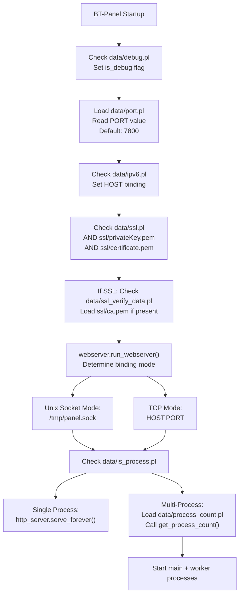
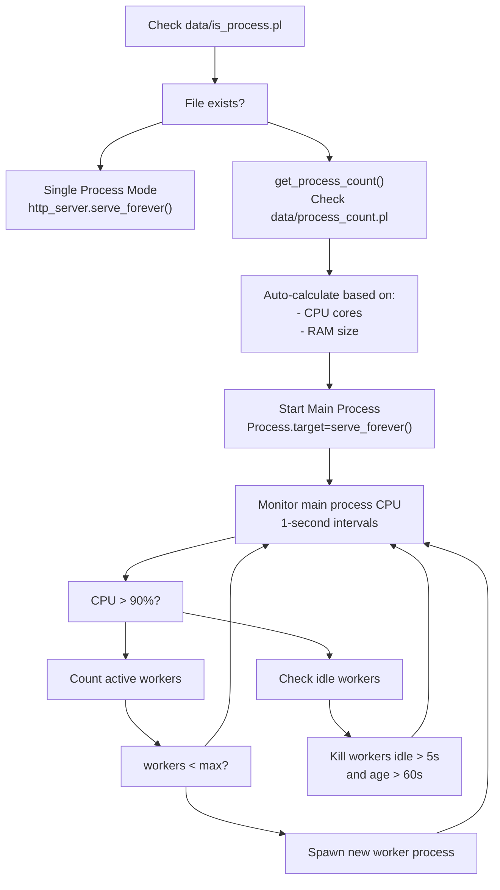
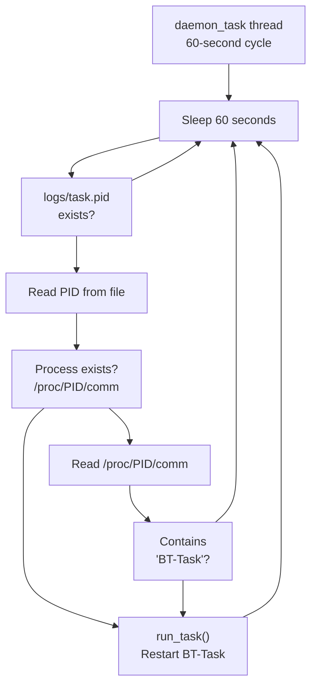
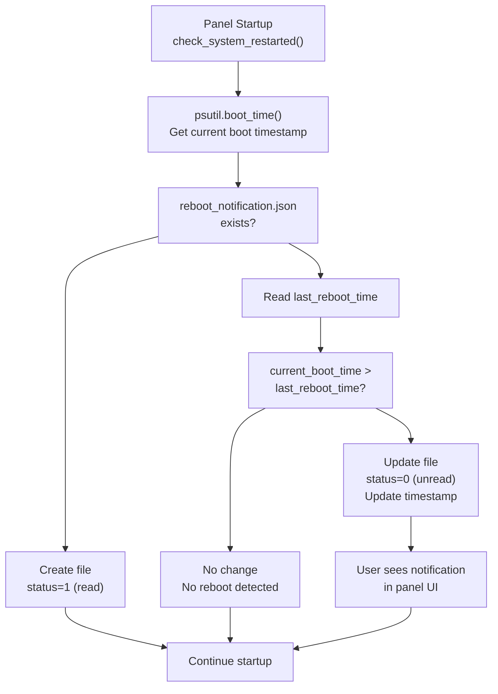
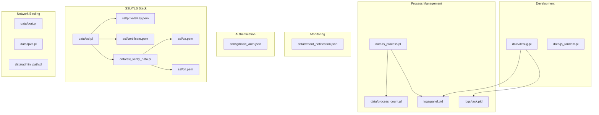

# Configuration Files Reference

> **Relevant source files**
> * [BT-Panel](https://github.com/aaPanel/aaPanel/blob/b6e4ab8b/BT-Panel)
> * [BTPanel/app.py](https://github.com/aaPanel/aaPanel/blob/b6e4ab8b/BTPanel/app.py)

This document provides a detailed reference for all configuration files used by aaPanel. These files control core system behavior including network binding, security settings, process management, and operational modes.

For information about modifying configuration values at runtime, see [Configuration Management](/aaPanel/aaPanel/9-configuration-management). For SSL/TLS certificate setup, see [SSL/TLS Configuration](/aaPanel/aaPanel/10.1-ssltls-configuration). For production deployment considerations, see [Deployment Guide](/aaPanel/aaPanel/10-deployment-guide).

---

## Configuration System Overview

aaPanel uses a file-based configuration system where settings are stored in simple text files (`.pl` files) and JSON files. Configuration files are located in two primary directories:

* `data/` - Runtime configuration and operational flags
* `config/` - Structured configuration (JSON format)
* `ssl/` - SSL/TLS certificates and keys
* `logs/` - Process ID files for monitoring

The `.pl` extension is used for plain text configuration files containing single values or simple flags. The presence or absence of certain `.pl` files acts as a boolean switch for features.

**Sources:** [BT-Panel L1-L450](https://github.com/aaPanel/aaPanel/blob/b6e4ab8b/BT-Panel#L1-L450)

 [BTPanel/app.py L1-L672](https://github.com/aaPanel/aaPanel/blob/b6e4ab8b/BTPanel/app.py#L1-L672)

---

## Configuration File Loading Sequence

The following diagram shows when and how configuration files are loaded during the BT-Panel startup process:



**Sources:** [BT-Panel L46-L47](https://github.com/aaPanel/aaPanel/blob/b6e4ab8b/BT-Panel#L46-L47)

 [BT-Panel L254-L268](https://github.com/aaPanel/aaPanel/blob/b6e4ab8b/BT-Panel#L254-L268)

 [BT-Panel L328-L380](https://github.com/aaPanel/aaPanel/blob/b6e4ab8b/BT-Panel#L328-L380)

 [BT-Panel L390-L449](https://github.com/aaPanel/aaPanel/blob/b6e4ab8b/BT-Panel#L390-L449)

---

## Configuration Files by Category

### Network Configuration Files

| File Path | Type | Purpose | Default Behavior |
| --- | --- | --- | --- |
| `data/port.pl` | Text | TCP port number for panel | 7800 |
| `data/ipv6.pl` | Flag | Enable IPv6 binding | IPv4 (0.0.0.0) |
| `data/admin_path.pl` | Text | Custom admin URL path | / |

### Security Configuration Files

| File Path | Type | Purpose | Default Behavior |
| --- | --- | --- | --- |
| `data/ssl.pl` | Flag | Enable SSL/TLS | Disabled |
| `ssl/privateKey.pem` | Certificate | SSL private key | Required for SSL |
| `ssl/certificate.pem` | Certificate | SSL certificate | Required for SSL |
| `data/ssl_verify_data.pl` | Flag | Enable client certificate verification | Disabled |
| `ssl/ca.pem` | Certificate | Root CA for client verification | Required if verify enabled |
| `ssl/crl.pem` | Certificate | Certificate revocation list | Optional |
| `config/basic_auth.json` | JSON | HTTP Basic Authentication config | Disabled |

### Process Management Files

| File Path | Type | Purpose | Default Behavior |
| --- | --- | --- | --- |
| `data/is_process.pl` | Flag | Enable multi-process mode | Single process |
| `data/process_count.pl` | Text | Custom worker count (1-4) | Auto-calculated |
| `logs/panel.pid` | Text | Main process PID | Created on startup |
| `logs/task.pid` | Text | Background task process PID | Created by BT-Task |

### Development and Debug Files

| File Path | Type | Purpose | Default Behavior |
| --- | --- | --- | --- |
| `data/debug.pl` | Flag | Enable debug mode | Production mode |
| `data/js_random.pl` | Text | Frontend cache-busting token | Generated on first access |

### Runtime State Files

| File Path | Type | Purpose | Default Behavior |
| --- | --- | --- | --- |
| `data/reboot_notification.json` | JSON | System reboot detection state | Created on startup |

**Sources:** [BT-Panel L46-L268](https://github.com/aaPanel/aaPanel/blob/b6e4ab8b/BT-Panel#L46-L268)

 [BTPanel/app.py L90-L139](https://github.com/aaPanel/aaPanel/blob/b6e4ab8b/BTPanel/app.py#L90-L139)

---

## Detailed Configuration Reference

### data/port.pl

**Purpose:** Specifies the TCP port number on which the BT-Panel web server listens.

**Format:** Single integer value (1-65535)

**Example:**

```
8888
```

**Loading Logic:**

```

```

**Default Value:** 7800

**Notes:**

* Must be a valid port number not already in use
* Changes require panel restart
* Does not apply when using Unix socket mode (with webserver)

**Sources:** [BT-Panel L254-L259](https://github.com/aaPanel/aaPanel/blob/b6e4ab8b/BT-Panel#L254-L259)

---

### data/ipv6.pl

**Purpose:** Flag file that enables IPv6 binding mode. When present, the panel binds to the IPv6 any address instead of IPv4.

**Format:** Presence/absence flag (file content is ignored)

**Effect:**

```

```

**To Enable IPv6:**

```

```

**To Disable IPv6:**

```

```

**Notes:**

* Requires IPv6 network support on the host
* Does not apply when using Unix socket mode

**Sources:** [BT-Panel L261-L262](https://github.com/aaPanel/aaPanel/blob/b6e4ab8b/BT-Panel#L261-L262)

---

### data/ssl.pl

**Purpose:** Flag file that enables SSL/TLS encryption for the panel web server.

**Format:** Presence/absence flag

**Dependencies:** Requires both `ssl/privateKey.pem` and `ssl/certificate.pem` to be present.

**Loading Logic:**

```

```

**SSL Context Configuration:**

```

```

**Security Settings:**

* Minimum TLS version: TLSv1.2
* Disabled: SSLv2, SSLv3, TLSv1.0, TLSv1.1
* Cipher suite: Strong modern ciphers only

**Session Cookie Behavior:**

```

```

**Sources:** [BT-Panel L267-L290](https://github.com/aaPanel/aaPanel/blob/b6e4ab8b/BT-Panel#L267-L290)

 [BTPanel/app.py L91](https://github.com/aaPanel/aaPanel/blob/b6e4ab8b/BTPanel/app.py#L91-L91)

 [BTPanel/app.py L118-L122](https://github.com/aaPanel/aaPanel/blob/b6e4ab8b/BTPanel/app.py#L118-L122)

---

### ssl/privateKey.pem and ssl/certificate.pem

**Purpose:** SSL/TLS private key and certificate for HTTPS connections.

**Format:** PEM-encoded X.509 certificate and RSA/ECDSA private key

**File Locations:**

* `ssl/privateKey.pem` - Private key file
* `ssl/certificate.pem` - Certificate file (can include chain)

**Requirements:**

* Private key must be readable only by the panel user
* Certificate must match the private key
* Certificate should include intermediate certificates if needed

**Loading:**

```

```

**Recommended Permissions:**

```

```

**Sources:** [BT-Panel L264-L265](https://github.com/aaPanel/aaPanel/blob/b6e4ab8b/BT-Panel#L264-L265)

 [BT-Panel L284](https://github.com/aaPanel/aaPanel/blob/b6e4ab8b/BT-Panel#L284-L284)

---

### data/ssl_verify_data.pl

**Purpose:** Flag file that enables SSL client certificate verification. When present, the panel requires clients to present valid certificates signed by the CA in `ssl/ca.pem`.

**Format:** Presence/absence flag

**Dependencies:**

* `ssl/ca.pem` - Root CA certificate
* `ssl/crl.pem` - Certificate revocation list (optional)

**Configuration:**

```

```

**Effect:**

* `ssl.CERT_REQUIRED` - Client must present a valid certificate
* Certificate must be signed by CA in `ssl/ca.pem`
* Certificate must not be in CRL (if CRL checking enabled)

**Use Case:** Restrict panel access to clients with authorized certificates (mutual TLS).

**Sources:** [BT-Panel L291-L301](https://github.com/aaPanel/aaPanel/blob/b6e4ab8b/BT-Panel#L291-L301)

---

### config/basic_auth.json

**Purpose:** Configures HTTP Basic Authentication as an additional security layer before the panel login.

**Format:** JSON object with authentication credentials

**Structure:**

```

```

**Fields:**

| Field | Type | Required | Description |
| --- | --- | --- | --- |
| `basic_user` | string | Yes | Basic auth username |
| `basic_pwd` | string | Yes | Basic auth password (plain text) |
| `open` | boolean | Yes | Enable/disable basic auth |

**Loading Logic:**

```

```

**Authentication Flow:**

```

```

**Notes:**

* Password is stored in plain text (ensure file has restrictive permissions)
* Basic auth occurs before panel session authentication
* Useful for adding an extra layer when panel is exposed to the internet

**Sources:** [BTPanel/app.py L94-L103](https://github.com/aaPanel/aaPanel/blob/b6e4ab8b/BTPanel/app.py#L94-L103)

 [BTPanel/app.py L519-L526](https://github.com/aaPanel/aaPanel/blob/b6e4ab8b/BTPanel/app.py#L519-L526)

---

### data/admin_path.pl

**Purpose:** Defines a custom URL path prefix for accessing the panel, providing security through obscurity.

**Format:** Single-line text value representing the URL path

**Example:**

```
/secretadmin
```

**Loading and Validation:**

```

```

**Effect:**

* All panel routes are prefixed with this path
* Default routes like `/login` become `{admin_path}/login`
* Static assets remain accessible at `/static/`

**Route Construction:**

```

```

**Notes:**

* Should not conflict with reserved system paths
* Must start with `/`
* Trailing slashes are normalized
* Changes require panel restart

**Sources:** [BTPanel/app.py L136-L200](https://github.com/aaPanel/aaPanel/blob/b6e4ab8b/BTPanel/app.py#L136-L200)

---

### data/is_process.pl

**Purpose:** Flag file that enables multi-process deployment mode. When present, the panel spawns multiple worker processes to handle concurrent requests.

**Format:** Presence/absence flag

**Single vs Multi-Process Logic:**

```

```

**Multi-Process Architecture:**



**Dynamic Worker Scaling Algorithm:**

```

```

**When to Enable:**

* High-traffic production environments
* Servers with 4+ CPU cores and 4GB+ RAM
* Need for horizontal scaling within single instance

**Sources:** [BT-Panel L390-L449](https://github.com/aaPanel/aaPanel/blob/b6e4ab8b/BT-Panel#L390-L449)

---

### data/process_count.pl

**Purpose:** Overrides the automatic worker process count calculation in multi-process mode.

**Format:** Single integer value (1-4)

**Example:**

```
3
```

**Loading Logic:**

```

```

**Automatic Process Count Rules:**

| Memory (MB) | CPU Cores | Process Count |
| --- | --- | --- |
| < 4000 | Any | 1 |
| Any | < 4 | 1 |
| 4000-8000 | 4+ | 2 |
| 8000-14000 | 8+ | 3 |
| > 30000 | 16+ | 4 |

**Notes:**

* Only applies when `data/is_process.pl` exists
* Value must be between 1-4
* Manual override bypasses automatic calculation
* More processes ≠ better performance (context switching overhead)

**Sources:** [BT-Panel L171-L192](https://github.com/aaPanel/aaPanel/blob/b6e4ab8b/BT-Panel#L171-L192)

 [BT-Panel L408-L410](https://github.com/aaPanel/aaPanel/blob/b6e4ab8b/BT-Panel#L408-L410)

---

### data/debug.pl

**Purpose:** Flag file that enables debug mode with file watching and automatic reloading.

**Format:** Presence/absence flag

**Loading:**

```

```

**Debug Mode Features:**

1. **File Watching:** Uses `pyinotify` to monitor file changes

```

```

1. **Automatic Reload:** Panel restarts on code changes

```

```

1. **Enhanced Logging:**

```

```

**Watched File Extensions:**

* `.py` - Python source files
* `.html` - Template files
* `BT-Panel` - Main executable
* `.so` - Shared libraries

**Excluded Directories:**

* `plugin/` - Plugin directory
* `tmp/`, `temp/` - Temporary files
* `pyenv/` - Python environment
* `class/projectModel/`, `class/databaseModel/` - Generated models

**Performance Impact:**

* Continuous file system monitoring overhead
* Frequent restarts on code changes
* More verbose logging

**To Enable Debug Mode:**

```

```

**To Disable Debug Mode:**

```

```

**⚠️ Warning:** Never enable in production - severe performance impact and security risk.

**Sources:** [BT-Panel L46](https://github.com/aaPanel/aaPanel/blob/b6e4ab8b/BT-Panel#L46-L46)

 [BT-Panel L68-L137](https://github.com/aaPanel/aaPanel/blob/b6e4ab8b/BT-Panel#L68-L137)

 [BT-Panel L304-L306](https://github.com/aaPanel/aaPanel/blob/b6e4ab8b/BT-Panel#L304-L306)

 [BT-Panel L383-L388](https://github.com/aaPanel/aaPanel/blob/b6e4ab8b/BT-Panel#L383-L388)

---

### logs/panel.pid

**Purpose:** Stores the process ID (PID) of the running BT-Panel main process for monitoring and management.

**Format:** Single integer value (process ID)

**Example:**

```
12345
```

**Creation:**

```

```

**Usage:**

* Process management scripts use this to check if panel is running
* Init scripts use this to stop/restart the panel
* Monitoring tools use this to track the main process

**Related Commands:**

```

```

**Sources:** [BT-Panel L230-L245](https://github.com/aaPanel/aaPanel/blob/b6e4ab8b/BT-Panel#L230-L245)

---

### logs/task.pid

**Purpose:** Stores the PID of the background task processor (BT-Task) for health monitoring.

**Format:** Single integer value (process ID)

**Monitoring Logic:**

```

```

**Health Check Flow:**



**Automatic Recovery:** The daemon thread continuously monitors the task process and automatically restarts it if:

* PID file is missing or empty
* Process with that PID doesn't exist
* Process exists but is not BT-Task (hijacked PID)

**Sources:** [BT-Panel L143-L169](https://github.com/aaPanel/aaPanel/blob/b6e4ab8b/BT-Panel#L143-L169)

---

### data/reboot_notification.json

**Purpose:** Tracks system reboot events to notify users of unexpected restarts.

**Format:** JSON object with boot time tracking

**Structure:**

```

```

**Fields:**

| Field | Type | Description |
| --- | --- | --- |
| `last_reboot_time` | integer | Unix timestamp of last boot time |
| `status` | integer | 0=unread, 1=read/acknowledged |

**Reboot Detection Logic:**

```

```

**Reboot Detection Flow:**



**Use Case:**

* Detects unexpected server reboots
* Alerts administrators to investigate cause
* Tracks reboot history for compliance/auditing

**Sources:** [BT-Panel L195-L226](https://github.com/aaPanel/aaPanel/blob/b6e4ab8b/BT-Panel#L195-L226)

 [BT-Panel L234-L235](https://github.com/aaPanel/aaPanel/blob/b6e4ab8b/BT-Panel#L234-L235)

---

### data/js_random.pl

**Purpose:** Stores a random token used for cache-busting frontend assets without updating version numbers.

**Format:** Single-line random string (16 characters)

**Example:**

```
a7f3c9e2b1d4f8g6
```

**Generation Logic:**

```

```

**Usage in Templates:**

* Token appended to static asset URLs as query parameter
* Forces browser to reload changed files
* Example: `<script src="/static/js/app.js?v=a7f3c9e2b1d4f8g6">`

**Regeneration:**
To force all clients to reload assets:

```

```

**Notes:**

* Persists across panel restarts (unlike version-based busting)
* Useful for hotfixes that don't warrant version bump
* Does not require build system or version tracking

**Sources:** [BTPanel/app.py L568-L573](https://github.com/aaPanel/aaPanel/blob/b6e4ab8b/BTPanel/app.py#L568-L573)

---

## Configuration File Dependencies

The following diagram shows dependencies between configuration files:



**Sources:** [BT-Panel L46-L301](https://github.com/aaPanel/aaPanel/blob/b6e4ab8b/BT-Panel#L46-L301)

 [BTPanel/app.py L90-L139](https://github.com/aaPanel/aaPanel/blob/b6e4ab8b/BTPanel/app.py#L90-L139)

---

## Configuration Management Best Practices

### File Permissions

Recommended permissions for security:

```

```

### Making Changes

1. **Stop the panel** before modifying critical configuration:

```

```

1. **Edit configuration files** using a text editor
2. **Validate syntax** for JSON files:

```

```

1. **Restart the panel** to apply changes:

```

```

### Configuration Backup

Create backups before making changes:

```

```

### Testing Changes

For critical changes:

1. Enable debug mode first (`touch data/debug.pl`)
2. Test in development environment
3. Monitor logs: `tail -f logs/error.log`
4. Verify functionality before deploying to production

**Sources:** General best practices for configuration management

---

## Configuration File Locations Summary

Quick reference table for all configuration files:

| File | Location | Type | Restart Required |
| --- | --- | --- | --- |
| port.pl | data/ | Network | Yes |
| ipv6.pl | data/ | Network | Yes |
| admin_path.pl | data/ | Security | Yes |
| ssl.pl | data/ | Security | Yes |
| privateKey.pem | ssl/ | Security | Yes |
| certificate.pem | ssl/ | Security | Yes |
| ssl_verify_data.pl | data/ | Security | Yes |
| ca.pem | ssl/ | Security | Yes |
| crl.pem | ssl/ | Security | Yes |
| basic_auth.json | config/ | Security | Yes |
| is_process.pl | data/ | Process | Yes |
| process_count.pl | data/ | Process | Yes |
| debug.pl | data/ | Development | Yes |
| js_random.pl | data/ | Frontend | No |
| panel.pid | logs/ | Runtime | Auto-generated |
| task.pid | logs/ | Runtime | Auto-generated |
| reboot_notification.json | data/ | Monitoring | Auto-generated |

**Sources:** All configuration files documented above