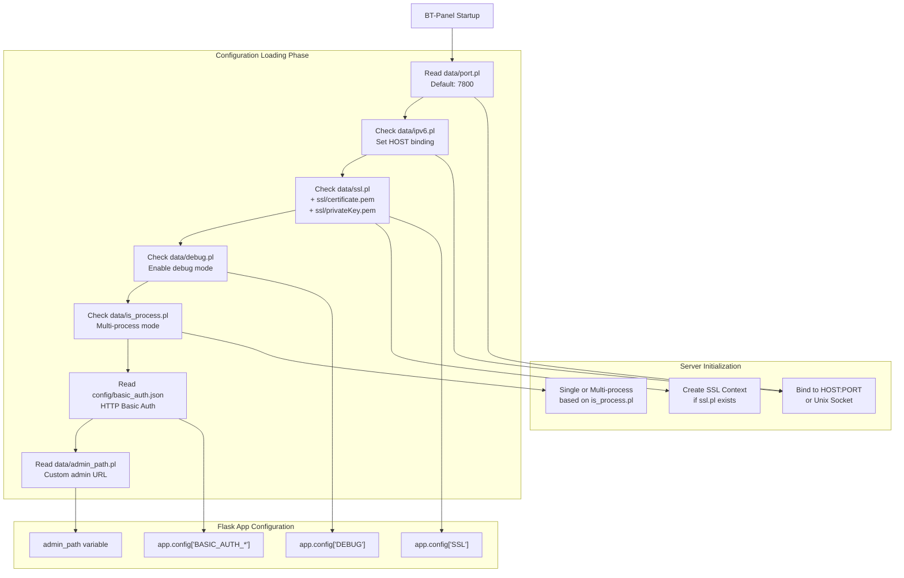
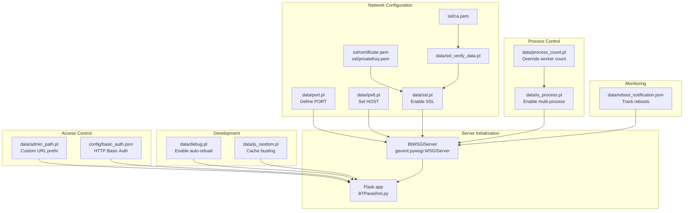

# Configuration Management

> **Relevant source files**
> * [BT-Panel](https://github.com/aaPanel/aaPanel/blob/b6e4ab8b/BT-Panel)
> * [BTPanel/app.py](https://github.com/aaPanel/aaPanel/blob/b6e4ab8b/BTPanel/app.py)

## Purpose and Scope

This document describes the configuration file system used by aaPanel to control panel behavior. aaPanel uses simple `.pl` (plain text) files and JSON configuration files stored in the `data/` and `config/` directories to manage settings such as port bindings, SSL/TLS, debug mode, process scaling, and authentication.

For information about deploying with specific network configurations, see [Network Binding Modes](/aaPanel/aaPanel/10.2-network-binding-modes). For SSL/TLS certificate setup, see [SSL/TLS Configuration](/aaPanel/aaPanel/10.1-ssltls-configuration). For multi-process deployment, see [Process Management](/aaPanel/aaPanel/7-process-management).

---

## Configuration File System Overview

aaPanel uses a file-based configuration system where the presence or contents of specific files control panel behavior. This approach allows for simple, human-readable configuration that persists across restarts without requiring database access. Configuration files are typically located in:

* **`data/`** - Runtime configuration files (`.pl` files)
* **`config/`** - Structured configuration (JSON files)
* **`ssl/`** - SSL/TLS certificates and keys

The `.pl` extension stands for "plain text" and these files typically contain a single value (e.g., a port number or path).

**Configuration File Categories:**

| Category | Files | Purpose |
| --- | --- | --- |
| Network Binding | `port.pl`, `ipv6.pl` | Control server listening address and port |
| Security | `ssl.pl`, `ssl_verify_data.pl`, `admin_path.pl` | Enable SSL and customize security settings |
| Authentication | `config/basic_auth.json` | HTTP Basic Authentication layer |
| Process Management | `is_process.pl`, `process_count.pl` | Control single vs multi-process mode |
| Development | `debug.pl`, `js_random.pl` | Enable debug mode and cache control |
| Monitoring | `data/reboot_notification.json` | Track system reboots |

Sources: [BT-Panel L1-L450](https://github.com/aaPanel/aaPanel/blob/b6e4ab8b/BT-Panel#L1-L450)

 [BTPanel/app.py L1-L672](https://github.com/aaPanel/aaPanel/blob/b6e4ab8b/BTPanel/app.py#L1-L672)

---

## Configuration Loading Architecture



**Configuration Loading Sequence**

Sources: [BT-Panel L254-L268](https://github.com/aaPanel/aaPanel/blob/b6e4ab8b/BT-Panel#L254-L268)

 [BT-Panel L390](https://github.com/aaPanel/aaPanel/blob/b6e4ab8b/BT-Panel#L390-L390)

 [BTPanel/app.py L90-L139](https://github.com/aaPanel/aaPanel/blob/b6e4ab8b/BTPanel/app.py#L90-L139)

---

## Core Configuration Files

### port.pl

**Location:** `data/port.pl`

**Purpose:** Defines the TCP port number for the panel web interface.

**Format:** Single integer value

**Default:** `7800`

**Code Reference:**

```

```

**Example:**

```
8888
```

**Notes:**

* If file is missing or empty, defaults to 7800
* Port changes require panel restart to take effect
* Common ports: 7800, 8888, 8080
* Ensure firewall allows the configured port

Sources: [BT-Panel L254-L259](https://github.com/aaPanel/aaPanel/blob/b6e4ab8b/BT-Panel#L254-L259)

---

### ipv6.pl

**Location:** `data/ipv6.pl`

**Purpose:** Enables IPv6 binding for the panel server.

**Format:** File presence indicates IPv6 mode (content irrelevant)

**Behavior:**

* **File exists:** Binds to `0:0:0:0:0:0:0:0` (all IPv6 interfaces)
* **File absent:** Binds to `0.0.0.0` (all IPv4 interfaces)

**Code Reference:**

```

```

**Enable IPv6:**

```

```

**Disable IPv6:**

```

```

Sources: [BT-Panel L261-L262](https://github.com/aaPanel/aaPanel/blob/b6e4ab8b/BT-Panel#L261-L262)

---

### ssl.pl

**Location:** `data/ssl.pl`

**Purpose:** Enables HTTPS/SSL for the panel web interface.

**Format:** File presence indicates SSL mode (content irrelevant)

**Required Files:**

* `ssl/certificate.pem` - SSL certificate
* `ssl/privateKey.pem` - Private key

**Code Reference:**

```

```

**SSL Context Configuration:**

```

```

**Effects When Enabled:**

* Requires HTTPS for all connections
* Sets minimum TLS version to 1.2
* Configures secure cipher suites
* Enables `SESSION_COOKIE_SECURE` flag

Sources: [BT-Panel L264-L268](https://github.com/aaPanel/aaPanel/blob/b6e4ab8b/BT-Panel#L264-L268)

 [BT-Panel L282-L290](https://github.com/aaPanel/aaPanel/blob/b6e4ab8b/BT-Panel#L282-L290)

 [BTPanel/app.py L91](https://github.com/aaPanel/aaPanel/blob/b6e4ab8b/BTPanel/app.py#L91-L91)

 [BTPanel/app.py L118-L122](https://github.com/aaPanel/aaPanel/blob/b6e4ab8b/BTPanel/app.py#L118-L122)

---

### admin_path.pl

**Location:** `data/admin_path.pl`

**Purpose:** Defines a custom URL path prefix for panel access (security through obscurity).

**Format:** Single line containing URL path (must start with `/`)

**Default:** `/` (root path)

**Code Reference:**

```

```

**Reserved Paths (Cannot Be Used):**

```

```

**Example:**

```
/my_secret_panel_path_2024
```

**Access:** `https://server-ip:port/my_secret_panel_path_2024`

**Notes:**

* Path is prepended to all panel routes
* Trailing slashes are removed automatically
* If path conflicts with reserved paths, defaults to `/bt`
* Reduces automated attack exposure

Sources: [BTPanel/app.py L136-L201](https://github.com/aaPanel/aaPanel/blob/b6e4ab8b/BTPanel/app.py#L136-L201)

---

### debug.pl

**Location:** `data/debug.pl`

**Purpose:** Enables debug mode with file watching and automatic reload.

**Format:** File presence indicates debug mode (content irrelevant)

**Features When Enabled:**

1. **Auto-reload on file changes** - Watches `.py`, `.html`, `.so`, `BT-Panel` files
2. **Detailed logging** - Sets logging level to `DEBUG`
3. **File system monitoring** - Uses `pyinotify` to detect file modifications
4. **Automatic restarts** - Reloads panel/tasks when files change

**Code Reference:**

```

```

**File Monitoring:**

```

```

**Excluded Directories:**

* `plugin/*` - Plugin directories
* `tmp/*`, `temp/*` - Temporary directories
* `pyenv/*` - Python environment
* `class/projectModel/*` - Project models
* `class/databaseModel/*` - Database models

**Enable Debug Mode:**

```

```

**Disable Debug Mode:**

```

```

**Performance Impact:** Debug mode adds overhead from file system monitoring. Not recommended for production.

Sources: [BT-Panel L46](https://github.com/aaPanel/aaPanel/blob/b6e4ab8b/BT-Panel#L46-L46)

 [BT-Panel L68-L137](https://github.com/aaPanel/aaPanel/blob/b6e4ab8b/BT-Panel#L68-L137)

 [BT-Panel L383-L388](https://github.com/aaPanel/aaPanel/blob/b6e4ab8b/BT-Panel#L383-L388)

---

### is_process.pl

**Location:** `data/is_process.pl`

**Purpose:** Enables multi-process mode for improved performance under high load.

**Format:** File presence indicates multi-process mode (content irrelevant)

**Behavior:**

* **File absent:** Single-process mode (simple, suitable for low traffic)
* **File exists:** Multi-process mode with dynamic worker scaling

**Code Reference:**

```

```

**Worker Scaling Logic:**

```

```

**Dynamic Worker Management:**

* Main process monitors CPU usage
* Spawns workers when main process CPU > 90%
* Maximum workers determined by `get_process_count()`
* Idle workers (5s no activity, 60s+ age) are terminated

**Enable Multi-process:**

```

```

Sources: [BT-Panel L390-L449](https://github.com/aaPanel/aaPanel/blob/b6e4ab8b/BT-Panel#L390-L449)

 [BT-Panel L171-L192](https://github.com/aaPanel/aaPanel/blob/b6e4ab8b/BT-Panel#L171-L192)

---

### process_count.pl

**Location:** `data/process_count.pl`

**Purpose:** Manually overrides automatic worker count calculation in multi-process mode.

**Format:** Single integer value (1-4)

**Default:** Auto-calculated based on RAM and CPU cores

**Code Reference:**

```

```

**Auto-calculation Table:**

| Memory | CPU Cores | Workers |
| --- | --- | --- |
| < 4GB | Any | 1 |
| < 4GB | < 4 | 1 |
| 4GB-8GB | > 3 | 2 |
| 8GB-14GB | > 7 | 3 |
| > 30GB | > 15 | 4 |
| Other | - | 1 |

**Example:**

```
3
```

Forces 3 worker processes regardless of system resources.

**Notes:**

* Only applies when `is_process.pl` exists
* Valid range: 1-4 workers
* Minimum 2 workers enforced in code
* Useful for fine-tuning on specific hardware

Sources: [BT-Panel L178-L192](https://github.com/aaPanel/aaPanel/blob/b6e4ab8b/BT-Panel#L178-L192)

 [BT-Panel L408-L410](https://github.com/aaPanel/aaPanel/blob/b6e4ab8b/BT-Panel#L408-L410)

---

## Advanced Configuration Files

### basic_auth.json

**Location:** `config/basic_auth.json`

**Purpose:** Configures HTTP Basic Authentication as an additional security layer.

**Format:** JSON object

**Structure:**

```

```

**Code Reference:**

```

```

**Fields:**

* `basic_user` - Username for HTTP Basic Auth
* `basic_pwd` - Password for HTTP Basic Auth
* `open` - Boolean flag to enable/disable

**Behavior:**
When enabled, users must pass HTTP Basic Authentication before accessing the panel login page. This provides defense-in-depth security.

For detailed setup, see [Basic Authentication Setup](/aaPanel/aaPanel/10.3-basic-authentication-setup).

Sources: [BTPanel/app.py L94-L103](https://github.com/aaPanel/aaPanel/blob/b6e4ab8b/BTPanel/app.py#L94-L103)

---

### ssl_verify_data.pl

**Location:** `data/ssl_verify_data.pl`

**Purpose:** Enables SSL client certificate verification (mutual TLS).

**Format:** File presence indicates verification mode (content irrelevant)

**Required Files:**

* `ssl/ca.pem` - Root CA certificate for verification
* `ssl/crl.pem` - Certificate Revocation List (optional, commented out)

**Code Reference:**

```

```

**Effects:**

* Requires clients to present valid certificates
* Certificates must be signed by CA in `ca.pem`
* `ssl.CERT_REQUIRED` enforces strict verification

**Use Case:** High-security environments requiring mutual TLS authentication.

Sources: [BT-Panel L291-L301](https://github.com/aaPanel/aaPanel/blob/b6e4ab8b/BT-Panel#L291-L301)

 [BT-Panel L357-L367](https://github.com/aaPanel/aaPanel/blob/b6e4ab8b/BT-Panel#L357-L367)

---

### js_random.pl

**Location:** `data/js_random.pl`

**Purpose:** Stores a random string used for JavaScript cache-busting.

**Format:** 16-character random string

**Code Reference:**

```

```

**Usage:** Appended to JavaScript/CSS URLs to force browser cache refresh without changing version numbers.

**Example:** `/static/app.js?v=a7b3c9d2e4f5g6h8`

**Notes:**

* Auto-generated on first access
* Persists across restarts
* Can be manually changed to force cache clear

Sources: [BTPanel/app.py L568-L573](https://github.com/aaPanel/aaPanel/blob/b6e4ab8b/BTPanel/app.py#L568-L573)

---

### reboot_notification.json

**Location:** `data/reboot_notification.json`

**Purpose:** Tracks system reboots to notify administrators.

**Format:** JSON object

**Structure:**

```

```

**Fields:**

* `last_reboot_time` - Unix timestamp of last boot time
* `status` - 0 = unread notification, 1 = read/dismissed

**Code Reference:**

```

```

**Behavior:**

* Checked during panel startup
* Compares current boot time with last recorded time
* Sets `status: 0` when reboot detected
* Allows UI to display reboot notification

Sources: [BT-Panel L195-L226](https://github.com/aaPanel/aaPanel/blob/b6e4ab8b/BT-Panel#L195-L226)

 [BT-Panel L234-L235](https://github.com/aaPanel/aaPanel/blob/b6e4ab8b/BT-Panel#L234-L235)

---

## Configuration File Interaction Map



**Configuration Dependencies and Effects**

Sources: [BT-Panel L254-L380](https://github.com/aaPanel/aaPanel/blob/b6e4ab8b/BT-Panel#L254-L380)

 [BTPanel/app.py L90-L139](https://github.com/aaPanel/aaPanel/blob/b6e4ab8b/BTPanel/app.py#L90-L139)

---

## Configuration Loading Sequence

The following diagram shows the exact order in which configuration files are read during panel startup:

```

```

**Startup Configuration Flow**

Sources: [BT-Panel L229-L450](https://github.com/aaPanel/aaPanel/blob/b6e4ab8b/BT-Panel#L229-L450)

 [BTPanel/app.py L74-L139](https://github.com/aaPanel/aaPanel/blob/b6e4ab8b/BTPanel/app.py#L74-L139)

---

## Modifying Configuration Files

### Manual Modification

Configuration files can be edited manually using any text editor:

```

```

### Programmatic Modification

Configuration files are also modified through panel UI and API calls using the `public.writeFile()` function:

```

```

### Restart Requirements

Most configuration changes require a panel restart to take effect:

| Configuration | Restart Required | Hot-Reload |
| --- | --- | --- |
| `port.pl` | Yes | No |
| `ipv6.pl` | Yes | No |
| `ssl.pl` | Yes | No |
| `admin_path.pl` | Yes | No |
| `is_process.pl` | Yes | No |
| `process_count.pl` | Yes | No |
| `debug.pl` | Yes | Auto-reload enabled when active |
| `basic_auth.json` | Yes | No |
| `js_random.pl` | No | Immediate |
| `reboot_notification.json` | No | Read at startup only |

**Restart Methods:**

```

```

Sources: [BT-Panel L230-L232](https://github.com/aaPanel/aaPanel/blob/b6e4ab8b/BT-Panel#L230-L232)

---

## Configuration Best Practices

### Security Considerations

1. **Restrict File Permissions:** ``` ```
2. **Use Custom Admin Path:** * Reduces automated attack surface * Choose non-obvious paths * Avoid reserved paths listed in `admin_path_checks`
3. **Enable SSL/TLS:** * Always use SSL in production * Keep certificates up to date * Consider client certificate verification for high-security
4. **Enable Basic Authentication:** * Adds additional layer before panel login * Use strong, unique credentials * Different from panel admin credentials

### Performance Tuning

1. **Multi-process Mode:** * Enable for servers with 4+ GB RAM and 4+ CPU cores * Manually tune `process_count.pl` for specific workloads * Monitor CPU usage to verify worker effectiveness
2. **Disable Debug Mode:** * File watching adds overhead * Only use debug mode in development * Remove `debug.pl` before production deployment
3. **IPv6 Considerations:** * Use IPv6 only if network infrastructure supports it * Dual-stack configurations require firewall rules for both protocols

### Backup and Recovery

1. **Backup Configuration Directory:** ``` ```
2. **Version Control:** * Consider tracking configuration files in git * Exclude sensitive files (SSL keys, passwords) * Use `.gitignore` for secrets
3. **Documentation:** * Document custom configurations * Note reasons for non-default settings * Track configuration changes over time

Sources: [BT-Panel L1-L450](https://github.com/aaPanel/aaPanel/blob/b6e4ab8b/BT-Panel#L1-L450)

 [BTPanel/app.py L1-L672](https://github.com/aaPanel/aaPanel/blob/b6e4ab8b/BTPanel/app.py#L1-L672)

---

## Configuration Validation

```

```

**Configuration Validation Logic**

The panel applies defensive checks when reading configuration files:

1. **Port Validation:** * Default to 7800 if invalid * Handle missing file gracefully
2. **SSL Validation:** * Requires both certificate and key files * Falls back to non-SSL if files missing
3. **Admin Path Validation:** * Checks against reserved path list * Defaults to `/bt` if conflicts * Strips trailing slashes
4. **Process Count Validation:** * Ignores if not parseable as integer * Falls back to auto-calculation * Enforces minimum of 2 in multi-process mode

Sources: [BT-Panel L254-L259](https://github.com/aaPanel/aaPanel/blob/b6e4ab8b/BT-Panel#L254-L259)

 [BT-Panel L264-L268](https://github.com/aaPanel/aaPanel/blob/b6e4ab8b/BT-Panel#L264-L268)

 [BTPanel/app.py L136-L191](https://github.com/aaPanel/aaPanel/blob/b6e4ab8b/BTPanel/app.py#L136-L191)

 [BT-Panel L178-L183](https://github.com/aaPanel/aaPanel/blob/b6e4ab8b/BT-Panel#L178-L183)

---

## Troubleshooting Configuration Issues

### Port Already in Use

**Symptom:** Panel fails to start, error about port binding

**Solution:**

```

```

### SSL Certificate Errors

**Symptom:** Panel starts but SSL warnings appear

**Solution:**

1. Verify certificate files exist and are valid: ``` ```
2. Ensure proper permissions: ``` ```
3. Regenerate if needed

### Admin Path Not Working

**Symptom:** Cannot access panel at custom path

**Check:**

1. Path is not in reserved list
2. Path starts with `/`
3. No trailing slashes
4. Panel restarted after change

### Multi-process Mode Issues

**Symptom:** High memory usage or poor performance

**Solution:**

1. Check system resources meet requirements
2. Manually set worker count: ``` ```
3. Consider disabling multi-process mode: ``` ```

### Debug Mode Stuck

**Symptom:** Panel continuously reloading

**Solution:**

1. Disable debug mode: ``` ```
2. Check for syntax errors in Python files
3. Review `logs/error.log` for details

Sources: [BT-Panel L1-L450](https://github.com/aaPanel/aaPanel/blob/b6e4ab8b/BT-Panel#L1-L450)