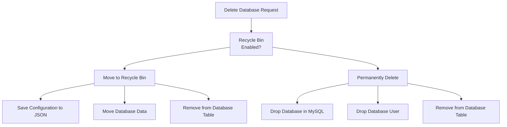
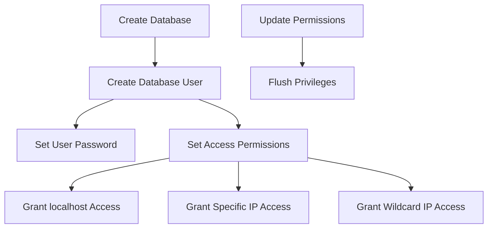
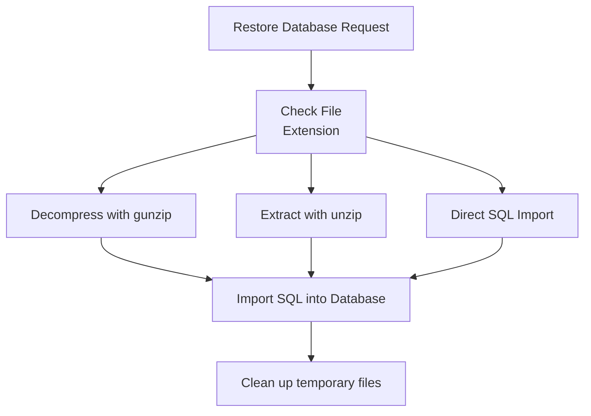
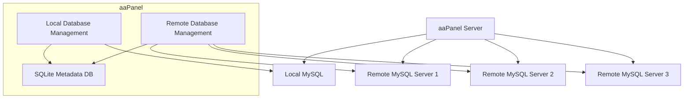
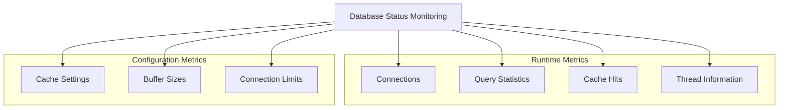
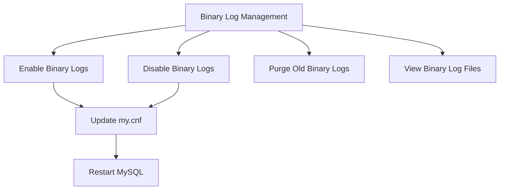
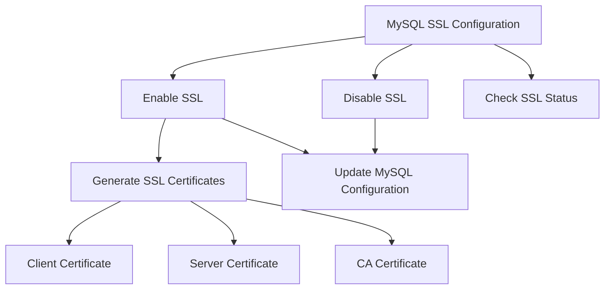
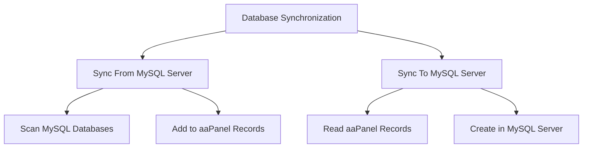
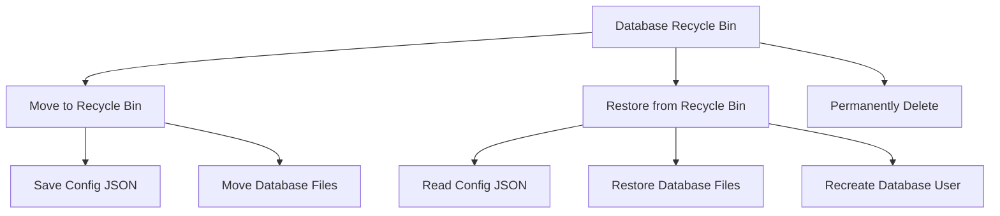

# Database Management

> **Relevant source files**
> * [BTPanel/__init__.py](https://github.com/aaPanel/aaPanel/blob/b6e4ab8b/BTPanel/__init__.py)

Database Management in aaPanel provides comprehensive tools for creating, managing, and monitoring MySQL databases. This page documents the database management architecture, operations, and configuration within the aaPanel system.

## Overview

The Database Management module allows administrators to:

* Create and manage local and remote MySQL databases
* Configure database users and permissions
* Back up and restore databases
* Monitor and optimize database performance
* Configure MySQL server settings

The module is primarily implemented through the `database` class in the aaPanel codebase, which extends `datatool.datatools`.

Sources: [class/database.py L25-L26](https://github.com/aaPanel/aaPanel/blob/b6e4ab8b/class/database.py#L25-L26)

## Architecture

The Database Management system consists of several components working together to provide database functionality in aaPanel.

### Database Module Architecture

```

```

The database management system uses several different classes to interact with MySQL:

* The main `database` class implements the user-facing API
* `panelMysql` provides direct query execution for local databases
* `db_mysql` handles connections to remote database servers
* Utility functions in `public` provide helper methods

Sources: [class/database.py L13-L22](https://github.com/aaPanel/aaPanel/blob/b6e4ab8b/class/database.py#L13-L22)

 [class/database.py L248-L252](https://github.com/aaPanel/aaPanel/blob/b6e4ab8b/class/database.py#L248-L252)

### Data Flow Diagram

```

```

The system maintains metadata about databases in a SQLite database while connecting to local or remote MySQL servers for actual database operations.

Sources: [class/database.py L19](https://github.com/aaPanel/aaPanel/blob/b6e4ab8b/class/database.py#L19-L19)

 [class/database.py L323-L326](https://github.com/aaPanel/aaPanel/blob/b6e4ab8b/class/database.py#L323-L326)

 [class/database.py L365-L367](https://github.com/aaPanel/aaPanel/blob/b6e4ab8b/class/database.py#L365-L367)

## Database Operations

### Creating Databases

The Database Management module allows creating MySQL databases with specific character sets, usernames, and access permissions.

```mermaid
sequenceDiagram
  participant User
  participant database.AddDatabase()
  participant MySQL Server
  participant SQLite DB

  User->>database.AddDatabase(): Request with name, username, password, character set
  database.AddDatabase()->>database.AddDatabase(): Validate database & username
  database.AddDatabase()->>MySQL Server: Create database with specified charset
  database.AddDatabase()->>MySQL Server: Create user with password
  database.AddDatabase()->>MySQL Server: Grant permissions to user
  database.AddDatabase()->>SQLite DB: Store database metadata
  database.AddDatabase()->>User: Return success response
```

When creating a database, the system:

1. Validates the database name and username against reserved words and patterns
2. Creates the database with the specified character encoding
3. Creates a user with the provided password
4. Grants permissions to the user
5. Stores metadata in the SQLite database

Sources: [class/database.py L296-L368](https://github.com/aaPanel/aaPanel/blob/b6e4ab8b/class/database.py#L296-L368)

### Database Deletion

Databases can be either permanently deleted or moved to a recycle bin for potential recovery.



The recycle bin functionality allows recovering databases that were accidentally deleted by preserving both the database files and configuration.

Sources: [class/database.py L607-L636](https://github.com/aaPanel/aaPanel/blob/b6e4ab8b/class/database.py#L607-L636)

 [class/database.py L649-L685](https://github.com/aaPanel/aaPanel/blob/b6e4ab8b/class/database.py#L649-L685)

## User Management

### Database Users and Permissions

Each database in aaPanel typically has a dedicated user with specific access permissions. The management system allows configuring which hosts can connect using each database user.



By default, each database has its own dedicated user for security reasons. The system prevents one database user from managing multiple databases.

Sources: [class/database.py L451-L470](https://github.com/aaPanel/aaPanel/blob/b6e4ab8b/class/database.py#L451-L470)

 [class/database.py L1242-L1288](https://github.com/aaPanel/aaPanel/blob/b6e4ab8b/class/database.py#L1242-L1288)

### Password Management

The system provides functions to set or reset passwords for both database users and the MySQL root user.

```mermaid
sequenceDiagram
  participant User
  participant database.ResDatabasePassword()
  participant MySQL Server
  participant SQLite DB

  User->>database.ResDatabasePassword(): Request password change
  database.ResDatabasePassword()->>database.ResDatabasePassword(): Validate password format
  loop [MySQL 5.7 or 8.0]
    database.ResDatabasePassword()->>MySQL Server: Use ALTER USER syntax
    database.ResDatabasePassword()->>MySQL Server: Use UPDATE user SET Password syntax
  end
  database.ResDatabasePassword()->>MySQL Server: Flush privileges
  database.ResDatabasePassword()->>SQLite DB: Update password in database records
  database.ResDatabasePassword()->>User: Return success response
```

Password changes are handled differently depending on the MySQL version, with appropriate syntax used for different MySQL versions.

Sources: [class/database.py L770-L893](https://github.com/aaPanel/aaPanel/blob/b6e4ab8b/class/database.py#L770-L893)

## Backup and Restore

### Database Backup

The system provides functionality to back up databases to compressed files.

```mermaid
sequenceDiagram
  participant User
  participant database.ToBackup()
  participant mysqldump
  participant File System
  participant SQLite DB

  User->>database.ToBackup(): Request backup
  database.ToBackup()->>database.ToBackup(): Generate backup filename
  loop [Local Database]
    database.ToBackup()->>mysqldump: Execute mysqldump for local database
    database.ToBackup()->>mysqldump: Execute mysqldump with remote connection parameters
  end
  mysqldump->>File System: Write compressed SQL file
  database.ToBackup()->>SQLite DB: Record backup in backup table
  database.ToBackup()->>User: Return success response
```

The backup process uses `mysqldump` to create a SQL dump of the database and compresses it with gzip. Backup records are stored in the aaPanel's SQLite database.

Sources: [class/database.py L896-L970](https://github.com/aaPanel/aaPanel/blob/b6e4ab8b/class/database.py#L896-L970)

### Database Restore

Databases can be restored from backup files in SQL, GZ, or ZIP formats.



The restore process handles different compressed formats by extracting them before importing the SQL contents into the target database.

Sources: [class/database.py L998-L1114](https://github.com/aaPanel/aaPanel/blob/b6e4ab8b/class/database.py#L998-L1114)

## Remote Database Management

aaPanel can manage both local and remote MySQL databases through a unified interface.

### Remote Server Architecture



Remote database servers are stored in the `database_servers` table and can be managed similarly to local databases.

Sources: [class/database.py L40-L87](https://github.com/aaPanel/aaPanel/blob/b6e4ab8b/class/database.py#L40-L87)

 [class/database.py L84-L97](https://github.com/aaPanel/aaPanel/blob/b6e4ab8b/class/database.py#L84-L97)

### Remote Database Operations

Adding and managing remote databases involves:

1. Configuring connection parameters to remote MySQL servers
2. Testing the connection
3. Storing connection details securely
4. Executing operations against the remote server

The system supports common operations such as creating databases, backing up, and restoring on remote servers.

Sources: [class/database.py L176-L233](https://github.com/aaPanel/aaPanel/blob/b6e4ab8b/class/database.py#L176-L233)

 [class/database.py L235-L266](https://github.com/aaPanel/aaPanel/blob/b6e4ab8b/class/database.py#L235-L266)

## Performance and Monitoring

### Database Status Monitoring

aaPanel provides tools to monitor MySQL server status and performance metrics.



The monitoring system collects and displays various MySQL configuration parameters and runtime statistics.

Sources: [class/database.py L1430-L1447](https://github.com/aaPanel/aaPanel/blob/b6e4ab8b/class/database.py#L1430-L1447)

 [class/database.py L1487-L1526](https://github.com/aaPanel/aaPanel/blob/b6e4ab8b/class/database.py#L1487-L1526)

### MySQL Log Management

The system provides access to various MySQL logs:

| Log Type | Description | Access Function |
| --- | --- | --- |
| Error Log | Records MySQL errors | `GetErrorLog()` |
| Slow Query Log | Records slow-running queries | `GetSlowLogs()` |
| Binary Logs | Used for replication and point-in-time recovery | `GetMySQLBinlogs()` |

Binary logs can be managed (enabled/disabled) and purged after a specific number of days.

Sources: [class/database.py L1350-L1362](https://github.com/aaPanel/aaPanel/blob/b6e4ab8b/class/database.py#L1350-L1362)

 [class/database.py L1527-L1532](https://github.com/aaPanel/aaPanel/blob/b6e4ab8b/class/database.py#L1527-L1532)

 [class/database.py L1533-L1583](https://github.com/aaPanel/aaPanel/blob/b6e4ab8b/class/database.py#L1533-L1583)

## Configuration Management

### MySQL Server Configuration

The Database Management module allows configuring various MySQL performance parameters:

```mermaid
flowchart TD

MySQLConfig["MySQL Configuration"]
KeyBuffer["key_buffer_size"]
QueryCache["query_cache_size"]
TmpTable["tmp_table_size"]
HeapTable["max_heap_table_size"]
InnodbBuffer["innodb_buffer_pool_size"]
LogBuffer["innodb_log_buffer_size"]
MaxConnections["max_connections"]
ThreadCache["thread_cache_size"]
TableCache["table_open_cache"]
SortBuffer["sort_buffer_size"]
ReadBuffer["read_buffer_size"]
JoinBuffer["join_buffer_size"]

MySQLConfig --> KeyBuffer
MySQLConfig --> QueryCache
MySQLConfig --> TmpTable
MySQLConfig --> HeapTable
MySQLConfig --> InnodbBuffer
MySQLConfig --> LogBuffer
MySQLConfig --> MaxConnections
MySQLConfig --> ThreadCache
MySQLConfig --> TableCache
MySQLConfig --> SortBuffer
MySQLConfig --> ReadBuffer
MySQLConfig --> JoinBuffer

subgraph subGraph2 ["Query Settings"]
    SortBuffer
    ReadBuffer
    JoinBuffer
end

subgraph subGraph1 ["Connection Settings"]
    MaxConnections
    ThreadCache
    TableCache
end

subgraph subGraph0 ["Memory Settings"]
    KeyBuffer
    QueryCache
    TmpTable
    HeapTable
    InnodbBuffer
    LogBuffer
end
```



The configuration system allows adjusting MySQL parameters through the aaPanel interface, which then updates the MySQL configuration file.

Sources: [class/database.py L1451-L1485](https://github.com/aaPanel/aaPanel/blob/b6e4ab8b/class/database.py#L1451-L1485)

### Data Directory Management

aaPanel allows changing the MySQL data directory:

```mermaid
sequenceDiagram
  participant User
  participant database.SetDataDir()
  participant MySQL Server
  participant File System

  User->>database.SetDataDir(): Request data directory change
  database.SetDataDir()->>MySQL Server: Stop MySQL server
  database.SetDataDir()->>File System: Copy data files to new location
  database.SetDataDir()->>File System: Update permissions on new location
  database.SetDataDir()->>File System: Update MySQL configuration file
  database.SetDataDir()->>MySQL Server: Start MySQL server
  database.SetDataDir()->>User: Return success response
```

Moving the data directory involves stopping the MySQL server, copying all data files, updating permissions, modifying the MySQL configuration, and restarting the server.

Sources: [class/database.py L1306-L1337](https://github.com/aaPanel/aaPanel/blob/b6e4ab8b/class/database.py#L1306-L1337)

### Binary Log Management

Binary logs are essential for MySQL replication and point-in-time recovery. aaPanel provides controls to enable, disable, and purge binary logs.



Binary logs can be managed through the interface, which modifies the MySQL configuration file and restarts the MySQL service.

Sources: [class/database.py L1364-L1427](https://github.com/aaPanel/aaPanel/blob/b6e4ab8b/class/database.py#L1364-L1427)

## SSL Configuration

aaPanel supports configuring MySQL with SSL for secure connections:



SSL configuration includes generating the necessary certificates and updating the MySQL configuration to use them.

Sources: [class/database.py L370-L422](https://github.com/aaPanel/aaPanel/blob/b6e4ab8b/class/database.py#L370-L422)

 [class/database.py L424-L437](https://github.com/aaPanel/aaPanel/blob/b6e4ab8b/class/database.py#L424-L437)

## Database Utilities

### Table Operations

aaPanel provides utilities for table maintenance:

| Operation | Description | Function |
| --- | --- | --- |
| Repair | Fixes corrupted tables | `ReTable()` |
| Optimize | Reorganizes table storage | `OpTable()` |
| Change Engine | Converts table storage engine | `AlTable()` |

These operations help maintain database performance and integrity.

Sources: [class/database.py L1594-L1616](https://github.com/aaPanel/aaPanel/blob/b6e4ab8b/class/database.py#L1594-L1616)

### Database Synchronization

The system includes functionality to synchronize database structures between the aaPanel metadata and the actual MySQL server:



Synchronization ensures that the aaPanel database records match the actual state of the MySQL server.

Sources: [class/database.py L1117-L1145](https://github.com/aaPanel/aaPanel/blob/b6e4ab8b/class/database.py#L1117-L1145)

 [class/database.py L1196-L1240](https://github.com/aaPanel/aaPanel/blob/b6e4ab8b/class/database.py#L1196-L1240)

## Recycle Bin Management

When database deletion is performed with recycle bin enabled, databases are moved to a special recovery location:



The recycle bin functionality preserves both the database files and configuration, allowing for complete recovery of accidentally deleted databases.

Sources: [class/database.py L649-L685](https://github.com/aaPanel/aaPanel/blob/b6e4ab8b/class/database.py#L649-L685)

 [class/database.py L731-L768](https://github.com/aaPanel/aaPanel/blob/b6e4ab8b/class/database.py#L731-L768)

 [class/database.py L687-L729](https://github.com/aaPanel/aaPanel/blob/b6e4ab8b/class/database.py#L687-L729)

## Error Handling

The Database Management module includes comprehensive error detection and reporting for MySQL operations:

| Error Type | Description | Handling |
| --- | --- | --- |
| Authentication Errors | Wrong username or password | User-friendly error message |
| Database Existence | Checking if database exists | Proper verification before operations |
| Connection Issues | Unable to connect to database server | Detailed error messages |
| Permission Errors | Lack of needed permissions | Clear explanation of access issues |
| SQL Errors | Syntax or execution errors | Parsing error messages for readability |

The error handling system helps administrators diagnose and resolve issues with database operations.

Sources: [class/database.py L268-L288](https://github.com/aaPanel/aaPanel/blob/b6e4ab8b/class/database.py#L268-L288)

 [class/database.py L483-L497](https://github.com/aaPanel/aaPanel/blob/b6e4ab8b/class/database.py#L483-L497)