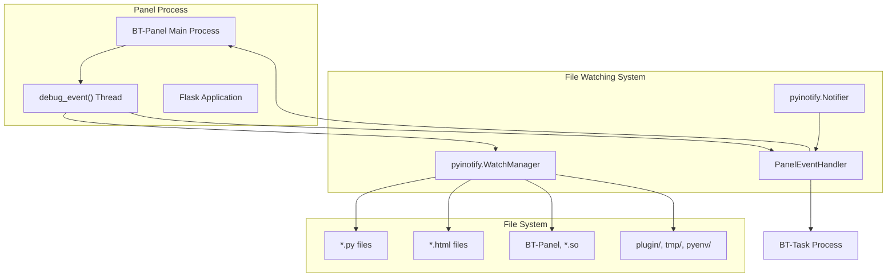
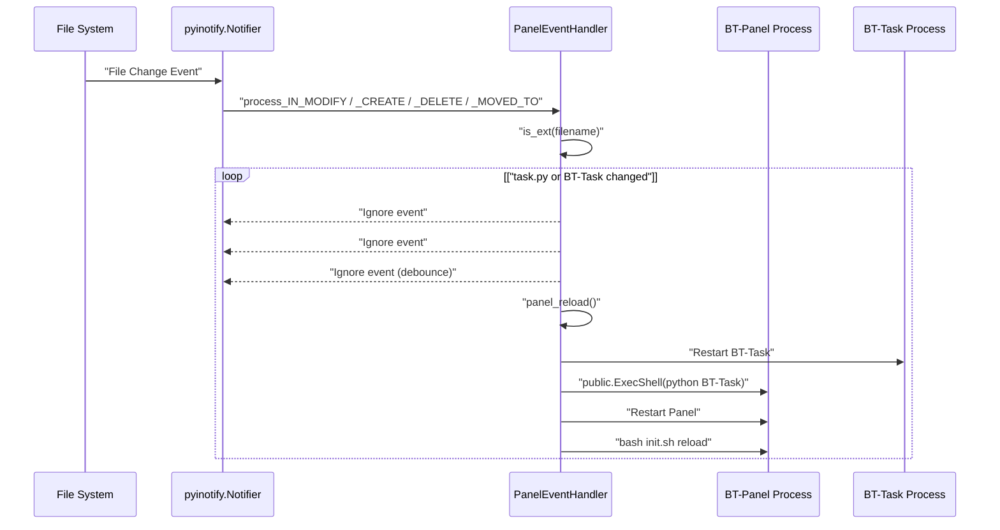
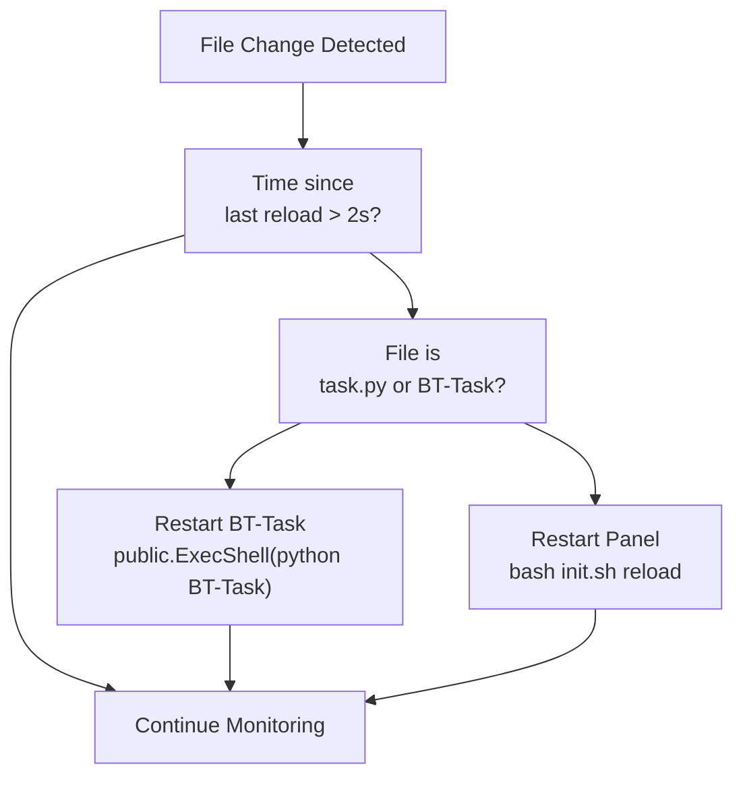
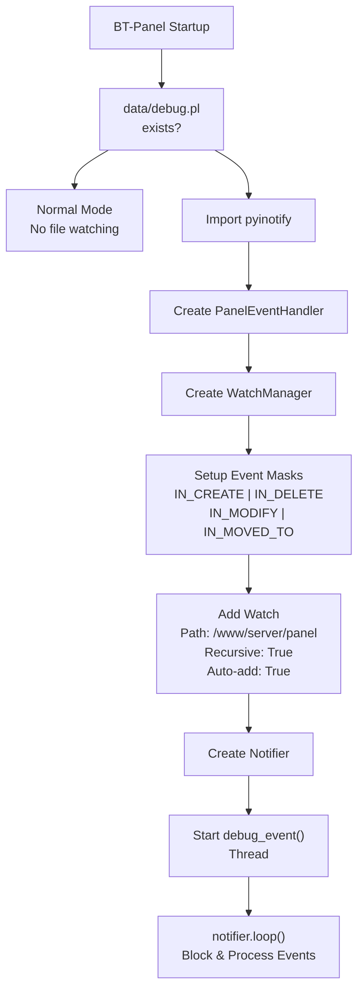
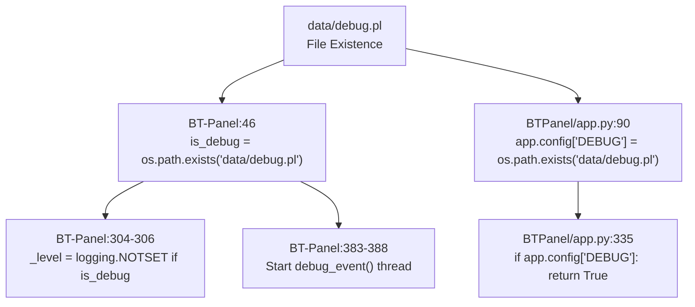

# Debug Mode

> **Relevant source files**
> * [BT-Panel](https://github.com/aaPanel/aaPanel/blob/b6e4ab8b/BT-Panel)
> * [BTPanel/app.py](https://github.com/aaPanel/aaPanel/blob/b6e4ab8b/BTPanel/app.py)

## Purpose and Scope

This document describes aaPanel's debug mode, which provides automatic code reloading and enhanced logging for development. Debug mode monitors file changes and automatically restarts the panel or background tasks, eliminating the need for manual restarts during development. For general development environment setup, see [Development Setup](/aaPanel/aaPanel/11-development-setup). For IDE-specific configuration, see [IntelliJ IDEA Configuration](/aaPanel/aaPanel/11.1-intellij-idea-configuration).

---

## Overview

Debug mode is a development feature that enables:

1. **Automatic file watching** - monitors Python files, templates, and binaries for changes
2. **Automatic reloading** - restarts the panel or background tasks when files are modified
3. **Enhanced logging** - provides detailed debug-level logging output
4. **Real-time feedback** - immediate application of code changes without manual intervention

Debug mode is controlled by the presence of the `data/debug.pl` configuration file. When this file exists, the panel starts in debug mode with file watching and automatic reload capabilities enabled.

Sources: [BT-Panel L46](https://github.com/aaPanel/aaPanel/blob/b6e4ab8b/BT-Panel#L46-L46)

 [BT-Panel L68-L138](https://github.com/aaPanel/aaPanel/blob/b6e4ab8b/BT-Panel#L68-L138)

 [BTPanel/app.py L90](https://github.com/aaPanel/aaPanel/blob/b6e4ab8b/BTPanel/app.py#L90-L90)

---

## Activation and Configuration

### Enabling Debug Mode

Debug mode is activated by creating the `data/debug.pl` file in the panel directory:

```

```

The presence of this file is checked during panel startup:

* [BT-Panel L46](https://github.com/aaPanel/aaPanel/blob/b6e4ab8b/BT-Panel#L46-L46)  - Initial check: `is_debug = os.path.exists('data/debug.pl')`
* [BTPanel/app.py L90](https://github.com/aaPanel/aaPanel/blob/b6e4ab8b/BTPanel/app.py#L90-L90)  - Flask app configuration: `app.config['DEBUG'] = os.path.exists('data/debug.pl')`

### Disabling Debug Mode

Remove the `data/debug.pl` file and restart the panel:

```

```

**Warning:** Debug mode should never be enabled in production environments as it introduces performance overhead and security risks through automatic code execution.

Sources: [BT-Panel L46](https://github.com/aaPanel/aaPanel/blob/b6e4ab8b/BT-Panel#L46-L46)

 [BTPanel/app.py L90](https://github.com/aaPanel/aaPanel/blob/b6e4ab8b/BTPanel/app.py#L90-L90)

---

## File Watching System

### Architecture



Sources: [BT-Panel L68-L138](https://github.com/aaPanel/aaPanel/blob/b6e4ab8b/BT-Panel#L68-L138)

 [BT-Panel L383-L388](https://github.com/aaPanel/aaPanel/blob/b6e4ab8b/BT-Panel#L383-L388)

### PanelEventHandler Implementation

The `PanelEventHandler` class extends `pyinotify.ProcessEvent` to handle file system events:

| Component | Purpose |
| --- | --- |
| `_exts` | Monitored file extensions: `['py', 'html', 'BT-Panel', 'so']` |
| `_explude_patts` | Regex patterns for excluded directories |
| `_last_time` | Timestamp to prevent duplicate reloads within 2 seconds |
| `is_ext()` | Validates file extension and checks exclusion patterns |
| `panel_reload()` | Triggers appropriate reload action based on file type |

#### Monitored File Extensions

[BT-Panel L74](https://github.com/aaPanel/aaPanel/blob/b6e4ab8b/BT-Panel#L74-L74)

 defines the monitored extensions:

* **`.py`** - Python source files
* **`.html`** - Template files
* **`BT-Panel`** - Main panel executable
* **`.so`** - Compiled shared objects (PluginLoader)

#### Excluded Directories

[BT-Panel L75-L82](https://github.com/aaPanel/aaPanel/blob/b6e4ab8b/BT-Panel#L75-L82)

 defines paths excluded from monitoring:

* `{panel_path}/plugin/*` - Plugin directories
* `{panel_path}/tmp/*` and `{panel_path}/temp/*` - Temporary directories
* `{panel_path}/pyenv/*` - Python virtual environment
* `{panel_path}/class/projectModel/*` - Project model classes
* `{panel_path}/class/databaseModel/*` - Database model classes
* `{panel_path}/panel/data/mail/in_bulk/content/*` - Bulk mail content

Sources: [BT-Panel L73-L82](https://github.com/aaPanel/aaPanel/blob/b6e4ab8b/BT-Panel#L73-L82)

---

## Automatic Reload Behavior

### Event Processing Flow



Sources: [BT-Panel L94-L127](https://github.com/aaPanel/aaPanel/blob/b6e4ab8b/BT-Panel#L94-L127)

### Event Handling Methods

The handler processes four types of file system events:

| Method | Trigger | Event Type |
| --- | --- | --- |
| `process_IN_CREATE()` | New file created | `[Create]` |
| `process_IN_DELETE()` | File deleted | `[Delete]` |
| `process_IN_MODIFY()` | File content modified | `[Modify]` |
| `process_IN_MOVED_TO()` | File moved/renamed into directory | `[Cover]` |

Each method:

1. Checks if the file extension is monitored via `is_ext()` [BT-Panel L86-L92](https://github.com/aaPanel/aaPanel/blob/b6e4ab8b/BT-Panel#L86-L92)
2. Calls `panel_reload()` with the filename and event type [BT-Panel L94-L127](https://github.com/aaPanel/aaPanel/blob/b6e4ab8b/BT-Panel#L94-L127)

### Reload Logic

[BT-Panel L94-L110](https://github.com/aaPanel/aaPanel/blob/b6e4ab8b/BT-Panel#L94-L110)

 implements the reload decision logic:



**Debounce Protection:** [BT-Panel L95-L98](https://github.com/aaPanel/aaPanel/blob/b6e4ab8b/BT-Panel#L95-L98)

 prevents reload thrashing by enforcing a 2-second minimum interval between reloads using `_last_time` timestamp.

**Task-Specific Handling:** [BT-Panel L104-L107](https://github.com/aaPanel/aaPanel/blob/b6e4ab8b/BT-Panel#L104-L107)

 detects changes to background task files (`task.py` or `BT-Task`) and restarts only the BT-Task process instead of the entire panel.

Sources: [BT-Panel L94-L110](https://github.com/aaPanel/aaPanel/blob/b6e4ab8b/BT-Panel#L94-L110)

---

## Debug Logging

### Logging Configuration

Debug mode enables comprehensive logging at multiple levels:

| Configuration | Normal Mode | Debug Mode |
| --- | --- | --- |
| Logging Level | `logging.WARNING` | `logging.NOTSET` |
| Format | `[%(asctime)s][%(levelname)s] - %(message)s` | Same |
| Output | `logs/error.log` | Console (stdout/stderr) |

[BT-Panel L304-L308](https://github.com/aaPanel/aaPanel/blob/b6e4ab8b/BT-Panel#L304-L308)

 configures the logging system:

```

```

### Debug Event Logging

[BT-Panel L128-L137](https://github.com/aaPanel/aaPanel/blob/b6e4ab8b/BT-Panel#L128-L137)

 implements the `debug_event()` function that starts the file watching system:

**Startup Messages:**

* "Launch the panel in debug mode"
* "Listening port: 0.0.0.0:{port}"

**File Change Messages:**
[BT-Panel L99](https://github.com/aaPanel/aaPanel/blob/b6e4ab8b/BT-Panel#L99-L99)

 logs each detected change:

* Format: `File detected: {filename} -> {event_type}`
* Example: `File detected: /www/server/panel/BTPanel/__init__.py -> [Modify]`

**Reload Messages:**

* Background task restart: "Background task..." → "Background task started!"
* Panel restart: "Restarting panel..."

Sources: [BT-Panel L69-L71](https://github.com/aaPanel/aaPanel/blob/b6e4ab8b/BT-Panel#L69-L71)

 [BT-Panel L99](https://github.com/aaPanel/aaPanel/blob/b6e4ab8b/BT-Panel#L99-L99)

 [BT-Panel L105-L110](https://github.com/aaPanel/aaPanel/blob/b6e4ab8b/BT-Panel#L105-L110)

 [BT-Panel L128-L137](https://github.com/aaPanel/aaPanel/blob/b6e4ab8b/BT-Panel#L128-L137)

 [BT-Panel L304-L308](https://github.com/aaPanel/aaPanel/blob/b6e4ab8b/BT-Panel#L304-L308)

---

## File Watching Initialization

### Setup Process



Sources: [BT-Panel L68-L69](https://github.com/aaPanel/aaPanel/blob/b6e4ab8b/BT-Panel#L68-L69)

 [BT-Panel L128-L137](https://github.com/aaPanel/aaPanel/blob/b6e4ab8b/BT-Panel#L128-L137)

 [BT-Panel L383-L388](https://github.com/aaPanel/aaPanel/blob/b6e4ab8b/BT-Panel#L383-L388)

### Implementation Details

[BT-Panel L128-L137](https://github.com/aaPanel/aaPanel/blob/b6e4ab8b/BT-Panel#L128-L137)

 defines the `debug_event()` function:

**Event Mask Configuration:**
[BT-Panel L134](https://github.com/aaPanel/aaPanel/blob/b6e4ab8b/BT-Panel#L134-L134)

 combines multiple event types:

```

```

**Watch Setup:**
[BT-Panel L135](https://github.com/aaPanel/aaPanel/blob/b6e4ab8b/BT-Panel#L135-L135)

 adds recursive monitoring:

```

```

* `_PATH` = `/www/server/panel`
* `auto_add=True` - automatically monitor new directories
* `rec=True` - recursive monitoring of subdirectories

**Thread Initialization:**
[BT-Panel L383-L388](https://github.com/aaPanel/aaPanel/blob/b6e4ab8b/BT-Panel#L383-L388)

 starts the debug event loop in a separate thread:

```

```

Sources: [BT-Panel L128-L137](https://github.com/aaPanel/aaPanel/blob/b6e4ab8b/BT-Panel#L128-L137)

 [BT-Panel L383-L388](https://github.com/aaPanel/aaPanel/blob/b6e4ab8b/BT-Panel#L383-L388)

---

## Development Workflow

### Typical Development Cycle

```css
#mermaid-vm1g4fcmnzc{font-family:ui-sans-serif,-apple-system,system-ui,Segoe UI,Helvetica;font-size:16px;fill:#333;}@keyframes edge-animation-frame{from{stroke-dashoffset:0;}}@keyframes dash{to{stroke-dashoffset:0;}}#mermaid-vm1g4fcmnzc .edge-animation-slow{stroke-dasharray:9,5!important;stroke-dashoffset:900;animation:dash 50s linear infinite;stroke-linecap:round;}#mermaid-vm1g4fcmnzc .edge-animation-fast{stroke-dasharray:9,5!important;stroke-dashoffset:900;animation:dash 20s linear infinite;stroke-linecap:round;}#mermaid-vm1g4fcmnzc .error-icon{fill:#dddddd;}#mermaid-vm1g4fcmnzc .error-text{fill:#222222;stroke:#222222;}#mermaid-vm1g4fcmnzc .edge-thickness-normal{stroke-width:1px;}#mermaid-vm1g4fcmnzc .edge-thickness-thick{stroke-width:3.5px;}#mermaid-vm1g4fcmnzc .edge-pattern-solid{stroke-dasharray:0;}#mermaid-vm1g4fcmnzc .edge-thickness-invisible{stroke-width:0;fill:none;}#mermaid-vm1g4fcmnzc .edge-pattern-dashed{stroke-dasharray:3;}#mermaid-vm1g4fcmnzc .edge-pattern-dotted{stroke-dasharray:2;}#mermaid-vm1g4fcmnzc .marker{fill:#999;stroke:#999;}#mermaid-vm1g4fcmnzc .marker.cross{stroke:#999;}#mermaid-vm1g4fcmnzc svg{font-family:ui-sans-serif,-apple-system,system-ui,Segoe UI,Helvetica;font-size:16px;}#mermaid-vm1g4fcmnzc p{margin:0;}#mermaid-vm1g4fcmnzc defs #statediagram-barbEnd{fill:#999;stroke:#999;}#mermaid-vm1g4fcmnzc g.stateGroup text{fill:#dddddd;stroke:none;font-size:10px;}#mermaid-vm1g4fcmnzc g.stateGroup text{fill:#333;stroke:none;font-size:10px;}#mermaid-vm1g4fcmnzc g.stateGroup .state-title{font-weight:bolder;fill:#333;}#mermaid-vm1g4fcmnzc g.stateGroup rect{fill:#ffffff;stroke:#dddddd;}#mermaid-vm1g4fcmnzc g.stateGroup line{stroke:#999;stroke-width:1;}#mermaid-vm1g4fcmnzc .transition{stroke:#999;stroke-width:1;fill:none;}#mermaid-vm1g4fcmnzc .stateGroup .composit{fill:#f4f4f4;border-bottom:1px;}#mermaid-vm1g4fcmnzc .stateGroup .alt-composit{fill:#e0e0e0;border-bottom:1px;}#mermaid-vm1g4fcmnzc .state-note{stroke:#e6d280;fill:#fff5ad;}#mermaid-vm1g4fcmnzc .state-note text{fill:#333;stroke:none;font-size:10px;}#mermaid-vm1g4fcmnzc .stateLabel .box{stroke:none;stroke-width:0;fill:#ffffff;opacity:0.5;}#mermaid-vm1g4fcmnzc .edgeLabel .label rect{fill:#ffffff;opacity:0.5;}#mermaid-vm1g4fcmnzc .edgeLabel{background-color:#ffffff;text-align:center;}#mermaid-vm1g4fcmnzc .edgeLabel p{background-color:#ffffff;}#mermaid-vm1g4fcmnzc .edgeLabel rect{opacity:0.5;background-color:#ffffff;fill:#ffffff;}#mermaid-vm1g4fcmnzc .edgeLabel .label text{fill:#333;}#mermaid-vm1g4fcmnzc .label div .edgeLabel{color:#333;}#mermaid-vm1g4fcmnzc .stateLabel text{fill:#333;font-size:10px;font-weight:bold;}#mermaid-vm1g4fcmnzc .node circle.state-start{fill:#999;stroke:#999;}#mermaid-vm1g4fcmnzc .node .fork-join{fill:#999;stroke:#999;}#mermaid-vm1g4fcmnzc .node circle.state-end{fill:#dddddd;stroke:#f4f4f4;stroke-width:1.5;}#mermaid-vm1g4fcmnzc .end-state-inner{fill:#f4f4f4;stroke-width:1.5;}#mermaid-vm1g4fcmnzc .node rect{fill:#ffffff;stroke:#dddddd;stroke-width:1px;}#mermaid-vm1g4fcmnzc .node polygon{fill:#ffffff;stroke:#dddddd;stroke-width:1px;}#mermaid-vm1g4fcmnzc #statediagram-barbEnd{fill:#999;}#mermaid-vm1g4fcmnzc .statediagram-cluster rect{fill:#ffffff;stroke:#dddddd;stroke-width:1px;}#mermaid-vm1g4fcmnzc .cluster-label,#mermaid-vm1g4fcmnzc .nodeLabel{color:#333;}#mermaid-vm1g4fcmnzc .statediagram-cluster rect.outer{rx:5px;ry:5px;}#mermaid-vm1g4fcmnzc .statediagram-state .divider{stroke:#dddddd;}#mermaid-vm1g4fcmnzc .statediagram-state .title-state{rx:5px;ry:5px;}#mermaid-vm1g4fcmnzc .statediagram-cluster.statediagram-cluster .inner{fill:#f4f4f4;}#mermaid-vm1g4fcmnzc .statediagram-cluster.statediagram-cluster-alt .inner{fill:#f8f8f8;}#mermaid-vm1g4fcmnzc .statediagram-cluster .inner{rx:0;ry:0;}#mermaid-vm1g4fcmnzc .statediagram-state rect.basic{rx:5px;ry:5px;}#mermaid-vm1g4fcmnzc .statediagram-state rect.divider{stroke-dasharray:10,10;fill:#f8f8f8;}#mermaid-vm1g4fcmnzc .note-edge{stroke-dasharray:5;}#mermaid-vm1g4fcmnzc .statediagram-note rect{fill:#fff5ad;stroke:#e6d280;stroke-width:1px;rx:0;ry:0;}#mermaid-vm1g4fcmnzc .statediagram-note rect{fill:#fff5ad;stroke:#e6d280;stroke-width:1px;rx:0;ry:0;}#mermaid-vm1g4fcmnzc .statediagram-note text{fill:#333;}#mermaid-vm1g4fcmnzc .statediagram-note .nodeLabel{color:#333;}#mermaid-vm1g4fcmnzc .statediagram .edgeLabel{color:red;}#mermaid-vm1g4fcmnzc #dependencyStart,#mermaid-vm1g4fcmnzc #dependencyEnd{fill:#999;stroke:#999;stroke-width:1;}#mermaid-vm1g4fcmnzc .statediagramTitleText{text-anchor:middle;font-size:18px;fill:#333;}#mermaid-vm1g4fcmnzc :root{--mermaid-font-family:"trebuchet ms",verdana,arial,sans-serif;}"touch data/debug.pl""bt restart""File watching active""Modify Python/HTML files""pyinotify detects change""Check file type & exclusions""Standard files changed""task.py/BT-Task changed""Excluded file/debounced""Panel restarted""BT-Task restarted""Development complete""rm data/debug.pl"EnableDebugStartPanelMonitoringEditCodeDetectChangeEvaluateChangeReloadPanelReloadTaskDisableDebug
```

Sources: [BT-Panel L46](https://github.com/aaPanel/aaPanel/blob/b6e4ab8b/BT-Panel#L46-L46)

 [BT-Panel L94-L110](https://github.com/aaPanel/aaPanel/blob/b6e4ab8b/BT-Panel#L94-L110)

### Best Practices

| Practice | Rationale |
| --- | --- |
| **Use debug mode only in development** | Prevents performance overhead and security risks in production |
| **Monitor console output** | Debug logging provides immediate feedback on file changes and reloads |
| **Be aware of debounce delay** | 2-second minimum between reloads prevents reload thrashing |
| **Exclude bulk operations** | Plugin installations and mass file operations may trigger excessive reloads |
| **Test with debug mode disabled** | Ensures application behavior matches production environment |

### Performance Considerations

Debug mode introduces overhead:

1. **File System Monitoring** - pyinotify consumes resources monitoring file changes
2. **Frequent Restarts** - Panel restarts disrupt active connections and sessions
3. **Debug Logging** - Verbose logging increases I/O operations
4. **Thread Overhead** - Separate thread runs the debug event loop

**Memory Usage:**

* pyinotify watch descriptors consume kernel memory
* Recursive monitoring of `/www/server/panel` creates many watch descriptors
* Each watched directory consumes approximately 1KB of kernel memory

**CPU Usage:**

* File change events trigger immediate processing
* Panel restarts involve process fork/exec operations
* Background task restarts execute shell commands

Sources: [BT-Panel L68-L138](https://github.com/aaPanel/aaPanel/blob/b6e4ab8b/BT-Panel#L68-L138)

 [BT-Panel L383-L388](https://github.com/aaPanel/aaPanel/blob/b6e4ab8b/BT-Panel#L383-L388)

---

## Integration with Flask Application

### Debug Flag Propagation



Sources: [BT-Panel L46](https://github.com/aaPanel/aaPanel/blob/b6e4ab8b/BT-Panel#L46-L46)

 [BT-Panel L304-L306](https://github.com/aaPanel/aaPanel/blob/b6e4ab8b/BT-Panel#L304-L306)

 [BT-Panel L383-L388](https://github.com/aaPanel/aaPanel/blob/b6e4ab8b/BT-Panel#L383-L388)

 [BTPanel/app.py L90](https://github.com/aaPanel/aaPanel/blob/b6e4ab8b/BTPanel/app.py#L90-L90)

 [BTPanel/app.py L335](https://github.com/aaPanel/aaPanel/blob/b6e4ab8b/BTPanel/app.py#L335-L335)

### CSRF Protection Bypass

[BTPanel/app.py L333-L339](https://github.com/aaPanel/aaPanel/blob/b6e4ab8b/BTPanel/app.py#L333-L339)

 implements the `check_csrf()` function:

```

```

**Debug Mode Behavior:** When `app.config['DEBUG']` is `True`, CSRF validation is automatically bypassed. This simplifies development testing but should never be used in production.

Sources: [BTPanel/app.py L333-L339](https://github.com/aaPanel/aaPanel/blob/b6e4ab8b/BTPanel/app.py#L333-L339)

---

## Troubleshooting

### Common Issues

| Issue | Cause | Solution |
| --- | --- | --- |
| Panel not reloading automatically | Debug mode not enabled | Verify `data/debug.pl` exists |
| Excessive reloads | File operations in monitored directories | Move bulk operations to excluded directories |
| Reload loops | Reload process modifies monitored files | Check for circular dependencies |
| Missing file changes | File in excluded directory | Review `_explude_patts` regex patterns |
| Permission errors | Insufficient permissions to execute reload commands | Ensure panel runs with appropriate privileges |

### Verification Steps

1. **Check debug mode is active:** ``` ```
2. **Monitor console output:** ``` ```
3. **Verify file watching thread:** ``` ```
4. **Test file change detection:** ``` ```

Sources: [BT-Panel L68-L138](https://github.com/aaPanel/aaPanel/blob/b6e4ab8b/BT-Panel#L68-L138)

---

## Related Configuration Files

| File | Purpose |
| --- | --- |
| `data/debug.pl` | Debug mode activation marker |
| `logs/error.log` | Error and debug logging output (non-debug mode) |
| `logs/panel.pid` | Main panel process ID |
| `logs/task.pid` | Background task process ID |
| `init.sh` | Panel control script (used for reload) |

Sources: [BT-Panel L46](https://github.com/aaPanel/aaPanel/blob/b6e4ab8b/BT-Panel#L46-L46)

 [BT-Panel L110](https://github.com/aaPanel/aaPanel/blob/b6e4ab8b/BT-Panel#L110-L110)

 [BT-Panel L230](https://github.com/aaPanel/aaPanel/blob/b6e4ab8b/BT-Panel#L230-L230)

 [BT-Panel L272-L274](https://github.com/aaPanel/aaPanel/blob/b6e4ab8b/BT-Panel#L272-L274)