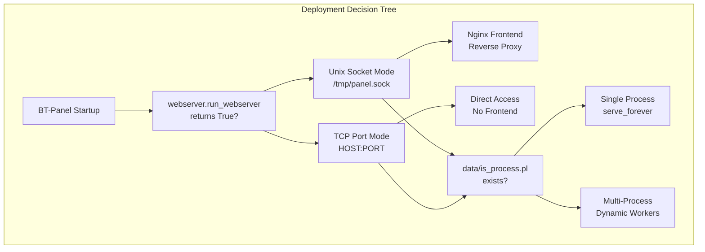
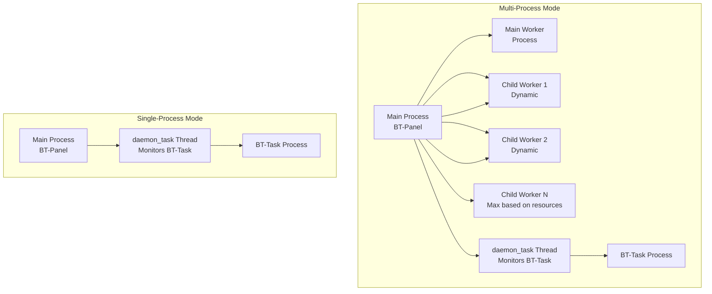
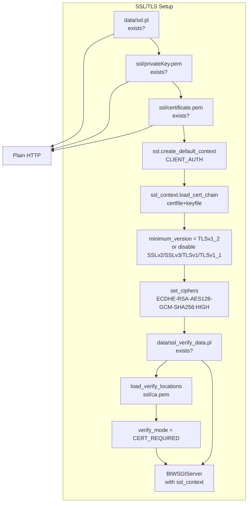
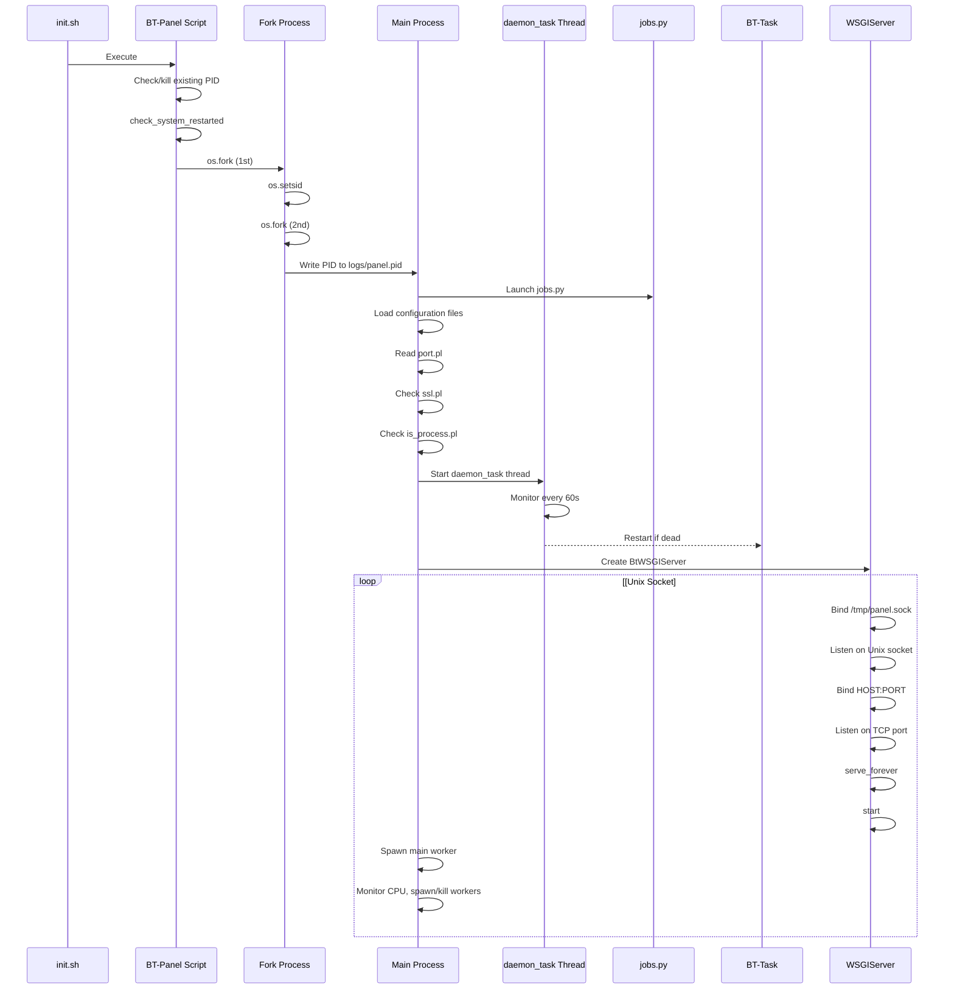

# Deployment Guide

> **Relevant source files**
> * [.idea/deployment.xml](https://github.com/aaPanel/aaPanel/blob/b6e4ab8b/.idea/deployment.xml)
> * [BT-Panel](https://github.com/aaPanel/aaPanel/blob/b6e4ab8b/BT-Panel)

This document covers production deployment of aaPanel, including network binding modes, process management, security hardening, and performance optimization. For initial installation and first-time setup, see [Quick Start Guide](/aaPanel/aaPanel/1.1-quick-start-guide). For detailed SSL/TLS certificate configuration, see [SSL/TLS Configuration](/aaPanel/aaPanel/10.1-ssltls-configuration). For network binding mode specifics, see [Network Binding Modes](/aaPanel/aaPanel/10.2-network-binding-modes). For HTTP Basic Authentication, see [Basic Authentication Setup](/aaPanel/aaPanel/10.3-basic-authentication-setup).

The deployment architecture is highly flexible, supporting both simple single-process deployments for low-traffic environments and multi-process deployments with dynamic worker scaling for production workloads.

## Deployment Architecture Overview

The BT-Panel main process can operate in two distinct deployment configurations:



**Deployment Architecture Decision Tree**

The deployment architecture involves two independent decisions:

1. **Network Binding**: Unix socket (for reverse proxy) or TCP port (direct access)
2. **Process Mode**: Single-process (simple) or multi-process (scalable)

Sources: [BT-Panel L328-L380](https://github.com/aaPanel/aaPanel/blob/b6e4ab8b/BT-Panel#L328-L380)

 [BT-Panel L390-L449](https://github.com/aaPanel/aaPanel/blob/b6e4ab8b/BT-Panel#L390-L449)

## Configuration Files

aaPanel uses simple marker files (`.pl` extension) to control deployment behavior:

| File Path | Purpose | Values |
| --- | --- | --- |
| `data/port.pl` | TCP port number | Integer (default: 7800) |
| `data/ipv6.pl` | Enable IPv6 binding | Presence indicates IPv6 |
| `data/ssl.pl` | Enable SSL/TLS | Presence indicates SSL enabled |
| `data/is_process.pl` | Multi-process mode | Presence enables multi-process |
| `data/debug.pl` | Debug mode | Presence enables debug logging |
| `data/process_count.pl` | Manual worker count | Integer (overrides auto-detection) |
| `ssl/privateKey.pem` | SSL private key | PEM format |
| `ssl/certificate.pem` | SSL certificate | PEM format |
| `data/basic_auth.json` | Basic HTTP auth | JSON with credentials |

Sources: [BT-Panel L254-L262](https://github.com/aaPanel/aaPanel/blob/b6e4ab8b/BT-Panel#L254-L262)

 [BT-Panel L264-L268](https://github.com/aaPanel/aaPanel/blob/b6e4ab8b/BT-Panel#L264-L268)

 [BT-Panel L390-L391](https://github.com/aaPanel/aaPanel/blob/b6e4ab8b/BT-Panel#L390-L391)

## Network Binding Modes

```

```

**Network Binding Architecture**

### Unix Socket Mode (Production)

Enabled when `webserver_obj.run_webserver()` returns `True` [BT-Panel L329](https://github.com/aaPanel/aaPanel/blob/b6e4ab8b/BT-Panel#L329-L329)

:

* Creates Unix domain socket at `/tmp/panel.sock` [BT-Panel L335](https://github.com/aaPanel/aaPanel/blob/b6e4ab8b/BT-Panel#L335-L335)
* Sets socket permissions to `0o777` [BT-Panel L340](https://github.com/aaPanel/aaPanel/blob/b6e4ab8b/BT-Panel#L340-L340)
* Requires Nginx or another web server as frontend
* Recommended for production deployments
* Better performance for local connections
* Isolated from network stack

Implementation details:

```

```

Sources: [BT-Panel L333-L340](https://github.com/aaPanel/aaPanel/blob/b6e4ab8b/BT-Panel#L333-L340)

### TCP Port Mode (Direct Access)

Used when not in Unix socket mode [BT-Panel L348-L380](https://github.com/aaPanel/aaPanel/blob/b6e4ab8b/BT-Panel#L348-L380)

:

* Binds directly to `HOST:PORT`
* Default host: `0.0.0.0` [BT-Panel L260](https://github.com/aaPanel/aaPanel/blob/b6e4ab8b/BT-Panel#L260-L260)
* IPv6 host: `0:0:0:0:0:0:0:0` if `data/ipv6.pl` exists [BT-Panel L261-L262](https://github.com/aaPanel/aaPanel/blob/b6e4ab8b/BT-Panel#L261-L262)
* Default port: `7800` [BT-Panel L259](https://github.com/aaPanel/aaPanel/blob/b6e4ab8b/BT-Panel#L259-L259)
* Suitable for development or simple deployments
* Can be SSL/TLS enabled

For detailed configuration of each mode, see [Network Binding Modes](/aaPanel/aaPanel/10.2-network-binding-modes).

Sources: [BT-Panel L254-L262](https://github.com/aaPanel/aaPanel/blob/b6e4ab8b/BT-Panel#L254-L262)

 [BT-Panel L348-L380](https://github.com/aaPanel/aaPanel/blob/b6e4ab8b/BT-Panel#L348-L380)

## Process Management Modes



**Process Management Architecture**

### Single-Process Mode

Default mode when `data/is_process.pl` does not exist [BT-Panel L390-L397](https://github.com/aaPanel/aaPanel/blob/b6e4ab8b/BT-Panel#L390-L397)

:

* Runs `http_server.serve_forever()` in main process
* Simple, predictable behavior
* Lower memory footprint
* Suitable for: * Development environments * Low-traffic sites * Servers with limited resources

### Multi-Process Mode

Enabled by creating `data/is_process.pl` [BT-Panel L390-L449](https://github.com/aaPanel/aaPanel/blob/b6e4ab8b/BT-Panel#L390-L449)

:

* Starts one main worker process immediately
* Dynamically spawns additional workers when needed
* Monitors CPU usage and adjusts worker count
* Terminates idle workers to conserve resources

**Worker Scaling Algorithm:**

1. Main worker process monitors CPU usage every second
2. If CPU > 90%, check for idle child workers
3. If all workers busy and count < max, spawn new worker
4. If worker idle >5s and age >60s, terminate worker

Maximum worker count determined by `get_process_count()` [BT-Panel L171-L192](https://github.com/aaPanel/aaPanel/blob/b6e4ab8b/BT-Panel#L171-L192)

:

| Memory | CPU Cores | Max Workers |
| --- | --- | --- |
| < 4 GB | Any | 1 |
| < 8 GB | > 3 cores | 2 |
| > 14 GB | > 7 cores | 3 |
| > 30 GB | > 15 cores | 4 |

Manual override: Create `data/process_count.pl` with desired count [BT-Panel L178-L183](https://github.com/aaPanel/aaPanel/blob/b6e4ab8b/BT-Panel#L178-L183)

For detailed worker scaling mechanics, see [Worker Scaling](/aaPanel/aaPanel/7.1-worker-scaling).

Sources: [BT-Panel L171-L192](https://github.com/aaPanel/aaPanel/blob/b6e4ab8b/BT-Panel#L171-L192)

 [BT-Panel L390-L449](https://github.com/aaPanel/aaPanel/blob/b6e4ab8b/BT-Panel#L390-L449)

## SSL/TLS Configuration



**SSL/TLS Configuration Flow**

### Basic SSL/TLS Setup

Enabled when all three conditions met [BT-Panel L267-L268](https://github.com/aaPanel/aaPanel/blob/b6e4ab8b/BT-Panel#L267-L268)

:

1. `data/ssl.pl` exists
2. `ssl/privateKey.pem` exists
3. `ssl/certificate.pem` exists

SSL context configuration [BT-Panel L282-L290](https://github.com/aaPanel/aaPanel/blob/b6e4ab8b/BT-Panel#L282-L290)

:

* Minimum TLS version: TLSv1.2 [BT-Panel L286](https://github.com/aaPanel/aaPanel/blob/b6e4ab8b/BT-Panel#L286-L286)
* Cipher suite: `ECDHE-RSA-AES128-GCM-SHA256:HIGH:!aNULL:!MD5:!RC4:!DHE` [BT-Panel L290](https://github.com/aaPanel/aaPanel/blob/b6e4ab8b/BT-Panel#L290-L290)
* Disables: SSLv2, SSLv3, TLSv1.0, TLSv1.1 [BT-Panel L288](https://github.com/aaPanel/aaPanel/blob/b6e4ab8b/BT-Panel#L288-L288)

### Client Certificate Verification (Optional)

Enabled when `data/ssl_verify_data.pl` exists [BT-Panel L291](https://github.com/aaPanel/aaPanel/blob/b6e4ab8b/BT-Panel#L291-L291)

:

* Loads CA certificate from `ssl/ca.pem` [BT-Panel L299](https://github.com/aaPanel/aaPanel/blob/b6e4ab8b/BT-Panel#L299-L299)
* Sets `verify_mode = ssl.CERT_REQUIRED` [BT-Panel L300](https://github.com/aaPanel/aaPanel/blob/b6e4ab8b/BT-Panel#L300-L300)
* Validates client certificates against CA

For complete SSL/TLS configuration including certificate management and renewal, see [SSL/TLS Configuration](/aaPanel/aaPanel/10.1-ssltls-configuration).

Sources: [BT-Panel L264-L301](https://github.com/aaPanel/aaPanel/blob/b6e4ab8b/BT-Panel#L264-L301)

 [BT-Panel L348-L367](https://github.com/aaPanel/aaPanel/blob/b6e4ab8b/BT-Panel#L348-L367)

## Production Deployment Checklist

### Pre-Deployment

* Review [System Architecture](/aaPanel/aaPanel/2-system-architecture) to understand components
* Plan network binding mode (Unix socket recommended for production)
* Determine process mode based on expected traffic
* Obtain SSL/TLS certificates
* Configure firewall rules
* Set up monitoring infrastructure

### Security Hardening

* Enable SSL/TLS (see [SSL/TLS Configuration](/aaPanel/aaPanel/10.1-ssltls-configuration))
* Configure strong ciphers (TLSv1.2+ only)
* Enable Basic HTTP authentication if needed (see [Basic Authentication Setup](/aaPanel/aaPanel/10.3-basic-authentication-setup))
* Change default admin path for obscurity
* Configure IP whitelist/domain filtering
* Enable CSRF protection (enabled by default)
* Review [Security and Input Validation](/aaPanel/aaPanel/3.2-security-and-input-validation)

### Network Configuration

* Set appropriate port in `data/port.pl` (or use Unix socket)
* Configure IPv6 if needed (`data/ipv6.pl`)
* Set up Nginx reverse proxy for Unix socket mode
* Configure SSL termination (at Nginx or BT-Panel)
* Test both HTTP and HTTPS access

### Process Management

* Enable multi-process mode for production (`data/is_process.pl`)
* Configure worker count if auto-detection unsuitable
* Verify `daemon_task` monitoring thread starts
* Confirm BT-Task background processor runs
* Test automatic restart mechanisms

### Monitoring Setup

* Configure log rotation for `logs/error.log`
* Set up monitoring for PID files (`logs/panel.pid`, `logs/task.pid`)
* Monitor worker process count and CPU usage
* Set up alerts for process failures
* Review [System Monitoring](/aaPanel/aaPanel/13-system-monitoring) and [Process Monitoring](/aaPanel/aaPanel/7.2-process-monitoring)

Sources: Multiple sections above

## Startup Process



**BT-Panel Startup Sequence**

The startup process uses double-fork daemonization [BT-Panel L237-L245](https://github.com/aaPanel/aaPanel/blob/b6e4ab8b/BT-Panel#L237-L245)

:

1. First fork: Detach from parent process
2. `os.setsid()`: Create new session
3. Second fork: Prevent acquiring terminal
4. Write PID to `logs/panel.pid`

Sources: [BT-Panel L229-L449](https://github.com/aaPanel/aaPanel/blob/b6e4ab8b/BT-Panel#L229-L449)

## Background Services

The deployment includes several background services that must remain operational:

| Service | PID File | Purpose | Restart Mechanism |
| --- | --- | --- | --- |
| BT-Panel | `logs/panel.pid` | Main web server | Manual via `init.sh` |
| BT-Task | `logs/task.pid` | Background task processor | Auto by `daemon_task` |
| daemon_task | N/A (thread) | Health monitor | Auto restarts with BT-Panel |
| jobs.py | N/A | Startup tasks | One-time execution |

The `daemon_task` thread [BT-Panel L143-L169](https://github.com/aaPanel/aaPanel/blob/b6e4ab8b/BT-Panel#L143-L169)

:

* Runs every 60 seconds
* Checks if `logs/task.pid` exists
* Verifies PID is valid and process is `BT-Task`
* Restarts BT-Task if dead or missing

For complete background task architecture, see [Background Task System (BT-Task)](/aaPanel/aaPanel/2.2-background-task-system-(bt-task)) and [Process Monitoring](/aaPanel/aaPanel/7.2-process-monitoring).

Sources: [BT-Panel L143-L169](https://github.com/aaPanel/aaPanel/blob/b6e4ab8b/BT-Panel#L143-L169)

 [BT-Panel L278-L280](https://github.com/aaPanel/aaPanel/blob/b6e4ab8b/BT-Panel#L278-L280)

## Performance Tuning

### Resource-Based Optimization

The system automatically adjusts to available resources:

**Memory Considerations:**

* < 4 GB: Single worker only
* 4-8 GB: Up to 2 workers
* 8-14 GB: Up to 2 workers
* 14-30 GB: Up to 3 workers
* > 30 GB: Up to 4 workers

**CPU Considerations:**

* < 4 cores: Single worker
* 4-7 cores: 2 workers max
* 8-15 cores: 3 workers max
* > 15 cores: 4 workers max

### Manual Tuning

Override automatic detection by creating `data/process_count.pl`:

```

```

This forces exactly 3 worker processes regardless of system resources.

### Connection Tuning

Unix socket listen backlog: 500 connections [BT-Panel L339](https://github.com/aaPanel/aaPanel/blob/b6e4ab8b/BT-Panel#L339-L339)

* Adjust if experiencing connection refusals under high load
* Requires code modification in `BT-Panel`

For detailed worker scaling algorithm, see [Worker Scaling](/aaPanel/aaPanel/7.1-worker-scaling).

Sources: [BT-Panel L171-L192](https://github.com/aaPanel/aaPanel/blob/b6e4ab8b/BT-Panel#L171-L192)

 [BT-Panel L339](https://github.com/aaPanel/aaPanel/blob/b6e4ab8b/BT-Panel#L339-L339)

## Debug Mode Deployment

Debug mode is useful for development but **must not be used in production**.

Enable by creating `data/debug.pl` [BT-Panel L46](https://github.com/aaPanel/aaPanel/blob/b6e4ab8b/BT-Panel#L46-L46)

Debug mode features [BT-Panel L68-L137](https://github.com/aaPanel/aaPanel/blob/b6e4ab8b/BT-Panel#L68-L137)

:

* Logs all file changes (`.py`, `.html`, `.so`, `BT-Panel`)
* Auto-restarts panel on code changes
* Auto-restarts BT-Task on task.py changes
* Detailed logging with DEBUG level
* Uses `pyinotify` for file watching

**Performance Impact:**

* Monitors entire `/www/server/panel` directory recursively
* Significant CPU overhead from file system watching
* Delays from automatic restarts
* Verbose logging consumes disk I/O

For development setup details, see [Debug Mode](/aaPanel/aaPanel/11.2-debug-mode).

Sources: [BT-Panel L46](https://github.com/aaPanel/aaPanel/blob/b6e4ab8b/BT-Panel#L46-L46)

 [BT-Panel L68-L137](https://github.com/aaPanel/aaPanel/blob/b6e4ab8b/BT-Panel#L68-L137)

## System Reboot Detection

On startup, BT-Panel detects system reboots [BT-Panel L195-L225](https://github.com/aaPanel/aaPanel/blob/b6e4ab8b/BT-Panel#L195-L225)

:

1. Reads current boot time from `psutil.boot_time()`
2. Compares with `data/reboot_notification.json`
3. If boot time changed, marks system as rebooted
4. Sets status to 0 (unread) for notification

This enables the panel to notify administrators of unexpected reboots.

Sources: [BT-Panel L195-L235](https://github.com/aaPanel/aaPanel/blob/b6e4ab8b/BT-Panel#L195-L235)

## Common Deployment Scenarios

### Scenario 1: Small VPS (2 GB RAM, 2 cores)

**Configuration:**

* Network: TCP port mode (simple)
* Process: Single-process mode
* SSL: Enabled at BT-Panel level
* Port: 7800 (or custom)

**Setup:**

```

```

### Scenario 2: Production Server (16 GB RAM, 8 cores)

**Configuration:**

* Network: Unix socket mode with Nginx
* Process: Multi-process mode (auto 3 workers)
* SSL: Terminated at Nginx
* Additional: Basic auth, CSRF protection

**Setup:**

```

```

### Scenario 3: High-Security Environment

**Configuration:**

* Network: Unix socket behind Nginx
* Process: Multi-process mode
* SSL: Mutual TLS (client certificates)
* Additional: IP filtering, custom admin path

**Setup:**

```

```

For complete security configuration, see [Security Architecture](/aaPanel/aaPanel/3.2-security-and-input-validation) and [SSL/TLS Configuration](/aaPanel/aaPanel/10.1-ssltls-configuration).

## Deployment Validation

After deployment, verify the following:

### Process Verification

```

```

### Network Verification

```

```

### SSL Verification

```

```

### Service Health

```

```

For troubleshooting deployment issues, see [Troubleshooting](/aaPanel/aaPanel/14-troubleshooting).

Sources: [BT-Panel L230-L232](https://github.com/aaPanel/aaPanel/blob/b6e4ab8b/BT-Panel#L230-L232)

 [BT-Panel L253-L259](https://github.com/aaPanel/aaPanel/blob/b6e4ab8b/BT-Panel#L253-L259)