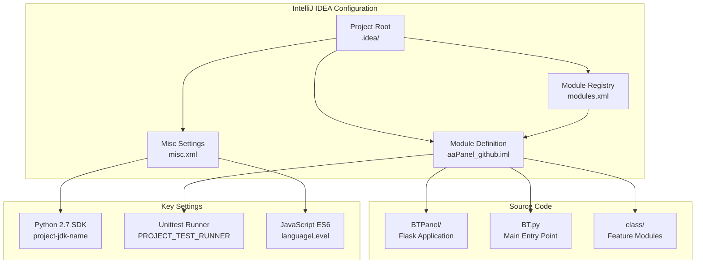
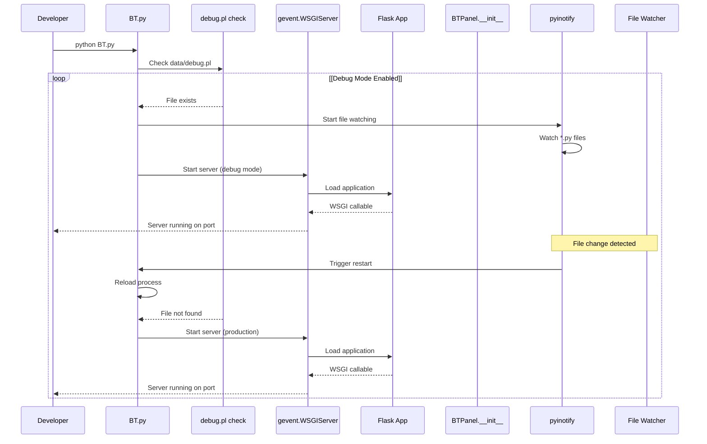
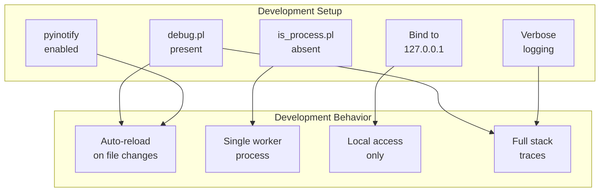
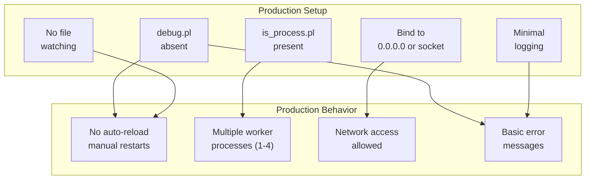

# Development Setup

> **Relevant source files**
> * [.idea/aaPanel_github.iml](https://github.com/aaPanel/aaPanel/blob/b6e4ab8b/.idea/aaPanel_github.iml)
> * [.idea/misc.xml](https://github.com/aaPanel/aaPanel/blob/b6e4ab8b/.idea/misc.xml)
> * [.idea/modules.xml](https://github.com/aaPanel/aaPanel/blob/b6e4ab8b/.idea/modules.xml)

## Purpose and Scope

This document provides guidance for setting up a development environment for aaPanel. It covers IDE configuration, Python environment setup, development mode operation, and development workflow. For detailed information about specific topics, see:

* [IntelliJ IDEA Configuration](/aaPanel/aaPanel/11.1-intellij-idea-configuration) for IDE-specific settings
* [Debug Mode](/aaPanel/aaPanel/11.2-debug-mode) for development mode features and automatic reload
* [Remote Deployment](/aaPanel/aaPanel/11.3-remote-deployment) for deploying to remote test servers

This guide assumes you are developing on a Linux system or have a Linux VM/container available, as aaPanel is designed for Linux server environments.

---

## Development Environment Requirements

### System Requirements

aaPanel requires a Linux environment with the following:

| Component | Requirement |
| --- | --- |
| Operating System | Linux (CentOS, Ubuntu, Debian supported) |
| Python Version | Python 2.7 (as configured in `.idea/misc.xml:6`) |
| Root Access | Required for system operations |
| Disk Space | Minimum 2GB for core files |
| RAM | Minimum 512MB (1GB+ recommended for development) |

### Python Environment

The project uses Python 2.7 with several key dependencies:

| Package | Purpose |
| --- | --- |
| Flask | Web application framework |
| gevent | Async networking and WSGI server |
| pyinotify | File system change monitoring (for debug mode) |
| psutil | System monitoring and process management |
| werkzeug | WSGI utilities and debugging |

**Sources:** [.idea/misc.xml L6](https://github.com/aaPanel/aaPanel/blob/b6e4ab8b/.idea/misc.xml#L6-L6)

---

## IDE Configuration Overview

The repository includes IntelliJ IDEA / PyCharm configuration in the `.idea/` directory. This configuration provides:

* Python SDK mapping to Python 2.7
* Project module structure
* JavaScript language level (ES6) for frontend code
* Unit test runner configuration

### IDE Project Structure



The module file `aaPanel_github.iml` defines the project structure with the project root as the content source. The test runner is configured for Python's built-in `Unittests` framework.

**Sources:** [.idea/aaPanel_github.iml L1-L11](https://github.com/aaPanel/aaPanel/blob/b6e4ab8b/.idea/aaPanel_github.iml#L1-L11)

 [.idea/misc.xml L1-L7](https://github.com/aaPanel/aaPanel/blob/b6e4ab8b/.idea/misc.xml#L1-L7)

 [.idea/modules.xml L1-L8](https://github.com/aaPanel/aaPanel/blob/b6e4ab8b/.idea/modules.xml#L1-L8)

For detailed IDE configuration, see [IntelliJ IDEA Configuration](/aaPanel/aaPanel/11.1-intellij-idea-configuration).

---

## Python Environment Setup

### Creating a Virtual Environment

While not required, using a virtual environment is recommended for development:

```

```

### Required Python Packages

Install the core dependencies:

```

```

Additional packages may be required depending on the features being developed. The main application imports these modules dynamically based on installed plugins and enabled features.

---

## Development Configuration Files

aaPanel uses `.pl` (plain text marker files) and JSON configuration files to control runtime behavior:

### Development Mode Files

| File | Purpose | Values |
| --- | --- | --- |
| `data/debug.pl` | Enable debug mode | Presence = enabled |
| `data/is_process.pl` | Multi-process mode | Presence = multi-process |
| `data/port.pl` | Panel HTTP port | Port number (default: 7800) |
| `data/admin_path.pl` | Custom admin path | URL path prefix |
| `data/ssl.pl` | SSL configuration | Presence = SSL enabled |

### Enabling Debug Mode

Debug mode enables automatic code reloading when files change:

```

```

When enabled, the main process uses `pyinotify` to watch for file changes and automatically restarts the application. For details, see [Debug Mode](/aaPanel/aaPanel/11.2-debug-mode).

### Single Process Mode for Development

For development, single-process mode is recommended for simpler debugging:

```

```

Single-process mode runs the Flask application with one worker, making it easier to use debuggers and trace execution.

**Sources:** See [Configuration Management](/aaPanel/aaPanel/9-configuration-management) and [Process Management](/aaPanel/aaPanel/7-process-management) for complete details.

---

## Development Workflow

### Starting the Development Server



### Starting the Panel

```

```

### Code Modification Workflow

1. **Edit Code**: Modify Python files in your IDE
2. **Automatic Reload**: If debug mode is enabled, changes are detected automatically
3. **Manual Restart**: Without debug mode, restart the process manually
4. **Test Changes**: Access the panel through the browser
5. **Check Logs**: Monitor `logs/error.log` and `logs/panel.log` for errors

**Sources:** See BT.py for main entry point logic, BTPanel/**init**.py for Flask application initialization

---

## Development vs Production Differences

### Development Mode Characteristics



### Production Mode Characteristics



| Aspect | Development | Production |
| --- | --- | --- |
| Process Mode | Single process | Multi-process (1-4 workers) |
| Auto-reload | Enabled (with debug mode) | Disabled |
| Binding | localhost only (recommended) | Network interface or Unix socket |
| Error Details | Full stack traces | Sanitized messages |
| File Watching | pyinotify active | No file watching |
| Performance | Lower (debug overhead) | Optimized |

**Sources:** See [Debug Mode](/aaPanel/aaPanel/11.2-debug-mode) for file watching details, [Process Management](/aaPanel/aaPanel/7-process-management) for worker scaling

---

## Testing Changes

### Manual Testing

1. **Access the Panel**: Navigate to `http://localhost:7800` (or configured port)
2. **Login**: Use the configured admin credentials
3. **Test Features**: Exercise the functionality you modified
4. **Check Logs**: Monitor error and access logs

### Unit Testing

The project is configured to use Python's `Unittests` framework:

```

```

The test runner configuration is defined in [.idea/aaPanel_github.iml L8-L10](https://github.com/aaPanel/aaPanel/blob/b6e4ab8b/.idea/aaPanel_github.iml#L8-L10)

### Log File Locations

| Log File | Purpose |
| --- | --- |
| `logs/panel.log` | General panel operations |
| `logs/error.log` | Error messages and exceptions |
| `logs/task.log` | Background task execution |
| `logs/panel.pid` | Main process PID |
| `logs/task.pid` | Task process PID |

---

## Development Tools Integration

### Code Editor Support

The `.idea/` directory configuration provides:

* **Syntax Highlighting**: Python and JavaScript syntax support
* **Code Completion**: Based on Python 2.7 SDK
* **Debugging**: Breakpoint support in PyCharm/IntelliJ IDEA
* **Version Control**: Git integration (if configured)

### Debugging

To use PyCharm's debugger:

1. **Disable debug mode**: Remove `data/debug.pl` (file watching interferes with breakpoints)
2. **Set breakpoints**: In your IDE, click in the gutter next to line numbers
3. **Run with debugger**: Right-click `BT.py` and select "Debug 'BT.py'"
4. **Step through code**: Use debugger controls to step through execution

### Remote Development

For developing on a remote server, use IDE deployment features to sync code. See [Remote Deployment](/aaPanel/aaPanel/11.3-remote-deployment) for configuration details.

**Sources:** [.idea/aaPanel_github.iml L1-L11](https://github.com/aaPanel/aaPanel/blob/b6e4ab8b/.idea/aaPanel_github.iml#L1-L11)

 [.idea/misc.xml L1-L7](https://github.com/aaPanel/aaPanel/blob/b6e4ab8b/.idea/misc.xml#L1-L7)

---

## Common Development Tasks

### Adding a New Feature Module

1. Create module file in `class/` directory
2. Define module class with methods
3. Register routes in `BTPanel/__init__.py` or use `publicObject` dispatcher
4. Add translations in `languages/` directories
5. Test module functionality
6. Update documentation

### Modifying Existing Features

1. Locate the feature module (see [Feature Modules](/aaPanel/aaPanel/5-feature-modules))
2. Modify the relevant class methods
3. Test changes with debug mode enabled
4. Check for security implications
5. Update translations if UI text changed

### Working with the Database

aaPanel stores configuration in SQLite databases and flat files:

* `data/default.db`: Main configuration database
* `data/system.db`: System information
* Various `.pl` files: Simple configuration flags

### Debugging Issues

1. **Enable Debug Mode**: Create `data/debug.pl`
2. **Check Error Logs**: Review `logs/error.log`
3. **Use Print Statements**: Add debug output (will appear in console)
4. **Test with Single Process**: Remove `data/is_process.pl`
5. **Isolate the Issue**: Disable plugins and features to narrow down the cause

**Sources:** See [Troubleshooting](/aaPanel/aaPanel/14-troubleshooting) for more debugging techniques

---

## Development Best Practices

### Code Organization

* **Follow module patterns**: Study existing modules in `class/` directory
* **Use `publicObject` dispatcher**: Leverage the security and routing infrastructure
* **Maintain backward compatibility**: Especially for API endpoints
* **Document changes**: Update comments and wiki pages

### Security Considerations

* **Test input validation**: Verify XSS and injection prevention
* **Check path traversal**: Ensure file operations stay within boundaries
* **Validate CSRF tokens**: Test with CSRF protection enabled
* **Review authentication**: Don't bypass security checks

See [Security and Input Validation](/aaPanel/aaPanel/3.2-security-and-input-validation) for security requirements.

### Performance Testing

* **Test in multi-process mode**: Ensure changes work with multiple workers
* **Monitor resource usage**: Check memory and CPU impact
* **Load test**: Use tools like `ab` or `wrk` for HTTP load testing
* **Profile slow code**: Use Python profilers to identify bottlenecks

---

## Next Steps

After setting up your development environment:

1. Review [Flask Application Core](/aaPanel/aaPanel/2.3-flask-application-core) to understand the application structure
2. Study [Module System and Routing](/aaPanel/aaPanel/4-module-system-and-routing) to learn the dispatch mechanism
3. Explore [Feature Modules](/aaPanel/aaPanel/5-feature-modules) to see implementation examples
4. Configure [Debug Mode](/aaPanel/aaPanel/11.2-debug-mode) for efficient development
5. Set up [Remote Deployment](/aaPanel/aaPanel/11.3-remote-deployment) if developing on a remote server

**Sources:** [.idea/aaPanel_github.iml L1-L11](https://github.com/aaPanel/aaPanel/blob/b6e4ab8b/.idea/aaPanel_github.iml#L1-L11)

 [.idea/misc.xml L1-L7](https://github.com/aaPanel/aaPanel/blob/b6e4ab8b/.idea/misc.xml#L1-L7)

 [.idea/modules.xml L1-L8](https://github.com/aaPanel/aaPanel/blob/b6e4ab8b/.idea/modules.xml#L1-L8)