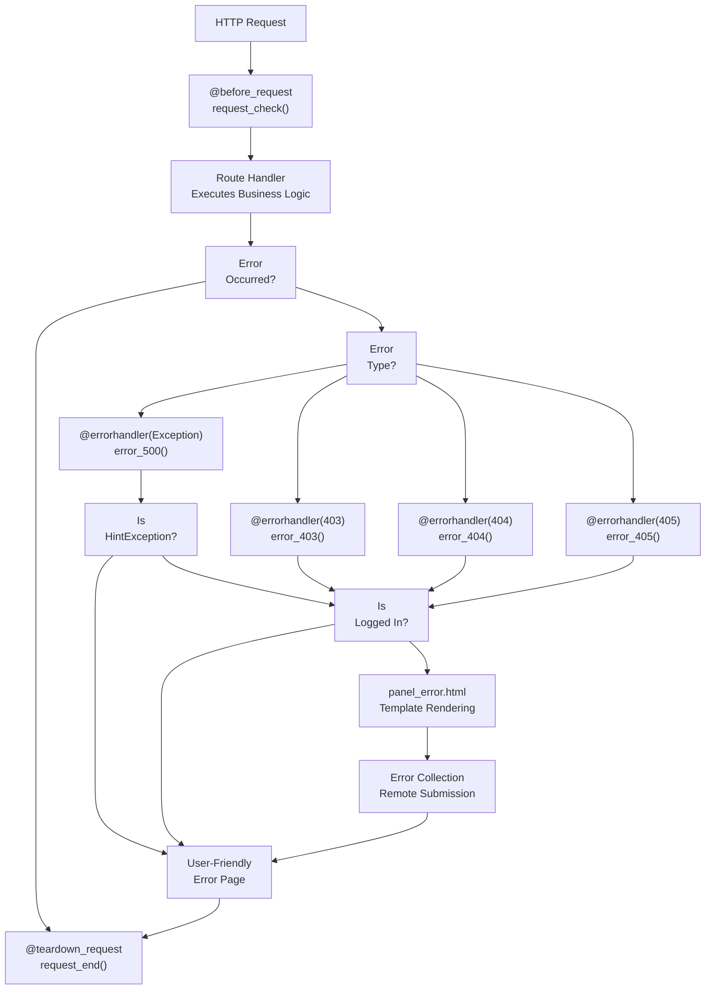
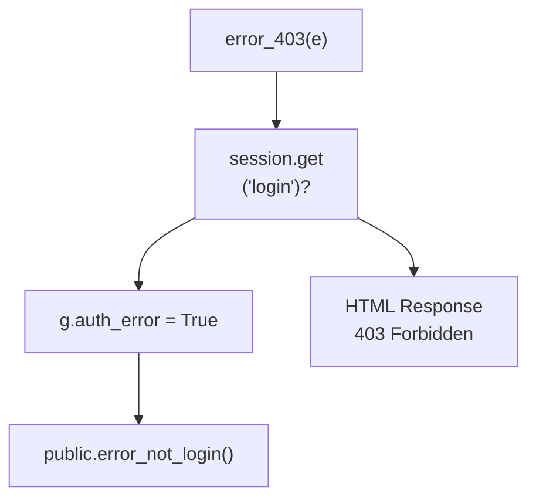
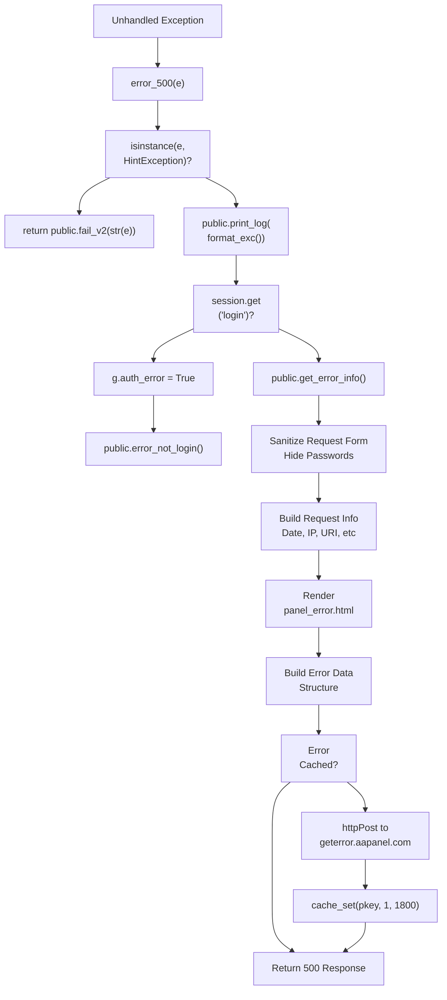
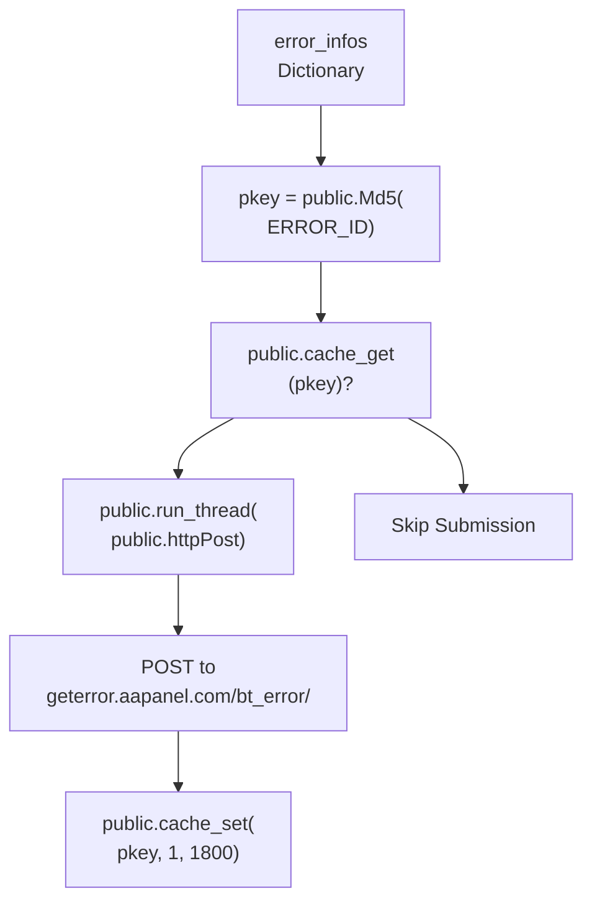
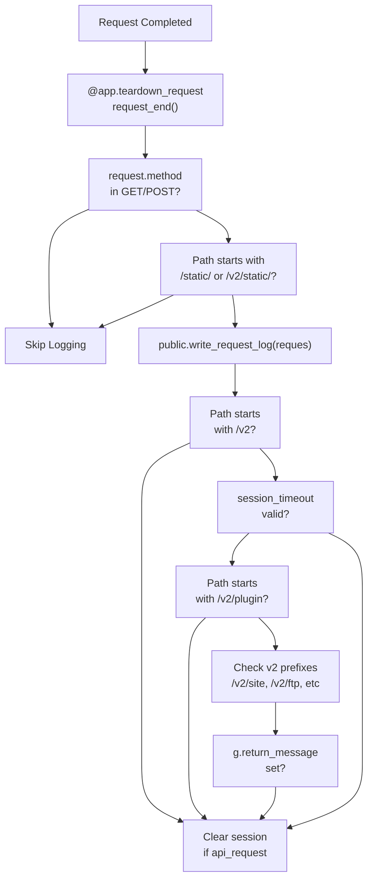
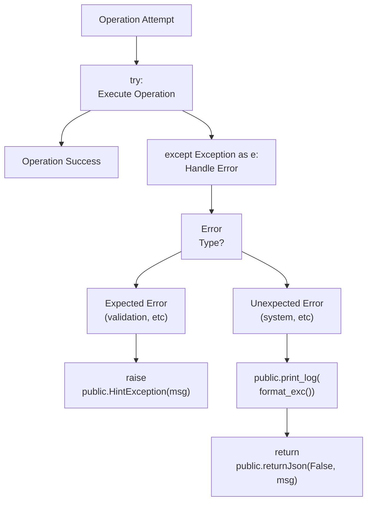

# Error Handling and Logging

> **Relevant source files**
> * [BTPanel/__init__.py](https://github.com/aaPanel/aaPanel/blob/b6e4ab8b/BTPanel/__init__.py)
> * [BTPanel/app.py](https://github.com/aaPanel/aaPanel/blob/b6e4ab8b/BTPanel/app.py)

This document covers the error handling and logging infrastructure in aaPanel, including HTTP error handlers, exception tracking, error collection/submission, request logging, and debugging facilities.

For authentication-related error handling, see [Authentication and Session Management](/aaPanel/aaPanel/3.1-authentication-and-session-management). For security validation that may trigger errors, see [Security and Input Validation](/aaPanel/aaPanel/3.2-security-and-input-validation). For development debugging tools, see [Debug Mode](/aaPanel/aaPanel/11.2-debug-mode).

---

## Overview

aaPanel implements a comprehensive error handling and logging system with the following components:

* **Flask Error Handlers**: Custom handlers for HTTP 403, 404, 405, and 500 errors
* **Exception Collection**: Automatic capture and remote submission of unhandled exceptions
* **Request Logging**: Recording of all panel requests via teardown hooks
* **Error Templates**: User-friendly error pages with detailed diagnostics
* **Sanitization**: Automatic redaction of sensitive information in error logs

The system balances user experience (friendly error pages), developer debugging (detailed stack traces), and security (sanitized error reports).

---

## Error Handler Architecture

### Error Handler Flow



**Sources:** [BTPanel/__init__.py L495-L654](https://github.com/aaPanel/aaPanel/blob/b6e4ab8b/BTPanel/__init__.py#L495-L654)

---

## HTTP Error Handlers

### 403 Forbidden Handler

Handles forbidden access attempts, typically from failed security checks or authentication failures.



**Implementation:**

* Function: `error_403(e)`
* Returns custom HTML with "403 Forbidden" message
* If not logged in, redirects to login via `public.error_not_login()`
* Sets `g.auth_error = True` flag for authentication errors

**Sources:** [BTPanel/__init__.py L532-L546](https://github.com/aaPanel/aaPanel/blob/b6e4ab8b/BTPanel/__init__.py#L532-L546)

---

### 404 Not Found Handler

Handles requests to non-existent routes or resources.

**Implementation:**

* Function: `error_404(e)`
* Returns custom HTML with "404 Not Found" message
* Checks login status before displaying error
* Uses mimicked nginx error format for consistency

**Sources:** [BTPanel/__init__.py L514-L528](https://github.com/aaPanel/aaPanel/blob/b6e4ab8b/BTPanel/__init__.py#L514-L528)

---

### 405 Method Not Allowed Handler

Handles invalid HTTP methods on valid routes.

**Implementation:**

* Function: `error_405(e)`
* Special message: "请求接口请使用统一响应函数" (Request interface should use unified response function)
* Indicates developer error - route should use `public.return_message()` pattern
* Enforces v2 API response standardization

**Sources:** [BTPanel/__init__.py L496-L510](https://github.com/aaPanel/aaPanel/blob/b6e4ab8b/BTPanel/__init__.py#L496-L510)

---

## Exception Handler and Error Collection

### Exception Handler Flow



**Sources:** [BTPanel/__init__.py L550-L653](https://github.com/aaPanel/aaPanel/blob/b6e4ab8b/BTPanel/__init__.py#L550-L653)

---

### HintException Special Handling

aaPanel uses a special `public.HintException` class for user-friendly error messages that should not trigger full error collection.

**Behavior:**

* Caught at the top of `error_500()`
* Returns immediately via `public.fail_v2(str(e))`
* No stack trace logging
* No remote error submission
* Used for expected validation failures or business logic errors

**Sources:** [BTPanel/__init__.py L553-L554](https://github.com/aaPanel/aaPanel/blob/b6e4ab8b/BTPanel/__init__.py#L553-L554)

---

### Error Information Structure

The error collection system builds a comprehensive data structure for remote submission:

| Field | Source | Purpose |
| --- | --- | --- |
| `REQUEST_DATE` | `public.getDate()` | Timestamp of error |
| `PANEL_VERSION` | `public.version()` | Panel version for debugging |
| `OS_VERSION` | `public.get_os_version()` | Operating system details |
| `REMOTE_ADDR` | `public.GetClientIp()` | Client IP address |
| `REQUEST_URI` | `request.method + request.full_path` | Full request path |
| `REQUEST_FORM` | Sanitized `request.form` | POST parameters (sanitized) |
| `USER_AGENT` | `request.headers.get('User-Agent')` | Browser/client info |
| `ERROR_INFO` | `public.get_error_info()` | Full stack trace |
| `PACK_TIME` | `config/update_time.pl` | Panel build timestamp |
| `TYPE` | `100` | Error type constant |
| `ERROR_ID` | `str(e)` | Unique error identifier |

**Sources:** [BTPanel/__init__.py L626-L642](https://github.com/aaPanel/aaPanel/blob/b6e4ab8b/BTPanel/__init__.py#L626-L642)

---

### Sensitive Data Sanitization

Before logging or submitting errors, the system sanitizes sensitive form fields:

```markdown
# Sanitized Fields
_form = request.form.to_dict()
if 'username' in _form: _form['username'] = '******'
if 'password' in _form: _form['password'] = '******'
if 'phone' in _form: _form['phone'] = '******'
if 'pem' in _form: _form['pem'] = '******'
if 'pwd' in _form: _form['pwd'] = '******'
if 'key' in _form: _form['key'] = '******'
if 'csr' in _form: _form['csr'] = '******'
if 'db_user' in _form: _form['db_user'] = '******'
if 'db_password' in _form: _form['db_pwd'] = '******'
```

**Sources:** [BTPanel/__init__.py L576-L584](https://github.com/aaPanel/aaPanel/blob/b6e4ab8b/BTPanel/__init__.py#L576-L584)

---

### Remote Error Submission

Error reports are submitted to aaPanel's error collection service with caching to prevent duplicates:



**Caching Strategy:**

* Cache key: MD5 hash of `ERROR_ID`
* Cache duration: 1800 seconds (30 minutes)
* Prevents duplicate error submissions
* Thread-based submission to avoid blocking user response

**Sources:** [BTPanel/__init__.py L643-L651](https://github.com/aaPanel/aaPanel/blob/b6e4ab8b/BTPanel/__init__.py#L643-L651)

---

## Request Logging System

### Teardown Request Hook

All requests are logged via the `@app.teardown_request` hook, which executes after every request regardless of success or failure.



**Implementation Details:**

* Executes for all GET/POST requests
* Skips static file requests
* Calls `public.write_request_log(reques)` for actual logging
* Validates v2 API routes use unified response pattern
* Clears session for API-only requests

**Sources:** [BTPanel/__init__.py L460-L493](https://github.com/aaPanel/aaPanel/blob/b6e4ab8b/BTPanel/__init__.py#L460-L493)

---

### Request Log Structure

The `public.write_request_log()` function (defined in the `public` module) records:

* Request timestamp via `g.request_time` set in `@before_request`
* Client IP and port
* Request method and URI
* Response status
* Request duration (calculated from `g.request_time`)
* User session information

**Integration Points:**

* `g.request_time` set in `request_check()` at line 304
* Log writing occurs in `request_end()` at line 465
* Special handling for file download logging at line 1706

**Sources:** [BTPanel/__init__.py L304](https://github.com/aaPanel/aaPanel/blob/b6e4ab8b/BTPanel/__init__.py#L304-L304)

 [BTPanel/__init__.py L465](https://github.com/aaPanel/aaPanel/blob/b6e4ab8b/BTPanel/__init__.py#L465-L465)

 [BTPanel/__init__.py L1706](https://github.com/aaPanel/aaPanel/blob/b6e4ab8b/BTPanel/__init__.py#L1706-L1706)

---

## Error Templates

### Panel Error Template

The main error template provides detailed diagnostics for logged-in users:

```python
panel_error.html Template Structure:
├── Error Title (extracted from exception)
├── Request Information Section
│   ├── Request Date/Time
│   ├── Panel Version
│   ├── OS Version
│   ├── Remote Address
│   ├── Request URI (sanitized)
│   ├── Request Form (sanitized)
│   └── User Agent (sanitized)
└── Error Message Section
    └── Full Stack Trace
```

**Template Rendering:**

```
result = public.readFile(
    public.get_panel_path() + '/BTPanel/templates/default/panel_error.html'
).format(
    error_title=error_title,
    request_info=request_info,
    error_msg=error_info
)
```

**Features:**

* XSS protection via `public.xsssec()` on all user input
* Formatted request information display
* Complete stack trace for debugging
* Consistent styling with panel theme

**Sources:** [BTPanel/__init__.py L605-L610](https://github.com/aaPanel/aaPanel/blob/b6e4ab8b/BTPanel/__init__.py#L605-L610)

---

### Simple Error Templates

For HTTP errors (403, 404, 405), simple HTML templates are returned inline:

```html
<html>
<head><title>404 Not Found</title></head>
<body>
<center><h1>404 Not Found</h1></center>
<hr><center>nginx</center>
</body>
</html>
```

**Design Rationale:**

* Mimics nginx default error pages
* Provides minimal information to unauthenticated users
* Prevents information disclosure
* Consistent with security best practices

**Sources:** [BTPanel/__init__.py L520-L526](https://github.com/aaPanel/aaPanel/blob/b6e4ab8b/BTPanel/__init__.py#L520-L526)

 [BTPanel/__init__.py L538-L544](https://github.com/aaPanel/aaPanel/blob/b6e4ab8b/BTPanel/__init__.py#L538-L544)

 [BTPanel/__init__.py L502-L508](https://github.com/aaPanel/aaPanel/blob/b6e4ab8b/BTPanel/__init__.py#L502-L508)

---

## Logging Functions Reference

### Core Logging Functions

| Function | Module | Purpose |
| --- | --- | --- |
| `public.write_request_log()` | `public` | Writes request logs to disk |
| `public.WriteLog()` | `public` | General-purpose log writer |
| `public.write_log_gettext()` | `public` | Localized log messages |
| `public.print_log()` | `public` | Debug output (console) |
| `public.get_error_info()` | `public` | Extracts formatted stack trace |

---

### Specialized Logging

**File Download Logging:**

```
public.WriteLog("TYPE_FILE", 'FILE_DOWNLOAD', 
                (filename, public.GetClientIp()))
```

Tracks file downloads with filename and client IP.

**Sources:** [BTPanel/__init__.py L1706-L1707](https://github.com/aaPanel/aaPanel/blob/b6e4ab8b/BTPanel/__init__.py#L1706-L1707)

---

**User Logout Logging:**

```
public.write_log_gettext('Logout', 
    'Client: {}, has manually exited the panel',
    (public.GetClientIp() + ":" + str(request.environ.get('REMOTE_PORT')),))
```

Records logout events with client information.

**Sources:** [BTPanel/__init__.py L1946-L1949](https://github.com/aaPanel/aaPanel/blob/b6e4ab8b/BTPanel/__init__.py#L1946-L1949)

---

## Error Collection Configuration

### Configuration File

Error collection can be configured via panel settings:

| Setting | Location | Default | Description |
| --- | --- | --- | --- |
| Error Collection | Panel Settings UI | Enabled | Enable/disable remote error submission |
| Cache Duration | Hardcoded | 1800s | Time to cache error reports |
| Submission Endpoint | Hardcoded | `geterror.aapanel.com` | Remote error collection server |

---

### Opt-Out Mechanism

Users can disable error collection through the panel settings interface. When disabled:

* Stack traces still logged locally
* Error templates still displayed
* Remote submission skipped
* Local debugging unaffected

**Sources:** [BTPanel/__init__.py L646-L651](https://github.com/aaPanel/aaPanel/blob/b6e4ab8b/BTPanel/__init__.py#L646-L651)

---

## Debug Mode Integration

When debug mode is enabled (see [Debug Mode](/aaPanel/aaPanel/11.2-debug-mode)):

**Changes to Error Handling:**

* CSRF checks may be relaxed
* More verbose error output
* Additional console logging via `public.print_log()`
* File watching for auto-reload enabled

**Debug Mode Detection:**

```
app.config['DEBUG'] = os.path.exists('data/debug.pl')
```

**Sources:** [BTPanel/__init__.py L67](https://github.com/aaPanel/aaPanel/blob/b6e4ab8b/BTPanel/__init__.py#L67-L67)

 [BTPanel/app.py L90](https://github.com/aaPanel/aaPanel/blob/b6e4ab8b/BTPanel/app.py#L90-L90)

---

## Error Handling Best Practices

### For Module Developers

1. **Use HintException for User Errors:** ``` raise public.HintException("User-friendly error message") ``` Prevents full error collection for expected failures.
2. **Sanitize Sensitive Data:** Always scrub passwords, keys, and tokens before logging.
3. **Use Unified Response Pattern:** V2 API routes should use `public.return_message()` to avoid 405 errors.
4. **Add Context to Exceptions:** Include relevant state information in exception messages for debugging.

---

### Error Recovery Patterns



**Sources:** Analysis of error handling patterns in [BTPanel/__init__.py](https://github.com/aaPanel/aaPanel/blob/b6e4ab8b/BTPanel/__init__.py)

---

## Related Error Handling Components

### Plugin Error Handling

Plugins have special error handling via `PluginLoader.plugin_run()`:

* Plugin load failures caught and displayed
* Special handling for `btwaf` plugin errors
* Template-based error responses

**Sources:** [BTPanel/__init__.py L2473-L2487](https://github.com/aaPanel/aaPanel/blob/b6e4ab8b/BTPanel/__init__.py#L2473-L2487)

---

### API Error Responses

The codebase uses standardized error response formats:

**V1 API (Legacy):**

```
return public.returnJson(False, "Error message"), json_header
```

**V2 API (Modern):**

```
return public.return_message(False, 0, "Error message")
```

---

## Troubleshooting

### Common Issues

**Error: "CSRF calibration failed"**

* Cause: CSRF token mismatch or expired session
* Solution: Clear browser cookies and log in again
* Related: See [CSRF Protection](/aaPanel/aaPanel/3.3-csrf-protection)

**Error: "请求接口请使用统一响应函数" (405)**

* Cause: V2 API route not using unified response pattern
* Solution: Update route to use `public.return_message()`
* Developer issue, not user issue

**Errors not appearing in logs**

* Check if error collection is disabled in settings
* Verify `logs/` directory permissions
* Check if error was cached (30-minute window)

---

## Summary

aaPanel's error handling and logging system provides:

| Component | Purpose | Key Files |
| --- | --- | --- |
| Flask Error Handlers | HTTP error responses | [BTPanel/__init__.py L495-L546](https://github.com/aaPanel/aaPanel/blob/b6e4ab8b/BTPanel/__init__.py#L495-L546) |
| Exception Handler | Unhandled exception capture | [BTPanel/__init__.py L550-L653](https://github.com/aaPanel/aaPanel/blob/b6e4ab8b/BTPanel/__init__.py#L550-L653) |
| Error Collection | Remote error submission | [BTPanel/__init__.py L626-L651](https://github.com/aaPanel/aaPanel/blob/b6e4ab8b/BTPanel/__init__.py#L626-L651) |
| Request Logging | Access log recording | [BTPanel/__init__.py L460-L465](https://github.com/aaPanel/aaPanel/blob/b6e4ab8b/BTPanel/__init__.py#L460-L465) |
| Error Templates | User-friendly error display | `templates/default/panel_error.html` |

The system balances security (sanitization), usability (friendly errors), and debuggability (detailed traces) to support both users and developers effectively.