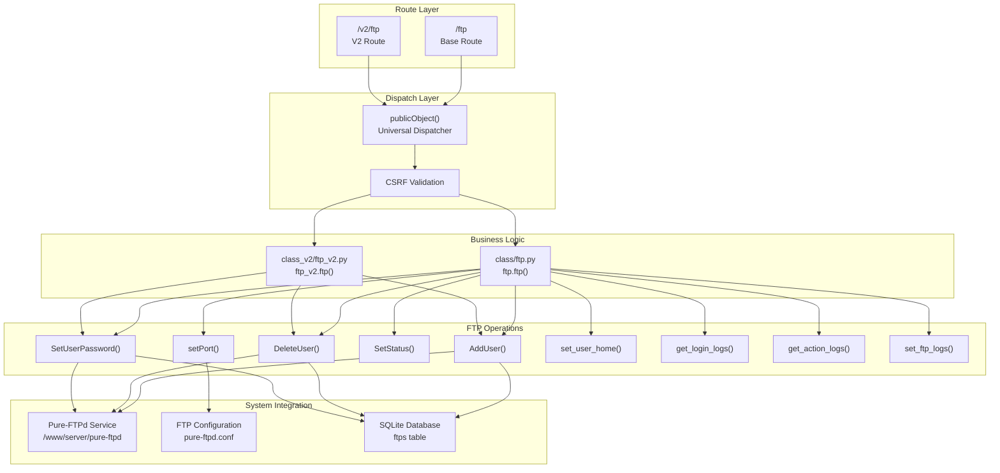
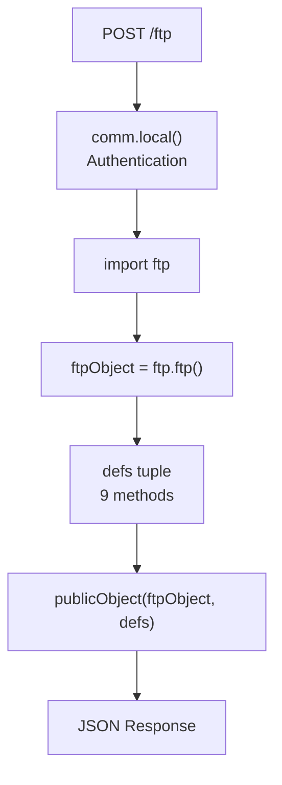
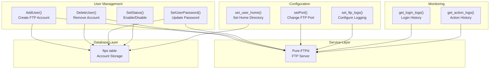
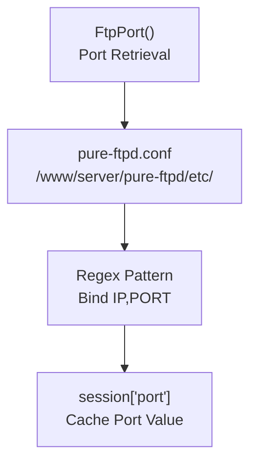
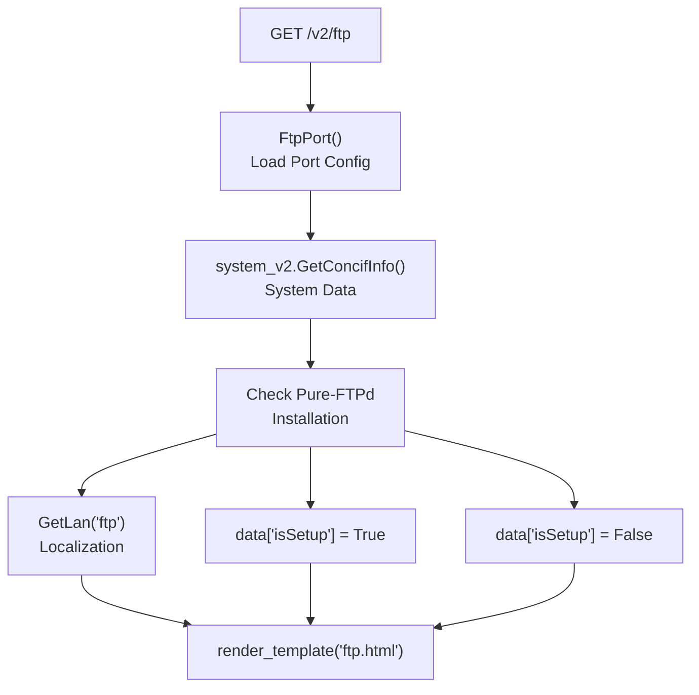
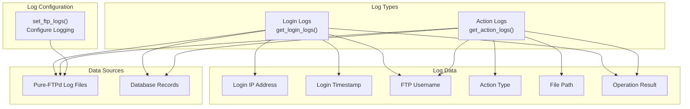
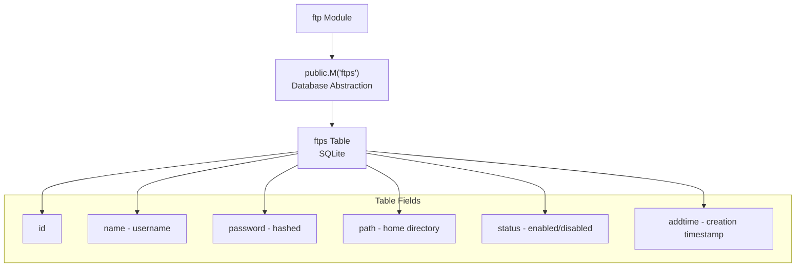
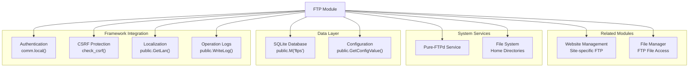

# FTP Management

> **Relevant source files**
> * [BTPanel/__init__.py](https://github.com/aaPanel/aaPanel/blob/b6e4ab8b/BTPanel/__init__.py)

## Purpose and Scope

The FTP Management module provides a web-based interface for managing FTP accounts and permissions in aaPanel. This module handles FTP user creation, deletion, password management, home directory configuration, and activity logging. It interfaces with the Pure-FTPd service to provide secure FTP access to server resources.

For website-specific FTP access configuration, see [Website Management](/aaPanel/aaPanel/5.1-website-management). For file operations and management, see the Files module documentation.

## Architecture Overview

The FTP management system follows aaPanel's standard module architecture with dual API versions and a clear separation between routing, business logic, and system configuration.



**Sources:** [BTPanel/__init__.py L979-L989](https://github.com/aaPanel/aaPanel/blob/b6e4ab8b/BTPanel/__init__.py#L979-L989)

 [BTPanel/__init__.py L3798-L3819](https://github.com/aaPanel/aaPanel/blob/b6e4ab8b/BTPanel/__init__.py#L3798-L3819)

 [BTPanel/__init__.py L2762-L2774](https://github.com/aaPanel/aaPanel/blob/b6e4ab8b/BTPanel/__init__.py#L2762-L2774)

## Route Handlers

The FTP module is accessible through two primary routes that follow aaPanel's dual API architecture:

### Base Route (V1)



The base route handler is defined at [BTPanel/__init__.py L979-L989](https://github.com/aaPanel/aaPanel/blob/b6e4ab8b/BTPanel/__init__.py#L979-L989)

:

* **Route:** `/ftp`
* **Method:** POST only
* **Authentication:** Required via `comm.local()`
* **Module:** `class/ftp.py`

### V2 Route

The V2 route handler is defined at [BTPanel/__init__.py L3798-L3819](https://github.com/aaPanel/aaPanel/blob/b6e4ab8b/BTPanel/__init__.py#L3798-L3819)

:

* **Route:** `/v2/ftp`
* **Methods:** GET (for page rendering) and POST (for operations)
* **Authentication:** Required via `comm.local()`
* **Module:** `class_v2/ftp_v2.py`

The V2 route includes template rendering logic when accessed via GET:

* Calls `FtpPort()` to retrieve FTP port configuration
* Checks if Pure-FTPd is installed at setup path
* Renders `ftp.html` template with system configuration data

**Sources:** [BTPanel/__init__.py L979-L989](https://github.com/aaPanel/aaPanel/blob/b6e4ab8b/BTPanel/__init__.py#L979-L989)

 [BTPanel/__init__.py L3798-L3819](https://github.com/aaPanel/aaPanel/blob/b6e4ab8b/BTPanel/__init__.py#L3798-L3819)

 [BTPanel/__init__.py L767-L776](https://github.com/aaPanel/aaPanel/blob/b6e4ab8b/BTPanel/__init__.py#L767-L776)

## FTP Module Operations

Both FTP module versions expose the same set of operations through the `publicObject` dispatcher pattern:

| Operation | Purpose | Parameters |
| --- | --- | --- |
| `AddUser` | Create new FTP account | username, password, path, permissions |
| `DeleteUser` | Remove FTP account | username |
| `SetUserPassword` | Change user password | username, new password |
| `SetStatus` | Enable/disable account | username, status |
| `setPort` | Configure FTP port | port number |
| `set_user_home` | Modify home directory | username, path |
| `get_login_logs` | Retrieve login history | filters, pagination |
| `get_action_logs` | Retrieve action history | filters, pagination |
| `set_ftp_logs` | Configure logging | log settings |



**Sources:** [BTPanel/__init__.py L986-L988](https://github.com/aaPanel/aaPanel/blob/b6e4ab8b/BTPanel/__init__.py#L986-L988)

 [BTPanel/__init__.py L3816-L3818](https://github.com/aaPanel/aaPanel/blob/b6e4ab8b/BTPanel/__init__.py#L3816-L3818)

## Request Processing Flow

The FTP module follows aaPanel's standard request processing pipeline with security enforcement at multiple layers:

```mermaid
sequenceDiagram
  participant Client
  participant /ftp Route
  participant comm.local()
  participant publicObject()
  participant check_csrf()
  participant ftp.ftp()
  participant Pure-FTPd
  participant SQLite DB

  Client->>/ftp Route: POST /ftp?action=AddUser
  /ftp Route->>comm.local(): Verify authentication
  loop [CSRF invalid]
    comm.local()-->>Client: Redirect to login
    comm.local()->>/ftp Route: Continue
    /ftp Route->>publicObject(): Dispatch request
    publicObject()->>check_csrf(): Validate CSRF token
    check_csrf()-->>Client: CSRF_ERR
    check_csrf()->>publicObject(): Continue
    publicObject()->>ftp.ftp(): ftpObject.AddUser(get)
    ftp.ftp()->>SQLite DB: Insert FTP account
    ftp.ftp()->>Pure-FTPd: Create system user
    Pure-FTPd-->>ftp.ftp(): Success
    ftp.ftp()-->>publicObject(): Operation result
    publicObject()-->>Client: JSON response
  end
```

### Security Validation

The FTP module benefits from multiple security layers enforced by the framework:

1. **Authentication Check** - `comm.local()` verifies user is logged in [BTPanel/__init__.py L982](https://github.com/aaPanel/aaPanel/blob/b6e4ab8b/BTPanel/__init__.py#L982-L982)
2. **CSRF Protection** - Token validation via `check_csrf()` [BTPanel/__init__.py L2688-L2694](https://github.com/aaPanel/aaPanel/blob/b6e4ab8b/BTPanel/__init__.py#L2688-L2694)
3. **Input Sanitization** - Path validation in `publicObject()` [BTPanel/__init__.py L2708-L2723](https://github.com/aaPanel/aaPanel/blob/b6e4ab8b/BTPanel/__init__.py#L2708-L2723)
4. **Site Path Check** - Prevents directory traversal [BTPanel/__init__.py L2725-L2728](https://github.com/aaPanel/aaPanel/blob/b6e4ab8b/BTPanel/__init__.py#L2725-L2728)

**Sources:** [BTPanel/__init__.py L979-L989](https://github.com/aaPanel/aaPanel/blob/b6e4ab8b/BTPanel/__init__.py#L979-L989)

 [BTPanel/__init__.py L2697-L2731](https://github.com/aaPanel/aaPanel/blob/b6e4ab8b/BTPanel/__init__.py#L2697-L2731)

 [BTPanel/__init__.py L2688-L2694](https://github.com/aaPanel/aaPanel/blob/b6e4ab8b/BTPanel/__init__.py#L2688-L2694)

## Port Configuration

The FTP port is managed through the Pure-FTPd configuration file and retrieved via the `FtpPort()` function:



The `FtpPort()` function [BTPanel/__init__.py L2762-L2774](https://github.com/aaPanel/aaPanel/blob/b6e4ab8b/BTPanel/__init__.py#L2762-L2774)

:

* Reads from `/www/server/pure-ftpd/etc/pure-ftpd.conf`
* Uses regex pattern `\n#?\s*Bind\s+[0-9]+\.[0-9]+\.[0-9]+\.+[0-9]+,([0-9]+)` to extract port
* Defaults to port `21` if not found
* Caches result in `session['port']` for performance

**Sources:** [BTPanel/__init__.py L2762-L2774](https://github.com/aaPanel/aaPanel/blob/b6e4ab8b/BTPanel/__init__.py#L2762-L2774)

## Page Rendering

When accessed via GET, the V2 FTP route renders the management interface:



The page rendering logic [BTPanel/__init__.py L3803-L3813](https://github.com/aaPanel/aaPanel/blob/b6e4ab8b/BTPanel/__init__.py#L3803-L3813)

:

* Invokes `FtpPort()` to populate session with port configuration
* Calls `system_v2.system().GetConcifInfo()` for system metadata
* Checks for Pure-FTPd installation at `{setup_path}/pure-ftpd`
* Sets `data['isSetup']` flag based on installation status
* Loads localization strings via `public.GetLan('ftp')`
* Includes `js_random` for cache busting
* Renders `ftp.html` template with compiled data dictionary

**Sources:** [BTPanel/__init__.py L3803-L3813](https://github.com/aaPanel/aaPanel/blob/b6e4ab8b/BTPanel/__init__.py#L3803-L3813)

 [BTPanel/__init__.py L767-L776](https://github.com/aaPanel/aaPanel/blob/b6e4ab8b/BTPanel/__init__.py#L767-L776)

## Logging System

The FTP module provides comprehensive logging capabilities for security auditing and troubleshooting:



### Log Operations

1. **`get_login_logs()`** - Retrieves FTP login attempts and authentication history
2. **`get_action_logs()`** - Retrieves file operation logs (upload, download, delete, etc.)
3. **`set_ftp_logs()`** - Configures logging verbosity and retention policies

**Sources:** [BTPanel/__init__.py L986-L988](https://github.com/aaPanel/aaPanel/blob/b6e4ab8b/BTPanel/__init__.py#L986-L988)

 [BTPanel/__init__.py L3816-L3818](https://github.com/aaPanel/aaPanel/blob/b6e4ab8b/BTPanel/__init__.py#L3816-L3818)

## Database Integration

The FTP module stores account information in the SQLite database using the `ftps` table through aaPanel's database abstraction layer:



Database operations use the standard `public.M()` interface which provides:

* Automatic SQL injection prevention
* Query building methods (`where()`, `select()`, `insert()`, etc.)
* Transaction support
* Connection pooling

Example count query from homepage: `public.M('ftps').count()` [BTPanel/__init__.py L691](https://github.com/aaPanel/aaPanel/blob/b6e4ab8b/BTPanel/__init__.py#L691-L691)

**Sources:** [BTPanel/__init__.py L691](https://github.com/aaPanel/aaPanel/blob/b6e4ab8b/BTPanel/__init__.py#L691-L691)

 [BTPanel/__init__.py L3512](https://github.com/aaPanel/aaPanel/blob/b6e4ab8b/BTPanel/__init__.py#L3512-L3512)

## Module Initialization

The FTP module follows a consistent initialization pattern across both API versions:

```javascript
# V1 Initialization
import ftp
ftpObject = ftp.ftp()
defs = ('AddUser', 'DeleteUser', 'SetUserPassword', 'SetStatus', 'setPort',
        'set_user_home', 'get_login_logs', 'get_action_logs', 'set_ftp_logs')
return publicObject(ftpObject, defs, None, pdata)

# V2 Initialization  
import ftp_v2
ftpObject = ftp_v2.ftp()
defs = ('AddUser', 'DeleteUser', 'SetUserPassword', 'SetStatus', 'setPort',
        'set_user_home', 'get_login_logs', 'get_action_logs', 'set_ftp_logs')
return publicObject(ftpObject, defs, None, pdata)
```

The `publicObject()` dispatcher [BTPanel/__init__.py L2697-L2731](https://github.com/aaPanel/aaPanel/blob/b6e4ab8b/BTPanel/__init__.py#L2697-L2731)

:

* Validates the requested action is in the allowed `defs` tuple
* Performs CSRF validation if required
* Sanitizes input parameters (path, filename, etc.)
* Executes the specified method via `getattr()`
* Returns JSON-encoded response

**Sources:** [BTPanel/__init__.py L979-L989](https://github.com/aaPanel/aaPanel/blob/b6e4ab8b/BTPanel/__init__.py#L979-L989)

 [BTPanel/__init__.py L3798-L3819](https://github.com/aaPanel/aaPanel/blob/b6e4ab8b/BTPanel/__init__.py#L3798-L3819)

 [BTPanel/__init__.py L2697-L2731](https://github.com/aaPanel/aaPanel/blob/b6e4ab8b/BTPanel/__init__.py#L2697-L2731)

## Integration Points

The FTP module integrates with several other aaPanel subsystems:



Key integration points:

* **Authentication:** Uses session-based authentication managed by the authentication system
* **CSRF Protection:** Enforced by the request pipeline before method execution
* **Localization:** UI strings loaded via `public.GetLan('ftp')`
* **Logging:** Operations logged via `public.WriteLog()` for audit trail
* **Configuration:** Pure-FTPd path retrieved via `public.GetConfigValue('setup_path')`
* **Database:** Account data persisted in `ftps` table via `public.M()` abstraction

**Sources:** [BTPanel/__init__.py L979-L989](https://github.com/aaPanel/aaPanel/blob/b6e4ab8b/BTPanel/__init__.py#L979-L989)

 [BTPanel/__init__.py L3798-L3819](https://github.com/aaPanel/aaPanel/blob/b6e4ab8b/BTPanel/__init__.py#L3798-L3819)

 [BTPanel/__init__.py L2762-L2774](https://github.com/aaPanel/aaPanel/blob/b6e4ab8b/BTPanel/__init__.py#L2762-L2774)

 [BTPanel/__init__.py L767-L776](https://github.com/aaPanel/aaPanel/blob/b6e4ab8b/BTPanel/__init__.py#L767-L776)