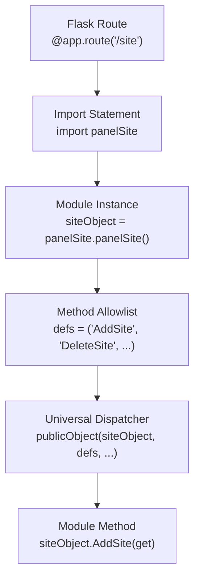
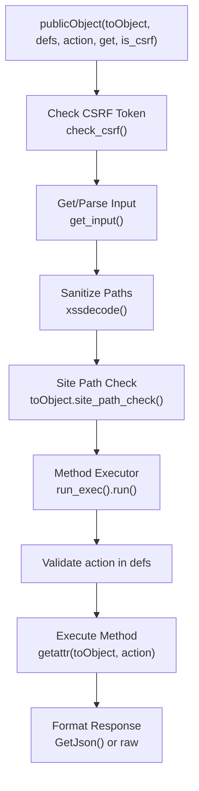
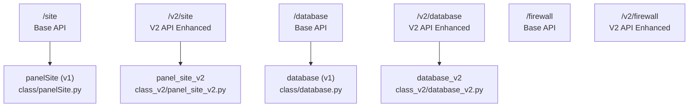
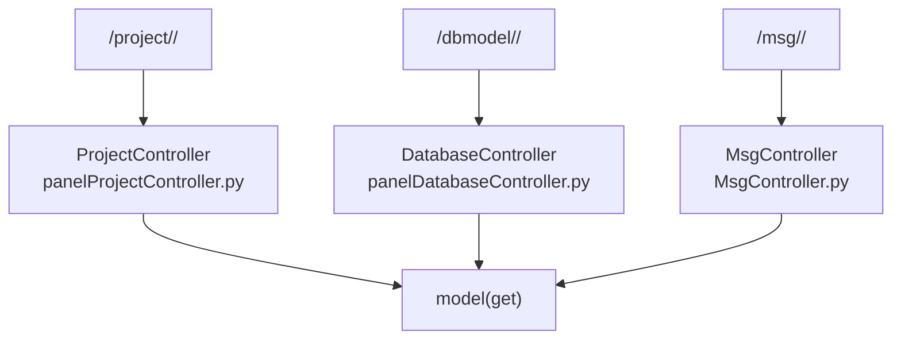
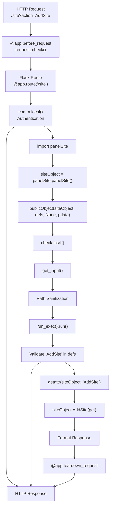

# Feature Modules

> **Relevant source files**
> * [BTPanel/__init__.py](https://github.com/aaPanel/aaPanel/blob/b6e4ab8b/BTPanel/__init__.py)

This document describes the feature module system in aaPanel, which provides the core functionality of the control panel through independently developed, domain-focused modules. Each module handles a specific aspect of server management (websites, FTP, databases, firewall, etc.) and exposes its functionality through the Flask routing system.

For information about how modules are dispatched and routed, see [Module System and Routing](/aaPanel/aaPanel/4-module-system-and-routing). For details on specific modules like website management or the plugin system, see their dedicated sections ([5.1](/aaPanel/aaPanel/5.1-website-management)-[5.5](/aaPanel/aaPanel/5.5-plugin-system)).

## Module Architecture Overview

The aaPanel feature module system follows a consistent pattern where Flask routes act as entry points that delegate to Python class modules. Each module is responsible for a specific domain and maintains independence from other modules.

### Module Structure Pattern



**Sources:** [BTPanel/__init__.py L855-L976](https://github.com/aaPanel/aaPanel/blob/b6e4ab8b/BTPanel/__init__.py#L855-L976)

### Request Flow Through Modules

When a request arrives at a feature module endpoint, it follows this lifecycle:

```mermaid
sequenceDiagram
  participant Client
  participant Flask Route Handler
  participant comm.local()
  participant Feature Module Object
  participant publicObject()
  participant Module Method

  Client->>Flask Route Handler: POST /site?action=AddSite
  Flask Route Handler->>comm.local(): Check authentication
  comm.local()-->>Flask Route Handler: Authentication result
  loop [Not authenticated]
    Flask Route Handler-->>Client: Redirect/Error
    Flask Route Handler->>Feature Module Object: Import & instantiate module
    Flask Route Handler->>publicObject(): publicObject(module, defs, get)
    publicObject()->>publicObject(): Validate action in defs
    publicObject()->>publicObject(): Check CSRF token
    publicObject()->>publicObject(): Sanitize input (path, filename)
    publicObject()->>Module Method: Execute module.action(get)
    Module Method-->>publicObject(): Return result
    publicObject()-->>Flask Route Handler: Format response (JSON/HTML)
    Flask Route Handler-->>Client: HTTP Response
  end
```

**Sources:** [BTPanel/__init__.py L2697-L2731](https://github.com/aaPanel/aaPanel/blob/b6e4ab8b/BTPanel/__init__.py#L2697-L2731)

 [BTPanel/__init__.py L264-L456](https://github.com/aaPanel/aaPanel/blob/b6e4ab8b/BTPanel/__init__.py#L264-L456)

## Core Feature Modules

The following table lists all primary feature modules available in aaPanel, organized by functional category:

| Category | Module Name | Route | Class File | Purpose |
| --- | --- | --- | --- | --- |
| **Website Management** | panelSite | `/site` | `class/panelSite.py` | Virtual host creation, domain management, SSL configuration |
| **FTP Services** | ftp | `/ftp` | `class/ftp.py` | FTP user management, permissions, logging |
| **Database** | database | `/database` | `class/database.py` | MySQL/MariaDB database and user management |
| **Firewall** | firewalls | `/firewall` | `class/firewalls.py` | Port rules, IP blocking, SSH configuration |
| **File Management** | files | `/files` | `class/files.py` | File operations, directory browsing, compression |
| **Scheduled Tasks** | crontab | `/crontab` | `class/crontab.py` | Cron job management, backup scheduling |
| **System Operations** | system | `/system` | `class/system.py` | System status, service management, resource monitoring |
| **Panel Configuration** | config | `/config` | `class/config.py` | Panel settings, security options, session management |
| **Plugin System** | panelPlugin | `/plugin` | `class/panelPlugin.py` | Plugin installation, updates, management |
| **SSL Certificates** | acme_v2 | `/acme` | `class/acme_v2.py` | Let's Encrypt certificate automation |
| **Commercial SSL** | panelSSL | `/ssl` | `class/panelSSL.py` | Commercial SSL certificate purchases and management |
| **Task Queue** | panelTask | `/task` | `class/panelTask.py` | Background task monitoring and logs |
| **Authentication** | panelAuth | `/auth` | `class/panelAuth.py` | License validation, product authorization |
| **Terminal Access** | ssh_terminal | `/xterm` | `class/ssh_terminal.py` | SSH host management, remote terminal access |
| **System AJAX** | ajax | `/ajax` | `class/ajax.py` | System service status, PHP info, quick operations |
| **Data Access** | data | `/data`, `/panel_data` | `class/data.py` | Generic database CRUD operations |

**Sources:** [BTPanel/__init__.py L855-L1575](https://github.com/aaPanel/aaPanel/blob/b6e4ab8b/BTPanel/__init__.py#L855-L1575)

## Module Registration Map

The following diagram shows how feature modules are registered and their relationships:

```mermaid
flowchart TD

Site["panelSite<br>Website Management"]
Files["files<br>File Operations"]
DB["database<br>Database Mgmt"]
Data["data<br>Data Access"]
FTP["ftp<br>FTP Server"]
FW["firewalls<br>Firewall Rules"]
SSH["ssh_terminal<br>Terminal Access"]
System["system<br>System Status"]
Ajax["ajax<br>Service Status"]
Cron["crontab<br>Scheduled Tasks"]
Acme["acme_v2<br>Let's Encrypt"]
SSL["panelSSL<br>Commercial SSL"]
Auth["panelAuth<br>Authorization"]
Config["config<br>Panel Settings"]
Plugin["panelPlugin<br>Plugin Loader"]
Task["panelTask<br>Task Queue"]
Flask["Flask Application<br>BTPanel/init.py"]

Flask --> Site
Flask --> Files
Flask --> DB
Flask --> Data
Flask --> FTP
Flask --> FW
Flask --> SSH
Flask --> System
Flask --> Ajax
Flask --> Cron
Flask --> Acme
Flask --> SSL
Flask --> Auth
Flask --> Config
Flask --> Plugin
Flask --> Task

subgraph subGraph5 ["Panel Core"]
    Config
    Plugin
    Task
end

subgraph subGraph4 ["Security & SSL"]
    Acme
    SSL
    Auth
end

subgraph subGraph3 ["System Management"]
    System
    Ajax
    Cron
end

subgraph subGraph2 ["Network Services"]
    FTP
    FW
    SSH
end

subgraph subGraph1 ["Database Services"]
    DB
    Data
end

subgraph subGraph0 ["Website & Content"]
    Site
    Files
end
```



**Sources:** [BTPanel/__init__.py L855-L1680](https://github.com/aaPanel/aaPanel/blob/b6e4ab8b/BTPanel/__init__.py#L855-L1680)

## Module Dispatch Mechanism

All feature modules use the `publicObject()` function as a universal dispatcher. This function provides consistent security enforcement and request handling across all modules.

### The publicObject Function

Located at [BTPanel/__init__.py L2697-L2731](https://github.com/aaPanel/aaPanel/blob/b6e4ab8b/BTPanel/__init__.py#L2697-L2731)

 `publicObject()` performs the following operations:

1. **CSRF Validation** - Checks `x-http-token` header against session token
2. **Input Sanitization** - Cleans `path`, `filename`, `sfile`, `dfile` parameters
3. **Path Security** - Validates safe paths through `site_path_check()` if module supports it
4. **Method Dispatch** - Delegates to `run_exec().run()` for actual execution



**Sources:** [BTPanel/__init__.py L2697-L2731](https://github.com/aaPanel/aaPanel/blob/b6e4ab8b/BTPanel/__init__.py#L2697-L2731)

 [BTPanel/__init__.py L2664-L2685](https://github.com/aaPanel/aaPanel/blob/b6e4ab8b/BTPanel/__init__.py#L2664-L2685)

### Defining Module Methods

Each module route specifies a `defs` tuple containing the allowlist of callable methods. Only methods listed in `defs` can be invoked through the dispatcher:

**Example from Site Module:**

```markdown
defs = (
    'AddSite',
    'DeleteSite', 
    'AddDomain',
    'DelDomain',
    'SetPHPVersion',
    'GetPHPVersion',
    # ... more methods
)
```

**Sources:** [BTPanel/__init__.py L863-L975](https://github.com/aaPanel/aaPanel/blob/b6e4ab8b/BTPanel/__init__.py#L863-L975)

This allowlist pattern ensures that:

* Only explicitly exposed methods can be called externally
* Internal helper methods remain private
* Security boundaries are clearly defined

## Module Implementation Pattern

Feature modules follow a consistent implementation pattern. Here's the typical structure:

### Base Route Handler Template

```mermaid
sequenceDiagram
  participant Route Handler Function
  participant comm.local()
  participant Module Import
  participant Module Instance
  participant publicObject()

  Route Handler Function->>comm.local(): comReturn = comm.local()
  loop [Not authenticated]
    comm.local()-->>Route Handler Function: Return redirect/error
    Route Handler Function->>Module Import: import module_name
    Route Handler Function->>Module Instance: obj = module_name.Class()
    Route Handler Function->>Route Handler Function: defs = ('method1', 'method2', ...)
    Route Handler Function->>publicObject(): return publicObject(obj, defs, None, pdata)
  end
```

**Example Implementation Pattern:**

```javascript
@app.route('/site', methods=method_post)
def site(pdata=None):
    # Authentication check
    comReturn = comm.local()
    if comReturn: return comReturn
    
    # Import module
    import panelSite
    siteObject = panelSite.panelSite()
    
    # Define allowed methods
    defs = (
        'AddSite',
        'DeleteSite',
        'AddDomain',
        # ... more methods
    )
    
    # Dispatch to module
    return publicObject(siteObject, defs, None, pdata)
```

**Sources:** [BTPanel/__init__.py L855-L976](https://github.com/aaPanel/aaPanel/blob/b6e4ab8b/BTPanel/__init__.py#L855-L976)

## Version 2 API Routes

aaPanel maintains parallel API versions for backwards compatibility. V2 routes are prefixed with `/v2` and often include enhanced functionality:



**V2 Route Examples:**

* `/v2/site` - Enhanced website management [BTPanel/__init__.py L3546-L3767](https://github.com/aaPanel/aaPanel/blob/b6e4ab8b/BTPanel/__init__.py#L3546-L3767)
* `/v2/database` - Enhanced database operations [BTPanel/__init__.py L3822-L3899](https://github.com/aaPanel/aaPanel/blob/b6e4ab8b/BTPanel/__init__.py#L3822-L3899)
* `/v2/firewall` - Enhanced firewall management [BTPanel/__init__.py L3953-L3970](https://github.com/aaPanel/aaPanel/blob/b6e4ab8b/BTPanel/__init__.py#L3953-L3970)

**Sources:** [BTPanel/__init__.py L3418-L4876](https://github.com/aaPanel/aaPanel/blob/b6e4ab8b/BTPanel/__init__.py#L3418-L4876)

## Module Categories and Responsibilities

### Website and Content Management

**panelSite Module** (`/site`):

* Website creation and deletion
* Domain binding/unbinding
* PHP version switching
* SSL certificate installation
* Rewrite rule management
* Directory authentication
* Reverse proxy configuration

**files Module** (`/files`):

* Directory browsing and navigation
* File upload/download
* Compression and extraction (Zip, Tar, Rar)
* File editing and permissions
* Remote file downloads
* Git and Composer integration

**Sources:** [BTPanel/__init__.py L855-L976](https://github.com/aaPanel/aaPanel/blob/b6e4ab8b/BTPanel/__init__.py#L855-L976)

 [BTPanel/__init__.py L1265-L1300](https://github.com/aaPanel/aaPanel/blob/b6e4ab8b/BTPanel/__init__.py#L1265-L1300)

### Network Services Management

**ftp Module** (`/ftp`):

* FTP user creation and deletion
* Password management
* Home directory configuration
* Login and action logging
* FTP server status control

**firewalls Module** (`/firewall`):

* Port rule management (add/remove)
* IP whitelist/blacklist
* SSH port configuration
* Ping response control
* Firewall service status

**Sources:** [BTPanel/__init__.py L979-L989](https://github.com/aaPanel/aaPanel/blob/b6e4ab8b/BTPanel/__init__.py#L979-L989)

 [BTPanel/__init__.py L1054-L1065](https://github.com/aaPanel/aaPanel/blob/b6e4ab8b/BTPanel/__init__.py#L1054-L1065)

### Database Services

**database Module** (`/database`):

* Database creation and deletion
* User management and permissions
* Remote access configuration
* Backup and restore operations
* Cloud database management
* SQL import/export
* Performance monitoring

**data Module** (`/data`, `/panel_data`):

* Generic CRUD operations
* Simple data storage and retrieval
* Key-value data access

**Sources:** [BTPanel/__init__.py L992-L1009](https://github.com/aaPanel/aaPanel/blob/b6e4ab8b/BTPanel/__init__.py#L992-L1009)

 [BTPanel/__init__.py L1566-L1575](https://github.com/aaPanel/aaPanel/blob/b6e4ab8b/BTPanel/__init__.py#L1566-L1575)

### System Operations

**system Module** (`/system`):

* CPU, memory, disk monitoring
* Network I/O statistics
* Service administration (start/stop/restart)
* System updates
* Server reboot
* Load average tracking

**ajax Module** (`/ajax`):

* Quick system checks
* PHP service status
* Apache/Nginx status
* Process management
* Software library installation
* phpMyAdmin configuration

**crontab Module** (`/crontab`):

* Scheduled task creation
* Task execution logs
* Backup scheduling
* Task status management

**Sources:** [BTPanel/__init__.py L1539-L1551](https://github.com/aaPanel/aaPanel/blob/b6e4ab8b/BTPanel/__init__.py#L1539-L1551)

 [BTPanel/__init__.py L1512-L1536](https://github.com/aaPanel/aaPanel/blob/b6e4ab8b/BTPanel/__init__.py#L1512-L1536)

 [BTPanel/__init__.py L1303-L1313](https://github.com/aaPanel/aaPanel/blob/b6e4ab8b/BTPanel/__init__.py#L1303-L1313)

### Security and SSL

**acme_v2 Module** (`/acme`):

* Let's Encrypt certificate orders
* Domain authentication (HTTP/DNS)
* Automatic certificate renewal
* Multi-domain certificates
* Certificate download and deployment

**panelSSL Module** (`/ssl`):

* Commercial SSL certificate purchases
* Certificate verification
* Order management
* Payment processing
* Certificate installation

**panelAuth Module** (`/auth`):

* License validation
* Product authorization
* Payment processing
* Plugin purchase management

**Sources:** [BTPanel/__init__.py L1012-L1024](https://github.com/aaPanel/aaPanel/blob/b6e4ab8b/BTPanel/__init__.py#L1012-L1024)

 [BTPanel/__init__.py L1578-L1610](https://github.com/aaPanel/aaPanel/blob/b6e4ab8b/BTPanel/__init__.py#L1578-L1610)

 [BTPanel/__init__.py L1659-L1679](https://github.com/aaPanel/aaPanel/blob/b6e4ab8b/BTPanel/__init__.py#L1659-L1679)

### Panel Core Services

**config Module** (`/config`):

* Panel username/password
* Port and SSL configuration
* Session timeout settings
* API token management
* Basic authentication
* Two-factor authentication
* Notification settings (email, Telegram, DingTalk)
* Language selection

**panelPlugin Module** (`/plugin`):

* Plugin discovery and listing
* Installation and uninstallation
* Plugin status management
* Update checking
* Configuration management

**panelTask Module** (`/task`):

* Background task queue
* Task progress monitoring
* Task logs and history
* Task cancellation

**Sources:** [BTPanel/__init__.py L1316-L1471](https://github.com/aaPanel/aaPanel/blob/b6e4ab8b/BTPanel/__init__.py#L1316-L1471)

 [BTPanel/__init__.py L1626-L1642](https://github.com/aaPanel/aaPanel/blob/b6e4ab8b/BTPanel/__init__.py#L1626-L1642)

 [BTPanel/__init__.py L1613-L1623](https://github.com/aaPanel/aaPanel/blob/b6e4ab8b/BTPanel/__init__.py#L1613-L1623)

## Special Module Routes

### Model Controllers

Some modules use a more flexible routing pattern with dynamic model/method dispatch:



These routes provide flexible module loading where:

* `mod_name` specifies the Python module to load
* `def_name` specifies the method to call within that module
* The controller handles dynamic import and execution

**Sources:** [BTPanel/__init__.py L1191-L1220](https://github.com/aaPanel/aaPanel/blob/b6e4ab8b/BTPanel/__init__.py#L1191-L1220)

 [BTPanel/__init__.py L1250-L1262](https://github.com/aaPanel/aaPanel/blob/b6e4ab8b/BTPanel/__init__.py#L1250-L1262)

 [BTPanel/__init__.py L1208-L1219](https://github.com/aaPanel/aaPanel/blob/b6e4ab8b/BTPanel/__init__.py#L1208-L1219)

### Database Module Routes

Database-specific model controllers handle different database systems:

* `/database/mongodb/<def_name>` - MongoDB operations
* `/database/pgsql/<def_name>` - PostgreSQL operations
* `/database/redis/<def_name>` - Redis operations
* `/database/sqlite/<def_name>` - SQLite operations
* `/database/sqlserver/<def_name>` - SQL Server operations

**Sources:** [BTPanel/__init__.py L2241-L2260](https://github.com/aaPanel/aaPanel/blob/b6e4ab8b/BTPanel/__init__.py#L2241-L2260)

### Safe/Security Module Routes

Security-focused model controllers:

* `/safe/firewall/<def_name>` - Firewall management
* `/safe/freeip/<def_name>` - IP whitelist management
* `/safe/ips/<def_name>` - IP blocking
* `/safe/security/<def_name>` - Security settings
* `/safe/ssh/<def_name>` - SSH security
* `/safe/syslog/<def_name>` - System logging

**Sources:** [BTPanel/__init__.py L2263-L2284](https://github.com/aaPanel/aaPanel/blob/b6e4ab8b/BTPanel/__init__.py#L2263-L2284)

## Module Loading and Execution Flow

The complete flow from route registration to method execution:



**Sources:** [BTPanel/__init__.py L264-L493](https://github.com/aaPanel/aaPanel/blob/b6e4ab8b/BTPanel/__init__.py#L264-L493)

 [BTPanel/__init__.py L855-L976](https://github.com/aaPanel/aaPanel/blob/b6e4ab8b/BTPanel/__init__.py#L855-L976)

 [BTPanel/__init__.py L2697-L2731](https://github.com/aaPanel/aaPanel/blob/b6e4ab8b/BTPanel/__init__.py#L2697-L2731)

 [BTPanel/__init__.py L2664-L2685](https://github.com/aaPanel/aaPanel/blob/b6e4ab8b/BTPanel/__init__.py#L2664-L2685)

## Input Handling and Security

The `get_input()` function collects and normalizes request data from multiple sources:

1. **Query Parameters** - `request.args`
2. **Form Data** - `request.form`
3. **JSON Payload** - `request.get_json()` when `request.is_json`
4. **Global Context** - `g.form_data` for middleware-injected data

**Excluded Parameters:** The `blob` parameter is explicitly excluded from processing to prevent binary data injection.

**Sources:** [BTPanel/__init__.py L2794-L2839](https://github.com/aaPanel/aaPanel/blob/b6e4ab8b/BTPanel/__init__.py#L2794-L2839)

### Path Sanitization

The `publicObject()` function sanitizes file paths to prevent directory traversal:

* Removes `//` and converts `\` to `/`
* Blocks paths containing `./`
* Blocks paths containing `->`
* Applies `xssdecode()` to prevent XSS

**Sources:** [BTPanel/__init__.py L2707-L2723](https://github.com/aaPanel/aaPanel/blob/b6e4ab8b/BTPanel/__init__.py#L2707-L2723)

## Module Method Signature

All module methods receive a single parameter containing the request data:

```python
def method_name(self, get):
    """
    Args:
        get: public.dict_obj containing request parameters
             - Form fields
             - Query parameters
             - JSON body
             
    Returns:
        dict or Response object
    """
    # Method implementation
    return result
```

The `get` parameter is a `public.dict_obj` that provides both dictionary and attribute access to request data.

**Sources:** [BTPanel/__init__.py L2794-L2839](https://github.com/aaPanel/aaPanel/blob/b6e4ab8b/BTPanel/__init__.py#L2794-L2839)

## Error Handling

Module errors are caught by the Flask error handler at the application level:

* **500 Errors** - Logged and reported via [BTPanel/__init__.py L550-L653](https://github.com/aaPanel/aaPanel/blob/b6e4ab8b/BTPanel/__init__.py#L550-L653)
* **404 Errors** - Custom template [BTPanel/__init__.py L514-L528](https://github.com/aaPanel/aaPanel/blob/b6e4ab8b/BTPanel/__init__.py#L514-L528)
* **403 Errors** - Access denied [BTPanel/__init__.py L532-L546](https://github.com/aaPanel/aaPanel/blob/b6e4ab8b/BTPanel/__init__.py#L532-L546)
* **Exception Collection** - Automatically submitted to error tracking service

**Sources:** [BTPanel/__init__.py L495-L653](https://github.com/aaPanel/aaPanel/blob/b6e4ab8b/BTPanel/__init__.py#L495-L653)

## Summary

The aaPanel feature module system provides:

1. **Consistent Architecture** - All modules follow the same pattern (import, instantiate, dispatch)
2. **Security by Default** - CSRF protection, input sanitization, and method allowlists
3. **Clear Separation** - Each module handles a specific domain independently
4. **Flexible Extension** - New modules can be added by following the established pattern
5. **Version Management** - Parallel V1 and V2 APIs for compatibility during migration

The `publicObject()` dispatcher serves as the universal entry point, ensuring consistent security enforcement across all feature modules while maintaining clean separation of concerns.

**Sources:** [BTPanel/__init__.py L855-L1680](https://github.com/aaPanel/aaPanel/blob/b6e4ab8b/BTPanel/__init__.py#L855-L1680)

 [BTPanel/__init__.py L2697-L2731](https://github.com/aaPanel/aaPanel/blob/b6e4ab8b/BTPanel/__init__.py#L2697-L2731)

 [BTPanel/__init__.py L3418-L4876](https://github.com/aaPanel/aaPanel/blob/b6e4ab8b/BTPanel/__init__.py#L3418-L4876)