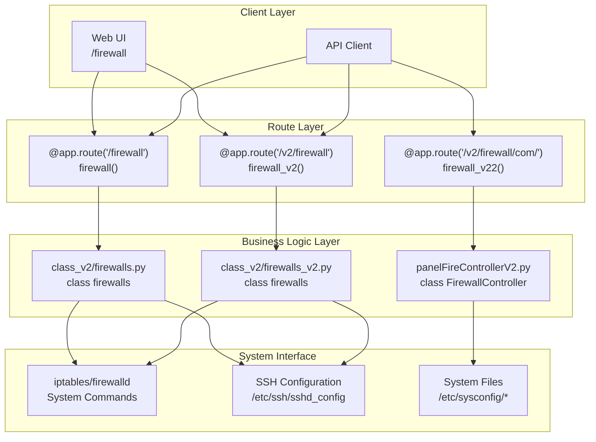
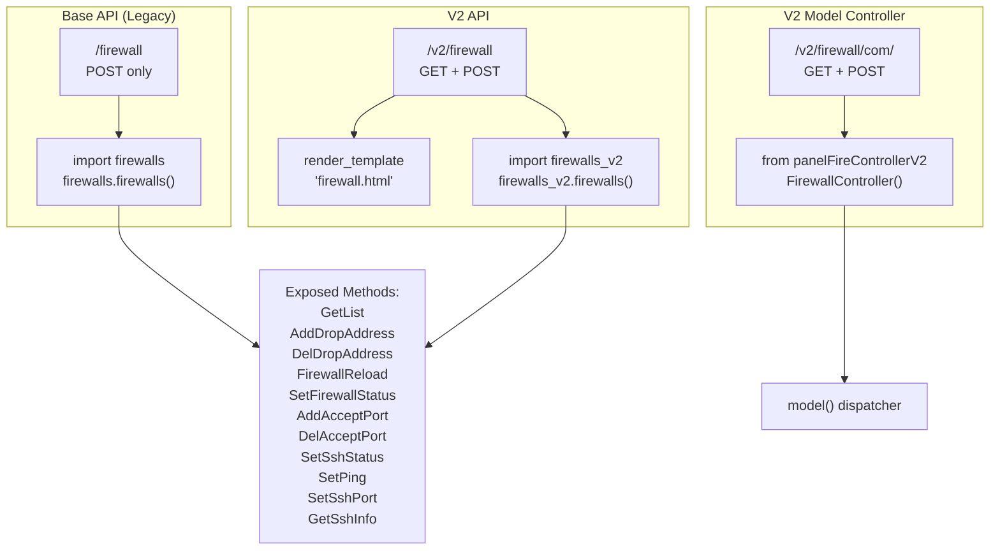
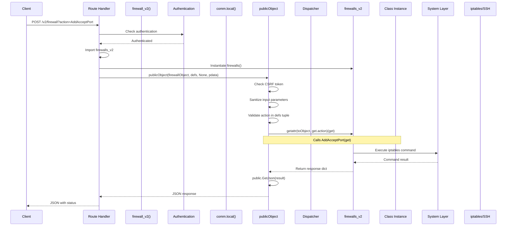
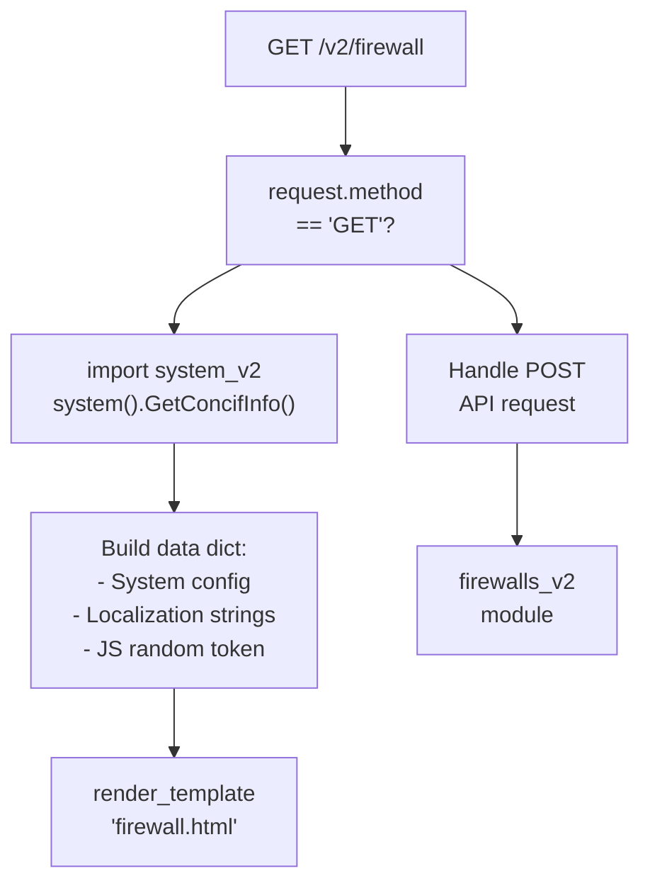
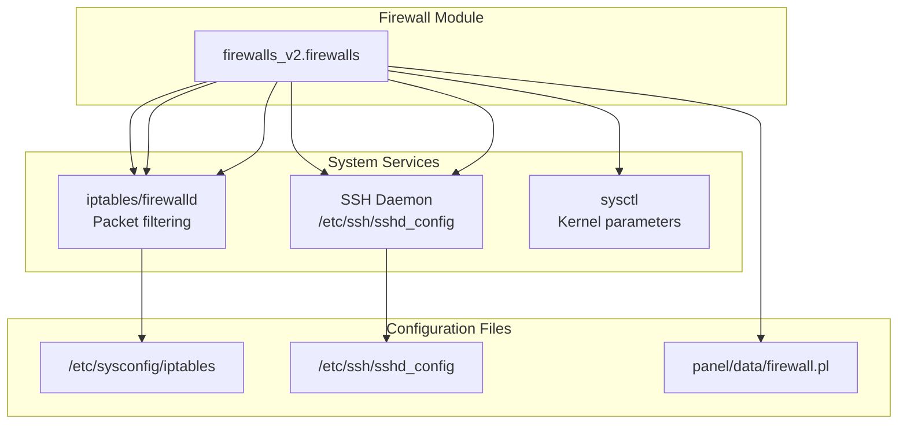

# Firewall Management

> **Relevant source files**
> * [BTPanel/__init__.py](https://github.com/aaPanel/aaPanel/blob/b6e4ab8b/BTPanel/__init__.py)

## Purpose and Scope

The Firewall Management system provides server-level firewall configuration through aaPanel's web interface. It allows administrators to manage firewall rules, control port access, configure SSH settings, and manage IP address allow/deny lists. This module interfaces with the underlying system firewall (typically iptables/firewalld on Linux) to enforce network security policies.

For related security features like SSH security hardening, see [SSH Security](/aaPanel/aaPanel/5.4-firewall-management) (referenced but would be separate page). For general panel security settings, see [Configuration Management](/aaPanel/aaPanel/9-configuration-management).

**Sources:** [BTPanel/__init__.py L1054-L1065](https://github.com/aaPanel/aaPanel/blob/b6e4ab8b/BTPanel/__init__.py#L1054-L1065)

 [BTPanel/__init__.py L3953-L3970](https://github.com/aaPanel/aaPanel/blob/b6e4ab8b/BTPanel/__init__.py#L3953-L3970)

---

## Architecture Overview

The firewall management system follows aaPanel's standard module architecture with both legacy (v1) and modernized (v2) implementations:



**Sources:** [BTPanel/__init__.py L1054-L1065](https://github.com/aaPanel/aaPanel/blob/b6e4ab8b/BTPanel/__init__.py#L1054-L1065)

 [BTPanel/__init__.py L3953-L3970](https://github.com/aaPanel/aaPanel/blob/b6e4ab8b/BTPanel/__init__.py#L3953-L3970)

 [BTPanel/__init__.py L3972-L3988](https://github.com/aaPanel/aaPanel/blob/b6e4ab8b/BTPanel/__init__.py#L3972-L3988)

---

## Route Structure

The firewall management system exposes three primary route endpoints:



### Route Definitions

| Route Pattern | Methods | Handler Function | Module | Line Reference |
| --- | --- | --- | --- | --- |
| `/firewall` | POST | `firewall()` | `firewalls.firewalls` | [BTPanel/__init__.py L1054-L1065](https://github.com/aaPanel/aaPanel/blob/b6e4ab8b/BTPanel/__init__.py#L1054-L1065) |
| `/v2/firewall` | GET, POST | `firewall_v2()` | `firewalls_v2.firewalls` | [BTPanel/__init__.py L3953-L3970](https://github.com/aaPanel/aaPanel/blob/b6e4ab8b/BTPanel/__init__.py#L3953-L3970) |
| `/v2/firewall/com/<def_name>` | GET, POST | `firewall_v22()` | `panelFireControllerV2.FirewallController` | [BTPanel/__init__.py L3972-L3988](https://github.com/aaPanel/aaPanel/blob/b6e4ab8b/BTPanel/__init__.py#L3972-L3988) |

**Sources:** [BTPanel/__init__.py L1054-L1065](https://github.com/aaPanel/aaPanel/blob/b6e4ab8b/BTPanel/__init__.py#L1054-L1065)

 [BTPanel/__init__.py L3953-L3970](https://github.com/aaPanel/aaPanel/blob/b6e4ab8b/BTPanel/__init__.py#L3953-L3970)

 [BTPanel/__init__.py L3972-L3988](https://github.com/aaPanel/aaPanel/blob/b6e4ab8b/BTPanel/__init__.py#L3972-L3988)

---

## Core Components

### Firewall Module Class

The firewall functionality is implemented through the `firewalls` class, which provides methods for firewall management operations. The class is instantiated in the route handlers and its methods are exposed through the `publicObject` dispatcher pattern.

**Module Import Patterns:**

* Base API: `import firewalls` → `firewalls.firewalls()`
* V2 API: `import firewalls_v2` → `firewalls_v2.firewalls()`

**Sources:** [BTPanel/__init__.py L1059-L1060](https://github.com/aaPanel/aaPanel/blob/b6e4ab8b/BTPanel/__init__.py#L1059-L1060)

 [BTPanel/__init__.py L3964-L3965](https://github.com/aaPanel/aaPanel/blob/b6e4ab8b/BTPanel/__init__.py#L3964-L3965)

### Exposed Methods

The firewall module exposes the following methods through the `publicObject` dispatcher:

| Method | Purpose |
| --- | --- |
| `GetList` | Retrieve current firewall rules and configuration |
| `AddDropAddress` | Add an IP address to the deny/drop list |
| `DelDropAddress` | Remove an IP address from the deny/drop list |
| `FirewallReload` | Reload firewall configuration |
| `SetFirewallStatus` | Enable or disable the firewall |
| `AddAcceptPort` | Add a port to the allowed ports list |
| `DelAcceptPort` | Remove a port from the allowed ports list |
| `SetSshStatus` | Enable or disable SSH service |
| `SetPing` | Enable or disable ICMP ping responses |
| `SetSshPort` | Change the SSH listening port |
| `GetSshInfo` | Retrieve current SSH configuration |

**Sources:** [BTPanel/__init__.py L1061-L1064](https://github.com/aaPanel/aaPanel/blob/b6e4ab8b/BTPanel/__init__.py#L1061-L1064)

 [BTPanel/__init__.py L3966-L3969](https://github.com/aaPanel/aaPanel/blob/b6e4ab8b/BTPanel/__init__.py#L3966-L3969)

### V2 Controller Architecture

The V2 API includes an additional controller-based routing pattern for extended firewall functionality:

```javascript
@app.route(route_v2 + '/firewall/com/<def_name>', methods=method_all)
def firewall_v22(def_name, pdata=None):
    from panelFireControllerV2 import FirewallController
    project_obj = FirewallController()
```

This controller pattern allows for modular extension of firewall functionality through the model dispatcher.

**Sources:** [BTPanel/__init__.py L3972-L3988](https://github.com/aaPanel/aaPanel/blob/b6e4ab8b/BTPanel/__init__.py#L3972-L3988)

---

## Request Processing Flow



### Request Flow Stages

1. **Route Resolution**: Request path matches firewall route pattern
2. **Authentication Check**: `comm.local()` verifies user session
3. **Module Instantiation**: Firewall class is imported and instantiated
4. **Dispatcher Invocation**: `publicObject()` handles method routing with security checks
5. **CSRF Validation**: Token verification for state-changing operations
6. **Input Sanitization**: Path traversal and XSS prevention
7. **Method Execution**: Actual firewall operation performed
8. **Response Formatting**: Result serialized to JSON

**Sources:** [BTPanel/__init__.py L3953-L3970](https://github.com/aaPanel/aaPanel/blob/b6e4ab8b/BTPanel/__init__.py#L3953-L3970)

 [BTPanel/__init__.py L2697-L2731](https://github.com/aaPanel/aaPanel/blob/b6e4ab8b/BTPanel/__init__.py#L2697-L2731)

---

## Page Rendering (V2 API)

The V2 firewall route supports GET requests for page rendering:



### Page Data Structure

The firewall page receives the following data context:

* `data['lan']`: Localized strings from `public.GetLan('firewall')`
* `data['js_random']`: Cache-busting token from `get_js_random()`
* System configuration from `system_v2.system().GetConcifInfo()`

**Sources:** [BTPanel/__init__.py L3958-L3963](https://github.com/aaPanel/aaPanel/blob/b6e4ab8b/BTPanel/__init__.py#L3958-L3963)

---

## Security and Access Control

### Authentication Requirements

All firewall routes require authentication via `comm.local()`:

```
comReturn = comm.local()
if comReturn: return comReturn
```

This check ensures:

* User has valid session
* User has appropriate permissions
* Request is from authenticated source

**Sources:** [BTPanel/__init__.py L1057-L1058](https://github.com/aaPanel/aaPanel/blob/b6e4ab8b/BTPanel/__init__.py#L1057-L1058)

 [BTPanel/__init__.py L3956-L3957](https://github.com/aaPanel/aaPanel/blob/b6e4ab8b/BTPanel/__init__.py#L3956-L3957)

### CSRF Protection

Firewall operations are protected by CSRF token validation within the `publicObject` dispatcher:

```python
def publicObject(toObject, defs, action=None, get=None, is_csrf=True):
    if is_csrf and public.get_csrf_sess_html_token_value() and session.get('login', None):
        if not check_csrf():
            return public.ReturnJson(False, 'INIT_CSRF_ERR'), json_header
```

**Sources:** [BTPanel/__init__.py L2700-L2702](https://github.com/aaPanel/aaPanel/blob/b6e4ab8b/BTPanel/__init__.py#L2700-L2702)

### Input Sanitization

Path and filename parameters are sanitized to prevent directory traversal attacks:

```
if hasattr(get, 'path'):
    get.path = get.path.replace('//', '/').replace('\\', '/')
    if get.path.find('./') != -1:
        return public.ReturnJson(False, 'Unsafe path'), json_header
```

**Sources:** [BTPanel/__init__.py L2708-L2711](https://github.com/aaPanel/aaPanel/blob/b6e4ab8b/BTPanel/__init__.py#L2708-L2711)

---

## Integration with System Services

The firewall module integrates with various system components:



**Sources:** [BTPanel/__init__.py L3964-L3969](https://github.com/aaPanel/aaPanel/blob/b6e4ab8b/BTPanel/__init__.py#L3964-L3969)

---

## Navigation and Menu Integration

The firewall page is integrated into the panel's navigation system:

### Menu Configuration

The firewall menu entry is mapped in the global `menu_map` dictionary:

```css
menu_map = {
    'memuafirewall': '/firewall',     # Security
}
```

This mapping is loaded from `config/menu.json` if present, otherwise defaults to the hardcoded map.

**Sources:** [BTPanel/__init__.py L209](https://github.com/aaPanel/aaPanel/blob/b6e4ab8b/BTPanel/__init__.py#L209-L209)

 [BTPanel/__init__.py L223-L232](https://github.com/aaPanel/aaPanel/blob/b6e4ab8b/BTPanel/__init__.py#L223-L232)

### Admin Path Checks

The firewall route is included in the `admin_path_checks` list for security validation:

```markdown
admin_path_checks = [
    # ... other paths ...
    '/firewall',
    # ... more paths ...
]
```

**Sources:** [BTPanel/__init__.py L137](https://github.com/aaPanel/aaPanel/blob/b6e4ab8b/BTPanel/__init__.py#L137-L137)

---

## Error Handling

Firewall operations follow the standard aaPanel error handling pattern:

1. **Module-level exceptions**: Caught and wrapped in error response by `publicObject`
2. **System command failures**: Returned as error status in method response
3. **Global exception handler**: Catches uncaught exceptions and displays error page

All errors are logged and returned in JSON format:

```
return public.ReturnJson(False, 'Error message'), json_header
```

**Sources:** [BTPanel/__init__.py L2730-L2731](https://github.com/aaPanel/aaPanel/blob/b6e4ab8b/BTPanel/__init__.py#L2730-L2731)

---

## API Versioning

The firewall module exists in two versions:

| Version | Route Prefix | Module | Status |
| --- | --- | --- | --- |
| V1 (Legacy) | `/firewall` | `firewalls.firewalls` | Maintained for compatibility |
| V2 (Current) | `/v2/firewall` | `firewalls_v2.firewalls` | Active development |

Both versions expose the same core methods through `publicObject`, ensuring backward compatibility while allowing for modernization in the V2 implementation.

**Sources:** [BTPanel/__init__.py L1054-L1065](https://github.com/aaPanel/aaPanel/blob/b6e4ab8b/BTPanel/__init__.py#L1054-L1065)

 [BTPanel/__init__.py L3953-L3970](https://github.com/aaPanel/aaPanel/blob/b6e4ab8b/BTPanel/__init__.py#L3953-L3970)

 [BTPanel/__init__.py L176](https://github.com/aaPanel/aaPanel/blob/b6e4ab8b/BTPanel/__init__.py#L176-L176)