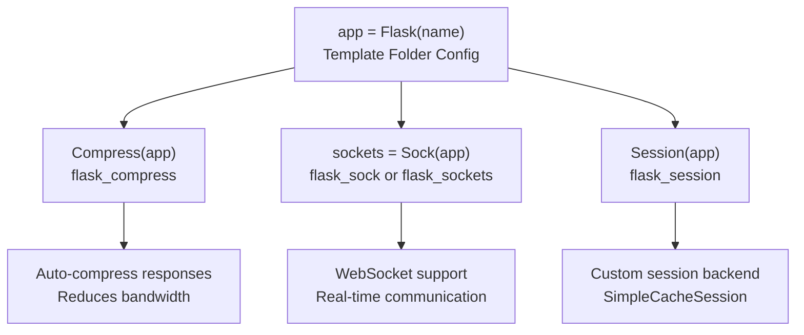
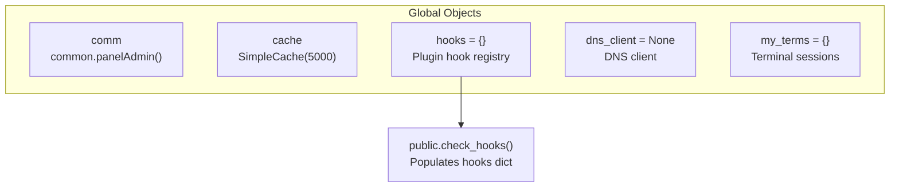
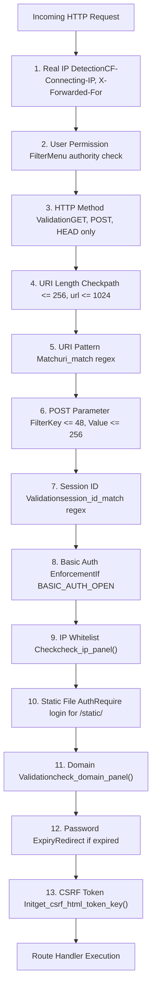
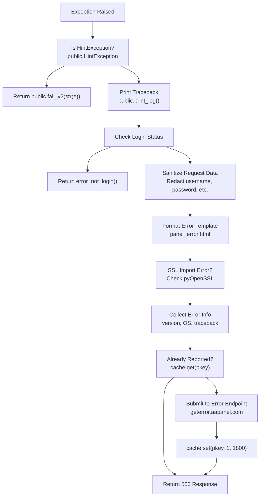
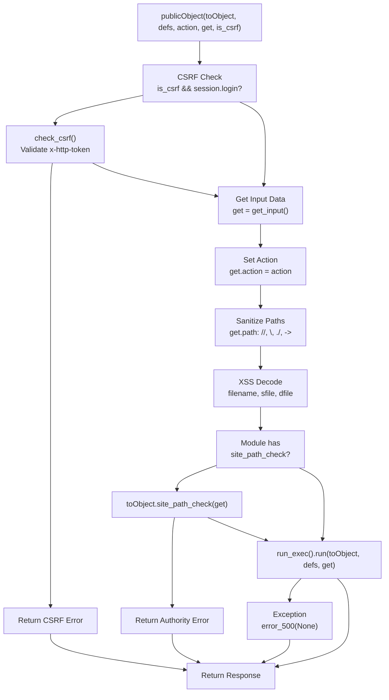

# Flask Application Core

> **Relevant source files**
> * [BTPanel/__init__.py](https://github.com/aaPanel/aaPanel/blob/b6e4ab8b/BTPanel/__init__.py)
> * [BTPanel/app.py](https://github.com/aaPanel/aaPanel/blob/b6e4ab8b/BTPanel/app.py)

## Purpose and Scope

This document describes the Flask application initialization, configuration, and core components that form the foundation of aaPanel's web interface. It covers the Flask application object, extensions integration, global state management, security configuration, and request lifecycle hooks. For the web server process that hosts this Flask application, see [Web Server (BT-Panel)](/aaPanel/aaPanel/2.1-web-server-(bt-panel)). For request processing and routing, see [Request Processing Pipeline](/aaPanel/aaPanel/3-request-processing-pipeline) and [Module System and Routing](/aaPanel/aaPanel/4-module-system-and-routing).

---

## Application Initialization

### Flask Application Object

The Flask application is initialized in two locations with identical configuration:

* Primary: [BTPanel/__init__.py L50-L53](https://github.com/aaPanel/aaPanel/blob/b6e4ab8b/BTPanel/__init__.py#L50-L53)
* Alternative: [BTPanel/app.py L74-L76](https://github.com/aaPanel/aaPanel/blob/b6e4ab8b/BTPanel/app.py#L74-L76)

```

```

The template folder is dynamically determined from panel configuration, allowing theme customization without code changes.

### Core Application Configuration

The application configuration is managed through `app.config` dictionary with settings loaded from multiple sources:

| Configuration Key | Source | Purpose |
| --- | --- | --- |
| `DEBUG` | `data/debug.pl` (file existence) | Enable debug mode and auto-reload |
| `SSL` | `data/ssl.pl` (file existence) | Enable SSL/TLS features |
| `BASIC_AUTH_OPEN` | `config/basic_auth.json` | Enable HTTP Basic Authentication |
| `BASIC_AUTH_USERNAME` | `config/basic_auth.json` | Basic auth username (hashed) |
| `BASIC_AUTH_PASSWORD` | `config/basic_auth.json` | Basic auth password (hashed) |

**Sources:** [BTPanel/__init__.py L67-L81](https://github.com/aaPanel/aaPanel/blob/b6e4ab8b/BTPanel/__init__.py#L67-L81)

 [BTPanel/app.py L90-L103](https://github.com/aaPanel/aaPanel/blob/b6e4ab8b/BTPanel/app.py#L90-L103)

---

## Flask Extensions Integration

### Extension Initialization Sequence



### Response Compression

The `Flask-Compress` extension automatically compresses HTTP responses, reducing bandwidth usage without code changes in route handlers.

**Sources:** [BTPanel/__init__.py L54](https://github.com/aaPanel/aaPanel/blob/b6e4ab8b/BTPanel/__init__.py#L54-L54)

 [BTPanel/app.py L77](https://github.com/aaPanel/aaPanel/blob/b6e4ab8b/BTPanel/app.py#L77-L77)

### WebSocket Support

WebSocket functionality uses either `flask_sock.Sock` or `flask_sockets.Sockets` (fallback):

```

```

The `sockets` object is used to register WebSocket endpoints. For WebSocket endpoints, see [WebSocket Support](/aaPanel/aaPanel/6-websocket-support).

**Sources:** [BTPanel/__init__.py L56-L60](https://github.com/aaPanel/aaPanel/blob/b6e4ab8b/BTPanel/__init__.py#L56-L60)

 [BTPanel/app.py L78-L83](https://github.com/aaPanel/aaPanel/blob/b6e4ab8b/BTPanel/app.py#L78-L83)

### Session Management

Session configuration uses a custom in-memory cache backend:

| Session Setting | Value | Purpose |
| --- | --- | --- |
| `SESSION_TYPE` | `'memcached'` | Use memcached-style storage |
| `SESSION_MEMCACHED` | `SimpleCacheSession(1000, 86400)` | 1000 entries, 24-hour TTL |
| `SESSION_PERMANENT` | `True` | Sessions persist across browser restarts |
| `SESSION_USE_SIGNER` | `True` | Sign session cookies for security |
| `SESSION_KEY_PREFIX` | `'BT_:'` | Prefix for session keys |
| `SESSION_COOKIE_NAME` | `md5(secret_key)` | Cookie name based on secret key |
| `PERMANENT_SESSION_LIFETIME` | `86400 * 30` | 30-day session lifetime |
| `SESSION_COOKIE_SAMESITE` | `'Lax'` (SSL) / `None` | CSRF protection |
| `SESSION_COOKIE_SECURE` | `True` (SSL only) | Require HTTPS |

**Sources:** [BTPanel/__init__.py L82-L102](https://github.com/aaPanel/aaPanel/blob/b6e4ab8b/BTPanel/__init__.py#L82-L102)

 [BTPanel/app.py L105-L124](https://github.com/aaPanel/aaPanel/blob/b6e4ab8b/BTPanel/app.py#L105-L124)

---

## Security Configuration

### Secret Key Generation

The application secret key is deterministically generated from system-specific data:

```

```

This creates a unique, stable key based on:

* System information (`os.uname()` - hostname, OS version, architecture)
* System boot time (`psutil.boot_time()` - unchanged until reboot)

The secret key secures:

* Session cookie signing
* CSRF token generation
* Cookie encryption

**Sources:** [BTPanel/__init__.py L83-L85](https://github.com/aaPanel/aaPanel/blob/b6e4ab8b/BTPanel/__init__.py#L83-L85)

 [BTPanel/app.py L106-L108](https://github.com/aaPanel/aaPanel/blob/b6e4ab8b/BTPanel/app.py#L106-L108)

### Admin Path Configuration

The admin path provides security through URL obscurity:

```

```

* Default: `'/'`
* Configurable via `data/admin_path.pl`
* Reserved path blacklist (35 paths including `/login`, `/site`, `/ftp`, etc.)
* Automatically changed to `/bt` if conflicts with reserved paths

**Sources:** [BTPanel/__init__.py L114-L171](https://github.com/aaPanel/aaPanel/blob/b6e4ab8b/BTPanel/__init__.py#L114-L171)

 [BTPanel/app.py L136-L190](https://github.com/aaPanel/aaPanel/blob/b6e4ab8b/BTPanel/app.py#L136-L190)

### URI and Session Validation

Two regex patterns enforce strict format requirements:

```

```

* `uri_match`: Validates request URIs (static files or alphanumeric paths)
* `session_id_match`: Validates session cookie values (alphanumeric, dots, hyphens only)

**Sources:** [BTPanel/__init__.py L172-L175](https://github.com/aaPanel/aaPanel/blob/b6e4ab8b/BTPanel/__init__.py#L172-L175)

 [BTPanel/app.py L192-L195](https://github.com/aaPanel/aaPanel/blob/b6e4ab8b/BTPanel/app.py#L192-L195)

---

## Global Objects and State

### Cache System

A global `SimpleCache` instance provides in-memory caching:

```

```

* Capacity: 5000 entries
* Used for: rate limiting, token validation, temporary data storage

**Key Cache Entries:**

| Cache Key | Purpose | TTL |
| --- | --- | --- |
| `p_token` | Panel token (MAC-based) | Permanent |
| `dologin` | Logout flag | Session-based |
| `bt_home_node` | Home node update flag | 3600s |
| `codeStr` | Verification code | 180s |
| `codeOut` | Code generation throttle | 0.1s |

**Sources:** [BTPanel/__init__.py L46](https://github.com/aaPanel/aaPanel/blob/b6e4ab8b/BTPanel/__init__.py#L46-L46)

 [BTPanel/app.py L35](https://github.com/aaPanel/aaPanel/blob/b6e4ab8b/BTPanel/app.py#L35-L35)

### Common Objects



**Sources:** [BTPanel/__init__.py L46-L110](https://github.com/aaPanel/aaPanel/blob/b6e4ab8b/BTPanel/__init__.py#L46-L110)

 [BTPanel/app.py L35-L134](https://github.com/aaPanel/aaPanel/blob/b6e4ab8b/BTPanel/app.py#L35-L134)

### HTTP Constants

```

```

These constants standardize HTTP method restrictions and response headers throughout the codebase.

**Sources:** [BTPanel/__init__.py L108-L112](https://github.com/aaPanel/aaPanel/blob/b6e4ab8b/BTPanel/__init__.py#L108-L112)

 [BTPanel/app.py L130-L134](https://github.com/aaPanel/aaPanel/blob/b6e4ab8b/BTPanel/app.py#L130-L134)

---

## Navigation and UI Configuration

### Menu Map System

The `menu_map` dictionary maps menu IDs to panel routes:

```

```

This map can be overridden by `config/menu.json`, allowing dynamic menu customization and user permission-based filtering.

**Sources:** [BTPanel/__init__.py L200-L234](https://github.com/aaPanel/aaPanel/blob/b6e4ab8b/BTPanel/__init__.py#L200-L234)

### Panel Asset Defaults

The `PANEL_DEFAULT_ASSET` dictionary defines UI customization defaults:

| Asset | Default Value | Description |
| --- | --- | --- |
| `favicon` | `/static/favicon.ico` | Browser tab icon |
| `show_login_logo` | `True` | Display logo on login |
| `login_logo` | `/static/icons/logo-green.svg` | Login page logo |
| `login_bg_images_opacity` | `100` | Background opacity (0-100) |
| `main_bg_images` | `/static/icons/main_bg.png` | Main interface background |
| `menu_logo` | `/static/icons/menu_logo.png` | Sidebar menu logo |
| `theme_color` | `#3c444d` | Primary theme color |
| `theme_name` | `default` | Active theme identifier |
| `home_state_font_size` | `24` | Dashboard font size |

**Sources:** [BTPanel/__init__.py L236-L258](https://github.com/aaPanel/aaPanel/blob/b6e4ab8b/BTPanel/__init__.py#L236-L258)

---

## Request Lifecycle Hooks

### Before Request Hook

The `request_check()` function executes before every request:



**Key Validations:**

1. **Real IP Detection**: Handles CDN proxy headers (`CDN_PROXY` config)
2. **User Permission Filtering**: Checks user router authority and menu access for non-admin users
3. **HTTP Method**: Only `GET`, `POST`, `HEAD` allowed; returns 404 for others
4. **URI Length**: Max path 256 chars, max URL 1024 chars
5. **URI Pattern**: Must match static file pattern or alphanumeric path
6. **POST Parameters**: For specific routes (`/login`, `/safe`, etc.), validates key ≤48 chars, value ≤256 chars
7. **Session ID**: Must match `[\w\.\-]+` pattern
8. **Basic Auth**: If enabled, validates HTTP Basic Authentication headers
9. **IP Whitelist**: Validates client IP via `public.check_ip_panel()`
10. **Static File Access**: Requires login/auth session for `/static/` access
11. **Domain Check**: Validates request domain via `public.check_domain_panel()`
12. **Password Expiry**: Redirects to `/modify_password` if password expired
13. **CSRF Token**: Sets `g.get_csrf_html_token_key` for CSRF protection

**Sources:** [BTPanel/__init__.py L265-L457](https://github.com/aaPanel/aaPanel/blob/b6e4ab8b/BTPanel/__init__.py#L265-L457)

### Teardown Request Hook

The `request_end()` function executes after every request:

```

```

**Functions:**

1. Logs all requests to disk
2. Validates V2 API endpoints use `public.return_message()`
3. Clears sessions for API requests (stateless API)

**Sources:** [BTPanel/__init__.py L460-L493](https://github.com/aaPanel/aaPanel/blob/b6e4ab8b/BTPanel/__init__.py#L460-L493)

### Error Handlers

Custom error handlers provide consistent error responses:

| HTTP Status | Handler Function | Behavior |
| --- | --- | --- |
| 404 | `error_404(e)` | Custom "404 Not Found" page |
| 403 | `error_403(e)` | Custom "403 Forbidden" page |
| 405 | `error_405(e)` | Unified response function error |
| Exception | `error_500(e)` | Error collection and reporting |

**Exception Handler Flow:**



**Error Collection Data:**

* Request date, panel version, OS version
* Client IP and request URI
* Request form data (sanitized)
* User agent string
* Full error traceback
* pyOpenSSL version (for SSL errors)

**Sources:** [BTPanel/__init__.py L496-L654](https://github.com/aaPanel/aaPanel/blob/b6e4ab8b/BTPanel/__init__.py#L496-L654)

---

## Module Dispatch Framework

### The run_exec Class

The `run_exec` class executes module methods with security validation:

```

```

**Sources:** [BTPanel/app.py L312-L331](https://github.com/aaPanel/aaPanel/blob/b6e4ab8b/BTPanel/app.py#L312-L331)

### The publicObject Function

The `publicObject()` function is the universal dispatcher for module access:



**Security Layers:**

1. **CSRF Protection**: Validates `x-http-token` header matches session token
2. **Path Sanitization**: Removes `//`, `\\`, `./`, `->` from paths
3. **XSS Decoding**: Decodes `filename`, `sfile`, `dfile` parameters via `public.xssdecode()`
4. **Site Path Check**: If module has `site_path_check()`, validates path boundaries

**Sources:** [BTPanel/app.py L342-L377](https://github.com/aaPanel/aaPanel/blob/b6e4ab8b/BTPanel/app.py#L342-L377)

---

## Helper Functions

### Input Processing

```

```

Returns a `public.dict_obj()` with all request parameters merged.

**Sources:** [BTPanel/app.py L576-L606](https://github.com/aaPanel/aaPanel/blob/b6e4ab8b/BTPanel/app.py#L576-L606)

### Authentication Helpers

| Function | Purpose | Return |
| --- | --- | --- |
| `check_login(http_token)` | Validates login status and token | `True`/`False` |
| `send_authenticated()` | Sends HTTP 401 Basic Auth challenge | `Response(401)` |
| `is_login(result)` | Processes login result | `result` (pass-through) |
| `check_csrf()` | Validates CSRF token | `True`/`False` |

**Sources:** [BTPanel/app.py L379-L389](https://github.com/aaPanel/aaPanel/blob/b6e4ab8b/BTPanel/app.py#L379-L389)

 [BTPanel/app.py L519-L564](https://github.com/aaPanel/aaPanel/blob/b6e4ab8b/BTPanel/app.py#L519-L564)

 [BTPanel/app.py L333-L340](https://github.com/aaPanel/aaPanel/blob/b6e4ab8b/BTPanel/app.py#L333-L340)

### Utility Functions

| Function | Purpose | Return Type |
| --- | --- | --- |
| `get_pd()` | Retrieves license/authorization info | `tuple(html, expire, ltd)` |
| `get_phpmyadmin_dir()` | Locates phpMyAdmin directory | `tuple(dirname, port)` or `None` |
| `get_dir_down(filename, token, find)` | Handles shared directory downloads | `Response` or `dict` |
| `FtpPort()` | Retrieves FTP port from config | `None` (sets `session['port']`) |
| `get_js_random()` | Generates cache-busting string | `str` (16-char random) |

**Sources:** [BTPanel/app.py L391-L517](https://github.com/aaPanel/aaPanel/blob/b6e4ab8b/BTPanel/app.py#L391-L517)

 [BTPanel/app.py L530-L543](https://github.com/aaPanel/aaPanel/blob/b6e4ab8b/BTPanel/app.py#L530-L543)

 [BTPanel/app.py L243-L267](https://github.com/aaPanel/aaPanel/blob/b6e4ab8b/BTPanel/app.py#L243-L267)

 [BTPanel/app.py L269-L310](https://github.com/aaPanel/aaPanel/blob/b6e4ab8b/BTPanel/app.py#L269-L310)

 [BTPanel/app.py L568-L573](https://github.com/aaPanel/aaPanel/blob/b6e4ab8b/BTPanel/app.py#L568-L573)

---

## Custom URL Converters

The application registers a `RegexConverter` for advanced URL pattern matching:

```

```

**Usage Example:**

```

```

**Sources:** [BTPanel/app.py L639-L670](https://github.com/aaPanel/aaPanel/blob/b6e4ab8b/BTPanel/app.py#L639-L670)

---

## Application Context Variables

Flask's `g` object stores request-scoped variables:

| Variable | Set By | Purpose |
| --- | --- | --- |
| `g.request_time` | `@before_request` | Request start timestamp |
| `g.return_message` | `@before_request` | Response message handling flag |
| `g.get_csrf_html_token_key` | `@before_request` | CSRF token key |
| `g.auth_error` | Error handlers | Authentication error flag |
| `g.dologin` | `/login` route | Logout operation flag |
| `g.is_aes` | `run_exec.run()` | AES encryption enabled |
| `g.aes_key` | `run_exec.run()` | AES encryption key |
| `g.form_data` | Various | Additional form data |
| `g.api_request` | API routes | API request flag |

**Sources:** [BTPanel/__init__.py L304-L305](https://github.com/aaPanel/aaPanel/blob/b6e4ab8b/BTPanel/__init__.py#L304-L305)

 [BTPanel/__init__.py L341](https://github.com/aaPanel/aaPanel/blob/b6e4ab8b/BTPanel/__init__.py#L341-L341)

 [BTPanel/app.py L327-L328](https://github.com/aaPanel/aaPanel/blob/b6e4ab8b/BTPanel/app.py#L327-L328)

---

## Translation System Integration

The application loads translation data at initialization:

```

```

This provides internationalization support for 14+ languages. For details, see [Internationalization and Localization](/aaPanel/aaPanel/8-internationalization-and-localization).

**Sources:** [BTPanel/__init__.py L178-L183](https://github.com/aaPanel/aaPanel/blob/b6e4ab8b/BTPanel/__init__.py#L178-L183)

---

## Initialization Sequence Diagram

```mermaid
flowchart TD

Start["Module Import"]
HookImport["hook_import()<br>Custom Import Hook"]
PathSetup["sys.path.insert<br>class/ and class_v2/"]
FlaskInit["app = Flask(name)<br>Set template folder"]
CompressInit["Compress(app)"]
SockInit["sockets = Sock(app)"]
ConfigFiles["Load Config Files<br>debug.pl, ssl.pl<br>basic_auth.json"]
SecretKey["app.secret_key =<br>md5(uname + boot_time)"]
SessionSetup["Configure SESSION_*<br>SimpleCacheSession(1000, 86400)"]
SessionInit["Session(app)"]
CommonInit["comm = common.panelAdmin()"]
CacheInit["cache = SimpleCache(5000)<br>cache.set('p_token', ...)"]
AdminPathLoad["Load admin_path from<br>data/admin_path.pl"]
URIRegex["Compile uri_match and<br>session_id_match regex"]
TranslationLoad["load_translations()<br>load_login_translations()"]
HooksCheck["public.check_hooks()<br>Populate hooks dict"]
MenuLoad["Load menu_map from<br>config/menu.json (optional)"]
AssetsDefault["Set PANEL_DEFAULT_ASSET<br>UI defaults"]
Ready["Application Ready<br>Routes can be registered"]

Start --> HookImport
HookImport --> PathSetup
PathSetup --> FlaskInit
FlaskInit --> CompressInit
CompressInit --> SockInit
SockInit --> ConfigFiles
ConfigFiles --> SecretKey
SecretKey --> SessionSetup
SessionSetup --> SessionInit
SessionInit --> CommonInit
CommonInit --> CacheInit
CacheInit --> AdminPathLoad
AdminPathLoad --> URIRegex
URIRegex --> TranslationLoad
TranslationLoad --> HooksCheck
HooksCheck --> MenuLoad
MenuLoad --> AssetsDefault
AssetsDefault --> Ready
```



**Sources:** [BTPanel/__init__.py L1-L258](https://github.com/aaPanel/aaPanel/blob/b6e4ab8b/BTPanel/__init__.py#L1-L258)

---

## Integration with Other Systems

The Flask application core integrates with:

* **Web Server**: Hosted by BT-Panel gevent server [Web Server (BT-Panel)](/aaPanel/aaPanel/2.1-web-server-(bt-panel))
* **Request Processing**: Uses authentication middleware [Request Processing Pipeline](/aaPanel/aaPanel/3-request-processing-pipeline)
* **Module Routing**: Dispatches via `publicObject()` [Module System and Routing](/aaPanel/aaPanel/4-module-system-and-routing)
* **WebSockets**: Real-time communication [WebSocket Support](/aaPanel/aaPanel/6-websocket-support)
* **Session Storage**: In-memory `SimpleCacheSession` backend
* **Localization**: Multi-language support [Internationalization and Localization](/aaPanel/aaPanel/8-internationalization-and-localization)
* **Background Tasks**: Task queuing [Background Task System](/aaPanel/aaPanel/2.2-background-task-system-(bt-task))

**Sources:** [BTPanel/__init__.py L1-L2688](https://github.com/aaPanel/aaPanel/blob/b6e4ab8b/BTPanel/__init__.py#L1-L2688)