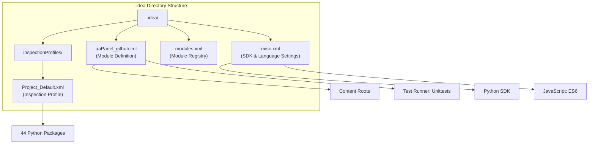
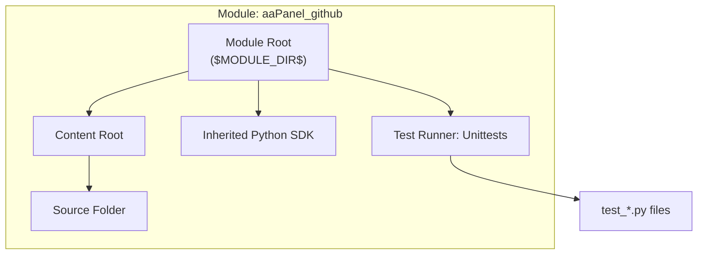
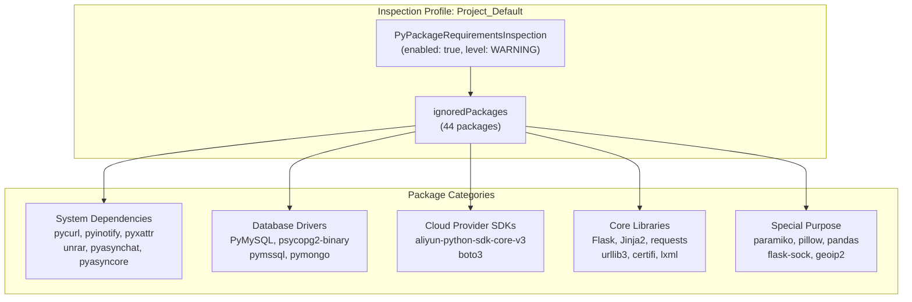
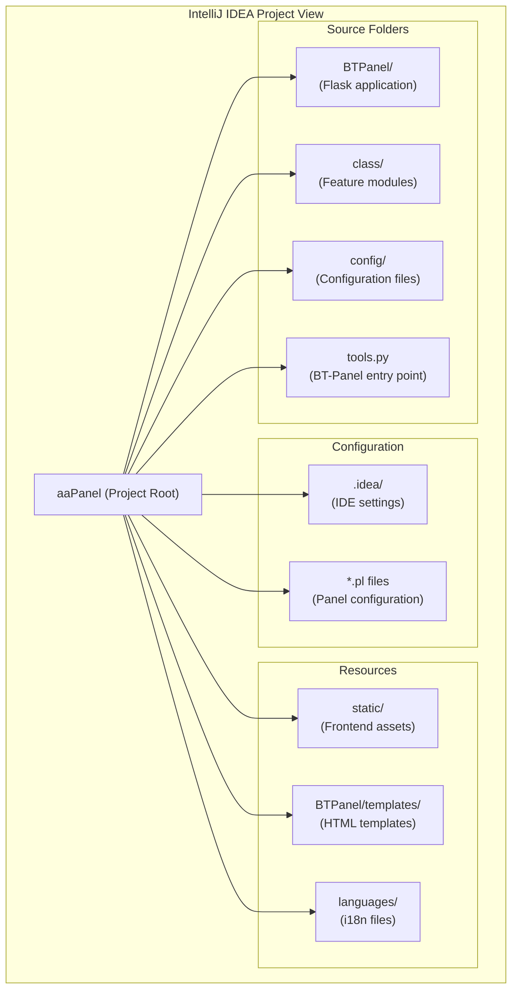

# IntelliJ IDEA Configuration

> **Relevant source files**
> * [.idea/aaPanel_github.iml](https://github.com/aaPanel/aaPanel/blob/b6e4ab8b/.idea/aaPanel_github.iml)
> * [.idea/inspectionProfiles/Project_Default.xml](https://github.com/aaPanel/aaPanel/blob/b6e4ab8b/.idea/inspectionProfiles/Project_Default.xml)
> * [.idea/misc.xml](https://github.com/aaPanel/aaPanel/blob/b6e4ab8b/.idea/misc.xml)
> * [.idea/modules.xml](https://github.com/aaPanel/aaPanel/blob/b6e4ab8b/.idea/modules.xml)

## Purpose and Scope

This document describes the IntelliJ IDEA (PyCharm) configuration files located in the `.idea` directory of the aaPanel repository. These configuration files define the project structure, Python SDK settings, code inspection profiles, and test runner configuration for the IDE.

For general development environment setup, see [Development Setup](/aaPanel/aaPanel/11-development-setup). For debug mode configuration and file watching, see [Debug Mode](/aaPanel/aaPanel/11.2-debug-mode). For remote deployment setup, see [Remote Deployment](/aaPanel/aaPanel/11.3-remote-deployment).

---

## IDE Configuration Overview

The aaPanel project includes pre-configured IntelliJ IDEA/PyCharm settings that provide a consistent development environment. The configuration files are stored in the `.idea` directory and include module definitions, inspection profiles, and project-level settings.



**Sources:** [.idea/aaPanel_github.iml L1-L11](https://github.com/aaPanel/aaPanel/blob/b6e4ab8b/.idea/aaPanel_github.iml#L1-L11)

 [.idea/misc.xml L1-L7](https://github.com/aaPanel/aaPanel/blob/b6e4ab8b/.idea/misc.xml#L1-L7)

 [.idea/modules.xml L1-L8](https://github.com/aaPanel/aaPanel/blob/b6e4ab8b/.idea/modules.xml#L1-L8)

 [.idea/inspectionProfiles/Project_Default.xml L1-L57](https://github.com/aaPanel/aaPanel/blob/b6e4ab8b/.idea/inspectionProfiles/Project_Default.xml#L1-L57)

---

## Module Configuration

The module configuration file `aaPanel_github.iml` defines the project as a Python module with standard content roots and test runner settings.

### Module Structure

| Component | Configuration | Purpose |
| --- | --- | --- |
| Module Type | `PYTHON_MODULE` | Identifies this as a Python project |
| Content URL | `file://$MODULE_DIR$` | Sets project root as content root |
| Order Entry | `inheritedJdk` | Uses project-level Python SDK |
| Order Entry | `sourceFolder` | Marks root as source folder |
| Test Runner | `Unittests` | Configures Python's unittest framework |



The module configuration is minimal, treating the entire project root as a source directory. This allows the IDE to recognize all Python files under the project root for code completion, navigation, and refactoring.

**Sources:** [.idea/aaPanel_github.iml L1-L11](https://github.com/aaPanel/aaPanel/blob/b6e4ab8b/.idea/aaPanel_github.iml#L1-L11)

 [.idea/modules.xml L1-L8](https://github.com/aaPanel/aaPanel/blob/b6e4ab8b/.idea/modules.xml#L1-L8)

---

## Python SDK Configuration

The `misc.xml` file configures the Python interpreter and language settings for the project.

### SDK Settings

```
<component name="ProjectRootManager" version="2" 
           project-jdk-name="Python 2.7 (test)" 
           project-jdk-type="Python SDK" />
```

**Important Note:** The configuration file references Python 2.7, but the aaPanel codebase requires **Python 3.7+** based on:

* Use of Flask and gevent (modern versions)
* Python 3 syntax throughout the codebase
* Modern async/await features

Developers should update the Python SDK setting to point to a Python 3.7+ interpreter. This can be done through:

1. File → Project Structure → Project Settings → Project
2. Select a Python 3.7+ SDK from the dropdown

### JavaScript Language Level

The configuration also sets JavaScript language level to ES6, enabling modern JavaScript syntax highlighting and code completion for frontend code:

```xml
<component name="JavaScriptSettings">
  <option name="languageLevel" value="ES6" />
</component>
```

**Sources:** [.idea/misc.xml L1-L7](https://github.com/aaPanel/aaPanel/blob/b6e4ab8b/.idea/misc.xml#L1-L7)

---

## Inspection Profile Configuration

The `Project_Default.xml` inspection profile customizes code quality checks for the aaPanel project, particularly around package requirements validation.

### Package Requirements Inspection

The profile configures `PyPackageRequirementsInspection` to ignore 44 Python packages that have special installation requirements or platform-specific dependencies:



### Ignored Packages by Category

| Category | Packages | Reason for Ignoring |
| --- | --- | --- |
| **System Dependencies** | pycurl, pyinotify, pyxattr, unrar | Require system libraries (libcurl, inotify, xattr) |
| **Async/Deprecated** | pyasyncore, pyasynchat | Python 3.12+ moved to external packages |
| **Database Drivers** | PyMySQL, psycopg2-binary, pymssql, pymongo | Binary dependencies, platform-specific builds |
| **Compression** | Brotli, rarfile | Require system compression libraries |
| **Security** | pyotp, paramiko | Cryptography dependencies |
| **Cloud/External APIs** | boto3, aliyun-python-sdk-core-v3, geoip2 | Optional features, may not be installed |
| **Core Web Stack** | Flask, Jinja2, requests, urllib3 | Assumed to be properly installed |
| **Data Processing** | pandas, lxml, pillow | Heavy dependencies, optional features |
| **Other** | distro, ntplib, toml, click, natsort | Standard libraries or optional utilities |

### Why Packages Are Ignored

The inspection ignores these packages because:

1. **Platform-Specific Dependencies**: Packages like `pycurl` and `pyinotify` require platform-specific system libraries
2. **Binary Builds**: Database drivers often have complex compilation requirements
3. **Optional Features**: Cloud SDKs and specialized libraries are only needed for certain features
4. **Installation Order**: Some packages are installed via system package managers rather than pip
5. **Development vs Production**: Different environments may have different package subsets

**Sources:** [.idea/inspectionProfiles/Project_Default.xml L1-L57](https://github.com/aaPanel/aaPanel/blob/b6e4ab8b/.idea/inspectionProfiles/Project_Default.xml#L1-L57)

---

## Test Runner Configuration

The module is configured to use Python's built-in `unittest` framework as the default test runner.

```xml
<component name="TestRunnerService">
  <option name="PROJECT_TEST_RUNNER" value="Unittests" />
</component>
```

### Test Execution

When running tests through the IDE:

* Test files matching `test_*.py` or `*_test.py` patterns are automatically discovered
* Right-click context menu on test files/directories provides "Run Unittests" option
* Test results appear in the Run tool window with pass/fail indicators
* Failed tests show assertion messages and stack traces

### Alternative Test Frameworks

While the default configuration uses unittest, developers can:

* Switch to pytest by changing `PROJECT_TEST_RUNNER` to `pytest`
* Configure test runner per run configuration
* Use IDE test configuration templates for different test types

**Sources:** [.idea/aaPanel_github.iml L8-L10](https://github.com/aaPanel/aaPanel/blob/b6e4ab8b/.idea/aaPanel_github.iml#L8-L10)

---

## Setting Up the Project in IntelliJ IDEA

### Initial Setup Steps

1. **Open Project** * File → Open → Select the aaPanel repository root * IntelliJ IDEA will automatically detect the `.idea` directory
2. **Configure Python SDK** ```sql File → Project Structure → Project Settings → Project - Project SDK: Select Python 3.7+ interpreter - Project Language Level: 3.7 or higher ```
3. **Verify Module Settings** ``` File → Project Structure → Project Settings → Modules - Should show "aaPanel_github" module - Sources tab should show project root as source folder ```
4. **Configure Dependencies** ```python File → Settings → Project: aaPanel → Python Interpreter - Install required packages from requirements (if available) - Note: Some packages may need system dependencies installed first ```

### Project Structure in IDE



### Code Navigation Features

With the project properly configured, IntelliJ IDEA provides:

| Feature | Usage | Benefit |
| --- | --- | --- |
| **Go to Definition** | Ctrl+B on symbol | Jump to class/function definition |
| **Find Usages** | Alt+F7 on symbol | Find all references to a symbol |
| **Navigate to File** | Ctrl+Shift+N | Quick file search |
| **Navigate to Symbol** | Ctrl+Alt+Shift+N | Quick class/function search |
| **Recent Files** | Ctrl+E | Switch between recently edited files |
| **File Structure** | Ctrl+F12 | View methods/fields in current file |

### Inspection Profile Usage

The configured inspection profile will:

* Suppress warnings for the 44 ignored packages
* Still show warnings for other unresolved references
* Highlight actual code issues (syntax errors, type mismatches, etc.)
* Provide refactoring suggestions

If you need to modify the inspection profile:

```sql
File → Settings → Editor → Inspections
- Select "Project Default" profile
- Modify inspection settings as needed
```

**Sources:** [.idea/aaPanel_github.iml L1-L11](https://github.com/aaPanel/aaPanel/blob/b6e4ab8b/.idea/aaPanel_github.iml#L1-L11)

 [.idea/misc.xml L1-L7](https://github.com/aaPanel/aaPanel/blob/b6e4ab8b/.idea/misc.xml#L1-L7)

 [.idea/modules.xml L1-L8](https://github.com/aaPanel/aaPanel/blob/b6e4ab8b/.idea/modules.xml#L1-L8)

---

## Configuration File Reference

### Module File (aaPanel_github.iml)

**Location:** `.idea/aaPanel_github.iml`

**Key Components:**

* `<module type="PYTHON_MODULE">`: Identifies module type
* `<content url="file://$MODULE_DIR$">`: Defines content root
* `<orderEntry type="inheritedJdk">`: Uses project SDK
* `<orderEntry type="sourceFolder">`: Marks as source folder
* `<option name="PROJECT_TEST_RUNNER" value="Unittests">`: Sets test framework

### Miscellaneous Settings (misc.xml)

**Location:** `.idea/misc.xml`

**Key Components:**

* `<component name="JavaScriptSettings">`: JavaScript language level (ES6)
* `<component name="ProjectRootManager">`: Python SDK configuration

**Note:** Update `project-jdk-name` to reference a Python 3.7+ interpreter.

### Module Registry (modules.xml)

**Location:** `.idea/modules.xml`

**Purpose:** Lists all modules in the project. Single-module projects have one entry pointing to the `.iml` file.

### Inspection Profile (Project_Default.xml)

**Location:** `.idea/inspectionProfiles/Project_Default.xml`

**Key Components:**

* `<profile version="1.0">`: Profile format version
* `<inspection_tool class="PyPackageRequirementsInspection">`: Package validation settings
* `<option name="ignoredPackages">`: List of packages to ignore in validation

**Sources:** [.idea/aaPanel_github.iml L1-L11](https://github.com/aaPanel/aaPanel/blob/b6e4ab8b/.idea/aaPanel_github.iml#L1-L11)

 [.idea/misc.xml L1-L7](https://github.com/aaPanel/aaPanel/blob/b6e4ab8b/.idea/misc.xml#L1-L7)

 [.idea/modules.xml L1-L8](https://github.com/aaPanel/aaPanel/blob/b6e4ab8b/.idea/modules.xml#L1-L8)

 [.idea/inspectionProfiles/Project_Default.xml L1-L57](https://github.com/aaPanel/aaPanel/blob/b6e4ab8b/.idea/inspectionProfiles/Project_Default.xml#L1-L57)

---

## Common Issues and Solutions

### Issue: Wrong Python Version Selected

**Symptom:** IDE shows Python 2.7 in the status bar

**Solution:**

1. File → Project Structure → Project
2. Change Project SDK to Python 3.7+
3. Update `.idea/misc.xml` if you want to commit the change

### Issue: Unresolved Reference Warnings

**Symptom:** IDE shows warnings for packages that are actually installed

**Solution:**

* Check if the package is in the ignored list [.idea/inspectionProfiles/Project_Default.xml L7-L51](https://github.com/aaPanel/aaPanel/blob/b6e4ab8b/.idea/inspectionProfiles/Project_Default.xml#L7-L51)
* If it's a new dependency, add it to the ignored packages list
* Verify the Python interpreter path is correct

### Issue: Tests Not Discovered

**Symptom:** Right-click on test files doesn't show "Run Unittests" option

**Solution:**

1. Verify test runner is set to "Unittests" [.idea/aaPanel_github.iml L8-L10](https://github.com/aaPanel/aaPanel/blob/b6e4ab8b/.idea/aaPanel_github.iml#L8-L10)
2. Check that test files follow naming conventions (`test_*.py` or `*_test.py`)
3. Ensure test files are in a recognized source folder

### Issue: Module Not Recognized

**Symptom:** IDE doesn't recognize imports from the project

**Solution:**

1. File → Project Structure → Modules
2. Verify content root is set to project root [.idea/aaPanel_github.iml L4](https://github.com/aaPanel/aaPanel/blob/b6e4ab8b/.idea/aaPanel_github.iml#L4-L4)
3. Mark project root as "Sources" folder
4. Invalidate caches: File → Invalidate Caches / Restart

**Sources:** [.idea/aaPanel_github.iml L1-L11](https://github.com/aaPanel/aaPanel/blob/b6e4ab8b/.idea/aaPanel_github.iml#L1-L11)

 [.idea/misc.xml L1-L7](https://github.com/aaPanel/aaPanel/blob/b6e4ab8b/.idea/misc.xml#L1-L7)

 [.idea/inspectionProfiles/Project_Default.xml L1-L57](https://github.com/aaPanel/aaPanel/blob/b6e4ab8b/.idea/inspectionProfiles/Project_Default.xml#L1-L57)