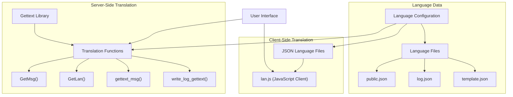
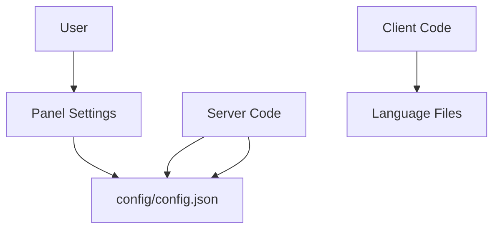
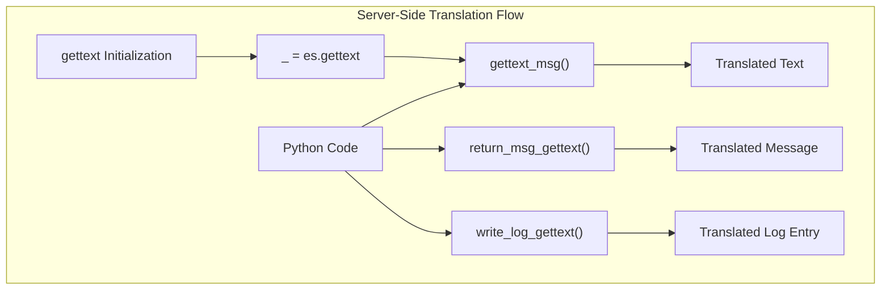
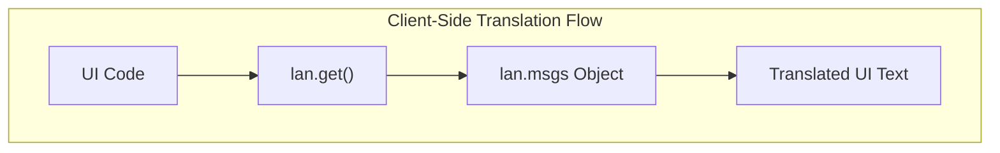
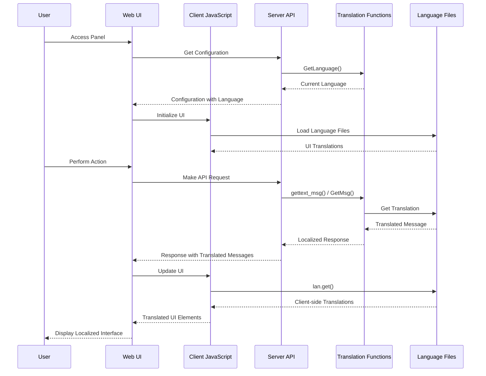
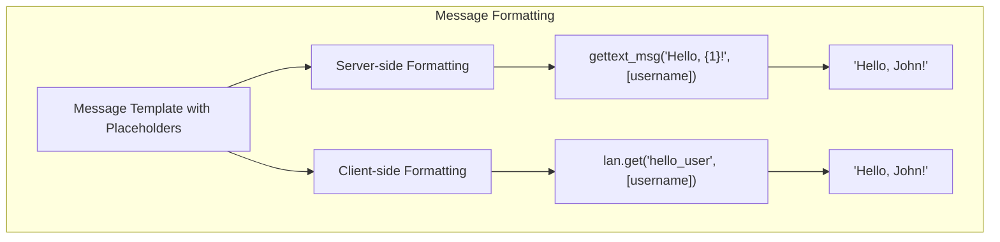
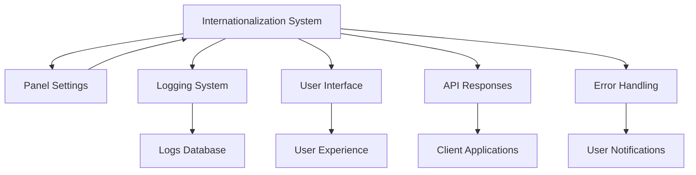

# Internationalization and Localization

> **Relevant source files**
> * [BTPanel/languages/all/cht.json](https://github.com/aaPanel/aaPanel/blob/b6e4ab8b/BTPanel/languages/all/cht.json)
> * [BTPanel/languages/all/en.json](https://github.com/aaPanel/aaPanel/blob/b6e4ab8b/BTPanel/languages/all/en.json)
> * [BTPanel/languages/all/zh.json](https://github.com/aaPanel/aaPanel/blob/b6e4ab8b/BTPanel/languages/all/zh.json)

This document explains how aaPanel implements internationalization (i18n) and localization (l10n) to support multiple languages throughout the system. It covers both server-side and client-side translation mechanisms, language configuration, and the overall architecture of the translation system.

For information about configuring panel settings, including language options, see [Configuration Management](/aaPanel/aaPanel/11-development-setup).

## Architecture Overview

aaPanel implements a comprehensive internationalization system using a combination of server-side and client-side translation mechanisms.



Sources: [class/public.py L15-L18](https://github.com/aaPanel/aaPanel/blob/b6e4ab8b/class/public.py#L15-L18)

 [class/public.py L379-L385](https://github.com/aaPanel/aaPanel/blob/b6e4ab8b/class/public.py#L379-L385)

 [class/public.py L451-L458](https://github.com/aaPanel/aaPanel/blob/b6e4ab8b/class/public.py#L451-L458)

 [BTPanel/static/language/English/lan.js L1-L41](https://github.com/aaPanel/aaPanel/blob/b6e4ab8b/BTPanel/static/language/English/lan.js#L1-L41)

## Language Configuration

The system language is controlled by a configuration setting that can be retrieved using the `GetLanguage()` function:



The language setting affects both server-side translations (via gettext) and client-side translations (via JSON language files).

Sources: [class/public.py L451-L458](https://github.com/aaPanel/aaPanel/blob/b6e4ab8b/class/public.py#L451-L458)

 [class/public.py L460-L488](https://github.com/aaPanel/aaPanel/blob/b6e4ab8b/class/public.py#L460-L488)

## Translation Mechanisms

### Server-Side Translation

Server-side translation in aaPanel uses Python's gettext library, initialized in `public.py`:



Key server-side translation functions:

| Function | Purpose | Source |
| --- | --- | --- |
| `gettext_msg(msg, args)` | Translates and formats messages with arguments | [public.py L379-L385](https://github.com/aaPanel/aaPanel/blob/b6e4ab8b/public.py#L379-L385) |
| `write_log_gettext(type, logmsg, args, not_web)` | Writes logs with translated messages | [public.py L387-L409](https://github.com/aaPanel/aaPanel/blob/b6e4ab8b/public.py#L387-L409) |
| `return_msg_gettext(status, msg, args)` | Returns status messages with translations | [public.py L237-L244](https://github.com/aaPanel/aaPanel/blob/b6e4ab8b/public.py#L237-L244) |
| `GetMsg(key, args)` | Gets translations from public.json | [public.py L505-L519](https://github.com/aaPanel/aaPanel/blob/b6e4ab8b/public.py#L505-L519) |
| `GetLan(key)` | Gets translations from template.json | [public.py L489-L503](https://github.com/aaPanel/aaPanel/blob/b6e4ab8b/public.py#L489-L503) |

Sources: [class/public.py L15-L18](https://github.com/aaPanel/aaPanel/blob/b6e4ab8b/class/public.py#L15-L18)

 [class/public.py L379-L385](https://github.com/aaPanel/aaPanel/blob/b6e4ab8b/class/public.py#L379-L385)

 [class/public.py L387-L409](https://github.com/aaPanel/aaPanel/blob/b6e4ab8b/class/public.py#L387-L409)

 [class/public.py L237-L244](https://github.com/aaPanel/aaPanel/blob/b6e4ab8b/class/public.py#L237-L244)

 [class/public.py L505-L519](https://github.com/aaPanel/aaPanel/blob/b6e4ab8b/class/public.py#L505-L519)

 [class/public.py L489-L503](https://github.com/aaPanel/aaPanel/blob/b6e4ab8b/class/public.py#L489-L503)

### Client-Side Translation

Client-side translation uses JSON files and JavaScript functions:



The main client-side translation mechanism is the `lan.get()` function in `lan.js`:

```javascript
get: function(key, args) {
    var msgs = {
        "diskinfo_span_1":"Available space on disk partition [{1}] is less than 1GB...",
        // More messages...
    }
    
    if(!msgs[key]) return '';
    msg = msgs[key];
    for(var i=0; i<args.length; i++){
        msg = msg.replace('{'+(i+1)+'}', args[i]+'');
    }
    
    return msg;
}
```

Sources: [BTPanel/static/language/English/lan.js L1-L41](https://github.com/aaPanel/aaPanel/blob/b6e4ab8b/BTPanel/static/language/English/lan.js#L1-L41)

## Language Files Organization

aaPanel organizes translations in a structured directory hierarchy:

```markdown
BTPanel/static/language/
├── English/
│   ├── lan.js          # JavaScript UI translations
│   ├── log.json        # Log message translations
│   ├── public.json     # Public message translations
│   └── template.json   # Template message translations
└── [Other Languages]/
    ├── ...
```

Each language file serves a specific purpose:

| File | Purpose | Example Content |
| --- | --- | --- |
| `lan.js` | Client-side UI translations | UI messages, confirmations, errors |
| `log.json` | System log messages | Operation logs, status changes |
| `public.json` | General-purpose messages | Common messages, errors, status notifications |
| `template.json` | UI template messages | Page titles, section headers, button labels |

Sources: [BTPanel/static/language/English/lan.js](https://github.com/aaPanel/aaPanel/blob/b6e4ab8b/BTPanel/static/language/English/lan.js)

 [BTPanel/static/language/English/log.json](https://github.com/aaPanel/aaPanel/blob/b6e4ab8b/BTPanel/static/language/English/log.json)

 [BTPanel/static/language/English/public.json](https://github.com/aaPanel/aaPanel/blob/b6e4ab8b/BTPanel/static/language/English/public.json)

 [BTPanel/static/language/English/template.json](https://github.com/aaPanel/aaPanel/blob/b6e4ab8b/BTPanel/static/language/English/template.json)

## Translation Process Flow

When a user interacts with aaPanel, translations flow through the system as follows:



Sources: [class/public.py L379-L385](https://github.com/aaPanel/aaPanel/blob/b6e4ab8b/class/public.py#L379-L385)

 [class/public.py L451-L458](https://github.com/aaPanel/aaPanel/blob/b6e4ab8b/class/public.py#L451-L458)

 [BTPanel/static/language/English/lan.js L1-L41](https://github.com/aaPanel/aaPanel/blob/b6e4ab8b/BTPanel/static/language/English/lan.js#L1-L41)

## Message Formatting

Both server-side and client-side translation functions support parameter substitution:



Examples of message formatting:

1. Server-side with `gettext_msg()`: ```markdown gettext_msg("SUCCESS_ADD", [item_name])  # "Successfully added {1}" ```
2. Client-side with `lan.get()`: ```sql lan.get("del", ["my_file.txt"])  # "Delete [{1}]" ```

Sources: [class/public.py L379-L385](https://github.com/aaPanel/aaPanel/blob/b6e4ab8b/class/public.py#L379-L385)

 [BTPanel/static/language/English/lan.js L1-L41](https://github.com/aaPanel/aaPanel/blob/b6e4ab8b/BTPanel/static/language/English/lan.js#L1-L41)

## Relationship to Other Systems

The internationalization system interacts with various components of aaPanel:



The logging system particularly relies on translated messages through the `write_log_gettext()` function, which ensures log entries are stored in the user's configured language.

Sources: [class/public.py L387-L409](https://github.com/aaPanel/aaPanel/blob/b6e4ab8b/class/public.py#L387-L409)

 [class/public.py L410-L449](https://github.com/aaPanel/aaPanel/blob/b6e4ab8b/class/public.py#L410-L449)

## Adding New Languages

To add support for a new language:

1. Create a new directory in `BTPanel/static/language/` with the language name
2. Create the required files (`lan.js`, `log.json`, `public.json`, `template.json`)
3. Translate all messages in these files
4. Configure gettext to recognize the new language

## Conclusion

aaPanel's internationalization and localization system provides a comprehensive solution for supporting multiple languages throughout the application. By using a combination of gettext for server-side translations and JSON files for client-side translations, it ensures a consistent multilingual experience for users.

The system is designed to be easily extensible with new languages and provides developers with clear methods for ensuring their code supports internationalization through the provided translation functions.