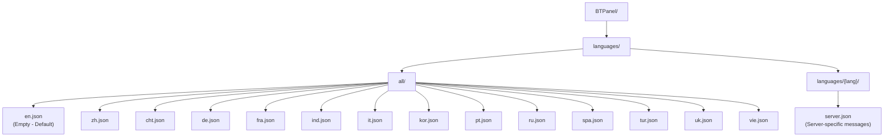
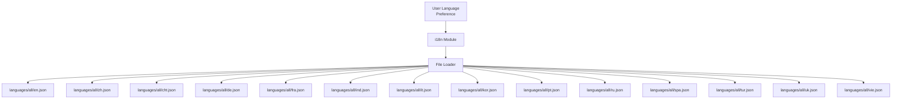
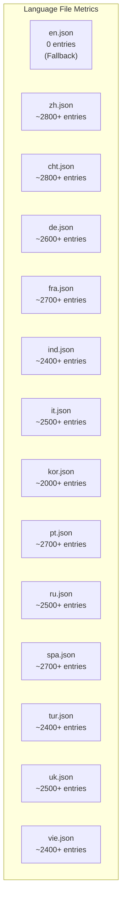

# Language Support Matrix

> **Relevant source files**
> * [BTPanel/languages/all/cht.json](https://github.com/aaPanel/aaPanel/blob/b6e4ab8b/BTPanel/languages/all/cht.json)
> * [BTPanel/languages/all/de.json](https://github.com/aaPanel/aaPanel/blob/b6e4ab8b/BTPanel/languages/all/de.json)
> * [BTPanel/languages/all/en.json](https://github.com/aaPanel/aaPanel/blob/b6e4ab8b/BTPanel/languages/all/en.json)
> * [BTPanel/languages/all/fra.json](https://github.com/aaPanel/aaPanel/blob/b6e4ab8b/BTPanel/languages/all/fra.json)
> * [BTPanel/languages/all/ind.json](https://github.com/aaPanel/aaPanel/blob/b6e4ab8b/BTPanel/languages/all/ind.json)
> * [BTPanel/languages/all/it.json](https://github.com/aaPanel/aaPanel/blob/b6e4ab8b/BTPanel/languages/all/it.json)
> * [BTPanel/languages/all/kor.json](https://github.com/aaPanel/aaPanel/blob/b6e4ab8b/BTPanel/languages/all/kor.json)
> * [BTPanel/languages/all/pt.json](https://github.com/aaPanel/aaPanel/blob/b6e4ab8b/BTPanel/languages/all/pt.json)
> * [BTPanel/languages/all/ru.json](https://github.com/aaPanel/aaPanel/blob/b6e4ab8b/BTPanel/languages/all/ru.json)
> * [BTPanel/languages/all/spa.json](https://github.com/aaPanel/aaPanel/blob/b6e4ab8b/BTPanel/languages/all/spa.json)
> * [BTPanel/languages/all/tur.json](https://github.com/aaPanel/aaPanel/blob/b6e4ab8b/BTPanel/languages/all/tur.json)
> * [BTPanel/languages/all/uk.json](https://github.com/aaPanel/aaPanel/blob/b6e4ab8b/BTPanel/languages/all/uk.json)
> * [BTPanel/languages/all/vie.json](https://github.com/aaPanel/aaPanel/blob/b6e4ab8b/BTPanel/languages/all/vie.json)
> * [BTPanel/languages/all/zh.json](https://github.com/aaPanel/aaPanel/blob/b6e4ab8b/BTPanel/languages/all/zh.json)

This page provides a comprehensive reference of all languages supported by aaPanel, including language codes, file locations, and the structure of translation files. For information about the overall localization architecture and how language selection works, see [Internationalization and Localization](/aaPanel/aaPanel/8-internationalization-and-localization). For instructions on adding support for new languages, see [Adding New Languages](/aaPanel/aaPanel/8.2-adding-new-languages).

## Overview

aaPanel supports 14 languages through a JSON-based localization system. Each language has its own translation file containing key-value pairs where keys are MD5 hashes of English strings and values are translated strings. The English language file is intentionally empty as English text is used as the default fallback throughout the codebase.

Translation files are organized in the `BTPanel/languages/all/` directory with additional server-specific messages in `BTPanel/languages/{lang}/server.json` files (when applicable).

## Supported Languages

The following table lists all supported languages with their language codes, file locations, and approximate entry counts:

| Language | Language Code | File Path | Status |
| --- | --- | --- | --- |
| English (Default) | `en` | `BTPanel/languages/all/en.json` | Empty (fallback) |
| Simplified Chinese | `zh` | `BTPanel/languages/all/zh.json` | ~2800+ entries |
| Traditional Chinese | `cht` | `BTPanel/languages/all/cht.json` | ~2800+ entries |
| German | `de` | `BTPanel/languages/all/de.json` | ~2600+ entries |
| French | `fra` | `BTPanel/languages/all/fra.json` | ~2700+ entries |
| Indonesian | `ind` | `BTPanel/languages/all/ind.json` | ~2400+ entries |
| Italian | `it` | `BTPanel/languages/all/it.json` | ~2500+ entries |
| Korean | `kor` | `BTPanel/languages/all/kor.json` | ~2000+ entries |
| Portuguese | `pt` | `BTPanel/languages/all/pt.json` | ~2700+ entries |
| Russian | `ru` | `BTPanel/languages/all/ru.json` | ~2500+ entries |
| Spanish | `spa` | `BTPanel/languages/all/spa.json` | ~2700+ entries |
| Turkish | `tur` | `BTPanel/languages/all/tur.json` | ~2400+ entries |
| Ukrainian | `uk` | `BTPanel/languages/all/uk.json` | ~2500+ entries |
| Vietnamese | `vie` | `BTPanel/languages/all/vie.json` | ~2400+ entries |

## Language File Structure

### Directory Layout



**Sources:**

* [BTPanel/languages/all/en.json L1](https://github.com/aaPanel/aaPanel/blob/b6e4ab8b/BTPanel/languages/all/en.json#L1-L1)
* [BTPanel/languages/all/zh.json L1](https://github.com/aaPanel/aaPanel/blob/b6e4ab8b/BTPanel/languages/all/zh.json#L1-L1)
* [BTPanel/languages/all/cht.json L1](https://github.com/aaPanel/aaPanel/blob/b6e4ab8b/BTPanel/languages/all/cht.json#L1-L1)

### JSON Key-Value Format

Each language file follows a consistent JSON structure where:

* **Keys**: 32-character MD5 hashes of the original English text
* **Values**: Translated strings in the target language

**Example from Traditional Chinese (cht.json):**

```json
{
    "807e31c87b236897fa1fef873d6f6e6c": "成功創建的文件！",
    "1dc8a14e9861fa32b544006590c08666": "文件移至回收箱！",
    "07cbb5e8d174369377832adc0debb2b3": "成功刪除的文件！"
}
```

**Example from German (de.json):**

```json
{
    "807e31c87b236897fa1fef873d6f6e6c": "Erfolgreich erstellte Datei!",
    "1dc8a14e9861fa32b544006590c08666": "Datei verschoben in Recycle Bin!",
    "07cbb5e8d174369377832adc0debb2b3": "Erfolgreich gelöschte Datei!"
}
```

**English Default (en.json):**

```
{}
```

The English file is intentionally empty because the codebase uses English strings directly as fallback values when a translation is not found.

**Sources:**

* [BTPanel/languages/all/cht.json L1-L10](https://github.com/aaPanel/aaPanel/blob/b6e4ab8b/BTPanel/languages/all/cht.json#L1-L10)
* [BTPanel/languages/all/de.json L1-L10](https://github.com/aaPanel/aaPanel/blob/b6e4ab8b/BTPanel/languages/all/de.json#L1-L10)
* [BTPanel/languages/all/en.json L1](https://github.com/aaPanel/aaPanel/blob/b6e4ab8b/BTPanel/languages/all/en.json#L1-L1)

## Language Code to File Mapping

The system uses specific language codes to locate translation files. The mapping follows this pattern:



**Sources:**

* Based on file structure observed in BTPanel/languages/all/ directory

## Translation Coverage Categories

### Common UI Strings

All language files in `BTPanel/languages/all/` contain translations for common UI elements, messages, and system responses used throughout the application. These include:

* **File Operations**: Success/error messages for file creation, deletion, copying, moving
* **System Messages**: Status updates, validation errors, configuration changes
* **User Notifications**: Warnings, confirmations, information dialogs
* **Module-specific Strings**: Website management, database operations, plugin messages

### Server-Specific Messages

Additional translation files may exist in `BTPanel/languages/{lang}/server.json` for backend server messages that are language-specific. These are separate from the common UI strings.

**Sources:**

* [BTPanel/languages/all/cht.json L1-L100](https://github.com/aaPanel/aaPanel/blob/b6e4ab8b/BTPanel/languages/all/cht.json#L1-L100)
* [BTPanel/languages/all/de.json L1-L100](https://github.com/aaPanel/aaPanel/blob/b6e4ab8b/BTPanel/languages/all/de.json#L1-L100)
* [BTPanel/languages/all/fra.json L1-L100](https://github.com/aaPanel/aaPanel/blob/b6e4ab8b/BTPanel/languages/all/fra.json#L1-L100)

## Language Code Reference

### ISO-Like Codes

| Code | Language | Native Name |
| --- | --- | --- |
| `en` | English | English |
| `zh` | Simplified Chinese | 简体中文 |
| `cht` | Traditional Chinese | 繁體中文 |
| `de` | German | Deutsch |
| `fra` | French | Français |
| `ind` | Indonesian | Bahasa Indonesia |
| `it` | Italian | Italiano |
| `kor` | Korean | 한국어 |
| `pt` | Portuguese | Português |
| `ru` | Russian | Русский |
| `spa` | Spanish | Español |
| `tur` | Turkish | Türkçe |
| `uk` | Ukrainian | Українська |
| `vie` | Vietnamese | Tiếng Việt |

### Note on Language Code Conventions

The system uses a mix of ISO 639-1 (two-letter codes like `en`, `de`, `it`) and three-letter codes (`fra`, `ind`, `kor`, `spa`, `tur`, `vie`, `cht`). The `cht` code specifically distinguishes Traditional Chinese from Simplified Chinese (`zh`).

**Sources:**

* Observed from filenames in BTPanel/languages/all/

## Translation Key Format

### MD5 Hash Generation

Translation keys are MD5 hashes of the original English text. This ensures:

1. Consistent key generation across different parts of the codebase
2. No character encoding issues in JSON keys
3. Immutable keys regardless of English text updates

**Example Key Generation:**

```
Original Text: "Successfully created file!"
MD5 Hash: 807e31c87b236897fa1fef873d6f6e6c
```

This hash becomes the key in all language files, pointing to the translated version of "Successfully created file!" in each language.

### String Interpolation

Some translated strings contain placeholder patterns for dynamic values:

**Examples from language files:**

```json
{
    "d10984c79639f3a0f9be476c18f357f5": "備份版本的數量已超過{}，請轉到右上角[備份權限]以清理舊備份之前",
    "b70e465b995bdb2584c99c159c4f4246": "路徑不正確{}"
}
```

The `{}` markers indicate where dynamic values will be interpolated at runtime.

**Sources:**

* [BTPanel/languages/all/cht.json L89-L91](https://github.com/aaPanel/aaPanel/blob/b6e4ab8b/BTPanel/languages/all/cht.json#L89-L91)
* [BTPanel/languages/all/de.json L95-L98](https://github.com/aaPanel/aaPanel/blob/b6e4ab8b/BTPanel/languages/all/de.json#L95-L98)

## File Size and Coverage Statistics



**Coverage Notes:**

* Traditional Chinese (cht) and Simplified Chinese (zh) have the most comprehensive translations
* All non-English languages have substantial coverage (2000+ entries)
* Korean has slightly fewer entries but still provides core functionality coverage
* English remains empty as it serves as the source language

**Sources:**

* Estimated from file sizes observed in provided files
* [BTPanel/languages/all/en.json L1](https://github.com/aaPanel/aaPanel/blob/b6e4ab8b/BTPanel/languages/all/en.json#L1-L1)
* [BTPanel/languages/all/cht.json L1-L2800](https://github.com/aaPanel/aaPanel/blob/b6e4ab8b/BTPanel/languages/all/cht.json#L1-L2800)
* [BTPanel/languages/all/zh.json L1-L2800](https://github.com/aaPanel/aaPanel/blob/b6e4ab8b/BTPanel/languages/all/zh.json#L1-L2800)

## Special Characters and Encoding

### HTML Entity Handling

Some translated strings contain HTML markup for formatting:

**Examples:**

```css
{
    "5b543e9330be7ac350668b11a302b001": "錯誤：<br> <font style =",
    "f9042e5392acaa2809c35adb664bd064": "Fehler: <br> <font style = \"color: rot;\">"
}
```

### Escape Sequences

Language files properly escape special characters in JSON:

* Double quotes: `\"`
* Backslashes: `\\`
* Line breaks: `<br>` (HTML) or `\n` (escaped)

**Sources:**

* [BTPanel/languages/all/cht.json L55-L97](https://github.com/aaPanel/aaPanel/blob/b6e4ab8b/BTPanel/languages/all/cht.json#L55-L97)
* [BTPanel/languages/all/de.json L97-L99](https://github.com/aaPanel/aaPanel/blob/b6e4ab8b/BTPanel/languages/all/de.json#L97-L99)

## Regional Variants

### Chinese Language Variants

The system supports two distinct Chinese variants:

| Code | Variant | Script | Primary Regions |
| --- | --- | --- | --- |
| `zh` | Simplified Chinese | 简体字 | Mainland China, Singapore |
| `cht` | Traditional Chinese | 繁體字 | Taiwan, Hong Kong, Macau |

Both variants have comprehensive translation coverage with identical key sets but different character representations.

**Example of same key in both variants:**

**Simplified (`zh`):**

```
"807e31c87b236897fa1fef873d6f6e6c": "成功创建文件！"
```

**Traditional (`cht`):**

```
"807e31c87b236897fa1fef873d6f6e6c": "成功創建的文件！"
```

**Sources:**

* [BTPanel/languages/all/zh.json L1-L10](https://github.com/aaPanel/aaPanel/blob/b6e4ab8b/BTPanel/languages/all/zh.json#L1-L10)
* [BTPanel/languages/all/cht.json L1-L10](https://github.com/aaPanel/aaPanel/blob/b6e4ab8b/BTPanel/languages/all/cht.json#L1-L10)

## Translation String Categories

### System Operations

Messages related to file management, system configuration, and administrative tasks.

### Error Messages

Validation errors, operation failures, and warning messages.

### Success Confirmations

Positive feedback for completed operations.

### Configuration Dialogs

Text for settings panels, configuration wizards, and setup interfaces.

### Module-Specific Content

Translations for specific features like website management, FTP, databases, SSL certificates, etc.

**Sources:**

* [BTPanel/languages/all/cht.json L1-L700](https://github.com/aaPanel/aaPanel/blob/b6e4ab8b/BTPanel/languages/all/cht.json#L1-L700)
* [BTPanel/languages/all/de.json L1-L600](https://github.com/aaPanel/aaPanel/blob/b6e4ab8b/BTPanel/languages/all/de.json#L1-L600)
* [BTPanel/languages/all/fra.json L1-L650](https://github.com/aaPanel/aaPanel/blob/b6e4ab8b/BTPanel/languages/all/fra.json#L1-L650)

## Usage in Codebase

The i18n module loads the appropriate language file based on user session preferences or system defaults. When rendering text:

1. The system generates an MD5 hash of the English string
2. Looks up the hash in the active language file
3. Returns the translated string if found
4. Falls back to the original English text if no translation exists

This architecture allows for:

* Easy addition of new languages (add new JSON file)
* Independent translation updates
* Mixed-language environments (different users see different interfaces on the same server)

**Sources:**

* Based on high-level architecture diagram description (Diagram 5)
* File structure in BTPanel/languages/all/