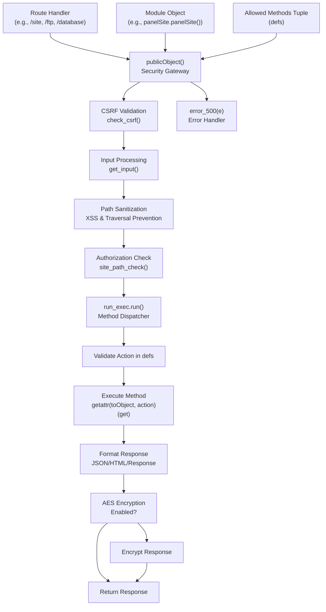
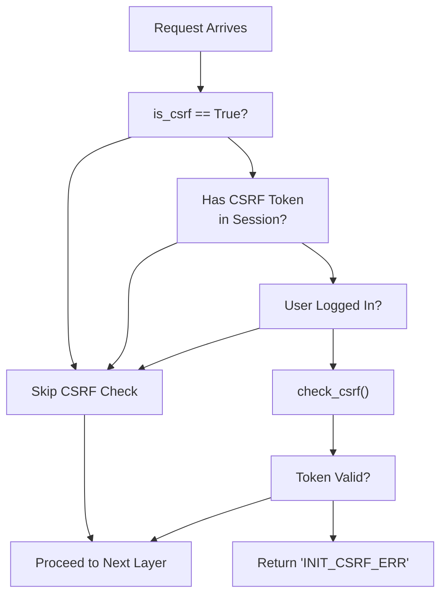
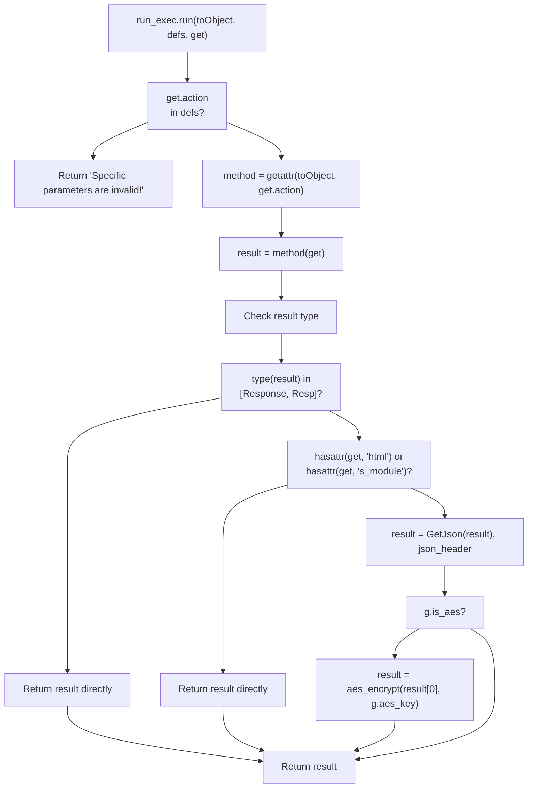
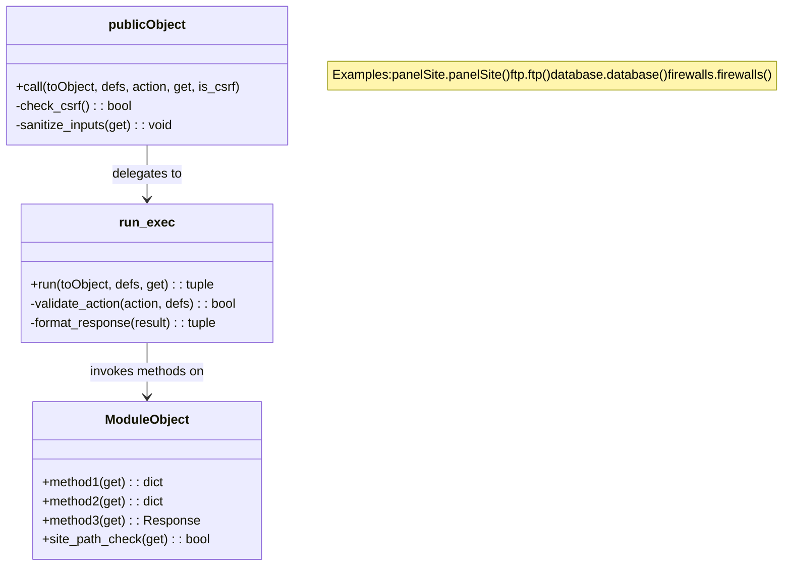
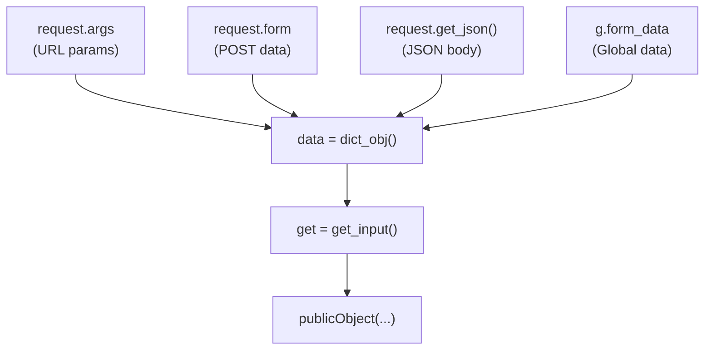
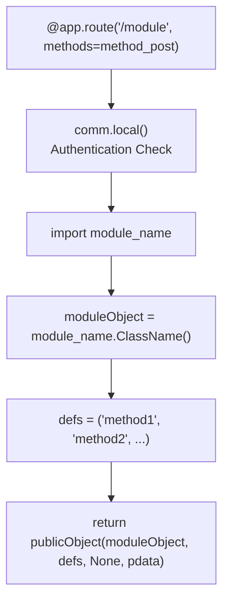

# Module Dispatch (publicObject)

> **Relevant source files**
> * [BTPanel/__init__.py](https://github.com/aaPanel/aaPanel/blob/b6e4ab8b/BTPanel/__init__.py)

## Purpose and Scope

The `publicObject` function is the central dispatching mechanism in aaPanel that provides universal routing from HTTP endpoints to module methods. It acts as a security gateway and standardizes request handling across all feature modules. This function enforces CSRF protection, validates and sanitizes inputs, checks authorization boundaries, dispatches method calls, and formats responses consistently.

This document covers the internal mechanics of `publicObject`, its security enforcement layers, and how it integrates with the module system. For information about how routes are defined and mapped to modules, see [Module System and Routing](/aaPanel/aaPanel/4-module-system-and-routing). For API versioning strategies, see [API Versioning](/aaPanel/aaPanel/4.2-api-versioning).

**Sources:** [BTPanel/__init__.py L2697-L2732](https://github.com/aaPanel/aaPanel/blob/b6e4ab8b/BTPanel/__init__.py#L2697-L2732)

---

## Architecture Overview

The `publicObject` function works in conjunction with the `run_exec` class to provide a two-stage dispatch mechanism:



**Sources:** [BTPanel/__init__.py L2697-L2732](https://github.com/aaPanel/aaPanel/blob/b6e4ab8b/BTPanel/__init__.py#L2697-L2732)

 [BTPanel/__init__.py L2664-L2686](https://github.com/aaPanel/aaPanel/blob/b6e4ab8b/BTPanel/__init__.py#L2664-L2686)

---

## Function Signature and Parameters

The `publicObject` function is defined at [BTPanel/__init__.py L2697](https://github.com/aaPanel/aaPanel/blob/b6e4ab8b/BTPanel/__init__.py#L2697-L2697)

 with the following signature:

```python
def publicObject(toObject, defs, action=None, get=None, is_csrf=True)
```

| Parameter | Type | Required | Description |
| --- | --- | --- | --- |
| `toObject` | object | Yes | Instance of the module class (e.g., `panelSite()`, `ftp()`, `database()`) |
| `defs` | tuple | Yes | Tuple of allowed method names that can be called on `toObject` |
| `action` | str | No | Pre-specified action/method name; if provided, overrides `get.action` |
| `get` | dict_obj | No | Request parameters object; if `None`, created via `get_input()` |
| `is_csrf` | bool | No | Whether to enforce CSRF validation (default: `True`) |

**Return Value:** Tuple of `(response_data, headers)` or Flask `Response` object

**Sources:** [BTPanel/__init__.py L2697-L2732](https://github.com/aaPanel/aaPanel/blob/b6e4ab8b/BTPanel/__init__.py#L2697-L2732)

---

## Dispatch Flow Diagram

```mermaid
sequenceDiagram
  participant Client
  participant Route Handler
  participant publicObject()
  participant run_exec
  participant Module Object

  Client->>Route Handler: HTTP POST /site?action=AddSite
  Route Handler->>Route Handler: Create siteObject = panelSite()
  Route Handler->>Route Handler: Define defs = ('AddSite', 'DeleteSite', ...)
  Route Handler->>publicObject(): publicObject(siteObject, defs, None, pdata)
  loop [CSRF Invalid]
    publicObject()->>publicObject(): check_csrf()
    publicObject()-->>Route Handler: ReturnJson(False, 'INIT_CSRF_ERR')
    publicObject()->>publicObject(): get = get_input() if not provided
    publicObject()->>publicObject(): get.action = action if provided
    publicObject()->>publicObject(): Sanitize get.path, get.filename, get.sfile, get.dfile
    note over publicObject(): Remove //, \, ./, ->
    publicObject()->>Module Object: site_path_check(get)
    publicObject()-->>Route Handler: ReturnJson(False, 'Overstepping one authority!')
    publicObject()->>run_exec: run_exec().run(toObject, defs, get)
    run_exec-->>publicObject(): ReturnJson(False, 'Specific parameters are invalid!')
    run_exec->>Module Object: getattr(toObject, get.action)(get)
    Module Object-->>run_exec: result
    run_exec->>run_exec: Format as JSON: GetJson(result)
    run_exec->>run_exec: aes_encrypt(result, g.aes_key)
  end
  run_exec-->>publicObject(): formatted result
  publicObject()-->>Route Handler: result
  Route Handler-->>Client: HTTP Response
```

**Sources:** [BTPanel/__init__.py L2697-L2732](https://github.com/aaPanel/aaPanel/blob/b6e4ab8b/BTPanel/__init__.py#L2697-L2732)

 [BTPanel/__init__.py L2664-L2686](https://github.com/aaPanel/aaPanel/blob/b6e4ab8b/BTPanel/__init__.py#L2664-L2686)

---

## Security Enforcement Layers

The `publicObject` function implements multiple security layers in sequence:

### Layer 1: CSRF Protection



CSRF validation checks that the `x-http-token` header matches the session token value via `check_csrf()` [BTPanel/__init__.py L2688-L2695](https://github.com/aaPanel/aaPanel/blob/b6e4ab8b/BTPanel/__init__.py#L2688-L2695)

 This prevents cross-site request forgery attacks.

**Sources:** [BTPanel/__init__.py L2700-L2702](https://github.com/aaPanel/aaPanel/blob/b6e4ab8b/BTPanel/__init__.py#L2700-L2702)

 [BTPanel/__init__.py L2688-L2695](https://github.com/aaPanel/aaPanel/blob/b6e4ab8b/BTPanel/__init__.py#L2688-L2695)

### Layer 2: Input Sanitization

The function sanitizes specific input parameters to prevent path traversal and XSS attacks:

| Parameter | Sanitization Applied |
| --- | --- |
| `get.path` | Replace `//` → `/`, `\` → `/`; reject if contains `./`; extract before `->` marker; apply `xssdecode()` |
| `get.filename` | Apply `xssdecode()` |
| `get.sfile` | Replace `//` → `/`, `\` → `/`; apply `xssdecode()` |
| `get.dfile` | Replace `//` → `/`, `\` → `/`; apply `xssdecode()` |

**Sources:** [BTPanel/__init__.py L2708-L2724](https://github.com/aaPanel/aaPanel/blob/b6e4ab8b/BTPanel/__init__.py#L2708-L2724)

### Layer 3: Site Path Authorization

If the module object implements `site_path_check()`, it is invoked to verify the user has permission to access the requested path:

```
if hasattr(toObject, 'site_path_check'):
    if not toObject.site_path_check(get):
        return public.ReturnJson(False, "Overstepping one authority!"), json_header
```

This prevents users from accessing files or directories outside their authorized scope.

**Sources:** [BTPanel/__init__.py L2726-L2729](https://github.com/aaPanel/aaPanel/blob/b6e4ab8b/BTPanel/__init__.py#L2726-L2729)

### Layer 4: Method Whitelist Validation

The `run_exec.run()` method validates that the requested action exists in the `defs` tuple:

```
if not get.action in defs:
    return public.ReturnJson(False, 'Specific parameters are invalid!'), json_header
```

This ensures only explicitly allowed methods can be invoked, preventing arbitrary method execution.

**Sources:** [BTPanel/__init__.py L2670-L2672](https://github.com/aaPanel/aaPanel/blob/b6e4ab8b/BTPanel/__init__.py#L2670-L2672)

---

## The run_exec Dispatch Class

The `run_exec` class at [BTPanel/__init__.py L2664-L2686](https://github.com/aaPanel/aaPanel/blob/b6e4ab8b/BTPanel/__init__.py#L2664-L2686)

 performs the actual method invocation:



The class uses Python's `getattr()` to dynamically invoke the method on the module object, passing the `get` parameters object.

**Sources:** [BTPanel/__init__.py L2664-L2686](https://github.com/aaPanel/aaPanel/blob/b6e4ab8b/BTPanel/__init__.py#L2664-L2686)

---

## Usage Pattern Examples

### Example 1: Website Management Module

```javascript
@app.route('/site', methods=method_post)
def site(pdata=None):
    comReturn = comm.local()
    if comReturn: return comReturn
    import panelSite
    siteObject = panelSite.panelSite()
    
    defs = (
        'AddSite',
        'DeleteSite',
        'GetPHPVersion',
        'SetPHPVersion',
        # ... more methods
    )
    return publicObject(siteObject, defs, None, pdata)
```

**Request Flow:**

1. Client sends `POST /site?action=AddSite` with form data
2. Route handler creates `panelSite.panelSite()` instance
3. Calls `publicObject(siteObject, defs, None, pdata)`
4. `publicObject` validates CSRF, sanitizes inputs
5. `run_exec` calls `siteObject.AddSite(get)`
6. Result formatted as JSON and returned

**Sources:** [BTPanel/__init__.py L855-L977](https://github.com/aaPanel/aaPanel/blob/b6e4ab8b/BTPanel/__init__.py#L855-L977)

### Example 2: Database Module with Pre-specified Action

```javascript
@app.route('/database', methods=method_post)
def database(pdata=None):
    comReturn = comm.local()
    if comReturn: return comReturn
    import database
    databaseObject = database.database()
    defs = ('AddDatabase', 'DeleteDatabase', 'SetupPassword', ...)
    return publicObject(databaseObject, defs, None, pdata)
```

**Sources:** [BTPanel/__init__.py L992-L1010](https://github.com/aaPanel/aaPanel/blob/b6e4ab8b/BTPanel/__init__.py#L992-L1010)

### Example 3: SSH Security with Disabled CSRF

```javascript
@app.route('/ssh_security', methods=method_all)
def ssh_security(pdata=None):
    comReturn = comm.local()
    if comReturn: return comReturn
    import ssh_security
    firewallObject = ssh_security.ssh_security()
    is_csrf = True
    if request.args.get('action', '') in ['download_key']: 
        is_csrf = False
    defs = ('set_password', 'set_sshkey', 'download_key', ...)
    return publicObject(firewallObject, defs, None, pdata, is_csrf)
```

CSRF is disabled for the `download_key` action because it's a GET request for file download.

**Sources:** [BTPanel/__init__.py L1069-L1089](https://github.com/aaPanel/aaPanel/blob/b6e4ab8b/BTPanel/__init__.py#L1069-L1089)

---

## Module Object Requirements

For a module to work with `publicObject`, it must:

1. **Define public methods** corresponding to the actions listed in `defs`
2. **Accept a parameter object** (typically named `get`) as the first argument to each method
3. **Return JSON-serializable data** (dict, list, etc.) or Flask `Response` objects
4. **Optionally implement** `site_path_check(get)` for path authorization



**Sources:** [BTPanel/__init__.py L2664-L2732](https://github.com/aaPanel/aaPanel/blob/b6e4ab8b/BTPanel/__init__.py#L2664-L2732)

---

## Input Parameter Processing

The `get_input()` function at [BTPanel/__init__.py L2795-L2840](https://github.com/aaPanel/aaPanel/blob/b6e4ab8b/BTPanel/__init__.py#L2795-L2840)

 creates the parameters object by merging:

1. **Query string parameters** (`request.args`)
2. **Form data** (`request.form`)
3. **JSON body** (`request.get_json()`)
4. **Global form data** (`g.form_data`)



The resulting `data` object is a `public.dict_obj()` that allows both dictionary and attribute access:

* `data['key']` or `data.key`

**Sources:** [BTPanel/__init__.py L2795-L2840](https://github.com/aaPanel/aaPanel/blob/b6e4ab8b/BTPanel/__init__.py#L2795-L2840)

---

## Response Formatting

The `run_exec` class handles response formatting based on result type:

| Result Type | Processing | Output |
| --- | --- | --- |
| `Response` or `Resp` | Return directly | Flask Response object |
| Has `get.html` attribute | Return directly | Raw result (typically HTML string) |
| Has `get.s_module` attribute | Return directly | Raw result |
| Other (dict, list, etc.) | `GetJson(result)` | `(json_string, json_header)` tuple |

If AES encryption is enabled (`g.is_aes == True`), the response is encrypted before returning.

**Sources:** [BTPanel/__init__.py L2676-L2686](https://github.com/aaPanel/aaPanel/blob/b6e4ab8b/BTPanel/__init__.py#L2676-L2686)

---

## Error Handling

All exceptions in `publicObject` are caught and passed to `error_500()`:

```yaml
try:
    # ... security checks and dispatch
    return run_exec().run(toObject, defs, get)
except Exception as e:
    return error_500(e)
```

The `error_500()` handler at [BTPanel/__init__.py L550-L654](https://github.com/aaPanel/aaPanel/blob/b6e4ab8b/BTPanel/__init__.py#L550-L654)

:

* Logs the error with full traceback
* Sanitizes sensitive data from request parameters
* Renders an error page with debugging information
* Submits error reports to the remote error collection service

**Sources:** [BTPanel/__init__.py L2730-L2732](https://github.com/aaPanel/aaPanel/blob/b6e4ab8b/BTPanel/__init__.py#L2730-L2732)

 [BTPanel/__init__.py L550-L654](https://github.com/aaPanel/aaPanel/blob/b6e4ab8b/BTPanel/__init__.py#L550-L654)

---

## Integration with Route Handlers

All route handlers follow this pattern:



This pattern is repeated for all feature modules:

* `/site` → `panelSite.panelSite()`
* `/ftp` → `ftp.ftp()`
* `/database` → `database.database()`
* `/firewall` → `firewalls.firewalls()`
* `/files` → `files.files()`
* `/crontab` → `crontab.crontab()`
* And many more...

**Sources:** [BTPanel/__init__.py L855-L977](https://github.com/aaPanel/aaPanel/blob/b6e4ab8b/BTPanel/__init__.py#L855-L977)

 [BTPanel/__init__.py L979-L990](https://github.com/aaPanel/aaPanel/blob/b6e4ab8b/BTPanel/__init__.py#L979-L990)

 [BTPanel/__init__.py L992-L1010](https://github.com/aaPanel/aaPanel/blob/b6e4ab8b/BTPanel/__init__.py#L992-L1010)

 [BTPanel/__init__.py L1054-L1066](https://github.com/aaPanel/aaPanel/blob/b6e4ab8b/BTPanel/__init__.py#L1054-L1066)

 [BTPanel/__init__.py L1265-L1301](https://github.com/aaPanel/aaPanel/blob/b6e4ab8b/BTPanel/__init__.py#L1265-L1301)

 [BTPanel/__init__.py L1303-L1314](https://github.com/aaPanel/aaPanel/blob/b6e4ab8b/BTPanel/__init__.py#L1303-L1314)

---

## Summary Table: publicObject Flow

| Stage | Component | Purpose | Error on Failure |
| --- | --- | --- | --- |
| 1 | CSRF Check | Prevent cross-site request forgery | `INIT_CSRF_ERR` |
| 2 | Input Creation | Build parameters object from request | N/A |
| 3 | Path Sanitization | Prevent path traversal and XSS | `Unsafe path` |
| 4 | Authorization Check | Verify path access permissions | `Overstepping one authority!` |
| 5 | Method Validation | Ensure method is in whitelist | `Specific parameters are invalid!` |
| 6 | Method Execution | Invoke module method | Various (module-specific) |
| 7 | Response Formatting | Convert to JSON/Response | N/A |
| 8 | AES Encryption | Encrypt if enabled | N/A |

**Sources:** [BTPanel/__init__.py L2697-L2732](https://github.com/aaPanel/aaPanel/blob/b6e4ab8b/BTPanel/__init__.py#L2697-L2732)

 [BTPanel/__init__.py L2664-L2686](https://github.com/aaPanel/aaPanel/blob/b6e4ab8b/BTPanel/__init__.py#L2664-L2686)