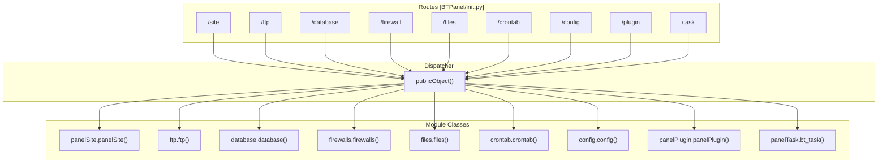
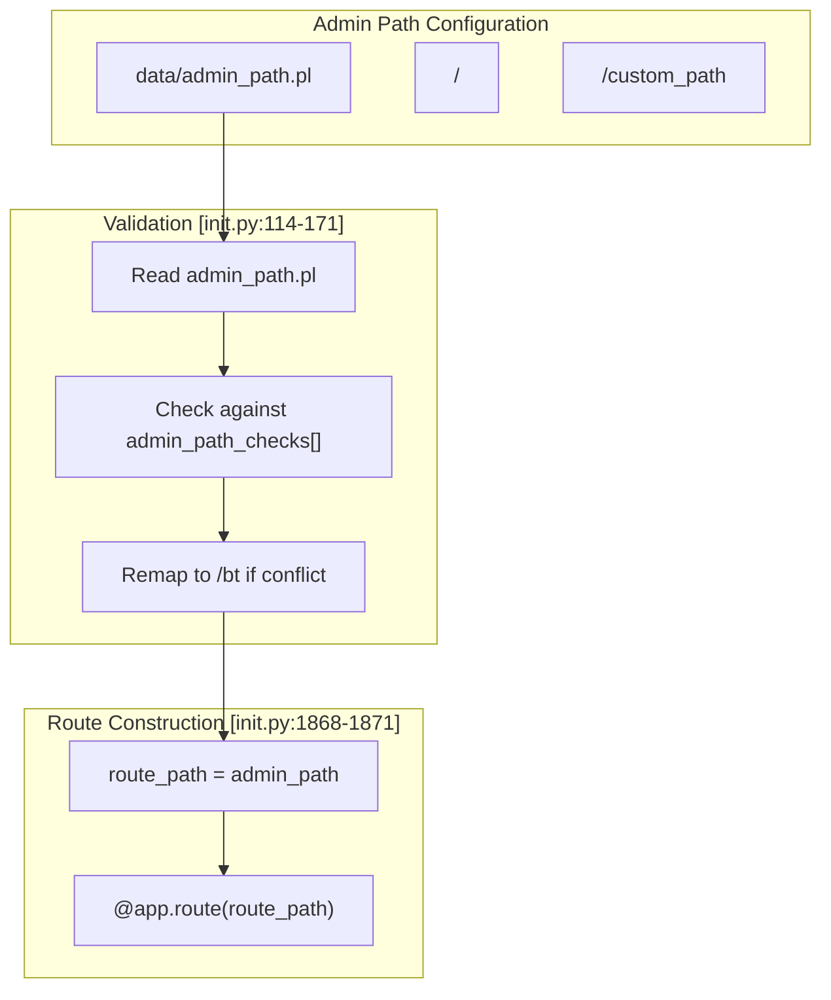
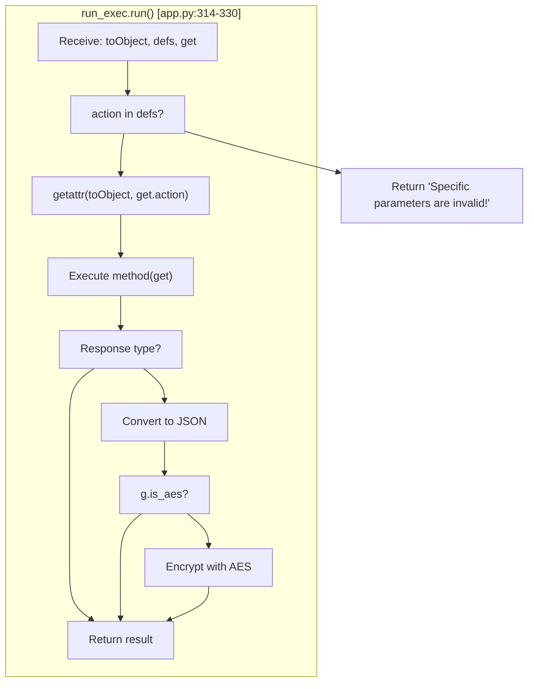
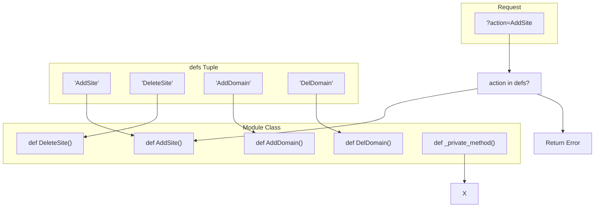
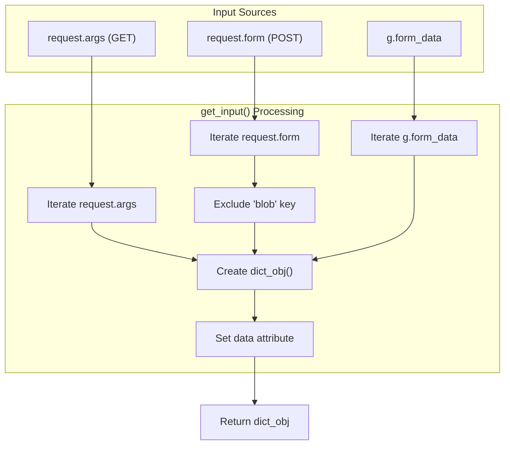
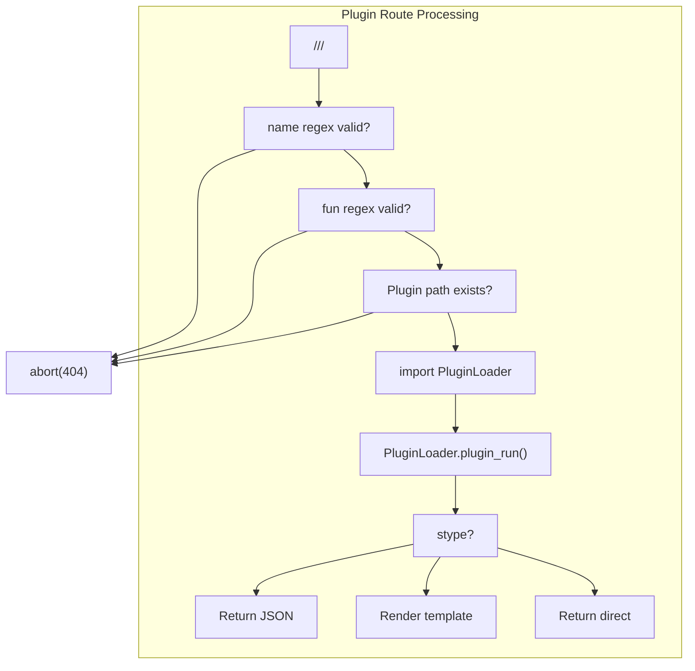
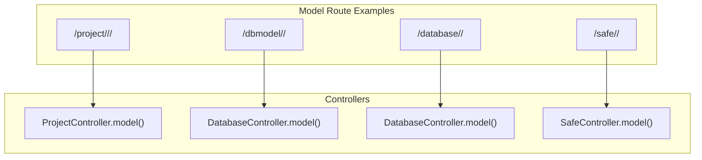
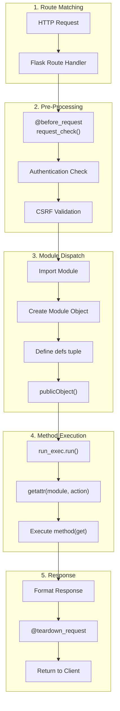
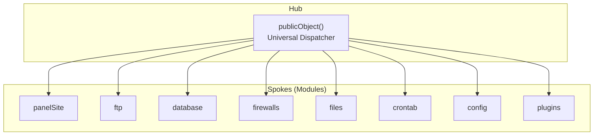

# Module System and Routing

> **Relevant source files**
> * [BTPanel/__init__.py](https://github.com/aaPanel/aaPanel/blob/b6e4ab8b/BTPanel/__init__.py)
> * [BTPanel/app.py](https://github.com/aaPanel/aaPanel/blob/b6e4ab8b/BTPanel/app.py)

This document describes aaPanel's module system and routing architecture. It covers how HTTP requests are mapped to routes, how routes dispatch to feature modules, and how the universal dispatcher pattern (`publicObject`) provides consistent security and execution across all modules.

For authentication and session handling, see [Authentication and Session Management](/aaPanel/aaPanel/3.1-authentication-and-session-management). For security validation details, see [Security and Input Validation](/aaPanel/aaPanel/3.2-security-and-input-validation). For CSRF protection mechanisms, see [CSRF Protection](/aaPanel/aaPanel/3.3-csrf-protection). For individual feature module documentation, see [Feature Modules](/aaPanel/aaPanel/5-feature-modules).

---

## Routing Architecture

aaPanel uses Flask's routing system with a consistent pattern: routes are defined at the application level and dispatch to feature modules through a universal dispatcher.

### Route Definitions

Routes are defined in [BTPanel/__init__.py L676-L2088](https://github.com/aaPanel/aaPanel/blob/b6e4ab8b/BTPanel/__init__.py#L676-L2088)

 using Flask decorators. Each route corresponds to a feature area:

```

```

### Core Route-to-Module Mapping



**Sources:** [BTPanel/__init__.py L855-L976](https://github.com/aaPanel/aaPanel/blob/b6e4ab8b/BTPanel/__init__.py#L855-L976)

 [BTPanel/__init__.py L979-L989](https://github.com/aaPanel/aaPanel/blob/b6e4ab8b/BTPanel/__init__.py#L979-L989)

 [BTPanel/__init__.py L992-L1009](https://github.com/aaPanel/aaPanel/blob/b6e4ab8b/BTPanel/__init__.py#L992-L1009)

 [BTPanel/__init__.py L1054-L1065](https://github.com/aaPanel/aaPanel/blob/b6e4ab8b/BTPanel/__init__.py#L1054-L1065)

 [BTPanel/__init__.py L1265-L1300](https://github.com/aaPanel/aaPanel/blob/b6e4ab8b/BTPanel/__init__.py#L1265-L1300)

 [BTPanel/__init__.py L1303-L1313](https://github.com/aaPanel/aaPanel/blob/b6e4ab8b/BTPanel/__init__.py#L1303-L1313)

 [BTPanel/__init__.py L1316-L1471](https://github.com/aaPanel/aaPanel/blob/b6e4ab8b/BTPanel/__init__.py#L1316-L1471)

 [BTPanel/__init__.py L1626-L1642](https://github.com/aaPanel/aaPanel/blob/b6e4ab8b/BTPanel/__init__.py#L1626-L1642)

 [BTPanel/__init__.py L1613-L1623](https://github.com/aaPanel/aaPanel/blob/b6e4ab8b/BTPanel/__init__.py#L1613-L1623)

### Route Table

| Route Path | HTTP Method | Module Class | Module File | Line Reference |
| --- | --- | --- | --- | --- |
| `/site` | POST | `panelSite.panelSite()` | `class/panelSite.py` | [BTPanel/__init__.py L855-L976](https://github.com/aaPanel/aaPanel/blob/b6e4ab8b/BTPanel/__init__.py#L855-L976) |
| `/ftp` | POST | `ftp.ftp()` | `class/ftp.py` | [BTPanel/__init__.py L979-L989](https://github.com/aaPanel/aaPanel/blob/b6e4ab8b/BTPanel/__init__.py#L979-L989) |
| `/database` | POST | `database.database()` | `class/database.py` | [BTPanel/__init__.py L992-L1009](https://github.com/aaPanel/aaPanel/blob/b6e4ab8b/BTPanel/__init__.py#L992-L1009) |
| `/firewall` | POST | `firewalls.firewalls()` | `class/firewalls.py` | [BTPanel/__init__.py L1054-L1065](https://github.com/aaPanel/aaPanel/blob/b6e4ab8b/BTPanel/__init__.py#L1054-L1065) |
| `/files` | POST/GET | `files.files()` | `class/files.py` | [BTPanel/__init__.py L1265-L1300](https://github.com/aaPanel/aaPanel/blob/b6e4ab8b/BTPanel/__init__.py#L1265-L1300) |
| `/crontab` | POST | `crontab.crontab()` | `class/crontab.py` | [BTPanel/__init__.py L1303-L1313](https://github.com/aaPanel/aaPanel/blob/b6e4ab8b/BTPanel/__init__.py#L1303-L1313) |
| `/config` | POST | `config.config()` | `class/config.py` | [BTPanel/__init__.py L1316-L1471](https://github.com/aaPanel/aaPanel/blob/b6e4ab8b/BTPanel/__init__.py#L1316-L1471) |
| `/plugin` | ALL | `panelPlugin.panelPlugin()` | `class/panelPlugin.py` | [BTPanel/__init__.py L1626-L1642](https://github.com/aaPanel/aaPanel/blob/b6e4ab8b/BTPanel/__init__.py#L1626-L1642) |
| `/task` | ALL | `panelTask.bt_task()` | `class/panelTask.py` | [BTPanel/__init__.py L1613-L1623](https://github.com/aaPanel/aaPanel/blob/b6e4ab8b/BTPanel/__init__.py#L1613-L1623) |
| `/ajax` | ALL | `ajax.ajax()` | `class/ajax.py` | [BTPanel/__init__.py L1512-L1536](https://github.com/aaPanel/aaPanel/blob/b6e4ab8b/BTPanel/__init__.py#L1512-L1536) |
| `/system` | ALL | `system.system()` | `class/system.py` | [BTPanel/__init__.py L1539-L1551](https://github.com/aaPanel/aaPanel/blob/b6e4ab8b/BTPanel/__init__.py#L1539-L1551) |

**Sources:** [BTPanel/__init__.py L855-L1551](https://github.com/aaPanel/aaPanel/blob/b6e4ab8b/BTPanel/__init__.py#L855-L1551)

### Admin Path Customization

The admin path can be customized for security through obscurity. The system validates and remaps the path if it conflicts with reserved paths:



**Sources:** [BTPanel/__init__.py L114-L171](https://github.com/aaPanel/aaPanel/blob/b6e4ab8b/BTPanel/__init__.py#L114-L171)

 [BTPanel/__init__.py L1868-L1876](https://github.com/aaPanel/aaPanel/blob/b6e4ab8b/BTPanel/__init__.py#L1868-L1876)

The `admin_path_checks` list [BTPanel/__init__.py L118-L169](https://github.com/aaPanel/aaPanel/blob/b6e4ab8b/BTPanel/__init__.py#L118-L169)

 contains reserved paths that cannot be used as custom admin paths.

---

## Module Dispatch System

The module dispatch system uses the `publicObject()` function as a universal dispatcher that enforces security, validates input, and executes module methods.

### Request Flow Through publicObject

```mermaid
sequenceDiagram
  participant Flask Route
  participant publicObject()
  participant check_csrf()
  participant get_input()
  participant run_exec.run()
  participant Module Method

  Flask Route->>publicObject(): publicObject(moduleObj, defs, action, get)
  publicObject()->>check_csrf(): Validate CSRF token
  loop [CSRF Invalid]
    check_csrf()-->>Flask Route: Return 'INIT_CSRF_ERR'
    publicObject()->>get_input(): get_input() if not provided
    publicObject()->>publicObject(): Sanitize path parameters
    note over publicObject(): Replace '//', check './', decode XSS
    publicObject()->>Module Method: Check site_path_check() if exists
    publicObject()-->>Flask Route: Return "Overstepping one authority!"
  end
  publicObject()->>run_exec.run(): run(toObject, defs, get)
  run_exec.run()->>run_exec.run(): Validate action in defs
  run_exec.run()->>Module Method: getattr(toObject, action)(get)
  Module Method-->>run_exec.run(): Return result
  run_exec.run()->>run_exec.run(): Convert to JSON if needed
  run_exec.run()-->>publicObject(): Return formatted response
  publicObject()-->>Flask Route: Return response
```

**Sources:** [BTPanel/app.py L342-L376](https://github.com/aaPanel/aaPanel/blob/b6e4ab8b/BTPanel/app.py#L342-L376)

 [BTPanel/__init__.py L2649-L2683](https://github.com/aaPanel/aaPanel/blob/b6e4ab8b/BTPanel/__init__.py#L2649-L2683)

### The publicObject Function

The `publicObject()` function [BTPanel/app.py L342-L376](https://github.com/aaPanel/aaPanel/blob/b6e4ab8b/BTPanel/app.py#L342-L376)

 provides:

1. **CSRF Validation**: Checks CSRF token via `check_csrf()` [BTPanel/app.py L333-L339](https://github.com/aaPanel/aaPanel/blob/b6e4ab8b/BTPanel/app.py#L333-L339)
2. **Input Processing**: Retrieves and sanitizes request parameters via `get_input()` [BTPanel/app.py L577-L605](https://github.com/aaPanel/aaPanel/blob/b6e4ab8b/BTPanel/app.py#L577-L605)
3. **Path Sanitization**: Cleans `path`, `filename`, `sfile`, `dfile` parameters [BTPanel/app.py L353-L368](https://github.com/aaPanel/aaPanel/blob/b6e4ab8b/BTPanel/app.py#L353-L368)
4. **Site Path Checking**: Validates site-specific paths if module implements `site_path_check()`
5. **Method Execution**: Delegates to `run_exec().run()` [BTPanel/app.py L374](https://github.com/aaPanel/aaPanel/blob/b6e4ab8b/BTPanel/app.py#L374-L374)

```

```

**Sources:** [BTPanel/app.py L342-L376](https://github.com/aaPanel/aaPanel/blob/b6e4ab8b/BTPanel/app.py#L342-L376)

### The run_exec Class

The `run_exec` class [BTPanel/app.py L312-L330](https://github.com/aaPanel/aaPanel/blob/b6e4ab8b/BTPanel/app.py#L312-L330)

 handles the actual method invocation:



**Sources:** [BTPanel/app.py L312-L330](https://github.com/aaPanel/aaPanel/blob/b6e4ab8b/BTPanel/app.py#L312-L330)

The `defs` tuple acts as a whitelist of allowed methods. If `get.action` is not in `defs`, the request is rejected [BTPanel/app.py L317-L319](https://github.com/aaPanel/aaPanel/blob/b6e4ab8b/BTPanel/app.py#L317-L319)

---

## Module Structure

### Module Definition Pattern

Each feature module follows a consistent pattern:

1. **Import Module**: The route handler imports the module class
2. **Instantiate Object**: Creates an instance of the module class
3. **Define Methods**: Lists allowed methods in the `defs` tuple
4. **Dispatch**: Passes to `publicObject()`

Example from [BTPanel/__init__.py L855-L976](https://github.com/aaPanel/aaPanel/blob/b6e4ab8b/BTPanel/__init__.py#L855-L976)

:

```

```

### Method Whitelisting with defs

The `defs` tuple serves as a security boundary, explicitly listing which methods can be called:



**Sources:** [BTPanel/app.py L317-L319](https://github.com/aaPanel/aaPanel/blob/b6e4ab8b/BTPanel/app.py#L317-L319)

This pattern ensures:

* Only explicitly allowed methods are accessible
* Private methods (not in `defs`) cannot be invoked externally
* Each route defines its own security boundary

### Common Modules

| Module | Class | Methods Count | Purpose |
| --- | --- | --- | --- |
| panelSite | `panelSite.panelSite()` | 80+ | Website/virtual host management |
| ftp | `ftp.ftp()` | 8 | FTP account management |
| database | `database.database()` | 20+ | MySQL/PostgreSQL management |
| firewalls | `firewalls.firewalls()` | 10+ | Firewall rule management |
| files | `files.files()` | 60+ | File system operations |
| crontab | `crontab.crontab()` | 12 | Scheduled task management |
| config | `config.config()` | 100+ | Panel configuration |
| panelPlugin | `panelPlugin.panelPlugin()` | 25+ | Plugin system |

**Sources:** [BTPanel/__init__.py L855-L1642](https://github.com/aaPanel/aaPanel/blob/b6e4ab8b/BTPanel/__init__.py#L855-L1642)

---

## API Versioning

aaPanel supports two parallel API versions for backward compatibility during migration:

### Version 1 (Base Routes)

Base routes are accessed directly at the root level:

* `/site?action=AddSite`
* `/ftp?action=AddUser`
* `/database?action=AddDatabase`

**Sources:** [BTPanel/__init__.py L855-L1551](https://github.com/aaPanel/aaPanel/blob/b6e4ab8b/BTPanel/__init__.py#L855-L1551)

### Version 2 Routes

V2 routes use the `/v2` prefix [BTPanel/__init__.py L176](https://github.com/aaPanel/aaPanel/blob/b6e4ab8b/BTPanel/__init__.py#L176-L176)

 and are defined separately:

```

```

V2 routes follow the pattern:

* `/v2/site/...`
* `/v2/ftp/...`
* `/v2/database/...`

The system monitors V2 route usage and enforces unified response patterns [BTPanel/__init__.py L468-L489](https://github.com/aaPanel/aaPanel/blob/b6e4ab8b/BTPanel/__init__.py#L468-L489)

:

```

```

**Sources:** [BTPanel/__init__.py L468-L489](https://github.com/aaPanel/aaPanel/blob/b6e4ab8b/BTPanel/__init__.py#L468-L489)

### Migration Strategy

The dual API system allows:

1. **Gradual Migration**: Old clients continue using V1 while new features use V2
2. **Response Format Evolution**: V2 enforces standardized response formats
3. **Feature Parity**: Both versions can coexist during transition

---

## Input Processing

### get_input() Function

The `get_input()` function [BTPanel/app.py L577-L605](https://github.com/aaPanel/aaPanel/blob/b6e4ab8b/BTPanel/app.py#L577-L605)

 collects parameters from multiple sources:



**Sources:** [BTPanel/app.py L577-L605](https://github.com/aaPanel/aaPanel/blob/b6e4ab8b/BTPanel/app.py#L577-L605)

```

```

### Input Sanitization

The `publicObject()` function sanitizes specific parameters [BTPanel/app.py L353-L368](https://github.com/aaPanel/aaPanel/blob/b6e4ab8b/BTPanel/app.py#L353-L368)

:

| Parameter | Sanitization | Purpose |
| --- | --- | --- |
| `path` | Replace `//`, `\`, decode XSS, check for `./` | Prevent path traversal |
| `filename` | Decode XSS | Prevent XSS attacks |
| `sfile` | Replace `//`, `\`, decode XSS | Source file safety |
| `dfile` | Replace `//`, `\`, decode XSS | Destination file safety |

**Sources:** [BTPanel/app.py L353-L368](https://github.com/aaPanel/aaPanel/blob/b6e4ab8b/BTPanel/app.py#L353-L368)

---

## Special Route Patterns

### Plugin Routes

Plugin routes follow the pattern `/<plugin_name>/<function>` and are handled by the generic handler [BTPanel/__init__.py L2372-L2528](https://github.com/aaPanel/aaPanel/blob/b6e4ab8b/BTPanel/__init__.py#L2372-L2528)

:



**Sources:** [BTPanel/__init__.py L2372-L2528](https://github.com/aaPanel/aaPanel/blob/b6e4ab8b/BTPanel/__init__.py#L2372-L2528)

### Model Routes

Model routes provide a generic controller pattern for organized code:



**Sources:** [BTPanel/__init__.py L1191-L1220](https://github.com/aaPanel/aaPanel/blob/b6e4ab8b/BTPanel/__init__.py#L1191-L1220)

 [BTPanel/__init__.py L1250-L1262](https://github.com/aaPanel/aaPanel/blob/b6e4ab8b/BTPanel/__init__.py#L1250-L1262)

 [BTPanel/__init__.py L2241-L2260](https://github.com/aaPanel/aaPanel/blob/b6e4ab8b/BTPanel/__init__.py#L2241-L2260)

 [BTPanel/__init__.py L2264-L2284](https://github.com/aaPanel/aaPanel/blob/b6e4ab8b/BTPanel/__init__.py#L2264-L2284)

These routes use a standardized pattern where:

1. URL segments map to `mod_name` and `def_name` parameters
2. A `Controller.model()` method handles routing to the actual implementation
3. The controller uses `publicObject()` for consistency

### Static File Routes

Static files are handled specially for security [BTPanel/__init__.py L406-L451](https://github.com/aaPanel/aaPanel/blob/b6e4ab8b/BTPanel/__init__.py#L406-L451)

:

```

```

**Sources:** [BTPanel/__init__.py L406-L451](https://github.com/aaPanel/aaPanel/blob/b6e4ab8b/BTPanel/__init__.py#L406-L451)

---

## Request Lifecycle Summary



**Sources:** [BTPanel/__init__.py L265-L457](https://github.com/aaPanel/aaPanel/blob/b6e4ab8b/BTPanel/__init__.py#L265-L457)

 [BTPanel/app.py L342-L376](https://github.com/aaPanel/aaPanel/blob/b6e4ab8b/BTPanel/app.py#L342-L376)

 [BTPanel/app.py L312-L330](https://github.com/aaPanel/aaPanel/blob/b6e4ab8b/BTPanel/app.py#L312-L330)

 [BTPanel/__init__.py L460-L493](https://github.com/aaPanel/aaPanel/blob/b6e4ab8b/BTPanel/__init__.py#L460-L493)

---

## Key Design Patterns

### Universal Dispatcher Pattern

The `publicObject()` function implements a universal dispatcher that:

* **Centralizes Security**: All requests go through the same CSRF and input validation
* **Standardizes Execution**: Consistent method invocation across all modules
* **Enforces Boundaries**: Method whitelisting via `defs` tuple
* **Simplifies Modules**: Modules focus on business logic, not security

**Sources:** [BTPanel/app.py L342-L376](https://github.com/aaPanel/aaPanel/blob/b6e4ab8b/BTPanel/app.py#L342-L376)

### Hub-and-Spoke Architecture



All modules connect through the central dispatcher, ensuring:

* Consistent security enforcement
* Simplified module development
* Easy addition of new modules
* Centralized logging and monitoring

**Sources:** [BTPanel/app.py L342-L376](https://github.com/aaPanel/aaPanel/blob/b6e4ab8b/BTPanel/app.py#L342-L376)

 [BTPanel/__init__.py L855-L1642](https://github.com/aaPanel/aaPanel/blob/b6e4ab8b/BTPanel/__init__.py#L855-L1642)

### Method Whitelisting

Instead of relying on naming conventions (e.g., private methods starting with `_`), aaPanel uses explicit whitelisting:

```

```

This ensures:

* No accidental exposure of internal methods
* Clear API surface for each module
* Self-documenting interface (defs tuple shows all available operations)

**Sources:** [BTPanel/app.py L317-L319](https://github.com/aaPanel/aaPanel/blob/b6e4ab8b/BTPanel/app.py#L317-L319)