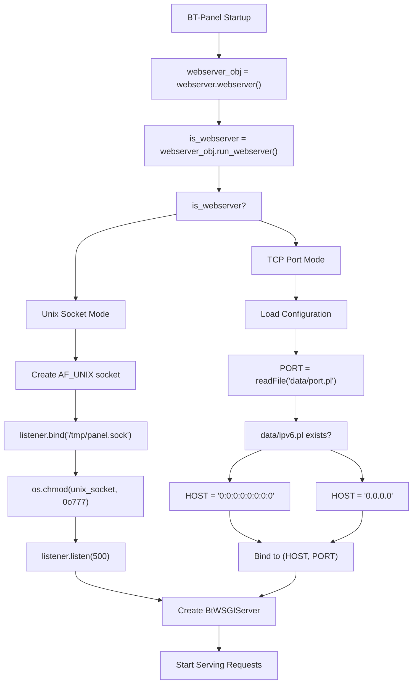
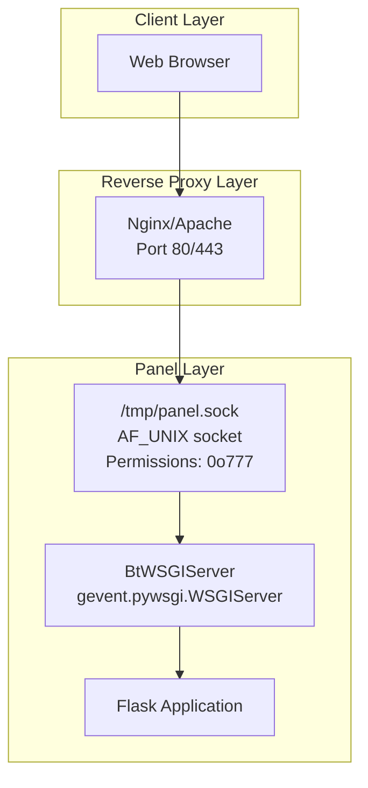
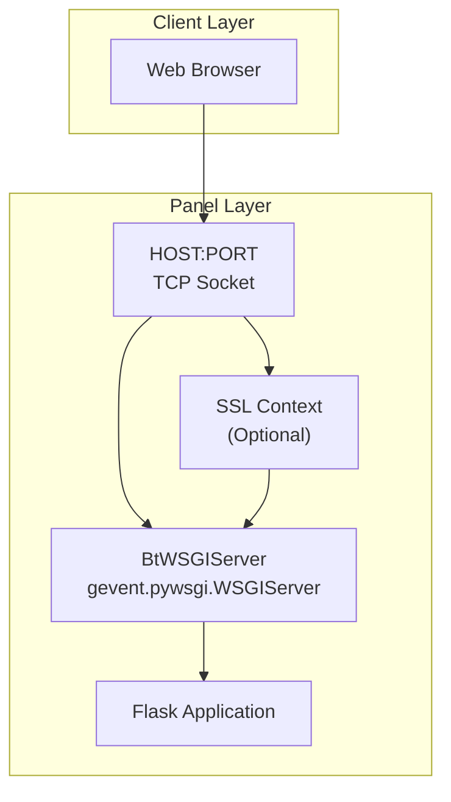
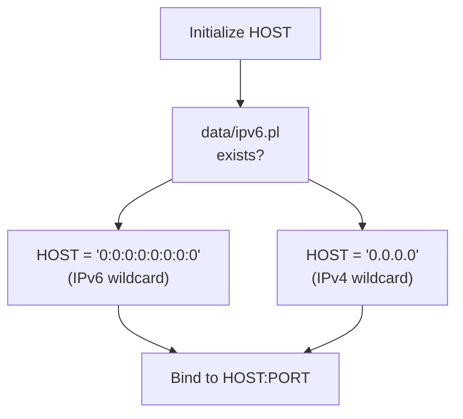

# Network Binding Modes

> **Relevant source files**
> * [BT-Panel](https://github.com/aaPanel/aaPanel/blob/b6e4ab8b/BT-Panel)

## Purpose

This document explains the two network binding modes supported by aaPanel's BT-Panel web server: Unix socket mode and TCP port mode. It covers the selection logic, configuration, and use cases for each mode.

For SSL/TLS configuration details, see [SSL/TLS Configuration](/aaPanel/aaPanel/10.1-ssltls-configuration). For reverse proxy setup with Nginx, see [Deployment Guide](/aaPanel/aaPanel/10-deployment-guide). For basic authentication setup, see [Basic Authentication Setup](/aaPanel/aaPanel/10.3-basic-authentication-setup).

## Overview

BT-Panel supports two mutually exclusive network binding modes determined at startup:

| Mode | Binding Target | Primary Use Case | Configuration |
| --- | --- | --- | --- |
| Unix Socket Mode | `/tmp/panel.sock` | Production with Nginx/Apache frontend | Determined by `webserver` module |
| TCP Port Mode | `HOST:PORT` | Direct access or development | `data/port.pl` and `data/ipv6.pl` |

The binding mode is automatically selected based on whether a webserver (Nginx or Apache) is detected and configured to proxy the panel.

Sources: [BT-Panel L328-L380](https://github.com/aaPanel/aaPanel/blob/b6e4ab8b/BT-Panel#L328-L380)

## Binding Mode Selection

### Decision Flow



**Diagram: Binding Mode Selection Logic**

The `webserver.webserver()` class determines whether Nginx or Apache is installed and configured to proxy the panel. If a compatible webserver configuration is detected, BT-Panel operates in Unix socket mode; otherwise, it uses TCP port mode.

Sources: [BT-Panel L328-L380](https://github.com/aaPanel/aaPanel/blob/b6e4ab8b/BT-Panel#L328-L380)

### Code Entry Points

| Component | File Location | Line Numbers |
| --- | --- | --- |
| Webserver detection | `class/webserver.py` | N/A (imported module) |
| Binding logic | `BT-Panel` | [328-380](https://github.com/aaPanel/aaPanel/blob/b6e4ab8b/328-380) |
| Socket creation | `BT-Panel` | [333-340](https://github.com/aaPanel/aaPanel/blob/b6e4ab8b/333-340) |
| TCP binding | `BT-Panel` | [369-380](https://github.com/aaPanel/aaPanel/blob/b6e4ab8b/369-380) |

Sources: [BT-Panel L310-L380](https://github.com/aaPanel/aaPanel/blob/b6e4ab8b/BT-Panel#L310-L380)

## Unix Socket Mode

### Architecture



**Diagram: Unix Socket Mode Architecture**

In Unix socket mode, BT-Panel creates an `AF_UNIX` socket at `/tmp/panel.sock` that accepts connections from a local webserver. The webserver handles SSL termination, static file serving, and request proxying.

Sources: [BT-Panel L332-L346](https://github.com/aaPanel/aaPanel/blob/b6e4ab8b/BT-Panel#L332-L346)

### Implementation Details

The Unix socket mode implementation consists of the following steps:

1. **Socket Creation**: Creates an `AF_UNIX` socket using `gevent.socket`
2. **Cleanup**: Removes existing socket file if present
3. **Binding**: Binds to `/tmp/panel.sock`
4. **Permissions**: Sets socket permissions to `0o777` for webserver access
5. **Listen Queue**: Configures backlog of 500 connections
6. **WSGI Server**: Initializes `BtWSGIServer` with the socket listener

```javascript
# Simplified from BT-Panel:333-346
from gevent import socket
listener = socket.socket(socket.AF_UNIX, socket.SOCK_STREAM)
unix_socket = '/tmp/panel.sock'
if os.path.exists(unix_socket):
    os.remove(unix_socket)
listener.bind(unix_socket)
listener.listen(500)
os.chmod(unix_socket, 0o777)
```

Sources: [BT-Panel L333-L346](https://github.com/aaPanel/aaPanel/blob/b6e4ab8b/BT-Panel#L333-L346)

### WebSocket Handler Selection

BT-Panel attempts to use the modern `flask_sock` library for WebSocket support, falling back to `geventwebsocket` if unavailable:

```javascript
# From BT-Panel:342-346
try:
    import flask_sock
    http_server = BtWSGIServer(listener, app, log=app.logger)
except:
    from geventwebsocket.handler import WebSocketHandler
    http_server = BtWSGIServer(listener, app, handler_class=WebSocketHandler, log=app.logger)
```

This dual-path approach ensures WebSocket functionality for terminal access and real-time features regardless of the installed dependencies.

Sources: [BT-Panel L342-L346](https://github.com/aaPanel/aaPanel/blob/b6e4ab8b/BT-Panel#L342-L346)

### Use Cases

Unix socket mode is recommended for:

* **Production deployments** with Nginx or Apache frontend
* **Enhanced security** through webserver-level access controls
* **SSL offloading** to the webserver layer
* **Static file serving** optimization
* **Multiple panel instances** on different socket paths
* **Load balancing** across multiple BT-Panel processes

The webserver configuration typically includes:

* SSL/TLS termination
* Static file caching and serving
* Request rate limiting
* IP-based access controls
* Custom error pages

Sources: [BT-Panel L332-L346](https://github.com/aaPanel/aaPanel/blob/b6e4ab8b/BT-Panel#L332-L346)

## TCP Port Mode

### Architecture



**Diagram: TCP Port Mode Architecture**

In TCP port mode, BT-Panel binds directly to a network interface and port, optionally handling SSL/TLS encryption itself. This mode provides direct client access without an intermediate proxy.

Sources: [BT-Panel L347-L380](https://github.com/aaPanel/aaPanel/blob/b6e4ab8b/BT-Panel#L347-L380)

### Implementation Details

TCP port mode initialization follows this sequence:

1. **Port Loading**: Reads port from `data/port.pl` (defaults to 7800)
2. **Host Determination**: Sets `HOST` based on IPv6 configuration
3. **SSL Setup**: Optionally loads SSL context (see [SSL/TLS Configuration](/aaPanel/aaPanel/10.1-ssltls-configuration))
4. **Server Creation**: Initializes `BtWSGIServer` bound to `(HOST, PORT)`

```python
# Simplified from BT-Panel:253-262
try:
    f = open('data/port.pl')
    PORT = int(f.read())
    f.close()
    if not PORT: PORT = 7800
except:
    PORT = 7800
HOST = '0.0.0.0'
if os.path.exists('data/ipv6.pl'):
    HOST = "0:0:0:0:0:0:0:0"
```

Sources: [BT-Panel L253-L262](https://github.com/aaPanel/aaPanel/blob/b6e4ab8b/BT-Panel#L253-L262)

### SSL Context Creation

When SSL is enabled (`data/ssl.pl` exists), BT-Panel creates an SSL context with security hardening:

```yaml
# From BT-Panel:349-367
if is_ssl:
    ssl_context = ssl.create_default_context(ssl.Purpose.CLIENT_AUTH)
    ssl_context.load_cert_chain(certfile=certfile, keyfile=keyfile)
    if hasattr(ssl_context, "minimum_version"):
        ssl_context.minimum_version = ssl.TLSVersion.TLSv1_2
    else:
        ssl_context.options = (ssl.OP_NO_SSLv2 | ssl.OP_NO_SSLv3 | ssl.OP_NO_TLSv1 | ssl.OP_NO_TLSv1_1)
    ssl_context.set_ciphers("ECDHE-RSA-AES128-GCM-SHA256:HIGH:!aNULL:!MD5:!RC4:!DHE")
```

The SSL configuration enforces TLS 1.2+ and strong cipher suites. See [SSL/TLS Configuration](/aaPanel/aaPanel/10.1-ssltls-configuration) for details.

Sources: [BT-Panel L282-L301](https://github.com/aaPanel/aaPanel/blob/b6e4ab8b/BT-Panel#L282-L301)

 [BT-Panel L349-L367](https://github.com/aaPanel/aaPanel/blob/b6e4ab8b/BT-Panel#L349-L367)

### WSGI Server Initialization

The WSGI server initialization handles SSL and WebSocket configurations:

```javascript
# From BT-Panel:369-380
try:
    import flask_sock
    if is_ssl:
        http_server = BtWSGIServer((HOST, PORT), app, ssl_context=ssl_context, log=app.logger)
    else:
        http_server = BtWSGIServer((HOST, PORT), app, log=app.logger)
except:
    from geventwebsocket.handler import WebSocketHandler
    if is_ssl:
        http_server = BtWSGIServer((HOST, PORT), app, ssl_context=ssl_context, 
                                    handler_class=WebSocketHandler, log=app.logger)
    else:
        http_server = BtWSGIServer((HOST, PORT), app, handler_class=WebSocketHandler, log=app.logger)
```

Sources: [BT-Panel L369-L380](https://github.com/aaPanel/aaPanel/blob/b6e4ab8b/BT-Panel#L369-L380)

### Use Cases

TCP port mode is suitable for:

* **Development environments** with quick access
* **Simple deployments** without reverse proxy
* **Custom SSL configurations** handled by BT-Panel
* **Direct API access** from remote systems
* **Environments without Nginx/Apache**
* **Testing and debugging** with direct connectivity

This mode requires firewall configuration to expose the port and may benefit from additional security measures like IP whitelisting or Basic Authentication (see [Basic Authentication Setup](/aaPanel/aaPanel/10.3-basic-authentication-setup)).

Sources: [BT-Panel L347-L380](https://github.com/aaPanel/aaPanel/blob/b6e4ab8b/BT-Panel#L347-L380)

## HOST and PORT Configuration

### Configuration Files

| File | Purpose | Default Value | Format |
| --- | --- | --- | --- |
| `data/port.pl` | TCP port number | 7800 | Plain integer |
| `data/ipv6.pl` | Enable IPv6 binding | Not set (IPv4) | Presence flag |

Sources: [BT-Panel L253-L262](https://github.com/aaPanel/aaPanel/blob/b6e4ab8b/BT-Panel#L253-L262)

### HOST Resolution Logic



**Diagram: HOST Configuration Resolution**

The `HOST` variable determines which network interfaces BT-Panel binds to:

* **IPv4 mode** (`0.0.0.0`): Accepts connections on all IPv4 interfaces
* **IPv6 mode** (`0:0:0:0:0:0:0:0`): Accepts connections on all IPv6 interfaces

Sources: [BT-Panel L260-L262](https://github.com/aaPanel/aaPanel/blob/b6e4ab8b/BT-Panel#L260-L262)

### PORT Loading Mechanism

The port loading logic includes error handling and defaults:

```yaml
# From BT-Panel:253-259
try:
    f = open('data/port.pl')
    PORT = int(f.read())
    f.close()
    if not PORT: PORT = 7800
except:
    PORT = 7800
```

If `data/port.pl` is missing, corrupt, or contains an invalid value, BT-Panel defaults to port 7800.

Sources: [BT-Panel L253-L259](https://github.com/aaPanel/aaPanel/blob/b6e4ab8b/BT-Panel#L253-L259)

### Changing Configuration

To modify the binding configuration:

1. **Change Port**: Edit `data/port.pl` and write the new port number
2. **Enable IPv6**: Create `data/ipv6.pl` (content doesn't matter, file presence is checked)
3. **Disable IPv6**: Remove `data/ipv6.pl`
4. **Restart Panel**: Run `bash init.sh restart` to apply changes

These configuration changes only affect TCP port mode. Unix socket mode always binds to `/tmp/panel.sock` regardless of these settings.

Sources: [BT-Panel L253-L262](https://github.com/aaPanel/aaPanel/blob/b6e4ab8b/BT-Panel#L253-L262)

## Mode Comparison

### Feature Matrix

| Feature | Unix Socket Mode | TCP Port Mode |
| --- | --- | --- |
| **Network Binding** | `/tmp/panel.sock` | `HOST:PORT` |
| **SSL/TLS** | Handled by webserver | Handled by BT-Panel |
| **Direct Access** | No (via proxy) | Yes |
| **Static Files** | Served by webserver | Served by BT-Panel |
| **Load Balancing** | Webserver level | External required |
| **Firewall Rules** | Not required | Required for remote access |
| **Client Certificates** | Webserver configuration | BT-Panel configuration |
| **Performance** | Higher (webserver optimization) | Good (gevent async) |
| **Setup Complexity** | Higher (webserver config) | Lower (direct) |

Sources: [BT-Panel L328-L380](https://github.com/aaPanel/aaPanel/blob/b6e4ab8b/BT-Panel#L328-L380)

### Performance Considerations

**Unix Socket Mode**:

* Lower network overhead (no TCP/IP stack)
* Webserver static file caching
* Connection pooling at proxy level
* Better for high-traffic production

**TCP Port Mode**:

* Direct connection (lower latency for single requests)
* No proxy overhead for dynamic content
* Simpler for development and testing
* Gevent's async I/O provides good concurrency

Both modes use the same `BtWSGIServer` class wrapping `gevent.pywsgi.WSGIServer`, ensuring consistent request handling performance.

Sources: [BT-Panel L313-L327](https://github.com/aaPanel/aaPanel/blob/b6e4ab8b/BT-Panel#L313-L327)

 [BT-Panel L328-L380](https://github.com/aaPanel/aaPanel/blob/b6e4ab8b/BT-Panel#L328-L380)

## Configuration Examples

### Example 1: Unix Socket Mode with Nginx

**Nginx Configuration** (`/etc/nginx/sites-enabled/panel`):

```
upstream panel_backend {
    server unix:/tmp/panel.sock;
}

server {
    listen 443 ssl http2;
    server_name panel.example.com;
    
    ssl_certificate /path/to/cert.pem;
    ssl_certificate_key /path/to/key.pem;
    
    location / {
        proxy_pass http://panel_backend;
        proxy_set_header Host $host;
        proxy_set_header X-Real-IP $remote_addr;
        proxy_set_header X-Forwarded-For $proxy_add_x_forwarded_for;
        proxy_set_header X-Forwarded-Proto $scheme;
    }
    
    location /ws {
        proxy_pass http://panel_backend;
        proxy_http_version 1.1;
        proxy_set_header Upgrade $http_upgrade;
        proxy_set_header Connection "upgrade";
    }
}
```

**BT-Panel will automatically detect Nginx and use Unix socket mode.**

Sources: [BT-Panel L332-L346](https://github.com/aaPanel/aaPanel/blob/b6e4ab8b/BT-Panel#L332-L346)

### Example 2: TCP Port Mode (Direct Access)

**Configuration Files**:

```markdown
# Set custom port
echo "8888" > /www/server/panel/data/port.pl

# Enable IPv6
touch /www/server/panel/data/ipv6.pl

# Enable SSL (optional)
touch /www/server/panel/data/ssl.pl

# Restart panel
bash /www/server/panel/init.sh restart
```

**Access**: `https://[::]:8888` or `https://server-ip:8888`

Sources: [BT-Panel L253-L262](https://github.com/aaPanel/aaPanel/blob/b6e4ab8b/BT-Panel#L253-L262)

### Example 3: TCP Port Mode with SSL

**SSL Setup**:

```markdown
# Place SSL certificates
cp certificate.pem /www/server/panel/ssl/
cp privateKey.pem /www/server/panel/ssl/

# Enable SSL
touch /www/server/panel/data/ssl.pl

# Set port (default 7800)
echo "7800" > /www/server/panel/data/port.pl

# Restart panel
bash /www/server/panel/init.sh restart
```

The panel will bind to `0.0.0.0:7800` with TLS 1.2+ encryption.

Sources: [BT-Panel L264-L268](https://github.com/aaPanel/aaPanel/blob/b6e4ab8b/BT-Panel#L264-L268)

 [BT-Panel L282-L301](https://github.com/aaPanel/aaPanel/blob/b6e4ab8b/BT-Panel#L282-L301)

## Related Components

The binding mode interacts with several other system components:

| Component | Relationship | Reference |
| --- | --- | --- |
| SSL/TLS | Both modes support SSL (TCP direct, Unix via proxy) | [SSL/TLS Configuration](/aaPanel/aaPanel/10.1-ssltls-configuration) |
| Process Mode | Multi-process works with both binding modes | [Process Management](/aaPanel/aaPanel/7-process-management) |
| Worker Scaling | Dynamic workers share the same socket/port | [Worker Scaling](/aaPanel/aaPanel/7.1-worker-scaling) |
| Basic Auth | Applied after socket binding, before request processing | [Basic Authentication Setup](/aaPanel/aaPanel/10.3-basic-authentication-setup) |
| WebSocket | Supported in both modes with appropriate handlers | [WebSocket Support](/aaPanel/aaPanel/6-websocket-support) |

Sources: [BT-Panel L328-L449](https://github.com/aaPanel/aaPanel/blob/b6e4ab8b/BT-Panel#L328-L449)

## Summary

BT-Panel's dual binding mode architecture provides flexibility for different deployment scenarios:

* **Unix Socket Mode**: Production-ready setup with reverse proxy, offering enhanced security and performance optimization
* **TCP Port Mode**: Direct access for development, testing, and simple deployments

The mode is automatically selected based on webserver detection, ensuring optimal configuration without manual intervention. Both modes support the full feature set including SSL/TLS, WebSockets, and multi-process operation.

Sources: [BT-Panel L328-L380](https://github.com/aaPanel/aaPanel/blob/b6e4ab8b/BT-Panel#L328-L380)