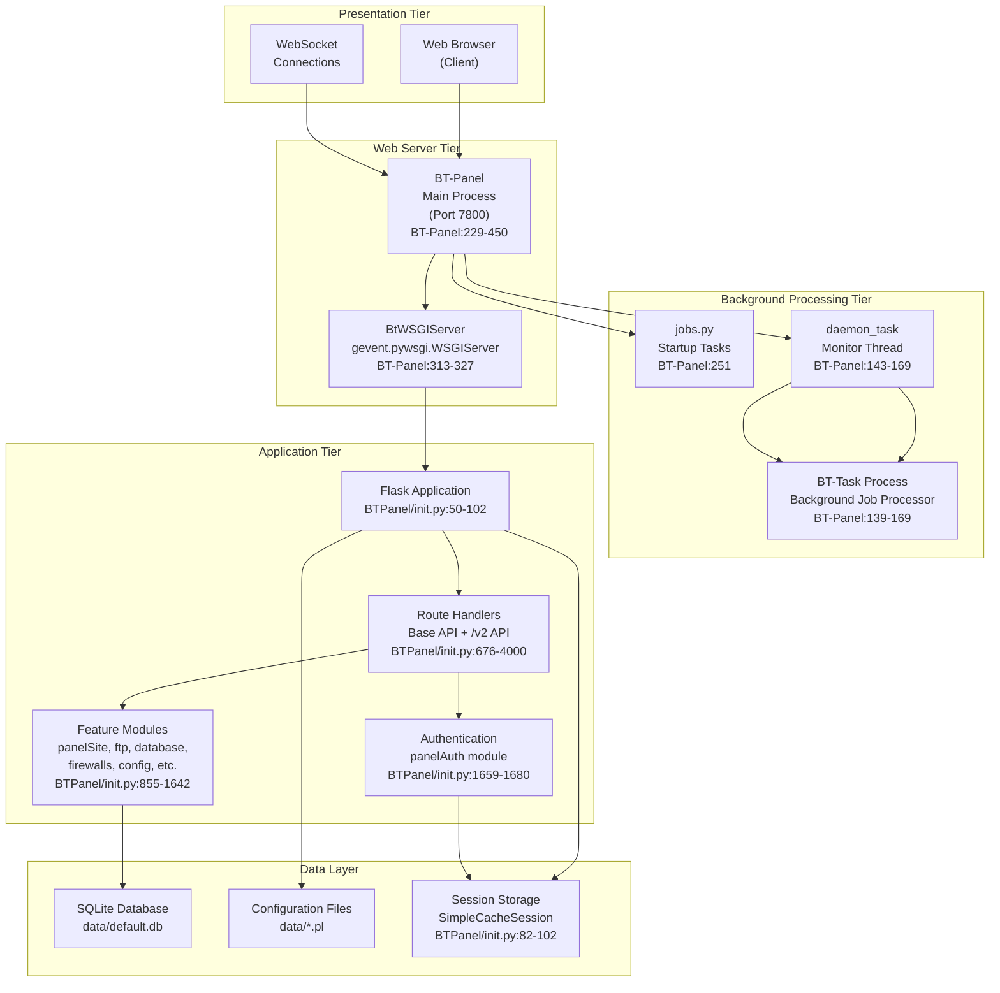
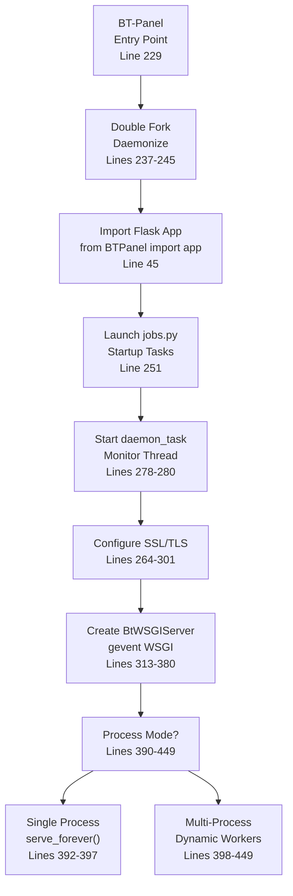
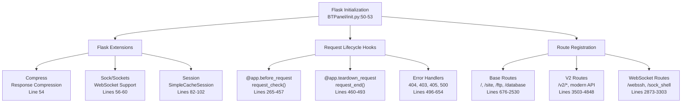
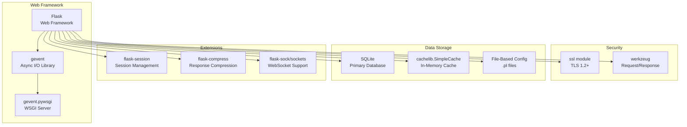
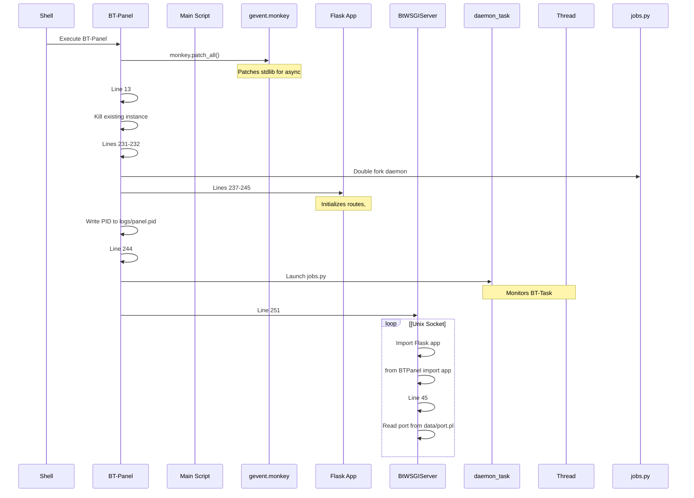
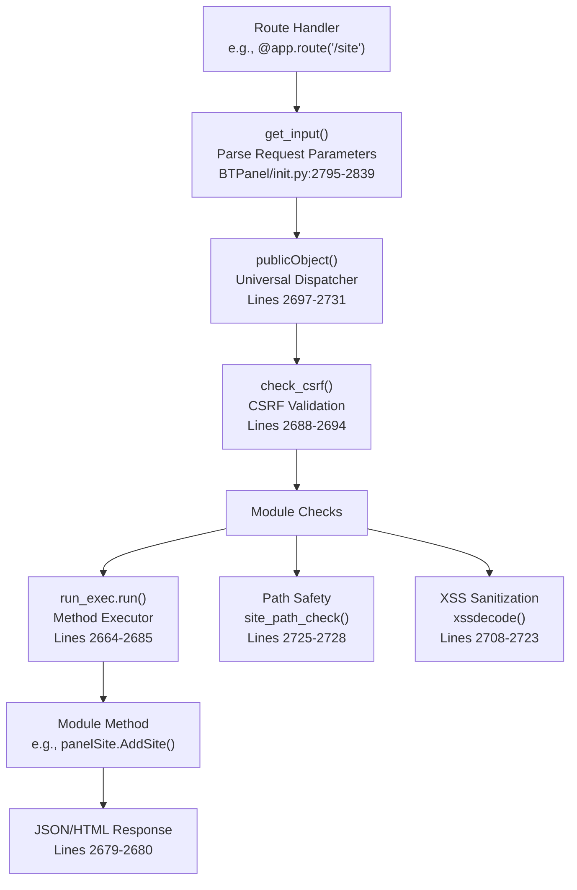
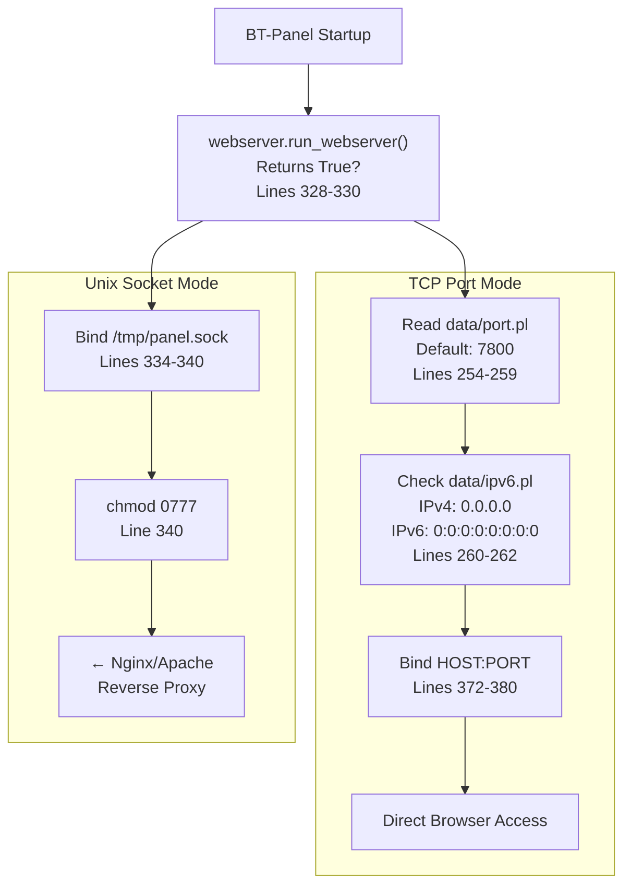
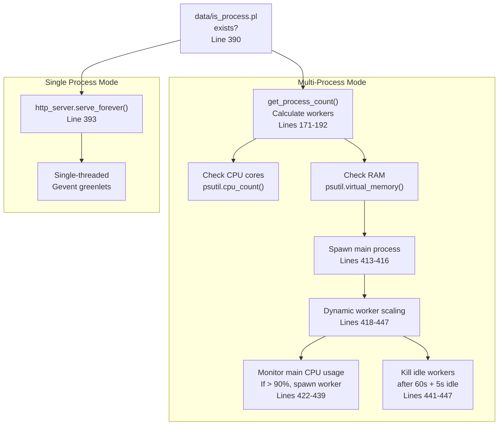
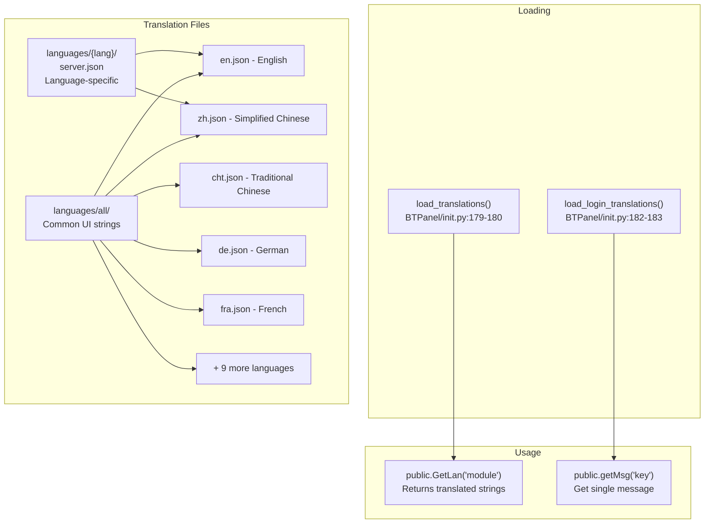

# Overview

> **Relevant source files**
> * [BT-Panel](https://github.com/aaPanel/aaPanel/blob/b6e4ab8b/BT-Panel)
> * [BTPanel/__init__.py](https://github.com/aaPanel/aaPanel/blob/b6e4ab8b/BTPanel/__init__.py)

aaPanel is a web-based Linux server control panel that provides a graphical interface for managing hosting environments. It handles website management, FTP accounts, databases (MySQL/PostgreSQL), firewall rules, scheduled tasks, file operations, and plugin extensions. The system is built with Python and Flask, uses gevent for asynchronous I/O, and supports multiple deployment modes including single-process and multi-process configurations with dynamic worker scaling.

This document provides an architectural overview of the system. For specific subsystems, see:

* Deployment and startup: [Quick Start Guide](/aaPanel/aaPanel/1.1-quick-start-guide)
* Detailed architecture: [System Architecture](/aaPanel/aaPanel/2-system-architecture)
* Request processing: [Request Processing Pipeline](/aaPanel/aaPanel/3-request-processing-pipeline)
* Feature modules: [Feature Modules](/aaPanel/aaPanel/5-feature-modules)
* WebSocket support: [WebSocket Support](/aaPanel/aaPanel/6-websocket-support)
* Multi-language support: [Internationalization and Localization](/aaPanel/aaPanel/8-internationalization-and-localization)

## System Purpose and Scope

aaPanel serves as a comprehensive control panel for Linux servers with these primary functions:

| Function Category | Capabilities |
| --- | --- |
| **Web Hosting** | Create/manage websites, virtual hosts, SSL certificates, domains, redirects, proxies |
| **File Management** | Browse, edit, upload, download, compress, decompress, search files |
| **Database Management** | MySQL, PostgreSQL, MongoDB, Redis database and user administration |
| **FTP Management** | Create and manage FTP accounts with access controls |
| **System Security** | Firewall rules, SSH security, IP filtering, fail2ban integration |
| **Task Scheduling** | Cron job management with various task types (backup, script, URL) |
| **Software Management** | Install and manage server software (Nginx, Apache, PHP, etc.) |
| **Plugin System** | Extensible architecture for third-party modules |
| **Monitoring** | System resource monitoring, process management, logs |

**Sources:** [BTPanel/__init__.py L1-L260](https://github.com/aaPanel/aaPanel/blob/b6e4ab8b/BTPanel/__init__.py#L1-L260)

 [BT-Panel L1-L50](https://github.com/aaPanel/aaPanel/blob/b6e4ab8b/BT-Panel#L1-L50)

## High-Level Architecture

aaPanel implements a three-tier architecture with clear separation of concerns:



**Sources:** [BT-Panel L1-L450](https://github.com/aaPanel/aaPanel/blob/b6e4ab8b/BT-Panel#L1-L450)

 [BTPanel/__init__.py L1-L260](https://github.com/aaPanel/aaPanel/blob/b6e4ab8b/BTPanel/__init__.py#L1-L260)

## Main Components

### 1. BT-Panel (Web Server Process)

The `BT-Panel` executable is the main entry point that initializes and manages the web server:



**Key Responsibilities:**

* **Daemonization:** Double-fork to run as background daemon [BT-Panel L237-L245](https://github.com/aaPanel/aaPanel/blob/b6e4ab8b/BT-Panel#L237-L245)
* **PID Management:** Writes process ID to `logs/panel.pid` [BT-Panel L244](https://github.com/aaPanel/aaPanel/blob/b6e4ab8b/BT-Panel#L244-L244)
* **SSL/TLS Setup:** Configures encryption if `data/ssl.pl` exists [BT-Panel L264-L301](https://github.com/aaPanel/aaPanel/blob/b6e4ab8b/BT-Panel#L264-L301)
* **Server Binding:** Binds to Unix socket (`/tmp/panel.sock`) or TCP port [BT-Panel L332-L380](https://github.com/aaPanel/aaPanel/blob/b6e4ab8b/BT-Panel#L332-L380)
* **Background Task Monitoring:** Spawns `daemon_task` thread to monitor BT-Task [BT-Panel L278-L280](https://github.com/aaPanel/aaPanel/blob/b6e4ab8b/BT-Panel#L278-L280)
* **Process Mode Selection:** Single or multi-process based on `data/is_process.pl` [BT-Panel L390-L449](https://github.com/aaPanel/aaPanel/blob/b6e4ab8b/BT-Panel#L390-L449)

**Sources:** [BT-Panel L229-L450](https://github.com/aaPanel/aaPanel/blob/b6e4ab8b/BT-Panel#L229-L450)

### 2. Flask Application Core

The Flask application is initialized in `BTPanel/__init__.py` and provides the web interface:



**Configuration:**

* **Secret Key:** Generated from system UUID and boot time [BTPanel/__init__.py L83-L85](https://github.com/aaPanel/aaPanel/blob/b6e4ab8b/BTPanel/__init__.py#L83-L85)
* **Session Storage:** In-memory cache with 30-day expiration [BTPanel/__init__.py L88-L94](https://github.com/aaPanel/aaPanel/blob/b6e4ab8b/BTPanel/__init__.py#L88-L94)
* **SSL Cookie:** Secure cookies when SSL enabled [BTPanel/__init__.py L97-L99](https://github.com/aaPanel/aaPanel/blob/b6e4ab8b/BTPanel/__init__.py#L97-L99)
* **Debug Mode:** Activated when `data/debug.pl` exists [BTPanel/__init__.py L67](https://github.com/aaPanel/aaPanel/blob/b6e4ab8b/BTPanel/__init__.py#L67-L67)

**Sources:** [BTPanel/__init__.py L50-L260](https://github.com/aaPanel/aaPanel/blob/b6e4ab8b/BTPanel/__init__.py#L50-L260)

### 3. Request Processing Pipeline

Every HTTP request passes through a multi-stage validation pipeline:

```mermaid
sequenceDiagram
  participant Client
  participant Flask
  participant request_check()
  participant URI Validator
  participant Session Check
  participant CSRF Validator
  participant Authentication
  participant Feature Module
  participant publicObject()
  participant Dispatcher

  Client->>Flask: HTTP Request
  Flask->>Flask: Check HTTP Method
  Flask->>URI Validator: (GET/POST/HEAD only)
  Flask->>URI Validator: Line 303
  Flask->>Session Check: Validate URI Length
  Flask->>Authentication: (max 1024 chars)
  Flask->>Authentication: Lines 310-311
  Flask->>Authentication: Validate URI Pattern
  loop [Static Resource]
    Flask->>Client: regex match
    Flask->>CSRF Validator: Line 314
    CSRF Validator->>Feature Module: Validate Session ID
    Feature Module->>publicObject(): regex pattern
    publicObject()->>Feature Module: Lines 333-334
    Feature Module->>Client: Check Basic Auth
  end
```

**Sources:** [BTPanel/__init__.py L265-L457](https://github.com/aaPanel/aaPanel/blob/b6e4ab8b/BTPanel/__init__.py#L265-L457)

### 4. Background Processing System

The background task system handles long-running operations asynchronously:

| Component | Purpose | Location |
| --- | --- | --- |
| **BT-Task** | Background job processor for backups, deployments, updates | Monitored by daemon_task |
| **daemon_task** | Monitor thread that checks BT-Task health every 60 seconds | [BT-Panel L143-L169](https://github.com/aaPanel/aaPanel/blob/b6e4ab8b/BT-Panel#L143-L169) |
| **jobs.py** | One-time startup tasks initialization | [BT-Panel L251](https://github.com/aaPanel/aaPanel/blob/b6e4ab8b/BT-Panel#L251-L251) |
| **panelTask** | Task management API for creating/monitoring background jobs | [BTPanel/__init__.py L1613-L1623](https://github.com/aaPanel/aaPanel/blob/b6e4ab8b/BTPanel/__init__.py#L1613-L1623) |

**Health Monitoring Logic:**

1. Check if `logs/task.pid` exists [BT-Panel L150-L151](https://github.com/aaPanel/aaPanel/blob/b6e4ab8b/BT-Panel#L150-L151)
2. Read PID from file [BT-Panel L154-L157](https://github.com/aaPanel/aaPanel/blob/b6e4ab8b/BT-Panel#L154-L157)
3. Verify process exists via `/proc/{pid}/comm` [BT-Panel L160-L163](https://github.com/aaPanel/aaPanel/blob/b6e4ab8b/BT-Panel#L160-L163)
4. Confirm process name contains 'BT-Task' [BT-Panel L166-L169](https://github.com/aaPanel/aaPanel/blob/b6e4ab8b/BT-Panel#L166-L169)
5. Restart if any check fails [BT-Panel L156-L168](https://github.com/aaPanel/aaPanel/blob/b6e4ab8b/BT-Panel#L156-L168)

**Sources:** [BT-Panel L139-L169](https://github.com/aaPanel/aaPanel/blob/b6e4ab8b/BT-Panel#L139-L169)

 [BT-Panel L251](https://github.com/aaPanel/aaPanel/blob/b6e4ab8b/BT-Panel#L251-L251)

 [BTPanel/__init__.py L1613-L1623](https://github.com/aaPanel/aaPanel/blob/b6e4ab8b/BTPanel/__init__.py#L1613-L1623)

## Core Technologies

### Technology Stack



**Key Dependencies:**

* **Flask:** Web application framework [BTPanel/__init__.py L37-L44](https://github.com/aaPanel/aaPanel/blob/b6e4ab8b/BTPanel/__init__.py#L37-L44)
* **gevent:** Enables async I/O with monkey patching [BT-Panel L10-L13](https://github.com/aaPanel/aaPanel/blob/b6e4ab8b/BT-Panel#L10-L13)
* **cachelib:** Provides `SimpleCache` and `SimpleCacheSession` [BTPanel/__init__.py L41-L88](https://github.com/aaPanel/aaPanel/blob/b6e4ab8b/BTPanel/__init__.py#L41-L88)
* **psutil:** System and process utilities [BT-Panel L21](https://github.com/aaPanel/aaPanel/blob/b6e4ab8b/BT-Panel#L21-L21)  [BT-Panel L186-L191](https://github.com/aaPanel/aaPanel/blob/b6e4ab8b/BT-Panel#L186-L191)

**Sources:** [BT-Panel L10-L21](https://github.com/aaPanel/aaPanel/blob/b6e4ab8b/BT-Panel#L10-L21)

 [BTPanel/__init__.py L37-L60](https://github.com/aaPanel/aaPanel/blob/b6e4ab8b/BTPanel/__init__.py#L37-L60)

## Entry Points and Startup Sequence

### Main Startup Flow



**Configuration File Loading:**

| File | Purpose | Default Value |
| --- | --- | --- |
| `data/port.pl` | Panel listening port | 7800 |
| `data/ssl.pl` | Enable SSL/TLS | Disabled |
| `data/ipv6.pl` | Enable IPv6 listening | IPv4 only |
| `data/admin_path.pl` | Custom admin URL path | `/` |
| `data/is_process.pl` | Enable multi-process mode | Single process |
| `data/debug.pl` | Enable debug mode with auto-reload | Disabled |

**Sources:** [BT-Panel L229-L450](https://github.com/aaPanel/aaPanel/blob/b6e4ab8b/BT-Panel#L229-L450)

 [BTPanel/__init__.py L1-L260](https://github.com/aaPanel/aaPanel/blob/b6e4ab8b/BTPanel/__init__.py#L1-L260)

## Module Dispatch Architecture

The system uses a universal dispatcher pattern to route requests to feature modules:



**Dispatcher Workflow:**

1. **Parameter Extraction:** `get_input()` consolidates GET/POST/JSON parameters [BTPanel/__init__.py L2795-L2839](https://github.com/aaPanel/aaPanel/blob/b6e4ab8b/BTPanel/__init__.py#L2795-L2839)
2. **CSRF Protection:** Validates `x-http-token` header if user authenticated [BTPanel/__init__.py L2700-L2702](https://github.com/aaPanel/aaPanel/blob/b6e4ab8b/BTPanel/__init__.py#L2700-L2702)
3. **Path Sanitization:** Removes `//`, `\`, `./`, sanitizes with `xssdecode()` [BTPanel/__init__.py L2708-L2723](https://github.com/aaPanel/aaPanel/blob/b6e4ab8b/BTPanel/__init__.py#L2708-L2723)
4. **Module Authorization:** Calls `site_path_check()` if module implements it [BTPanel/__init__.py L2725-L2728](https://github.com/aaPanel/aaPanel/blob/b6e4ab8b/BTPanel/__init__.py#L2725-L2728)
5. **Method Invocation:** Uses `getattr()` to call requested method [BTPanel/__init__.py L2676](https://github.com/aaPanel/aaPanel/blob/b6e4ab8b/BTPanel/__init__.py#L2676-L2676)
6. **Response Formatting:** Converts result to JSON unless raw response [BTPanel/__init__.py L2677-L2680](https://github.com/aaPanel/aaPanel/blob/b6e4ab8b/BTPanel/__init__.py#L2677-L2680)

**Sources:** [BTPanel/__init__.py L2664-L2731](https://github.com/aaPanel/aaPanel/blob/b6e4ab8b/BTPanel/__init__.py#L2664-L2731)

 [BTPanel/__init__.py L2795-L2839](https://github.com/aaPanel/aaPanel/blob/b6e4ab8b/BTPanel/__init__.py#L2795-L2839)

## Feature Module Organization

aaPanel organizes functionality into discrete modules, each handling a specific domain:

| Module | Route | Purpose | Code Reference |
| --- | --- | --- | --- |
| **panelSite** | `/site`, `/v2/site` | Website/virtual host management | [BTPanel/__init__.py L855-L976](https://github.com/aaPanel/aaPanel/blob/b6e4ab8b/BTPanel/__init__.py#L855-L976) |
| **ftp** | `/ftp`, `/v2/ftp` | FTP account management | [BTPanel/__init__.py L979-L989](https://github.com/aaPanel/aaPanel/blob/b6e4ab8b/BTPanel/__init__.py#L979-L989) |
| **database** | `/database`, `/v2/database` | MySQL/PostgreSQL management | [BTPanel/__init__.py L992-L1009](https://github.com/aaPanel/aaPanel/blob/b6e4ab8b/BTPanel/__init__.py#L992-L1009) |
| **firewalls** | `/firewall`, `/v2/firewall` | Firewall rule management | [BTPanel/__init__.py L1054-L1065](https://github.com/aaPanel/aaPanel/blob/b6e4ab8b/BTPanel/__init__.py#L1054-L1065) |
| **files** | `/files`, `/v2/files` | File browser and operations | [BTPanel/__init__.py L1265-L1300](https://github.com/aaPanel/aaPanel/blob/b6e4ab8b/BTPanel/__init__.py#L1265-L1300) |
| **crontab** | `/crontab`, `/v2/crontab` | Scheduled task management | [BTPanel/__init__.py L1303-L1313](https://github.com/aaPanel/aaPanel/blob/b6e4ab8b/BTPanel/__init__.py#L1303-L1313) |
| **config** | `/config`, `/v2/config` | Panel configuration | [BTPanel/__init__.py L1316-L1471](https://github.com/aaPanel/aaPanel/blob/b6e4ab8b/BTPanel/__init__.py#L1316-L1471) |
| **panelPlugin** | `/plugin`, `/v2/plugin` | Plugin system | [BTPanel/__init__.py L1626-L1642](https://github.com/aaPanel/aaPanel/blob/b6e4ab8b/BTPanel/__init__.py#L1626-L1642) |
| **panelSSL** | `/ssl`, `/v2/ssl` | SSL certificate management | [BTPanel/__init__.py L1578-L1611](https://github.com/aaPanel/aaPanel/blob/b6e4ab8b/BTPanel/__init__.py#L1578-L1611) |
| **panelAuth** | `/auth`, `/v2/auth` | License and authentication | [BTPanel/__init__.py L1659-L1680](https://github.com/aaPanel/aaPanel/blob/b6e4ab8b/BTPanel/__init__.py#L1659-L1680) |

**Common Module Pattern:**

All feature modules follow this pattern:

```javascript
# Import the module
import module_name

# Create module instance
moduleObject = module_name.ClassName()

# Define allowed methods (security whitelist)
defs = ('method1', 'method2', 'method3')

# Dispatch through universal router
return publicObject(moduleObject, defs, None, pdata)
```

**Sources:** [BTPanel/__init__.py L855-L1680](https://github.com/aaPanel/aaPanel/blob/b6e4ab8b/BTPanel/__init__.py#L855-L1680)

## Network Binding Modes

aaPanel supports two distinct network binding modes:



**Unix Socket Mode (Production):**

* Created when `webserver.run_webserver()` returns `True` [BT-Panel L329-L330](https://github.com/aaPanel/aaPanel/blob/b6e4ab8b/BT-Panel#L329-L330)
* Socket path: `/tmp/panel.sock` [BT-Panel L335](https://github.com/aaPanel/aaPanel/blob/b6e4ab8b/BT-Panel#L335-L335)
* Permissions: `0777` for web server access [BT-Panel L340](https://github.com/aaPanel/aaPanel/blob/b6e4ab8b/BT-Panel#L340-L340)
* Use case: Behind Nginx or Apache reverse proxy

**TCP Port Mode (Standalone):**

* Used when Unix socket mode not activated [BT-Panel L347-L380](https://github.com/aaPanel/aaPanel/blob/b6e4ab8b/BT-Panel#L347-L380)
* Port configured in `data/port.pl` (default: 7800) [BT-Panel L254-L259](https://github.com/aaPanel/aaPanel/blob/b6e4ab8b/BT-Panel#L254-L259)
* IPv6 support via `data/ipv6.pl` [BT-Panel L261-L262](https://github.com/aaPanel/aaPanel/blob/b6e4ab8b/BT-Panel#L261-L262)
* Use case: Direct browser access, development

**Sources:** [BT-Panel L254-L262](https://github.com/aaPanel/aaPanel/blob/b6e4ab8b/BT-Panel#L254-L262)

 [BT-Panel L328-L380](https://github.com/aaPanel/aaPanel/blob/b6e4ab8b/BT-Panel#L328-L380)

## Process Management Modes

### Single Process vs Multi-Process



**Worker Calculation Logic:**

| System Resources | Worker Count |
| --- | --- |
| RAM < 4GB OR CPU < 4 cores | 1 worker |
| 4GB ≤ RAM < 8GB AND CPU > 3 cores | 2 workers |
| 8GB < RAM ≤ 14GB AND CPU > 7 cores | 3 workers |
| RAM > 30GB AND CPU > 15 cores | 4 workers |
| Custom config in `data/process_count.pl` | User-defined |

**Dynamic Scaling Behavior:**

* **Spawn Trigger:** Main process CPU > 90% and no idle workers [BT-Panel L424-L439](https://github.com/aaPanel/aaPanel/blob/b6e4ab8b/BT-Panel#L424-L439)
* **Kill Trigger:** Worker created > 60s ago AND idle for 5s+ [BT-Panel L441-L447](https://github.com/aaPanel/aaPanel/blob/b6e4ab8b/BT-Panel#L441-L447)
* **Max Workers:** Limited by `get_process_count()` [BT-Panel L410](https://github.com/aaPanel/aaPanel/blob/b6e4ab8b/BT-Panel#L410-L410)

**Sources:** [BT-Panel L171-L192](https://github.com/aaPanel/aaPanel/blob/b6e4ab8b/BT-Panel#L171-L192)

 [BT-Panel L390-L449](https://github.com/aaPanel/aaPanel/blob/b6e4ab8b/BT-Panel#L390-L449)

## Security Architecture Layers

aaPanel implements defense-in-depth with multiple security layers:

| Layer | Mechanism | Implementation |
| --- | --- | --- |
| **Network** | SSL/TLS 1.2+ with strong ciphers | [BT-Panel L264-L301](https://github.com/aaPanel/aaPanel/blob/b6e4ab8b/BT-Panel#L264-L301) |
| **Network** | Optional HTTP Basic Authentication | [BTPanel/__init__.py L343-L355](https://github.com/aaPanel/aaPanel/blob/b6e4ab8b/BTPanel/__init__.py#L343-L355) |
| **Network** | IP whitelist filtering | [BTPanel/__init__.py L364-L365](https://github.com/aaPanel/aaPanel/blob/b6e4ab8b/BTPanel/__init__.py#L364-L365) |
| **Network** | Domain whitelist filtering | [BTPanel/__init__.py L370-L371](https://github.com/aaPanel/aaPanel/blob/b6e4ab8b/BTPanel/__init__.py#L370-L371) |
| **Request** | HTTP method validation (GET/POST/HEAD only) | [BTPanel/__init__.py L303](https://github.com/aaPanel/aaPanel/blob/b6e4ab8b/BTPanel/__init__.py#L303-L303) |
| **Request** | URI length limits (256/1024 chars) | [BTPanel/__init__.py L310-L311](https://github.com/aaPanel/aaPanel/blob/b6e4ab8b/BTPanel/__init__.py#L310-L311) |
| **Request** | URI pattern matching (regex) | [BTPanel/__init__.py L314](https://github.com/aaPanel/aaPanel/blob/b6e4ab8b/BTPanel/__init__.py#L314-L314) |
| **Request** | Session ID validation (regex) | [BTPanel/__init__.py L333-L334](https://github.com/aaPanel/aaPanel/blob/b6e4ab8b/BTPanel/__init__.py#L333-L334) |
| **Session** | Session-based authentication | [BTPanel/__init__.py L82-L102](https://github.com/aaPanel/aaPanel/blob/b6e4ab8b/BTPanel/__init__.py#L82-L102) |
| **Session** | CSRF token validation (`x-http-token`) | [BTPanel/__init__.py L2688-L2694](https://github.com/aaPanel/aaPanel/blob/b6e4ab8b/BTPanel/__init__.py#L2688-L2694) |
| **Input** | XSS sanitization (`xssdecode()`) | [BTPanel/__init__.py L2714-L2723](https://github.com/aaPanel/aaPanel/blob/b6e4ab8b/BTPanel/__init__.py#L2714-L2723) |
| **Input** | Path traversal prevention | [BTPanel/__init__.py L2708-L2711](https://github.com/aaPanel/aaPanel/blob/b6e4ab8b/BTPanel/__init__.py#L2708-L2711) |
| **Authorization** | Custom admin path (security by obscurity) | [BTPanel/__init__.py L114-L175](https://github.com/aaPanel/aaPanel/blob/b6e4ab8b/BTPanel/__init__.py#L114-L175) |
| **Authorization** | Module-level permissions | [BTPanel/__init__.py L2725-L2728](https://github.com/aaPanel/aaPanel/blob/b6e4ab8b/BTPanel/__init__.py#L2725-L2728) |

**Sources:** [BT-Panel L264-L301](https://github.com/aaPanel/aaPanel/blob/b6e4ab8b/BT-Panel#L264-L301)

 [BTPanel/__init__.py L265-L457](https://github.com/aaPanel/aaPanel/blob/b6e4ab8b/BTPanel/__init__.py#L265-L457)

 [BTPanel/__init__.py L2688-L2731](https://github.com/aaPanel/aaPanel/blob/b6e4ab8b/BTPanel/__init__.py#L2688-L2731)

## Internationalization

aaPanel supports 14+ languages with a centralized translation system:



**Supported Languages:**
English, Simplified Chinese, Traditional Chinese, German, French, Indonesian, Italian, Korean, Portuguese, Russian, Spanish, Turkish, Ukrainian, Vietnamese

**Sources:** [BTPanel/__init__.py L179-L183](https://github.com/aaPanel/aaPanel/blob/b6e4ab8b/BTPanel/__init__.py#L179-L183)

---

This overview provides the foundation for understanding aaPanel's architecture. For detailed information on specific subsystems, refer to the linked wiki pages at the beginning of this document.