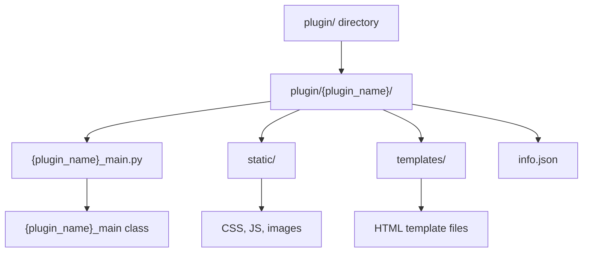
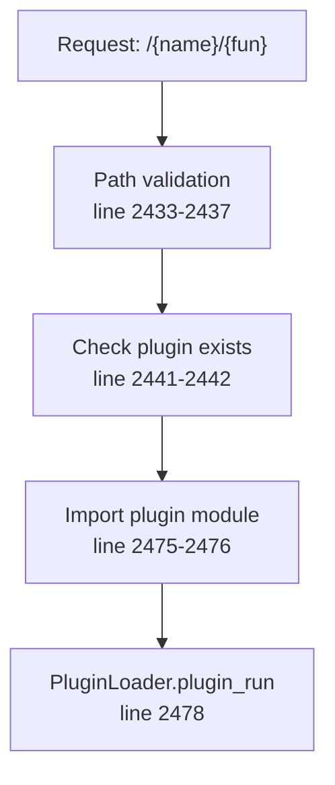
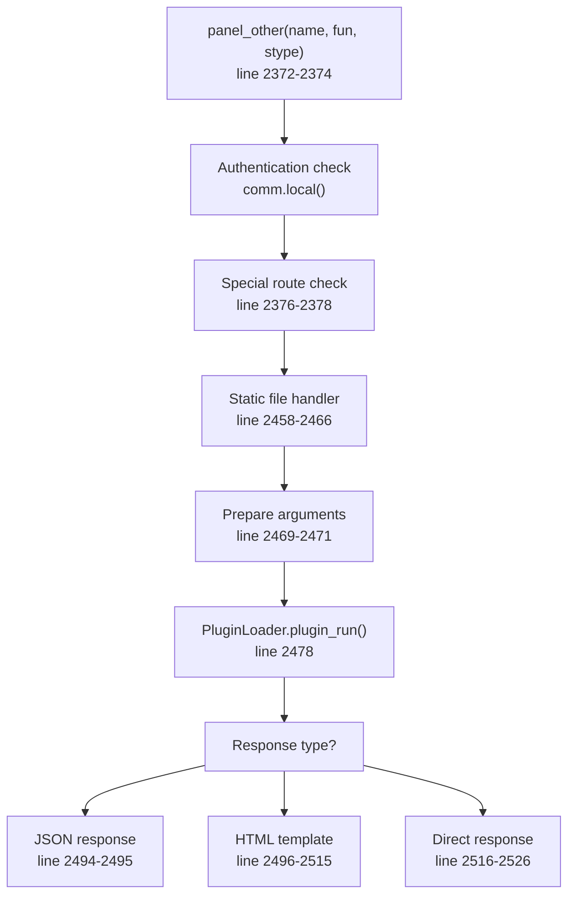
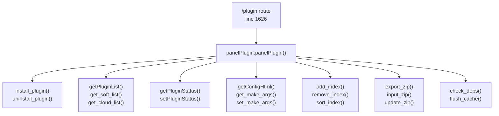
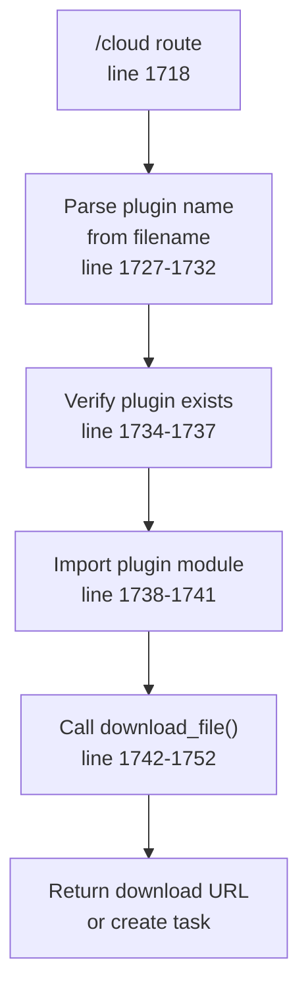
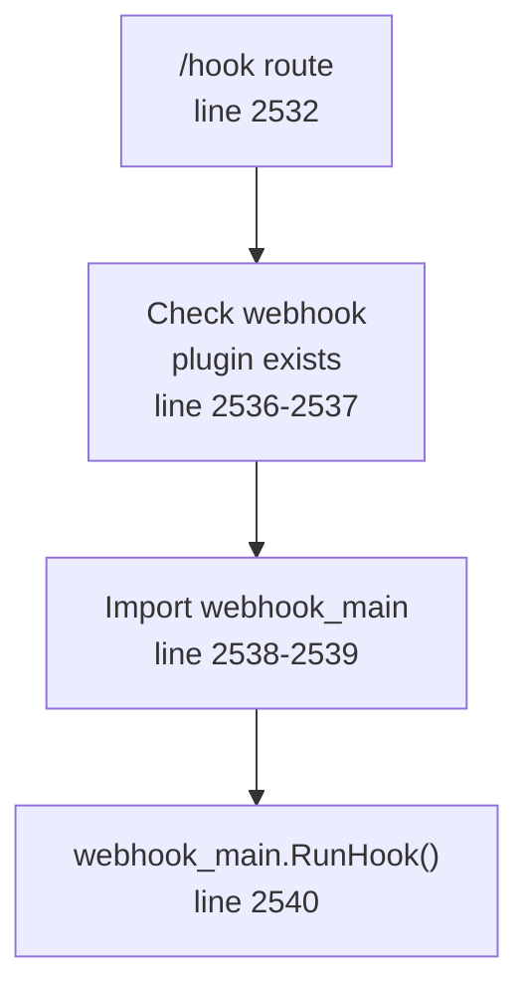
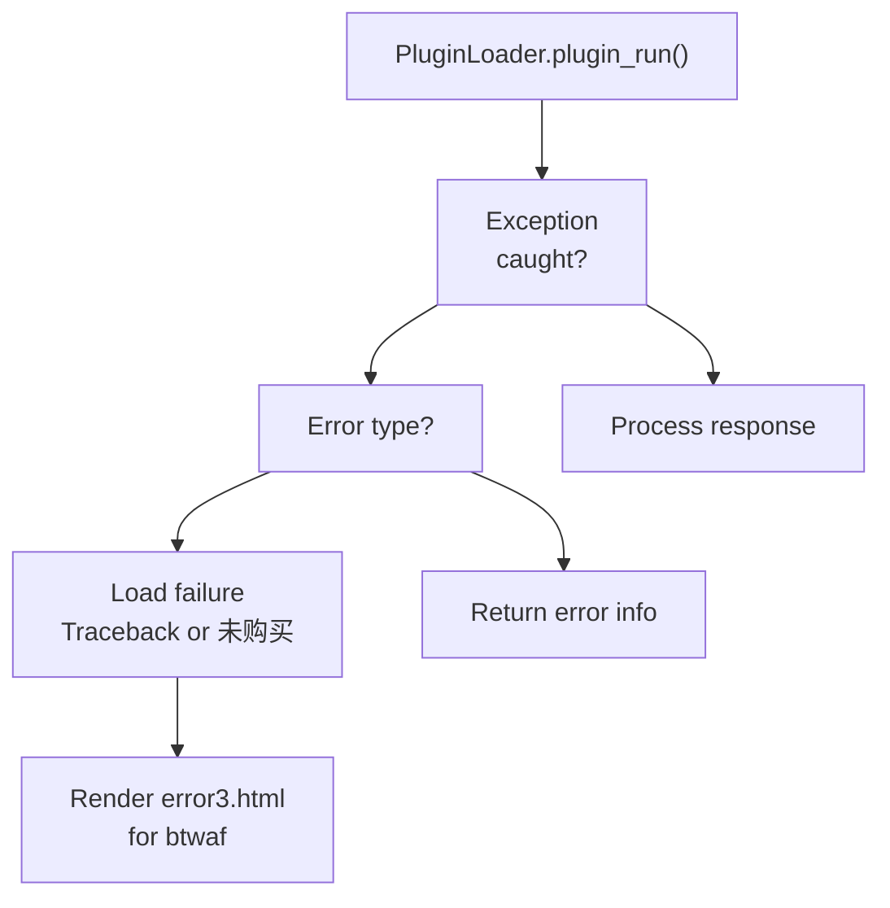
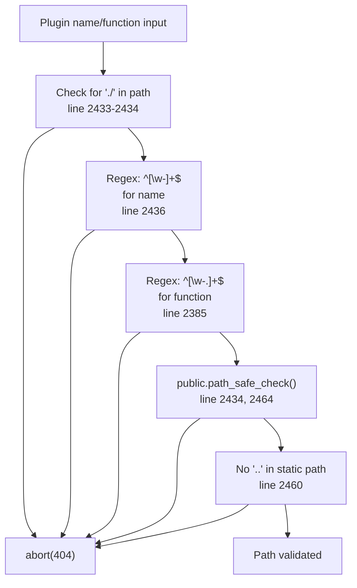

# Plugin System

> **Relevant source files**
> * [BTPanel/__init__.py](https://github.com/aaPanel/aaPanel/blob/b6e4ab8b/BTPanel/__init__.py)

This document describes the aaPanel plugin system architecture, including plugin discovery, loading, execution, and management. The plugin system allows extending panel functionality without modifying core code.

For general module architecture and routing, see [Module System and Routing](/aaPanel/aaPanel/4-module-system-and-routing). For specific plugin management operations through the web interface, see [Feature Modules](/aaPanel/aaPanel/5-feature-modules).

---

## Plugin Architecture

The aaPanel plugin system uses a directory-based architecture where each plugin resides in its own isolated directory under the `plugin/` folder.

### Directory Structure



**Sources:** [BTPanel/__init__.py L2440-L2443](https://github.com/aaPanel/aaPanel/blob/b6e4ab8b/BTPanel/__init__.py#L2440-L2443)

 [BTPanel/__init__.py L2458-L2466](https://github.com/aaPanel/aaPanel/blob/b6e4ab8b/BTPanel/__init__.py#L2458-L2466)

Each plugin must have:

* **Main module**: `plugin/{plugin_name}/{plugin_name}_main.py` containing the main plugin class
* **Static directory** (optional): `plugin/{plugin_name}/static/` for CSS, JavaScript, images
* **Templates directory** (optional): `plugin/{plugin_name}/templates/` for HTML templates
* **Metadata** (optional): `info.json` or similar configuration files

---

## Plugin Discovery and Loading

### Plugin Path Structure



**Sources:** [BTPanel/__init__.py L2372-L2374](https://github.com/aaPanel/aaPanel/blob/b6e4ab8b/BTPanel/__init__.py#L2372-L2374)

 [BTPanel/__init__.py L2433-L2442](https://github.com/aaPanel/aaPanel/blob/b6e4ab8b/BTPanel/__init__.py#L2433-L2442)

 [BTPanel/__init__.py L2475-L2478](https://github.com/aaPanel/aaPanel/blob/b6e4ab8b/BTPanel/__init__.py#L2475-L2478)

When a request comes to `/{plugin_name}/{function_name}`, the system:

1. **Validates the plugin name** - Checks for safe path characters and valid format [BTPanel/__init__.py L2433-L2437](https://github.com/aaPanel/aaPanel/blob/b6e4ab8b/BTPanel/__init__.py#L2433-L2437)
2. **Locates plugin directory** - Verifies `plugin/{plugin_name}/` exists [BTPanel/__init__.py L2441-L2442](https://github.com/aaPanel/aaPanel/blob/b6e4ab8b/BTPanel/__init__.py#L2441-L2442)
3. **Imports main module** - Dynamically loads `{plugin_name}_main.py` [BTPanel/__init__.py L2475-L2476](https://github.com/aaPanel/aaPanel/blob/b6e4ab8b/BTPanel/__init__.py#L2475-L2476)
4. **Executes function** - Calls the requested method via `PluginLoader.plugin_run()` [BTPanel/__init__.py L2478](https://github.com/aaPanel/aaPanel/blob/b6e4ab8b/BTPanel/__init__.py#L2478-L2478)

### Plugin Import Mechanism

The plugin import process uses dynamic module loading:

```mermaid
sequenceDiagram
  participant Route Handler
  participant public.package_path_append()
  participant __import__()
  participant PluginLoader.plugin_run()
  participant plugin_main.{plugin_name}_main

  Route Handler->>public.package_path_append(): Add plugin path to sys.path
  Route Handler->>__import__(): Import plugin_name + '_main'
  __import__()->>Route Handler: Return plugin module
  Route Handler->>PluginLoader.plugin_run(): plugin_run(name, fun, args)
  PluginLoader.plugin_run()->>plugin_main.{plugin_name}_main: Execute function
  plugin_main.{plugin_name}_main->>PluginLoader.plugin_run(): Return result
  PluginLoader.plugin_run()->>Route Handler: Return response
```

**Sources:** [BTPanel/__init__.py L2738](https://github.com/aaPanel/aaPanel/blob/b6e4ab8b/BTPanel/__init__.py#L2738-L2738)

 [BTPanel/__init__.py L2739-L2741](https://github.com/aaPanel/aaPanel/blob/b6e4ab8b/BTPanel/__init__.py#L2739-L2741)

 [BTPanel/__init__.py L2475-L2478](https://github.com/aaPanel/aaPanel/blob/b6e4ab8b/BTPanel/__init__.py#L2475-L2478)

For cloud storage plugin downloads, a similar pattern is used at [BTPanel/__init__.py L1738-L1741](https://github.com/aaPanel/aaPanel/blob/b6e4ab8b/BTPanel/__init__.py#L1738-L1741)

 where the plugin path is appended and the module is dynamically imported.

---

## Plugin Execution Flow

### Request Processing Pipeline



**Sources:** [BTPanel/__init__.py L2372-L2529](https://github.com/aaPanel/aaPanel/blob/b6e4ab8b/BTPanel/__init__.py#L2372-L2529)

The execution flow handles three main scenarios:

1. **Static file requests** - `/{plugin_name}/static/{file_path}` routes serve static resources directly [BTPanel/__init__.py L2458-L2466](https://github.com/aaPanel/aaPanel/blob/b6e4ab8b/BTPanel/__init__.py#L2458-L2466)
2. **Function execution** - `/{plugin_name}/{function}` routes execute plugin methods [BTPanel/__init__.py L2478](https://github.com/aaPanel/aaPanel/blob/b6e4ab8b/BTPanel/__init__.py#L2478-L2478)
3. **Template rendering** - `/{plugin_name}/{function}.html` routes render templates with plugin data [BTPanel/__init__.py L2496-L2515](https://github.com/aaPanel/aaPanel/blob/b6e4ab8b/BTPanel/__init__.py#L2496-L2515)

---

## Plugin Response Types

### Response Type Handling

Plugins can return data in three formats, determined by the `stype` parameter:

| Response Type | Route Pattern | Processing | Lines |
| --- | --- | --- | --- |
| **JSON** | `/{name}/{fun}.json` | Wrapped with `public.getJson()`, returns with `json_header` | [2494-2495](https://github.com/aaPanel/aaPanel/blob/b6e4ab8b/2494-2495) |
| **HTML Template** | `/{name}/{fun}.html` | Renders template from `plugin/{name}/templates/` | [2496-2515](https://github.com/aaPanel/aaPanel/blob/b6e4ab8b/2496-2515) |
| **Direct Response** | `/{name}/{fun}` | Returns plugin response directly (Flask Response, string, etc.) | [2516-2526](https://github.com/aaPanel/aaPanel/blob/b6e4ab8b/2516-2526) |

**Sources:** [BTPanel/__init__.py L2494-L2526](https://github.com/aaPanel/aaPanel/blob/b6e4ab8b/BTPanel/__init__.py#L2494-L2526)

### Template Processing

When a plugin returns HTML template type, the system:

1. Loads the template from `plugin/{name}/templates/{fun}.html` [BTPanel/__init__.py L2498-L2503](https://github.com/aaPanel/aaPanel/blob/b6e4ab8b/BTPanel/__init__.py#L2498-L2503)
2. Processes template includes using regex pattern `` [BTPanel/__init__.py L2506-L2514](https://github.com/aaPanel/aaPanel/blob/b6e4ab8b/BTPanel/__init__.py#L2506-L2514)
3. Renders the template with plugin data using `render_template_string()` [BTPanel/__init__.py L2515](https://github.com/aaPanel/aaPanel/blob/b6e4ab8b/BTPanel/__init__.py#L2515-L2515)

**Sources:** [BTPanel/__init__.py L2496-L2515](https://github.com/aaPanel/aaPanel/blob/b6e4ab8b/BTPanel/__init__.py#L2496-L2515)

---

## Plugin Management API

### Management Operations

The `/plugin` route provides comprehensive plugin management functionality through the `panelPlugin` class:



**Sources:** [BTPanel/__init__.py L1626-L1642](https://github.com/aaPanel/aaPanel/blob/b6e4ab8b/BTPanel/__init__.py#L1626-L1642)

 [BTPanel/__init__.py L4817-L4833](https://github.com/aaPanel/aaPanel/blob/b6e4ab8b/BTPanel/__init__.py#L4817-L4833)

### Plugin Management Methods

The `panelPlugin` class provides the following operations (available via `publicObject` dispatcher):

**Installation & Removal:**

* `install_plugin` - Install a plugin from repository
* `uninstall_plugin` / `unInstall` - Remove an installed plugin
* `check_install_limit` - Verify installation prerequisites

**Plugin Discovery:**

* `getPluginList` - List installed plugins
* `get_soft_list` - Get available software plugins
* `get_cloud_list` - Fetch plugins from cloud repository
* `get_soft_find` - Search for specific plugin
* `get_usually_plugin` - Get frequently used plugins

**Status Management:**

* `getPluginStatus` - Check if plugin is enabled/disabled
* `setPluginStatus` - Enable or disable a plugin
* `getPluginInfo` - Get detailed plugin information

**Configuration:**

* `getConfigHtml` - Get plugin configuration UI
* `get_make_args` / `add_make_args` / `set_make_args` / `del_make_args` - Manage plugin build arguments

**UI Customization:**

* `add_index` / `remove_index` / `sort_index` - Manage plugin display order
* `get_index_list` - Get plugin index configuration
* `savePluginSort` - Save plugin sort order

**Import/Export:**

* `export_zip` - Export plugin as zip file
* `input_zip` - Import plugin from zip
* `update_zip` - Update plugin via zip file

**Dependencies:**

* `check_deps` - Verify plugin dependencies
* `flush_cache` - Clear plugin cache
* `GetCloudWarning` - Get cloud plugin warnings

**Scoring:**

* `get_score` / `set_score` - Manage plugin ratings

**Sources:** [BTPanel/__init__.py L1633-L1641](https://github.com/aaPanel/aaPanel/blob/b6e4ab8b/BTPanel/__init__.py#L1633-L1641)

---

## Plugin Static Resources

### Static File Serving

Static files are served through a dedicated handler that bypasses plugin execution:

```mermaid
sequenceDiagram
  participant Client
  participant panel_other()
  participant Static file check
  participant line 2458
  participant Path validation
  participant line 2459-2464
  participant send_file()
  participant line 2466

  Client->>panel_other(): GET /{plugin}/static/{file}
  panel_other()->>Static file check: fun == 'static'?
  Static file check->>Path validation: Check path safety
  Path validation->>Path validation: Verify no '..' in path
  Path validation->>Path validation: Verify file exists
  Path validation->>send_file(): Path validated
  send_file()->>Client: Return file
```

**Sources:** [BTPanel/__init__.py L2458-L2466](https://github.com/aaPanel/aaPanel/blob/b6e4ab8b/BTPanel/__init__.py#L2458-L2466)

The static file handler:

1. Checks if the function parameter is `'static'` [BTPanel/__init__.py L2458](https://github.com/aaPanel/aaPanel/blob/b6e4ab8b/BTPanel/__init__.py#L2458-L2458)
2. Validates the file path for security (no `..` traversal) [BTPanel/__init__.py L2460-L2464](https://github.com/aaPanel/aaPanel/blob/b6e4ab8b/BTPanel/__init__.py#L2460-L2464)
3. Serves the file using Flask's `send_file()` with caching enabled [BTPanel/__init__.py L2466](https://github.com/aaPanel/aaPanel/blob/b6e4ab8b/BTPanel/__init__.py#L2466-L2466)

---

## Special Plugin Integrations

### Cloud Storage Plugin Integration

The `/cloud` route provides special handling for cloud storage plugins to download backup files:



**Sources:** [BTPanel/__init__.py L1718-L1784](https://github.com/aaPanel/aaPanel/blob/b6e4ab8b/BTPanel/__init__.py#L1718-L1784)

 [BTPanel/__init__.py L4915-L4981](https://github.com/aaPanel/aaPanel/blob/b6e4ab8b/BTPanel/__init__.py#L4915-L4981)

This integration allows plugins like `alioss`, `qiniu`, `upyun`, `txcos`, `ftp`, etc. to provide backup file downloads through the `download_file()` method [BTPanel/__init__.py L1746](https://github.com/aaPanel/aaPanel/blob/b6e4ab8b/BTPanel/__init__.py#L1746-L1746)

### Webhook Plugin Integration

The `/hook` route provides webhook functionality for plugins:



**Sources:** [BTPanel/__init__.py L2532-L2540](https://github.com/aaPanel/aaPanel/blob/b6e4ab8b/BTPanel/__init__.py#L2532-L2540)

---

## Plugin Error Handling

### Error Response Flow



**Sources:** [BTPanel/__init__.py L2473-L2529](https://github.com/aaPanel/aaPanel/blob/b6e4ab8b/BTPanel/__init__.py#L2473-L2529)

The plugin system handles errors at multiple levels:

1. **Plugin load failures** - Detected when `data['msg']` contains '加载失败' or starts with 'Traceback' [BTPanel/__init__.py L2481-L2483](https://github.com/aaPanel/aaPanel/blob/b6e4ab8b/BTPanel/__init__.py#L2481-L2483)
2. **Authorization failures** - Special handling for btwaf plugin when user hasn't purchased [BTPanel/__init__.py L2485-L2486](https://github.com/aaPanel/aaPanel/blob/b6e4ab8b/BTPanel/__init__.py#L2485-L2486)
3. **Template errors** - Returns error if template file doesn't exist [BTPanel/__init__.py L2499-L2502](https://github.com/aaPanel/aaPanel/blob/b6e4ab8b/BTPanel/__init__.py#L2499-L2502)
4. **General exceptions** - Caught and logged with plugin context [BTPanel/__init__.py L2527-L2529](https://github.com/aaPanel/aaPanel/blob/b6e4ab8b/BTPanel/__init__.py#L2527-L2529)

---

## Plugin Path Security

### Path Validation

The system implements multiple security checks to prevent path traversal attacks:



**Sources:** [BTPanel/__init__.py L2433-L2437](https://github.com/aaPanel/aaPanel/blob/b6e4ab8b/BTPanel/__init__.py#L2433-L2437)

 [BTPanel/__init__.py L2384-L2385](https://github.com/aaPanel/aaPanel/blob/b6e4ab8b/BTPanel/__init__.py#L2384-L2385)

 [BTPanel/__init__.py L2459-L2464](https://github.com/aaPanel/aaPanel/blob/b6e4ab8b/BTPanel/__init__.py#L2459-L2464)

Security measures include:

* Rejecting names containing `./` [BTPanel/__init__.py L2436](https://github.com/aaPanel/aaPanel/blob/b6e4ab8b/BTPanel/__init__.py#L2436-L2436)
* Enforcing alphanumeric + hyphen naming [BTPanel/__init__.py L2436-L2437](https://github.com/aaPanel/aaPanel/blob/b6e4ab8b/BTPanel/__init__.py#L2436-L2437)
* Preventing directory traversal with `..` [BTPanel/__init__.py L2462](https://github.com/aaPanel/aaPanel/blob/b6e4ab8b/BTPanel/__init__.py#L2462-L2462)
* Using `public.path_safe_check()` for comprehensive validation [BTPanel/__init__.py L2434-L2464](https://github.com/aaPanel/aaPanel/blob/b6e4ab8b/BTPanel/__init__.py#L2434-L2464)

---

## Plugin Routing Integration

### Main Plugin Routes

The plugin system integrates with the routing system through multiple endpoints:

| Route Pattern | Purpose | API Version | Handler Function | Lines |
| --- | --- | --- | --- | --- |
| `/plugin` | Plugin management API | v1 | `plugin()` | [1626-1642](https://github.com/aaPanel/aaPanel/blob/b6e4ab8b/1626-1642) |
| `/v2/plugin` | Plugin management API | v2 | `plugin_v2()` | [4817-4833](https://github.com/aaPanel/aaPanel/blob/b6e4ab8b/4817-4833) |
| `/<name>/<fun>` | Plugin execution | v1 | `panel_other()` | [2372-2374](https://github.com/aaPanel/aaPanel/blob/b6e4ab8b/2372-2374) |
| `/<name>/<fun>/<stype>` | Plugin execution with type | v1 | `panel_other()` | [2373](https://github.com/aaPanel/aaPanel/blob/b6e4ab8b/2373) |
| `/cloud` | Cloud plugin downloads | v1/v2 | `panel_cloud()` | [1718](https://github.com/aaPanel/aaPanel/blob/b6e4ab8b/1718) <br>  [4915](https://github.com/aaPanel/aaPanel/blob/b6e4ab8b/4915) |
| `/hook` | Webhook integration | v1 | `panel_hook()` | [2532](https://github.com/aaPanel/aaPanel/blob/b6e4ab8b/2532) |

**Sources:** [BTPanel/__init__.py L1626](https://github.com/aaPanel/aaPanel/blob/b6e4ab8b/BTPanel/__init__.py#L1626-L1626)

 [BTPanel/__init__.py L2372-L2374](https://github.com/aaPanel/aaPanel/blob/b6e4ab8b/BTPanel/__init__.py#L2372-L2374)

 [BTPanel/__init__.py L1718](https://github.com/aaPanel/aaPanel/blob/b6e4ab8b/BTPanel/__init__.py#L1718-L1718)

 [BTPanel/__init__.py L2532](https://github.com/aaPanel/aaPanel/blob/b6e4ab8b/BTPanel/__init__.py#L2532-L2532)

 [BTPanel/__init__.py L4817](https://github.com/aaPanel/aaPanel/blob/b6e4ab8b/BTPanel/__init__.py#L4817-L4817)

 [BTPanel/__init__.py L4915](https://github.com/aaPanel/aaPanel/blob/b6e4ab8b/BTPanel/__init__.py#L4915-L4915)

All plugin routes support both GET and POST methods via `method_all` parameter, allowing flexible request handling [BTPanel/__init__.py L1626-L2532](https://github.com/aaPanel/aaPanel/blob/b6e4ab8b/BTPanel/__init__.py#L1626-L2532)