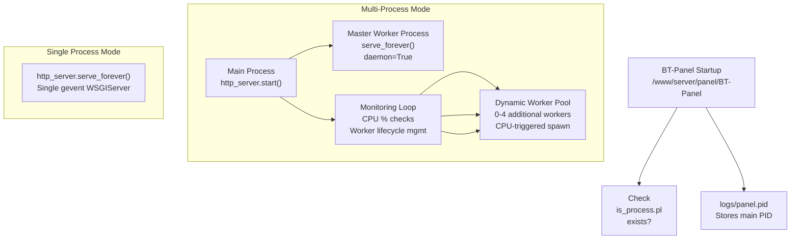
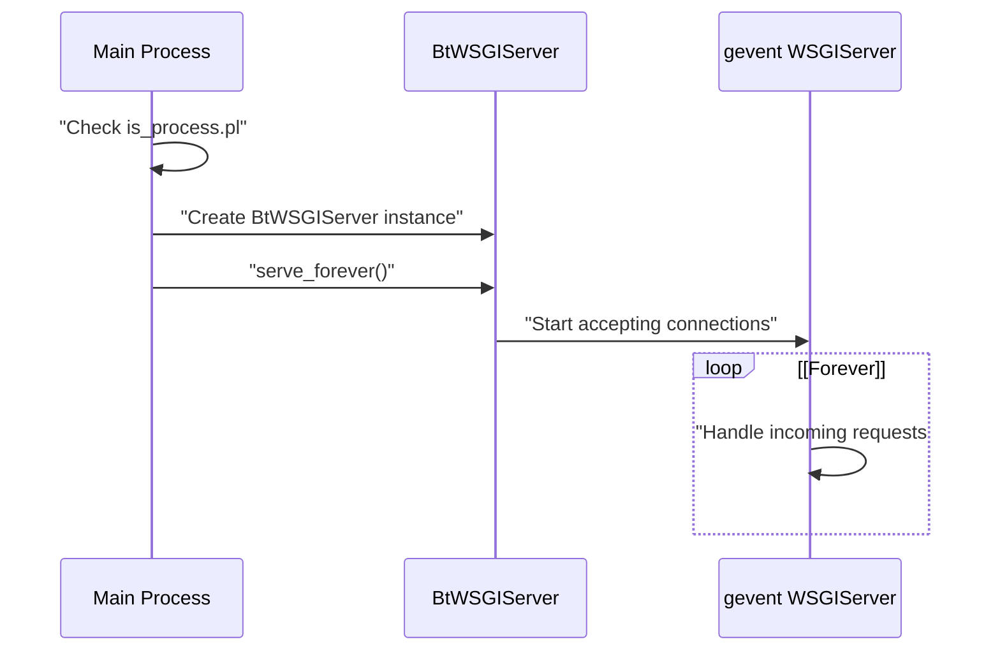
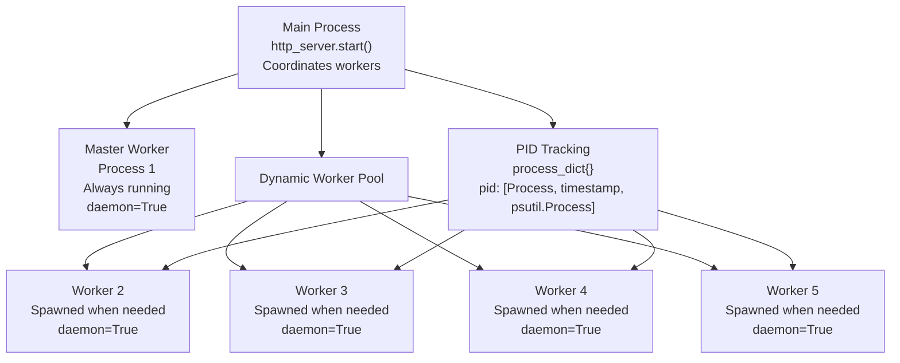
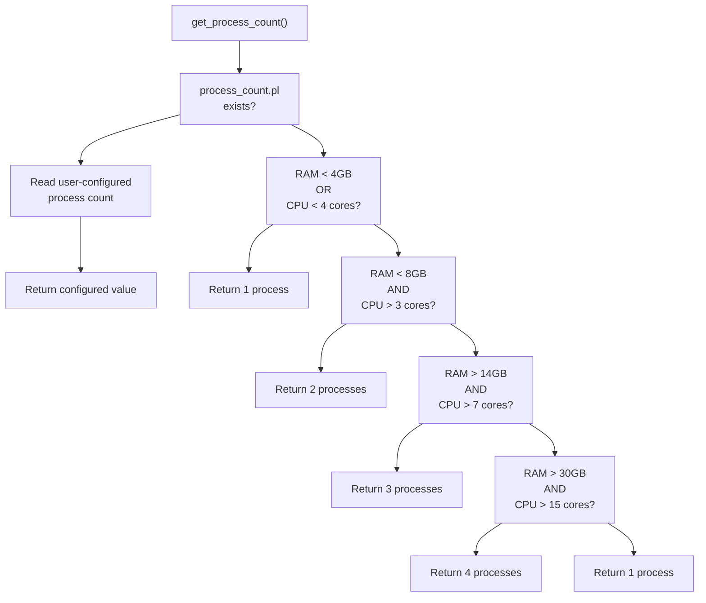
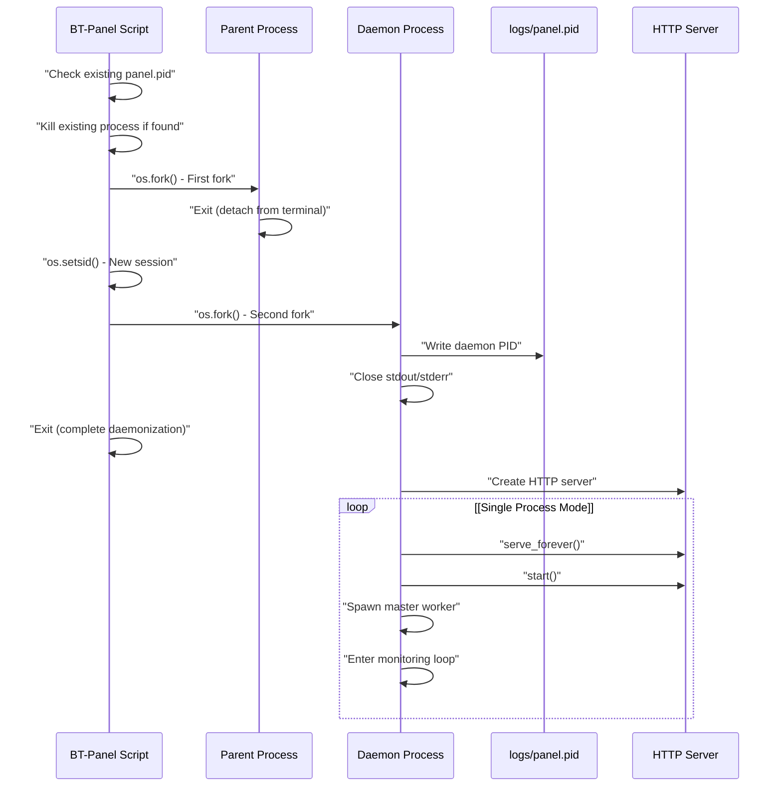
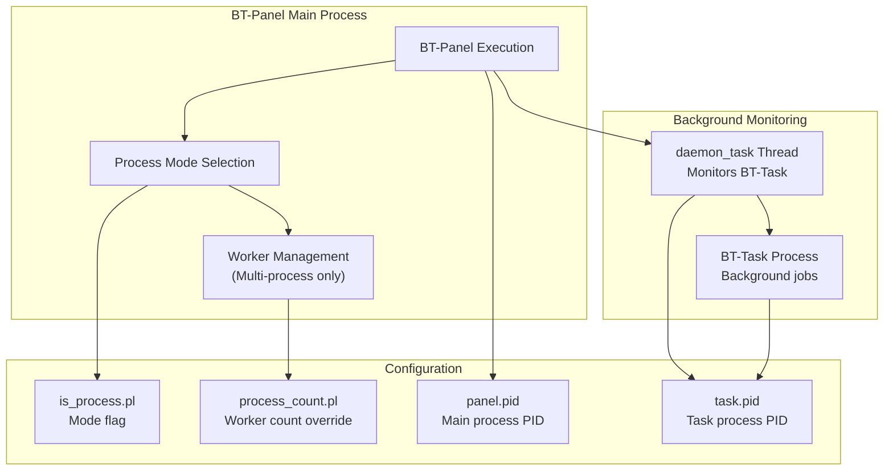

# Process Management

> **Relevant source files**
> * [BT-Panel](https://github.com/aaPanel/aaPanel/blob/b6e4ab8b/BT-Panel)

## Purpose and Scope

This document explains how aaPanel manages its execution processes, covering the choice between single-process and multi-process deployment modes, process lifecycle management, and configuration options. The system uses the presence of the `data/is_process.pl` file as a flag to determine which mode to use.

For details on dynamic worker scaling algorithms, see [Worker Scaling](/aaPanel/aaPanel/7.1-worker-scaling). For information on background task monitoring, see [Process Monitoring](/aaPanel/aaPanel/7.2-process-monitoring). For the overall web server architecture, see [Web Server (BT-Panel)](/aaPanel/aaPanel/2.1-web-server-(bt-panel)).

---

## Process Execution Modes

aaPanel supports two distinct process execution modes:

| Mode | Configuration | Use Case | Worker Processes |
| --- | --- | --- | --- |
| **Single Process** | `data/is_process.pl` absent | Low-traffic servers, development, <4GB RAM, <4 CPU cores | 0 (main process only) |
| **Multi-Process** | `data/is_process.pl` present | Production servers with adequate resources | 1-4 dynamically scaled workers |

The mode is determined at startup by checking for the existence of the `data/is_process.pl` configuration file [BT-Panel L390](https://github.com/aaPanel/aaPanel/blob/b6e4ab8b/BT-Panel#L390-L390)

**Sources:** [BT-Panel L390-L449](https://github.com/aaPanel/aaPanel/blob/b6e4ab8b/BT-Panel#L390-L449)

---

## Process Mode Architecture



**Sources:** [BT-Panel L390-L449](https://github.com/aaPanel/aaPanel/blob/b6e4ab8b/BT-Panel#L390-L449)

---

## Single Process Mode

### Behavior

When `data/is_process.pl` does not exist, aaPanel runs in single-process mode. The main process creates a single `BtWSGIServer` instance and calls `serve_forever()` to handle all incoming requests [BT-Panel L391-L397](https://github.com/aaPanel/aaPanel/blob/b6e4ab8b/BT-Panel#L391-L397)



### When to Use

Single-process mode is automatically selected when:

* System memory < 4GB
* CPU cores < 4
* Manual override (delete `is_process.pl` file)

This mode provides:

* Lower memory overhead
* Simpler process management
* Adequate performance for low-traffic environments
* Easier debugging (single process to attach debugger)

**Sources:** [BT-Panel L171-L192](https://github.com/aaPanel/aaPanel/blob/b6e4ab8b/BT-Panel#L171-L192)

 [BT-Panel L391-L397](https://github.com/aaPanel/aaPanel/blob/b6e4ab8b/BT-Panel#L391-L397)

---

## Multi-Process Mode

### Overview

When `data/is_process.pl` exists, aaPanel operates in multi-process mode with dynamic worker scaling. The system starts with a master worker process and dynamically spawns additional workers based on CPU load [BT-Panel L398-L449](https://github.com/aaPanel/aaPanel/blob/b6e4ab8b/BT-Panel#L398-L449)

### Process Hierarchy



### Worker Management Process

The main process continuously monitors the master worker's CPU usage and manages the worker pool [BT-Panel L418-L449](https://github.com/aaPanel/aaPanel/blob/b6e4ab8b/BT-Panel#L418-L449)

:

1. **CPU Monitoring**: Checks master worker CPU every 1 second using `main_psutil.cpu_percent(interval=1)`
2. **Spawn Trigger**: When master CPU > 90% and all existing workers are busy, spawn new worker
3. **Idle Detection**: Workers idle for >5 seconds after running for >60 seconds are terminated
4. **Max Workers**: Limited by `get_process_count()` (2-4 workers depending on system resources)

**Sources:** [BT-Panel L398-L449](https://github.com/aaPanel/aaPanel/blob/b6e4ab8b/BT-Panel#L398-L449)

---

## Process Count Determination

### The get_process_count() Function

The system automatically determines the optimal number of worker processes based on available system resources [BT-Panel L171-L192](https://github.com/aaPanel/aaPanel/blob/b6e4ab8b/BT-Panel#L171-L192)

:



### Resource Thresholds

| RAM | CPU Cores | Process Count |
| --- | --- | --- |
| < 4GB | Any | 1 |
| Any | < 4 | 1 |
| 4-8GB | > 3 | 2 |
| 8-14GB | > 3 | 2 |
| > 14GB | > 7 | 3 |
| > 30GB | > 15 | 4 |

### Manual Override

Administrators can override automatic process count detection by creating `data/process_count.pl` containing the desired process count as a string [BT-Panel L178-L183](https://github.com/aaPanel/aaPanel/blob/b6e4ab8b/BT-Panel#L178-L183)

**Sources:** [BT-Panel L171-L192](https://github.com/aaPanel/aaPanel/blob/b6e4ab8b/BT-Panel#L171-L192)

---

## Process Lifecycle

### Startup Sequence



### Daemonization Process

The BT-Panel script uses a double-fork technique to properly daemonize [BT-Panel L237-L245](https://github.com/aaPanel/aaPanel/blob/b6e4ab8b/BT-Panel#L237-L245)

:

1. **First Fork**: Creates child process and parent exits, detaching from terminal
2. **Session Leader**: `os.setsid()` creates new session, detaching from controlling terminal
3. **Second Fork**: Creates daemon process, preventing acquisition of controlling terminal
4. **PID File**: Writes daemon PID to `logs/panel.pid` for management scripts
5. **Descriptor Cleanup**: Closes/redirects stdout and stderr

### PID File Management

The `logs/panel.pid` file stores the main daemon process ID [BT-Panel L230-L244](https://github.com/aaPanel/aaPanel/blob/b6e4ab8b/BT-Panel#L230-L244)

:

* Created after successful daemonization
* Contains single integer (process ID)
* Used by init scripts to manage the panel
* Checked at startup to kill existing instances

**Sources:** [BT-Panel L229-L245](https://github.com/aaPanel/aaPanel/blob/b6e4ab8b/BT-Panel#L229-L245)

---

## Multi-Process Worker Scaling Logic

### Spawn Conditions

A new worker process is spawned when all of the following conditions are met [BT-Panel L422-L439](https://github.com/aaPanel/aaPanel/blob/b6e4ab8b/BT-Panel#L422-L439)

:

1. Master worker CPU usage > 90% for 1 second
2. All existing workers are active (CPU > 0%)
3. Current worker count < max process count from `get_process_count()`

### Worker State Tracking

The `process_dict` dictionary tracks worker metadata [BT-Panel L419-L439](https://github.com/aaPanel/aaPanel/blob/b6e4ab8b/BT-Panel#L419-L439)

:

```css
# Dictionary structure
process_dict = {
    pid: [Process_object, creation_timestamp, psutil.Process_object]
}
```

| Index | Type | Purpose |
| --- | --- | --- |
| 0 | `multiprocessing.Process` | Process object for control operations |
| 1 | `float` | Creation timestamp (from `time.time()`) |
| 2 | `psutil.Process` | psutil wrapper for CPU monitoring |

### Termination Conditions

A worker process is terminated when all conditions are met [BT-Panel L442-L447](https://github.com/aaPanel/aaPanel/blob/b6e4ab8b/BT-Panel#L442-L447)

:

1. Worker has been running for > 60 seconds (grace period)
2. Worker CPU usage < 0% for 5 consecutive seconds (idle detection)

This prevents premature termination of newly spawned workers while ensuring idle workers don't consume resources.

**Sources:** [BT-Panel L418-L449](https://github.com/aaPanel/aaPanel/blob/b6e4ab8b/BT-Panel#L418-L449)

---

## Network Binding

Process mode affects network binding configuration:

| Binding Mode | Process Mode | Configuration |
| --- | --- | --- |
| **Unix Socket** | Both | `/tmp/panel.sock` when webserver enabled |
| **TCP Port** | Both | `HOST:PORT` from `data/port.pl`, `data/ipv6.pl` |

In multi-process mode, all worker processes share the same socket/port through the shared `http_server` instance that calls `start_accepting()` [BT-Panel L403-L405](https://github.com/aaPanel/aaPanel/blob/b6e4ab8b/BT-Panel#L403-L405)

**Sources:** [BT-Panel L332-L380](https://github.com/aaPanel/aaPanel/blob/b6e4ab8b/BT-Panel#L332-L380)

---

## Configuration Files

### data/is_process.pl

* **Purpose**: Flag file to enable multi-process mode
* **Format**: Presence-based (file content ignored)
* **Location**: `/www/server/panel/data/is_process.pl`
* **Effect**: * Exists → Multi-process mode with worker scaling * Absent → Single-process mode

### data/process_count.pl

* **Purpose**: Manual override for worker count
* **Format**: Plain text integer (e.g., "3")
* **Location**: `/www/server/panel/data/process_count.pl`
* **Effect**: Overrides automatic detection from `get_process_count()`
* **Valid Range**: 1-4 processes (enforced by code logic)

**Sources:** [BT-Panel L178-L183](https://github.com/aaPanel/aaPanel/blob/b6e4ab8b/BT-Panel#L178-L183)

 [BT-Panel L390](https://github.com/aaPanel/aaPanel/blob/b6e4ab8b/BT-Panel#L390-L390)

---

## Process Management Integration



The process management system integrates with:

* **Background Task System**: See [Background Task System (BT-Task)](/aaPanel/aaPanel/2.2-background-task-system-(bt-task)) for BT-Task monitoring
* **Process Monitoring**: See [Process Monitoring](/aaPanel/aaPanel/7.2-process-monitoring) for daemon_task details
* **Worker Scaling**: See [Worker Scaling](/aaPanel/aaPanel/7.1-worker-scaling) for detailed scaling algorithms

**Sources:** [BT-Panel L143-L169](https://github.com/aaPanel/aaPanel/blob/b6e4ab8b/BT-Panel#L143-L169)

 [BT-Panel L279-L280](https://github.com/aaPanel/aaPanel/blob/b6e4ab8b/BT-Panel#L279-L280)

 [BT-Panel L390-L449](https://github.com/aaPanel/aaPanel/blob/b6e4ab8b/BT-Panel#L390-L449)