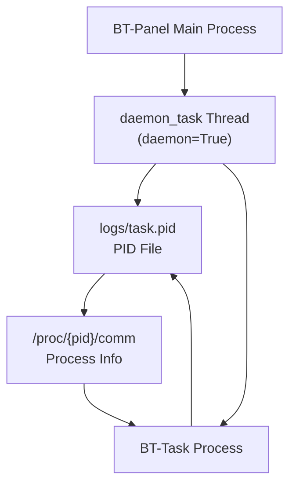
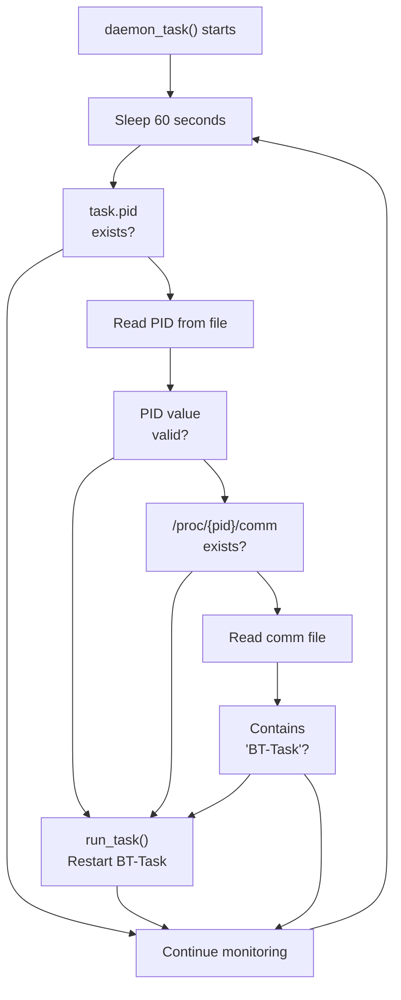
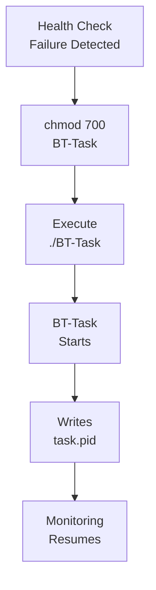

# Process Monitoring

> **Relevant source files**
> * [BT-Panel](https://github.com/aaPanel/aaPanel/blob/b6e4ab8b/BT-Panel)
> * [BT-Task](https://github.com/aaPanel/aaPanel/blob/b6e4ab8b/BT-Task)

## Purpose and Scope

This document describes the process monitoring system that ensures the BT-Task background processor remains operational. The monitoring system runs as a daemon thread within the main BT-Panel process and performs periodic health checks, automatically restarting BT-Task if it crashes or becomes unresponsive.

For information about the BT-Task background processor itself, see [Background Task System (BT-Task)](/aaPanel/aaPanel/2.2-background-task-system-(bt-task)). For information about worker process scaling in multi-process mode, see [Worker Scaling](/aaPanel/aaPanel/7.1-worker-scaling).

## Overview of Monitoring System

The process monitoring system consists of a daemon thread (`daemon_task`) that runs continuously within the BT-Panel main process. It performs health checks every 60 seconds to verify that BT-Task is running and restarts it if necessary.



**Sources:** [BT-Panel L143-L169](https://github.com/aaPanel/aaPanel/blob/b6e4ab8b/BT-Panel#L143-L169)

 [BT-Panel L279-L280](https://github.com/aaPanel/aaPanel/blob/b6e4ab8b/BT-Panel#L279-L280)

## Daemon Thread Architecture

The monitoring thread is started during BT-Panel initialization using Python's `threading` module with the `daemon=True` flag, ensuring it terminates when the main process exits.

### Thread Initialization

| Component | Value | Location |
| --- | --- | --- |
| Thread Target | `daemon_task` | [BT-Panel L279](https://github.com/aaPanel/aaPanel/blob/b6e4ab8b/BT-Panel#L279-L279) |
| Thread Type | Daemon thread | [BT-Panel L279](https://github.com/aaPanel/aaPanel/blob/b6e4ab8b/BT-Panel#L279-L279) |
| Start Point | After PID file creation | [BT-Panel L280](https://github.com/aaPanel/aaPanel/blob/b6e4ab8b/BT-Panel#L280-L280) |
| Lifecycle | Runs until BT-Panel exits | [BT-Panel L279-L280](https://github.com/aaPanel/aaPanel/blob/b6e4ab8b/BT-Panel#L279-L280) |

```markdown
# Thread creation and startup
task_thread = threading.Thread(target=daemon_task, daemon=True)
task_thread.start()
```

The daemon thread starts immediately after the BT-Panel process completes its double-fork daemonization and begins accepting requests.

**Sources:** [BT-Panel L278-L280](https://github.com/aaPanel/aaPanel/blob/b6e4ab8b/BT-Panel#L278-L280)

## Health Check Mechanism

The `daemon_task` function implements a continuous monitoring loop that performs health checks at fixed intervals.



### Health Check Parameters

| Parameter | Value | Purpose |
| --- | --- | --- |
| Check Interval | 60 seconds | Balance between responsiveness and overhead |
| PID File Path | `{_PATH}/logs/task.pid` | Standard location for task process ID |
| Comm File Path | `/proc/{pid}/comm` | Linux process command name |
| Expected Comm | Contains `BT-Task` | Validates correct process type |

**Sources:** [BT-Panel L143-L169](https://github.com/aaPanel/aaPanel/blob/b6e4ab8b/BT-Panel#L143-L169)

## PID File Management

The monitoring system relies on PID files to track running processes. Both BT-Panel and BT-Task maintain their own PID files.

### PID File Locations

| Process | PID File Path | Written By | Read By |
| --- | --- | --- | --- |
| BT-Panel | `logs/panel.pid` | BT-Panel main process | System scripts |
| BT-Task | `logs/task.pid` | BT-Task process | `daemon_task` thread |

### PID File Operations

The monitoring system performs the following operations with the task PID file:

1. **Existence Check** - Verifies the file exists before attempting to read it
2. **Content Read** - Reads the PID value as a string
3. **Validation** - Ensures the PID is non-empty and numeric
4. **Process Verification** - Uses PID to check `/proc/{pid}/comm`

```mermaid
sequenceDiagram
  participant daemon_task
  participant logs/task.pid
  participant /proc/{pid}/comm
  participant run_task()

  daemon_task->>logs/task.pid: Check if exists
  loop [Not BT-Task]
    daemon_task->>daemon_task: Continue (skip this cycle)
    daemon_task->>logs/task.pid: Read PID value
    daemon_task->>run_task(): Restart BT-Task
    daemon_task->>/proc/{pid}/comm: Check if exists
    daemon_task->>run_task(): Restart BT-Task
    daemon_task->>/proc/{pid}/comm: Read comm name
    daemon_task->>run_task(): Restart BT-Task
    daemon_task->>daemon_task: Continue monitoring
  end
```

**Sources:** [BT-Panel L145](https://github.com/aaPanel/aaPanel/blob/b6e4ab8b/BT-Panel#L145-L145)

 [BT-Panel L150-L156](https://github.com/aaPanel/aaPanel/blob/b6e4ab8b/BT-Panel#L150-L156)

 [BT-Panel L160-L168](https://github.com/aaPanel/aaPanel/blob/b6e4ab8b/BT-Panel#L160-L168)

## Process Validation

The monitoring system uses Linux's `/proc` filesystem to validate that the process is genuinely BT-Task and not another process that happens to be using the same PID.

### Validation Steps

1. **PID File Check** - Ensures `logs/task.pid` exists
2. **PID Read** - Retrieves the stored process ID
3. **Process Existence** - Verifies `/proc/{pid}/comm` file exists
4. **Command Validation** - Confirms comm contains the string `BT-Task`

### Process Validation Logic

```css
# PID file existence check
if not os.path.exists(task_pid_file):
    continue

# Read PID value
task_pid = public.readFile(task_pid_file)
if not task_pid:
    run_task()
    continue

# Check process existence via /proc
comm_file = "/proc/{}/comm".format(task_pid)
if not os.path.exists(comm_file):
    run_task()
    continue

# Validate process command name
comm = public.readFile(comm_file)
if comm.find('BT-Task') == -1:
    run_task()
    continue
```

This multi-step validation prevents false positives where:

* The PID file exists but the process has terminated
* A different process has been assigned the same PID (PID reuse)
* The process exists but is not the BT-Task background processor

**Sources:** [BT-Panel L150-L169](https://github.com/aaPanel/aaPanel/blob/b6e4ab8b/BT-Panel#L150-L169)

## Automatic Restart Logic

When any health check fails, the monitoring system automatically restarts BT-Task using the `run_task()` function.

### Restart Function

The `run_task()` function performs two operations:

1. **Permission Setting** - Ensures BT-Task script is executable
2. **Process Launch** - Executes BT-Task directly

```python
def run_task():
    public.ExecShell("chmod 700 {}/BT-Task".format(_PATH))
    public.ExecShell("{}/BT-Task".format(_PATH))
```

### Restart Triggers

| Condition | Check | Action |
| --- | --- | --- |
| Missing PID file | `not os.path.exists(task_pid_file)` | Skip this cycle (continue) |
| Empty PID value | `not task_pid` | Restart BT-Task |
| Process not running | `/proc/{pid}/comm` does not exist | Restart BT-Task |
| Wrong process | `comm.find('BT-Task') == -1` | Restart BT-Task |

### Restart Flow



**Note:** The `run_task()` function does not perform graceful shutdown of the existing process. It simply launches a new instance, relying on BT-Task's own startup logic to handle any existing instances.

**Sources:** [BT-Panel L139-L141](https://github.com/aaPanel/aaPanel/blob/b6e4ab8b/BT-Panel#L139-L141)

 [BT-Panel L156](https://github.com/aaPanel/aaPanel/blob/b6e4ab8b/BT-Panel#L156-L156)

 [BT-Panel L162](https://github.com/aaPanel/aaPanel/blob/b6e4ab8b/BT-Panel#L162-L162)

 [BT-Panel L168](https://github.com/aaPanel/aaPanel/blob/b6e4ab8b/BT-Panel#L168-L168)

## Monitoring Cycle Timeline

The complete monitoring cycle repeats continuously with the following timeline:

| Time | Activity | Duration |
| --- | --- | --- |
| T+0s | Sleep begins | - |
| T+60s | Wake up and check PID file | < 1ms |
| T+60s | Read PID value (if exists) | < 1ms |
| T+60s | Check /proc/{pid}/comm | < 1ms |
| T+60s | Read comm value | < 1ms |
| T+60s | Validate comm contains 'BT-Task' | < 1ms |
| T+60s | Restart if needed (async) | 0-1s |
| T+60s | Return to sleep | - |

The 60-second interval provides a reasonable balance:

* **Low Overhead** - Minimal CPU usage from periodic checks
* **Acceptable Recovery Time** - Maximum 60 seconds until restart detection
* **Prevents Restart Loops** - Sufficient time for BT-Task to initialize

**Sources:** [BT-Panel L144](https://github.com/aaPanel/aaPanel/blob/b6e4ab8b/BT-Panel#L144-L144)

 [BT-Panel L147](https://github.com/aaPanel/aaPanel/blob/b6e4ab8b/BT-Panel#L147-L147)

## Integration with BT-Task

The BT-Task process itself is responsible for:

1. Writing its PID to `logs/task.pid` on startup
2. Handling task queue processing
3. Exiting cleanly when stopped

The monitoring system does not:

* Send signals to running processes
* Perform graceful shutdown
* Track task execution status
* Monitor task queue length

These responsibilities belong to the BT-Task process itself, which is documented in [Background Task System (BT-Task)](/aaPanel/aaPanel/2.2-background-task-system-(bt-task)).

**Sources:** [BT-Panel L143-L169](https://github.com/aaPanel/aaPanel/blob/b6e4ab8b/BT-Panel#L143-L169)

 [BT-Task L1-L14](https://github.com/aaPanel/aaPanel/blob/b6e4ab8b/BT-Task#L1-L14)

## Error Handling

The monitoring system is designed to be fault-tolerant:

### Silent Failure Modes

The `daemon_task` function continues execution even when:

* The PID file is missing (normal during first cycle)
* File read operations fail
* The PID value is malformed
* The /proc filesystem returns unexpected data

In all cases, the monitoring thread simply continues to the next sleep cycle or triggers a restart, preventing the monitoring system itself from crashing.

### No Exception Handling

The `daemon_task` function does not include explicit try-except blocks. This design relies on:

1. **File Operations** - `public.readFile()` returns empty string on failure
2. **String Operations** - `str.find()` returns -1 when substring not found
3. **Boolean Checks** - `if not` patterns handle None/empty gracefully

This approach ensures the monitoring thread never terminates unexpectedly while maintaining simple, readable code.

**Sources:** [BT-Panel L143-L169](https://github.com/aaPanel/aaPanel/blob/b6e4ab8b/BT-Panel#L143-L169)