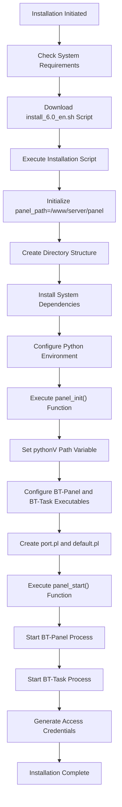
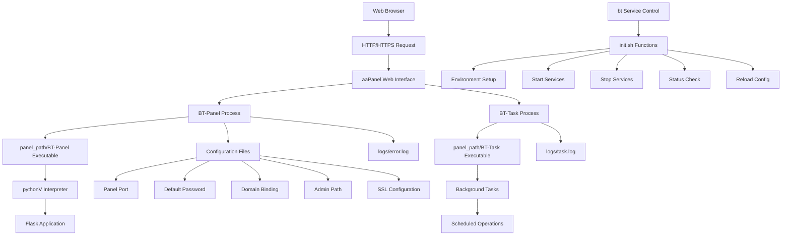

# Installation and Setup

> **Relevant source files**
> * [BT-Panel](https://github.com/aaPanel/aaPanel/blob/b6e4ab8b/BT-Panel)
> * [BTPanel/app.py](https://github.com/aaPanel/aaPanel/blob/b6e4ab8b/BTPanel/app.py)

This document provides technical instructions for installing aaPanel on a server and performing initial system configuration. It covers both standard Linux installation and Docker deployment methods, along with service management and post-installation tasks.

## System Requirements

Before installing aaPanel, ensure your system meets these technical prerequisites:

* **Memory**: 512MB minimum, 768MB+ recommended (panel itself uses ~60MB)
* **Disk Space**: 100MB+ available (panel core uses ~20MB)
* **Operating System**: CentOS 7.1+, Ubuntu 16.04+, or Debian 9.0+
* **Environment**: Clean server without existing Apache/Nginx/PHP/MySQL installations
* **Privileges**: Root access required for installation

Sources: [README.md L46-L52](https://github.com/aaPanel/aaPanel/blob/b6e4ab8b/README.md#L46-L52)

## Installation Methods

### Standard Linux Installation

Execute the following command with root privileges to install aaPanel directly on a Linux server:

```
URL=https://www.aapanel.com/script/install_6.0_en.sh && if [ -f /usr/bin/curl ];then curl -ksSO "$URL" ;else wget --no-check-certificate -O install_6.0_en.sh "$URL";fi;bash install_6.0_en.sh 66959f96
```

This command downloads the installation script, verifies the environment, and sets up the aaPanel directory structure at `/www/server/panel`.

Sources: [README.md L54-L56](https://github.com/aaPanel/aaPanel/blob/b6e4ab8b/README.md#L54-L56)

### Docker Deployment

For containerized environments, use this Docker command:

```
docker run -d -p 8886:8888 -p 22:21 -p 443:443 -p 80:80 -p 889:888 -v ~/website_data:/www/wwwroot -v ~/mysql_data:/www/server/data -v ~/vhost:/www/server/panel/vhost aapanel/aapanel:lib
```

Port and volume mapping configuration:

| Container Port | Host Port | Service Description |
| --- | --- | --- |
| 8888 | 8886 | Control Panel |
| 888 | 889 | phpMyAdmin |
| 80 | 80 | HTTP web service |
| 443 | 443 | HTTPS web service |
| 21 | 22 | FTP service |

| Container Path | Host Path | Content Description |
| --- | --- | --- |
| /www/wwwroot | ~/website_data | Website files and directories |
| /www/server/data | ~/mysql_data | MySQL database files |
| /www/server/panel/vhost | ~/vhost | Virtual host configurations |

Sources: [README.md L58-L82](https://github.com/aaPanel/aaPanel/blob/b6e4ab8b/README.md#L58-L82)

## Installation Process

The following diagram shows the aaPanel installation flow, highlighting key initialization steps:



Sources: [init.sh L15-L55](https://github.com/aaPanel/aaPanel/blob/b6e4ab8b/init.sh#L15-L55)

 [init.sh L70-L105](https://github.com/aaPanel/aaPanel/blob/b6e4ab8b/init.sh#L70-L105)

## Service Components

The aaPanel system consists of two primary service components:

1. **BT-Panel**: Web interface service that handles HTTP requests
2. **BT-Task**: Background process that manages scheduled and asynchronous tasks

These components work together to provide the complete panel functionality:



Sources: [init.sh L15-L55](https://github.com/aaPanel/aaPanel/blob/b6e4ab8b/init.sh#L15-L55)

 [init.sh L70-L105](https://github.com/aaPanel/aaPanel/blob/b6e4ab8b/init.sh#L70-L105)

 [init.sh L195-L221](https://github.com/aaPanel/aaPanel/blob/b6e4ab8b/init.sh#L195-L221)

 [init.sh L223-L239](https://github.com/aaPanel/aaPanel/blob/b6e4ab8b/init.sh#L223-L239)

## Post-Installation Access

After installation completes, the system will display access information including:

* **Panel URL**: `http://YOUR_SERVER_IP:PORT/login`
* **Default Username**: Generated during installation
* **Default Password**: Stored in `/www/server/panel/default.pl`

For Docker installations, the default credentials are:

* **Username**: `aapanel`
* **Password**: `aapanel123`

Sources: [README.md L72-L73](https://github.com/aaPanel/aaPanel/blob/b6e4ab8b/README.md#L72-L73)

 [init.sh L398-L426](https://github.com/aaPanel/aaPanel/blob/b6e4ab8b/init.sh#L398-L426)

## Service Management

### Service Commands

The `bt` service script provides several management functions:

| Command | Function | Description | Implementation |
| --- | --- | --- | --- |
| `service bt start` | panel_start() | Starts both panel services | [init.sh L70-L125](https://github.com/aaPanel/aaPanel/blob/b6e4ab8b/init.sh#L70-L125) |
| `service bt stop` | panel_stop() | Terminates all panel services | [init.sh L195-L221](https://github.com/aaPanel/aaPanel/blob/b6e4ab8b/init.sh#L195-L221) |
| `service bt restart` | restart case | Executes stop followed by start | [init.sh L323-L335](https://github.com/aaPanel/aaPanel/blob/b6e4ab8b/init.sh#L323-L335) |
| `service bt reload` | panel_reload() | Restarts panel without stopping tasks | [init.sh L241-L286](https://github.com/aaPanel/aaPanel/blob/b6e4ab8b/init.sh#L241-L286) |
| `service bt status` | panel_status() | Displays running status of processes | [init.sh L223-L239](https://github.com/aaPanel/aaPanel/blob/b6e4ab8b/init.sh#L223-L239) |
| `service bt logs` | error_logs() | Shows last 100 lines of error log | [init.sh L317-L320](https://github.com/aaPanel/aaPanel/blob/b6e4ab8b/init.sh#L317-L320) |
| `service bt default` | default case | Displays access information | [init.sh L348-L426](https://github.com/aaPanel/aaPanel/blob/b6e4ab8b/init.sh#L348-L426) |

Sources: [init.sh L323-L431](https://github.com/aaPanel/aaPanel/blob/b6e4ab8b/init.sh#L323-L431)

### Process Management Flow

This diagram illustrates how the `bt` service manages the panel processes:

```mermaid
sequenceDiagram
  participant User
  participant bt Service
  participant panel_init() Function
  participant BT-Panel Process
  participant BT-Task Process
  participant Log Files

  User->>bt Service: service bt start
  bt Service->>panel_init() Function: Initialize environment
  panel_init() Function->>bt Service: Return configuration
  bt Service->>BT-Panel Process: Launch panel_path/BT-Panel
  BT-Panel Process->>Log Files: Write to logs/error.log
  bt Service->>BT-Task Process: Launch panel_path/BT-Task
  BT-Task Process->>Log Files: Write to logs/task.log
  bt Service->>User: Return status
  User->>bt Service: service bt stop
  bt Service->>BT-Task Process: Kill task processes
  bt Service->>BT-Panel Process: Kill panel processes
  bt Service->>User: Return status
  User->>bt Service: service bt status
  bt Service->>BT-Panel Process: Check process with get_panel_pids()
  bt Service->>BT-Task Process: Check process with get_task_pids()
  bt Service->>User: Return running status
```

Sources: [init.sh L58-L68](https://github.com/aaPanel/aaPanel/blob/b6e4ab8b/init.sh#L58-L68)

 [init.sh L70-L125](https://github.com/aaPanel/aaPanel/blob/b6e4ab8b/init.sh#L70-L125)

 [init.sh L195-L239](https://github.com/aaPanel/aaPanel/blob/b6e4ab8b/init.sh#L195-L239)

## Essential Post-Installation Configuration

### 1. Secure Your Panel

Immediately after installation, perform these security measures:

* Change the default password through the panel interface
* Update the panel access port from the default 8888
* Consider enabling SSL for the panel interface

### 2. Firewall Configuration

Ensure these essential ports are accessible:

* Panel port (default: 8888)
* Web ports: 80 (HTTP) and 443 (HTTPS)
* FTP ports: 20 and 21
* Database port: 3306 (if needed)

The `panel_port_check()` function in [init.sh L127-L185](https://github.com/aaPanel/aaPanel/blob/b6e4ab8b/init.sh#L127-L185)

 automatically attempts to resolve port conflicts by restarting potentially conflicting services.

Sources: [README.md L424-L425](https://github.com/aaPanel/aaPanel/blob/b6e4ab8b/README.md#L424-L425)

### 3. Domain Binding (Optional)

For easier panel access:

1. Configure DNS for your domain to point to your server
2. In panel settings, bind the domain to your panel
3. After binding, the panel will only be accessible via the domain

To unbind a domain, use the command: `bt 12`

Sources: [init.sh L415-L416](https://github.com/aaPanel/aaPanel/blob/b6e4ab8b/init.sh#L415-L416)

## Troubleshooting Installation Issues

### Common Problems and Solutions

| Issue | Possible Cause | Solution | Reference |
| --- | --- | --- | --- |
| Panel won't start | Port conflict | Use `panel_port_check()` to identify conflicts | [init.sh L127-L185](https://github.com/aaPanel/aaPanel/blob/b6e4ab8b/init.sh#L127-L185) |
| Failed access | Firewall blocking | Open required ports in firewall |  |
| Service errors | Environment issues | Check logs with `service bt logs` | [init.sh L317-L320](https://github.com/aaPanel/aaPanel/blob/b6e4ab8b/init.sh#L317-L320) |
| Login issues | Credential problems | Reset password with `bt 6` |  |
| Python errors | Environment path | Verify `pythonV` path in init.sh | [init.sh L30-L42](https://github.com/aaPanel/aaPanel/blob/b6e4ab8b/init.sh#L30-L42) |

For port conflicts, the system uses `panel_port_check()` to identify processes using the panel port and attempts to restart conflicting services to free the port.

Sources: [init.sh L127-L185](https://github.com/aaPanel/aaPanel/blob/b6e4ab8b/init.sh#L127-L185)

## DNS API Integration (Optional)

aaPanel supports DNS API integration for domain management and SSL certificate issuance. The system includes connectors for various DNS providers including:

* CloudFlareDns
* NameCheapDns
* CloudNsDns
* CloudxnsDns

These providers can be configured through the panel interface or directly in the configuration files.

Sources: [class/panelDnsapi.py L23-L963](https://github.com/aaPanel/aaPanel/blob/b6e4ab8b/class/panelDnsapi.py#L23-L963)

## Next Steps

After successful installation and initial configuration:

1. Install web server software (Nginx, Apache, or LiteSpeed)
2. Configure PHP environments
3. Set up database servers (MySQL/MariaDB)
4. Create websites and configure domains
5. Implement backup strategies
6. Configure SSL certificates for websites

For detailed information on website management, see [Website Management](/aaPanel/aaPanel/3-request-processing-pipeline). For database management, see [Database Management](/aaPanel/aaPanel/5-feature-modules).