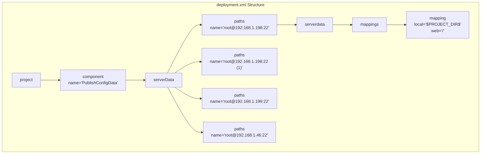
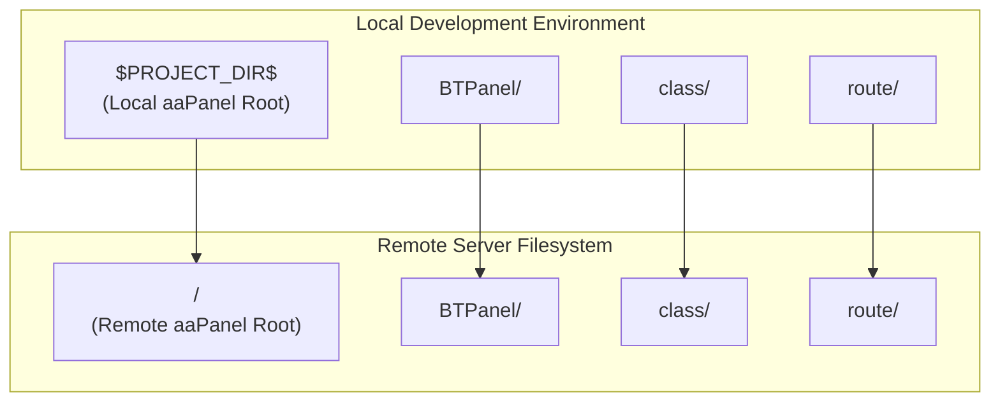
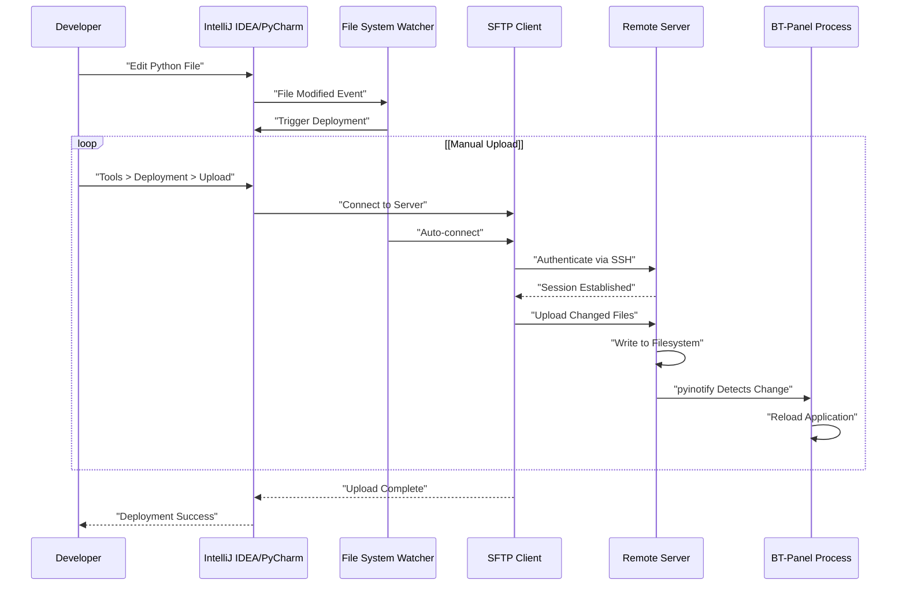
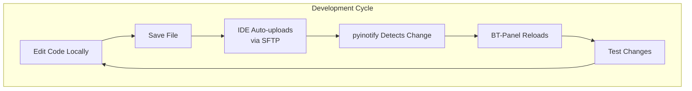

# Remote Deployment

> **Relevant source files**
> * [.idea/deployment.xml](https://github.com/aaPanel/aaPanel/blob/b6e4ab8b/.idea/deployment.xml)

## Purpose and Scope

This document explains how to configure and use IntelliJ IDEA/PyCharm's remote deployment feature to synchronize code from a local development environment to remote test servers. This workflow enables rapid iteration during development by automatically or manually uploading changed files to remote aaPanel installations for testing.

For general development environment setup, see [Development Setup](/aaPanel/aaPanel/11-development-setup). For debug mode configuration that complements remote deployment, see [Debug Mode](/aaPanel/aaPanel/11.2-debug-mode). For IDE project configuration, see [IntelliJ IDEA Configuration](/aaPanel/aaPanel/11.1-intellij-idea-configuration).

---

## Overview

Remote deployment allows developers to edit code locally while testing on remote servers without manually copying files via SCP or FTP. The IDE monitors file changes and can automatically sync them to configured remote servers over SSH/SFTP. This is particularly useful when:

* Testing on production-like environments with different OS configurations
* Verifying fixes on multiple server versions simultaneously
* Developing features that require specific server dependencies
* Avoiding local environment setup complexity

**Sources:** [.idea/deployment.xml L1-L35](https://github.com/aaPanel/aaPanel/blob/b6e4ab8b/.idea/deployment.xml#L1-L35)

---

## Deployment Configuration File

The deployment configuration is stored in [.idea/deployment.xml L1-L35](https://github.com/aaPanel/aaPanel/blob/b6e4ab8b/.idea/deployment.xml#L1-L35)

 and contains all remote server definitions and mapping rules. This file is part of the IntelliJ IDEA project configuration and defines how the IDE should synchronize files to remote servers.

### File Structure



**Diagram: Deployment Configuration XML Structure**

The configuration follows a hierarchical structure where each server definition (`paths`) contains connection information and directory mappings.

**Sources:** [.idea/deployment.xml L1-L35](https://github.com/aaPanel/aaPanel/blob/b6e4ab8b/.idea/deployment.xml#L1-L35)

---

## Server Configuration

Each server configuration in [.idea/deployment.xml L4-L33](https://github.com/aaPanel/aaPanel/blob/b6e4ab8b/.idea/deployment.xml#L4-L33)

 defines a deployment target with SSH connection parameters and directory mappings.

### Configured Servers

| Server Name | Connection String | Purpose |
| --- | --- | --- |
| root@192.168.1.198:22 | SSH to 192.168.1.198:22 | Primary test server |
| root@192.168.1.198:22 (1) | SSH to 192.168.1.198:22 | Alternate configuration for same server |
| root@192.168.1.199:22 | SSH to 192.168.1.199:22 | Secondary test server |
| root@192.168.1.46:22 | SSH to 192.168.1.46:22 | Additional test server |

Each server entry follows this structure:

```html
<paths name="root@192.168.1.198:22">
  <serverdata>
    <mappings>
      <mapping local="$PROJECT_DIR$" web="/" />
    </mappings>
  </serverdata>
</paths>
```

The `name` attribute uses the format `user@host:port`, which IntelliJ uses to identify the SSH connection.

**Sources:** [.idea/deployment.xml L5-L32](https://github.com/aaPanel/aaPanel/blob/b6e4ab8b/.idea/deployment.xml#L5-L32)

---

## Directory Mapping System

The mapping system defines how local directories correspond to remote paths on the target server.



**Diagram: Directory Mapping from Local to Remote**

### Mapping Attributes

Each mapping element [.idea/deployment.xml L8](https://github.com/aaPanel/aaPanel/blob/b6e4ab8b/.idea/deployment.xml#L8-L8)

 defines:

| Attribute | Value | Description |
| --- | --- | --- |
| `local` | `$PROJECT_DIR$` | Local project root directory |
| `web` | `/` | Remote base path (root of remote aaPanel installation) |

The `$PROJECT_DIR$` variable is automatically resolved by IntelliJ to the project's root directory. The `web` attribute of `/` means the entire project is mapped to the remote aaPanel installation root.

**Sources:** [.idea/deployment.xml L8-L29](https://github.com/aaPanel/aaPanel/blob/b6e4ab8b/.idea/deployment.xml#L8-L29)

---

## Deployment Workflow



**Diagram: Remote Deployment Process Flow**

### Deployment Modes

IntelliJ IDEA supports multiple deployment modes:

1. **Manual Upload**: Developer explicitly uploads files via menu or keyboard shortcut
2. **Automatic Upload**: Files are automatically uploaded on save (configurable)
3. **Automatic Upload on Explicit Save**: Upload triggered by explicit save action (Ctrl+S)
4. **Compare with Deployed Version**: Show differences between local and remote files

When combined with debug mode (see [Debug Mode](/aaPanel/aaPanel/11.2-debug-mode)), the remote BT-Panel process automatically detects file changes via `pyinotify` and reloads the application, creating a seamless edit-upload-test cycle.

**Sources:** [.idea/deployment.xml L1-L35](https://github.com/aaPanel/aaPanel/blob/b6e4ab8b/.idea/deployment.xml#L1-L35)

---

## Setting Up Remote Deployment

### Prerequisites

* IntelliJ IDEA or PyCharm with SSH/SFTP plugin (included in Professional editions)
* SSH access to remote servers
* SSH key authentication configured (recommended) or password access
* Write permissions to remote aaPanel installation directory

### Configuration Steps

1. **Open Deployment Settings** * Navigate to: `Settings/Preferences > Build, Execution, Deployment > Deployment` * Or: `Tools > Deployment > Configuration...`
2. **Add New Server** * Click `+` button to add a new server * Choose `SFTP` as the connection type * Enter server name (e.g., `root@192.168.1.198:22`)
3. **Configure Connection** * **Type**: SFTP * **Host**: Server IP address (e.g., `192.168.1.198`) * **Port**: SSH port (typically `22`) * **User name**: SSH user (typically `root` for aaPanel) * **Auth type**: Key pair (recommended) or Password * **Key pair**: Path to SSH private key * **Test Connection**: Verify connectivity
4. **Set Mapping** * In `Mappings` tab: * **Local path**: Set to project root (auto-populated) * **Deployment path**: Set to `/www/server/panel` or appropriate aaPanel installation path * **Web path**: `/` (optional, for URL mapping)
5. **Configure Options** * **Upload changed files automatically**: Choose preferred mode * **Create empty directories**: Enable to preserve directory structure * **Delete target items when source ones do not exist**: Use with caution

### Example Configuration Matching deployment.xml

The [.idea/deployment.xml L5-L11](https://github.com/aaPanel/aaPanel/blob/b6e4ab8b/.idea/deployment.xml#L5-L11)

 configuration represents:

```yaml
Server: root@192.168.1.198:22
Connection:
  - Host: 192.168.1.198
  - Port: 22
  - User: root
Mappings:
  - Local: [Project Root]
  - Remote: /www/server/panel (implied by '/')
```

**Sources:** [.idea/deployment.xml L5-L32](https://github.com/aaPanel/aaPanel/blob/b6e4ab8b/.idea/deployment.xml#L5-L32)

---

## Best Practices

### Security Considerations

1. **Use SSH Key Authentication** * Avoid storing passwords in IDE configuration * Use SSH keys with passphrase protection * Configure `~/.ssh/config` for key management
2. **Restrict Deployment Targets** * Never deploy directly to production servers * Use dedicated test/staging servers * Implement IP restrictions on test servers
3. **Exclude Sensitive Files** * Add exclusion patterns for: * `config/config.json` (panel configuration) * `*.pyc` (compiled Python files) * `.git/` (version control data) * `logs/` (log files) * `*.pid` (process ID files)

### Workflow Recommendations

1. **Combine with Debug Mode** * Enable debug mode on remote server (see [Debug Mode](/aaPanel/aaPanel/11.2-debug-mode)) * Create `debug.pl` file on remote server * Benefit from automatic application reload
2. **Use Multiple Server Configurations** * Configure multiple test servers as shown in [.idea/deployment.xml L4-L33](https://github.com/aaPanel/aaPanel/blob/b6e4ab8b/.idea/deployment.xml#L4-L33) * Test across different OS versions * Verify compatibility with different system configurations
3. **Verify File Permissions** * Ensure uploaded files maintain correct ownership * Check that executable permissions are preserved * Verify that `BT-Panel` process can read updated files
4. **Monitor Deployment Status** * Review deployment log in IDE * Check for failed uploads * Verify file synchronization in IDE's deployment view

### Performance Optimization

1. **Selective Upload** * Upload only changed files, not entire project * Use IDE's "Upload to..." context menu for specific files * Configure automatic upload to trigger only on explicit save
2. **Exclude Build Artifacts** * Exclude `__pycache__/` directories * Skip `.pyc` files (regenerated automatically) * Ignore IDE-specific files (`.idea/` except `deployment.xml`)
3. **Compression** * Enable SFTP compression in connection settings * Reduces bandwidth usage for large file transfers * Particularly useful for initial full project sync

**Sources:** [.idea/deployment.xml L1-L35](https://github.com/aaPanel/aaPanel/blob/b6e4ab8b/.idea/deployment.xml#L1-L35)

---

## Integration with Other Development Tools

### Debug Mode Integration

Remote deployment works seamlessly with debug mode (see [Debug Mode](/aaPanel/aaPanel/11.2-debug-mode)). When both are active:



**Diagram: Integrated Development Workflow with Remote Deployment and Debug Mode**

### Version Control Considerations

The `deployment.xml` file may contain environment-specific server addresses. Consider:

* **Commit to Repository**: If all developers use same test servers
* **Add to `.gitignore`**: If server addresses are developer-specific
* **Use Template**: Provide `deployment.xml.example` with placeholder values

### Monitoring Remote Logs

After deploying changes:

1. **Monitor Panel Logs** * Location: `/www/server/panel/logs/error.log` * Watch for Python errors after reload
2. **Check Task Logs** * Location: `/www/server/panel/logs/task.log` * Verify background tasks still function
3. **Review Request Logs** * Location: `/www/server/panel/logs/request/` * Confirm API endpoints respond correctly

**Sources:** [.idea/deployment.xml L1-L35](https://github.com/aaPanel/aaPanel/blob/b6e4ab8b/.idea/deployment.xml#L1-L35)

---

## Troubleshooting

### Common Issues

| Issue | Cause | Solution |
| --- | --- | --- |
| Connection refused | Firewall blocking SSH | Verify port 22 is open on remote server |
| Authentication failed | Invalid SSH key/password | Check SSH credentials and key permissions |
| Upload fails silently | Insufficient permissions | Verify write access to target directory |
| Changes not reflected | BT-Panel cache | Restart BT-Panel or enable debug mode |
| Slow upload speed | No SFTP compression | Enable compression in connection settings |

### Verifying Deployment Success

1. **Check File Timestamps** ``` ls -la /www/server/panel/BTPanel/__init__.py ``` Verify modification time matches deployment time
2. **Compare File Contents** * Use IDE's "Compare with Deployed Version" feature * SSH to server and diff files manually
3. **Test Application Response** * Access panel at `http://server-ip:7800` * Verify changes are active * Check browser console for errors

### Rollback Procedure

If deployment introduces errors:

1. **Use Version Control** ``` cd /www/server/panel git checkout [previous-commit] ```
2. **Restore from Backup** * Maintain backups before major deployments * Use IDE's local history feature
3. **Restart Services** ``` /etc/init.d/bt restart ```

**Sources:** [.idea/deployment.xml L1-L35](https://github.com/aaPanel/aaPanel/blob/b6e4ab8b/.idea/deployment.xml#L1-L35)

---

## Summary

Remote deployment via IntelliJ IDEA/PyCharm provides an efficient development workflow for aaPanel. The [.idea/deployment.xml L1-L35](https://github.com/aaPanel/aaPanel/blob/b6e4ab8b/.idea/deployment.xml#L1-L35)

 configuration file defines multiple server targets with directory mappings. When combined with debug mode, developers achieve a rapid edit-test cycle without manual file copying. Key considerations include using SSH key authentication, excluding sensitive files, and configuring multiple test servers for comprehensive testing.

**Sources:** [.idea/deployment.xml L1-L35](https://github.com/aaPanel/aaPanel/blob/b6e4ab8b/.idea/deployment.xml#L1-L35)