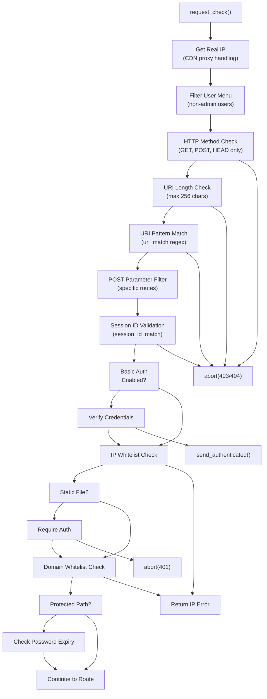
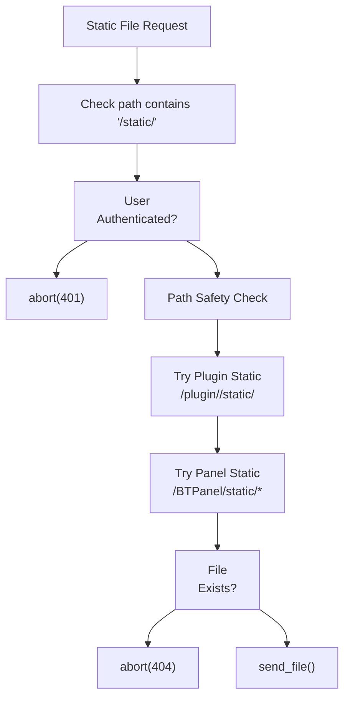
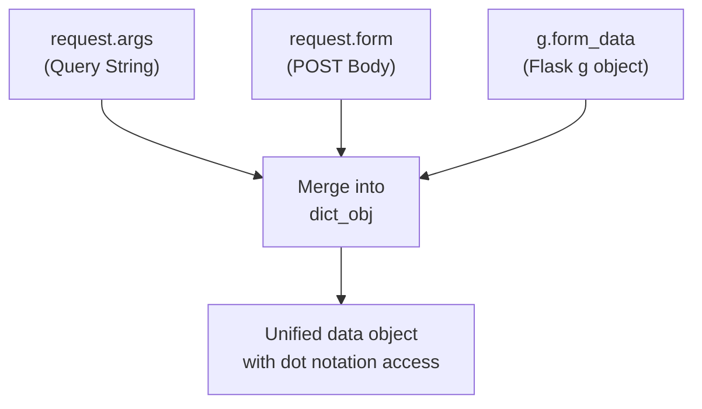
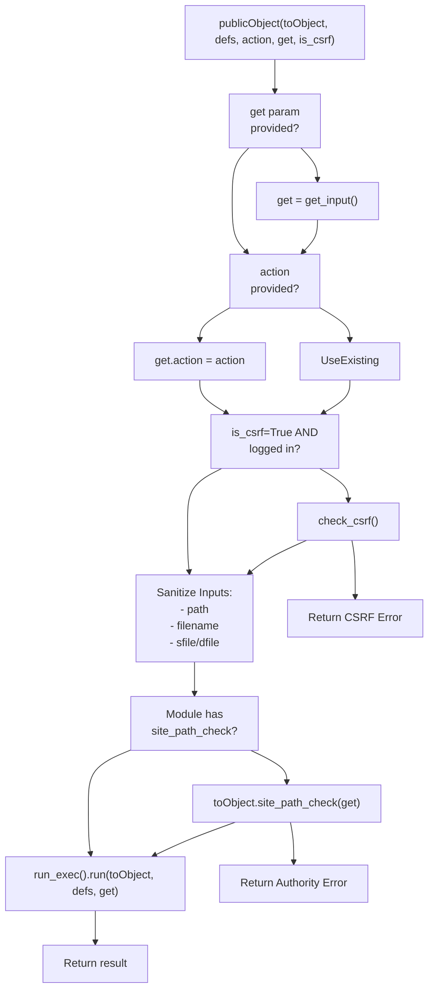
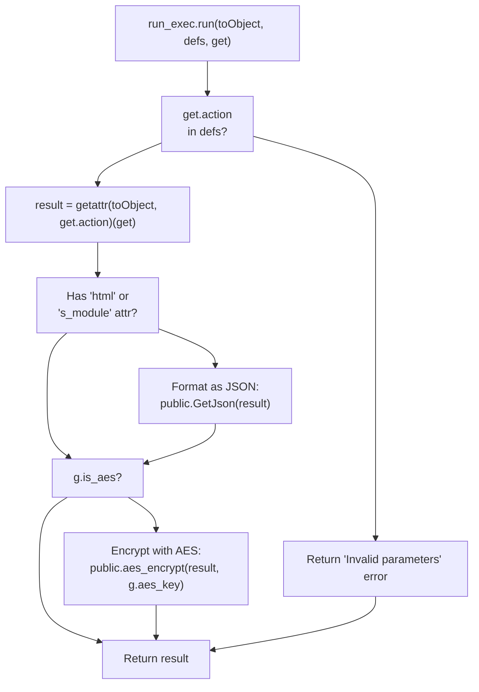
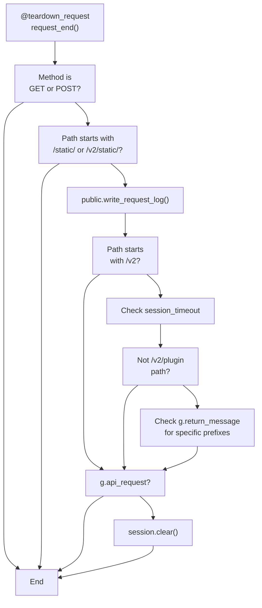
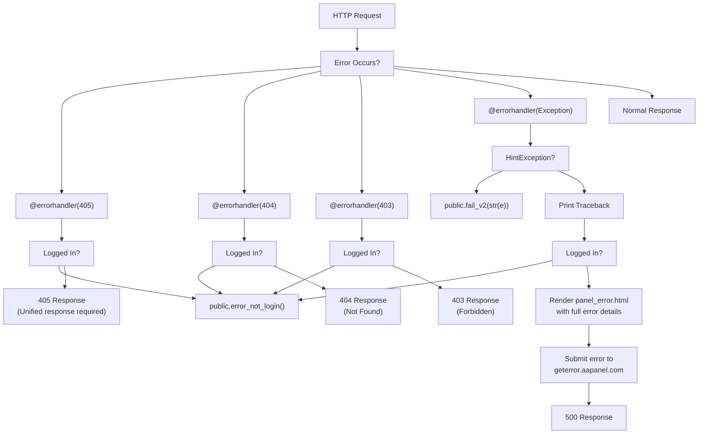
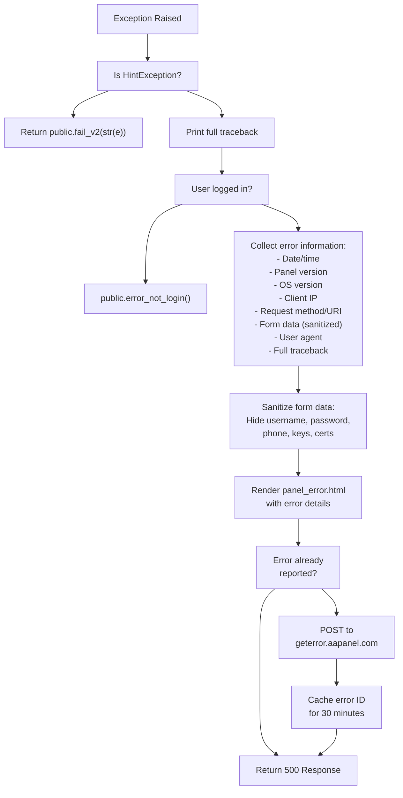
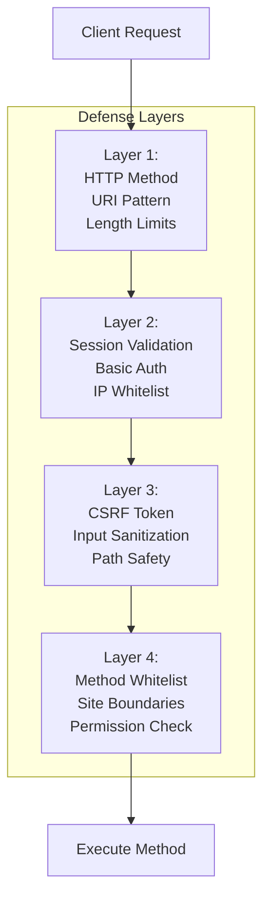

# Request Processing Pipeline

> **Relevant source files**
> * [BTPanel/__init__.py](https://github.com/aaPanel/aaPanel/blob/b6e4ab8b/BTPanel/__init__.py)
> * [BTPanel/app.py](https://github.com/aaPanel/aaPanel/blob/b6e4ab8b/BTPanel/app.py)

## Purpose and Scope

This document describes the complete request processing lifecycle in aaPanel, from the moment an HTTP request arrives at the Flask application until a response is returned to the client. It covers all validation stages, security checks, routing mechanisms, module dispatch, and response handling.

**Related Documentation:**

* For authentication mechanisms, see [Authentication and Session Management](/aaPanel/aaPanel/3.1-authentication-and-session-management)
* For security validation details, see [Security and Input Validation](/aaPanel/aaPanel/3.2-security-and-input-validation)
* For CSRF protection implementation, see [CSRF Protection](/aaPanel/aaPanel/3.3-csrf-protection)
* For module routing architecture, see [Module System and Routing](/aaPanel/aaPanel/4-module-system-and-routing)

---

## Request Lifecycle Overview

Every request in aaPanel passes through a multi-stage pipeline that enforces security, validates input, routes to appropriate handlers, and formats responses. The pipeline is implemented using Flask hooks and a custom dispatch system.

```mermaid
sequenceDiagram
  participant Client
  participant Flask
  participant @before_request
  participant request_check()
  participant Route Handler
  participant publicObject
  participant run_exec
  participant Feature Module
  participant @teardown_request

  Client->>Flask: "HTTP Request"
  Flask->>@before_request: "Pre-process request"
  loop ["Request Rejected"]
    @before_request-->>Client: "403/404 Error"
    @before_request->>Route Handler: "Continue to route"
    Route Handler->>publicObject: "Dispatch to module"
    publicObject->>publicObject: "CSRF check"
    publicObject->>publicObject: "Input sanitization"
    publicObject->>run_exec: "Execute method"
    run_exec->>Feature Module: "Call module.action()"
    Feature Module-->>run_exec: "Return result"
    run_exec-->>publicObject: "Format response"
    publicObject-->>Route Handler: "Return response"
    Route Handler-->>Flask: "Response object"
    Flask->>@teardown_request: "Post-process"
    @teardown_request->>@teardown_request: "Log request"
    Flask-->>Client: "HTTP Response"
  end
```

**Sources:** [BTPanel/__init__.py L265-L465](https://github.com/aaPanel/aaPanel/blob/b6e4ab8b/BTPanel/__init__.py#L265-L465)

---

## Stage 1: Before-Request Processing

The `@app.before_request` decorator registers the `request_check()` function, which executes before every request reaches its route handler. This function implements the first line of defense with multiple validation layers.

### Request Check Function Flow



**Sources:** [BTPanel/__init__.py L265-L457](https://github.com/aaPanel/aaPanel/blob/b6e4ab8b/BTPanel/__init__.py#L265-L457)

### Validation Stages

| Stage | Purpose | Rejection Response |
| --- | --- | --- |
| **Real IP Detection** | Extract client IP from headers when behind CDN/proxy | N/A |
| **Menu Filtering** | Redirect non-admin users to their allowed menus | `redirect()` or `abort(403)` |
| **HTTP Method** | Allow only GET, POST, HEAD | `abort(404)` |
| **URI Length** | Prevent buffer overflow attacks (max 256 chars path, 1024 URL) | `abort(403)` |
| **URI Pattern** | Match against `uri_match` regex for valid characters | `abort(403)` |
| **POST Parameters** | Validate parameter keys/values for login-related routes | `abort(403)` |
| **Session ID** | Validate session cookie format with `session_id_match` | `abort(403)` |
| **Basic Auth** | Optional HTTP Basic Authentication layer | `send_authenticated()` (401) |
| **IP Whitelist** | Check if client IP is allowed | IP error response |
| **Static File Auth** | Require authentication for static assets | `abort(401)` |
| **Domain Whitelist** | Validate request domain | Domain error response |
| **Path Protection** | Check for error state and password expiry | `redirect('/error')` or `redirect('/modify_password')` |

**Sources:** [BTPanel/__init__.py L268-L402](https://github.com/aaPanel/aaPanel/blob/b6e4ab8b/BTPanel/__init__.py#L268-L402)

### Real IP Detection

```

```

The system checks for CloudFlare's `CF-Connecting-IP`, standard `X-Forwarded-For`, or `X-Real-IP` headers to determine the actual client IP when behind a reverse proxy.

**Sources:** [BTPanel/__init__.py L268-L280](https://github.com/aaPanel/aaPanel/blob/b6e4ab8b/BTPanel/__init__.py#L268-L280)

### URI Validation

Two regex patterns control URI validation:

```

```

* `uri_match`: Validates URI contains only safe characters and valid static file extensions
* `session_id_match`: Ensures session cookie contains only alphanumeric, dots, and dashes

**Sources:** [BTPanel/__init__.py L172-L175](https://github.com/aaPanel/aaPanel/blob/b6e4ab8b/BTPanel/__init__.py#L172-L175)

 [BTPanel/__init__.py L308-L334](https://github.com/aaPanel/aaPanel/blob/b6e4ab8b/BTPanel/__init__.py#L308-L334)

### Static File Handling

Static files receive special handling to enforce authentication and resolve relative paths:



**Sources:** [BTPanel/__init__.py L367-L451](https://github.com/aaPanel/aaPanel/blob/b6e4ab8b/BTPanel/__init__.py#L367-L451)

---

## Stage 2: Route Matching and Input Parsing

After passing before-request validation, Flask routes the request to the appropriate handler function. Most routes follow a consistent pattern of calling `publicObject()` with a module instance and allowed methods.

### Route Definition Pattern

```

```

Each route handler:

1. Checks local/offline status via `comm.local()`
2. Imports the feature module
3. Instantiates the module class
4. Defines a tuple of allowed method names (`defs`)
5. Calls `publicObject()` to dispatch the request

**Sources:** [BTPanel/__init__.py L855-L976](https://github.com/aaPanel/aaPanel/blob/b6e4ab8b/BTPanel/__init__.py#L855-L976)

 [BTPanel/__init__.py L979-L989](https://github.com/aaPanel/aaPanel/blob/b6e4ab8b/BTPanel/__init__.py#L979-L989)

 [BTPanel/__init__.py L992-L1009](https://github.com/aaPanel/aaPanel/blob/b6e4ab8b/BTPanel/__init__.py#L992-L1009)

### Input Parameter Collection

The `get_input()` function consolidates parameters from multiple sources into a single `dict_obj`:



All parameters are converted to strings and stored in a `public.dict_obj` that provides both dictionary and attribute access (e.g., `data['key']` or `data.key`).

**Sources:** [BTPanel/app.py L576-L605](https://github.com/aaPanel/aaPanel/blob/b6e4ab8b/BTPanel/app.py#L576-L605)

---

## Stage 3: Universal Dispatch (publicObject)

The `publicObject()` function serves as a universal dispatcher that enforces security policies before executing any module method. It is the central gateway between routes and feature modules.

### publicObject Function Flow



**Sources:** [BTPanel/app.py L342-L376](https://github.com/aaPanel/aaPanel/blob/b6e4ab8b/BTPanel/app.py#L342-L376)

### Input Sanitization

The `publicObject()` function sanitizes common path parameters to prevent directory traversal and XSS attacks:

| Parameter | Sanitization |
| --- | --- |
| `get.path` | Remove `//`, convert `\` to `/`, reject `./`, strip `->` suffix, apply `xssdecode()` |
| `get.filename` | Apply `xssdecode()` |
| `get.sfile` | Remove `//`, convert `\` to `/`, apply `xssdecode()` |
| `get.dfile` | Remove `//`, convert `\` to `/`, apply `xssdecode()` |

**Sources:** [BTPanel/app.py L353-L368](https://github.com/aaPanel/aaPanel/blob/b6e4ab8b/BTPanel/app.py#L353-L368)

### Site Path Boundary Check

For modules that implement `site_path_check()`, this method is called to verify the request doesn't attempt to access files outside allowed site directories:

```

```

This prevents privilege escalation where a user might try to access files belonging to other websites or system directories.

**Sources:** [BTPanel/app.py L370-L373](https://github.com/aaPanel/aaPanel/blob/b6e4ab8b/BTPanel/app.py#L370-L373)

---

## Stage 4: Method Execution (run_exec)

The `run_exec` class handles the actual execution of module methods and response formatting.

### Method Execution Flow



**Sources:** [BTPanel/app.py L312-L330](https://github.com/aaPanel/aaPanel/blob/b6e4ab8b/BTPanel/app.py#L312-L330)

### Allowed Method Whitelist

The `defs` tuple passed to `publicObject()` acts as a whitelist of allowed methods. Only methods in this tuple can be called by clients:

```

```

This prevents attackers from calling internal helper methods or accessing unintended functionality.

**Sources:** [BTPanel/__init__.py L863-L975](https://github.com/aaPanel/aaPanel/blob/b6e4ab8b/BTPanel/__init__.py#L863-L975)

### Response Type Handling

The `run_exec` class handles multiple response types:

| Response Type | Handling |
| --- | --- |
| `flask.Response` or `werkzeug.Response` | Return directly without modification |
| `dict`, `list`, `str` (when not HTML mode) | Convert to JSON via `public.GetJson()` |
| HTML mode (`get.html` or `get.s_module` set) | Return raw result |
| AES encrypted (`g.is_aes = True`) | Encrypt result with `g.aes_key` |

**Sources:** [BTPanel/app.py L322-L329](https://github.com/aaPanel/aaPanel/blob/b6e4ab8b/BTPanel/app.py#L322-L329)

---

## Stage 5: After-Request Processing

The `@app.teardown_request` decorator registers a function that executes after every request, whether it succeeded or failed.

### Teardown Request Function



**Sources:** [BTPanel/__init__.py L460-L493](https://github.com/aaPanel/aaPanel/blob/b6e4ab8b/BTPanel/__init__.py#L460-L493)

### Request Logging

Every request (except static files) is logged via `public.write_request_log()`. This creates an audit trail for security and troubleshooting.

**Sources:** [BTPanel/__init__.py L465](https://github.com/aaPanel/aaPanel/blob/b6e4ab8b/BTPanel/__init__.py#L465-L465)

### V2 API Response Validation

For `/v2` routes, the teardown function checks if the handler used the standardized `public.return_message()` function. This enforces consistent response formatting across the V2 API:

```

```

**Sources:** [BTPanel/__init__.py L468-L489](https://github.com/aaPanel/aaPanel/blob/b6e4ab8b/BTPanel/__init__.py#L468-L489)

### API Session Cleanup

Requests marked as API calls (`g.api_request = True`) have their sessions cleared after the response to prevent session leakage:

```

```

**Sources:** [BTPanel/__init__.py L490-L492](https://github.com/aaPanel/aaPanel/blob/b6e4ab8b/BTPanel/__init__.py#L490-L492)

---

## Error Handling

aaPanel implements multiple error handlers for different HTTP status codes and exceptions. All error handlers check authentication status before displaying errors.

### Error Handler Overview



**Sources:** [BTPanel/__init__.py L496-L653](https://github.com/aaPanel/aaPanel/blob/b6e4ab8b/BTPanel/__init__.py#L496-L653)

### 404 Not Found Handler

```

```

Returns a simple HTML page mimicking nginx's 404 page. If the user is not logged in, redirects to login instead.

**Sources:** [BTPanel/__init__.py L514-L528](https://github.com/aaPanel/aaPanel/blob/b6e4ab8b/BTPanel/__init__.py#L514-L528)

### 403 Forbidden Handler

Identical structure to 404, but returns 403 status code. Used when access is denied due to insufficient permissions or validation failures.

**Sources:** [BTPanel/__init__.py L532-L546](https://github.com/aaPanel/aaPanel/blob/b6e4ab8b/BTPanel/__init__.py#L532-L546)

### 405 Method Not Allowed Handler

Special handler for V2 API routes that didn't use the unified response function:

```

```

Note: The error message is in Chinese, requesting use of unified response functions.

**Sources:** [BTPanel/__init__.py L496-L510](https://github.com/aaPanel/aaPanel/blob/b6e4ab8b/BTPanel/__init__.py#L496-L510)

### 500 Internal Server Error Handler

The most comprehensive error handler, capturing all unhandled exceptions:



**Sources:** [BTPanel/__init__.py L550-L653](https://github.com/aaPanel/aaPanel/blob/b6e4ab8b/BTPanel/__init__.py#L550-L653)

### Error Information Collection

The 500 handler collects comprehensive diagnostic information:

| Field | Source | Sanitization |
| --- | --- | --- |
| REQUEST_DATE | `public.getDate()` | None |
| PANEL_VERSION | `public.version()` | None |
| OS_VERSION | `public.get_os_version()` | None |
| REMOTE_ADDR | `public.GetClientIp()` | None |
| REQUEST_URI | `request.method + request.full_path` | XSS escaped |
| REQUEST_FORM | `request.form.to_dict()` | Passwords/keys masked with `******` |
| USER_AGENT | `request.headers.get('User-Agent')` | XSS escaped |
| ERROR_INFO | Full traceback | None |

**Sources:** [BTPanel/__init__.py L586-L642](https://github.com/aaPanel/aaPanel/blob/b6e4ab8b/BTPanel/__init__.py#L586-L642)

### Automatic Error Reporting

Errors are automatically submitted to `https://geterror.aapanel.com/bt_error/index.php` for analysis, but only once per unique error ID within 30 minutes to prevent spam:

```

```

**Sources:** [BTPanel/__init__.py L643-L651](https://github.com/aaPanel/aaPanel/blob/b6e4ab8b/BTPanel/__init__.py#L643-L651)

---

## Request Processing Summary

The complete request pipeline can be summarized in stages:

| Stage | Component | Key Functions | Purpose |
| --- | --- | --- | --- |
| **1. Pre-validation** | `@app.before_request` | `request_check()` | HTTP method, URI, session, auth, IP filtering |
| **2. Route matching** | Flask routing | `@app.route()` decorators | Map URL to handler function |
| **3. Input parsing** | Route handlers | `get_input()` | Consolidate request parameters |
| **4. Universal dispatch** | Security gateway | `publicObject()` | CSRF check, input sanitization, method validation |
| **5. Method execution** | Module executor | `run_exec.run()` | Call module method, format response |
| **6. Post-processing** | `@app.teardown_request` | `request_end()` | Logging, session cleanup, API validation |
| **7. Error handling** | Exception handlers | `@app.errorhandler()` | Standardized error responses, reporting |

### Key Security Checkpoints

Throughout the pipeline, multiple security mechanisms protect against common attacks:



Each layer provides defense-in-depth, ensuring that even if one layer is bypassed, multiple other protections remain active.

**Sources:** [BTPanel/__init__.py L265-L457](https://github.com/aaPanel/aaPanel/blob/b6e4ab8b/BTPanel/__init__.py#L265-L457)

 [BTPanel/app.py L342-L376](https://github.com/aaPanel/aaPanel/blob/b6e4ab8b/BTPanel/app.py#L342-L376)

 [BTPanel/app.py L312-L330](https://github.com/aaPanel/aaPanel/blob/b6e4ab8b/BTPanel/app.py#L312-L330)

---

## Code Entity Reference

### Key Files

| File | Purpose |
| --- | --- |
| `BTPanel/__init__.py` | Main application file with routes, hooks, and error handlers |
| `BTPanel/app.py` | Core application setup and utility functions |
| `class/public.py` | Common utilities for validation, logging, and response formatting |
| `class/common.py` | Contains `panelAdmin` class with `local()` method for route pre-checks |

### Key Functions

| Function | Location | Purpose |
| --- | --- | --- |
| `request_check()` | [BTPanel/__init__.py L266-L457](https://github.com/aaPanel/aaPanel/blob/b6e4ab8b/BTPanel/__init__.py#L266-L457) | Before-request validation hook |
| `request_end()` | [BTPanel/__init__.py L461-L493](https://github.com/aaPanel/aaPanel/blob/b6e4ab8b/BTPanel/__init__.py#L461-L493) | After-request logging and cleanup hook |
| `publicObject()` | [BTPanel/app.py L342-L376](https://github.com/aaPanel/aaPanel/blob/b6e4ab8b/BTPanel/app.py#L342-L376) | Universal dispatcher with security enforcement |
| `run_exec.run()` | [BTPanel/app.py L314-L330](https://github.com/aaPanel/aaPanel/blob/b6e4ab8b/BTPanel/app.py#L314-L330) | Module method executor |
| `get_input()` | [BTPanel/app.py L577-L605](https://github.com/aaPanel/aaPanel/blob/b6e4ab8b/BTPanel/app.py#L577-L605) | Request parameter parser |
| `check_csrf()` | [BTPanel/app.py L333-L339](https://github.com/aaPanel/aaPanel/blob/b6e4ab8b/BTPanel/app.py#L333-L339) | CSRF token validator |
| `error_404()`, `error_403()`, `error_405()`, `error_500()` | [BTPanel/__init__.py L496-L653](https://github.com/aaPanel/aaPanel/blob/b6e4ab8b/BTPanel/__init__.py#L496-L653) | HTTP error handlers |

### Key Variables

| Variable | Location | Purpose |
| --- | --- | --- |
| `uri_match` | [BTPanel/__init__.py L172-L174](https://github.com/aaPanel/aaPanel/blob/b6e4ab8b/BTPanel/__init__.py#L172-L174) | Regex for valid URI patterns |
| `session_id_match` | [BTPanel/__init__.py L175](https://github.com/aaPanel/aaPanel/blob/b6e4ab8b/BTPanel/__init__.py#L175-L175) | Regex for valid session IDs |
| `admin_path` | [BTPanel/__init__.py L115-L171](https://github.com/aaPanel/aaPanel/blob/b6e4ab8b/BTPanel/__init__.py#L115-L171) | Custom admin panel URL path |
| `admin_path_checks` | [BTPanel/__init__.py L118-L169](https://github.com/aaPanel/aaPanel/blob/b6e4ab8b/BTPanel/__init__.py#L118-L169) | List of protected route prefixes |
| `method_all`, `method_get`, `method_post` | [BTPanel/__init__.py L108-L110](https://github.com/aaPanel/aaPanel/blob/b6e4ab8b/BTPanel/__init__.py#L108-L110) | Allowed HTTP methods for routes |
| `json_header` | [BTPanel/__init__.py L111](https://github.com/aaPanel/aaPanel/blob/b6e4ab8b/BTPanel/__init__.py#L111-L111) | JSON response content-type header |

**Sources:** [BTPanel/__init__.py L1-L2891](https://github.com/aaPanel/aaPanel/blob/b6e4ab8b/BTPanel/__init__.py#L1-L2891)

 [BTPanel/app.py L1-L672](https://github.com/aaPanel/aaPanel/blob/b6e4ab8b/BTPanel/app.py#L1-L672)