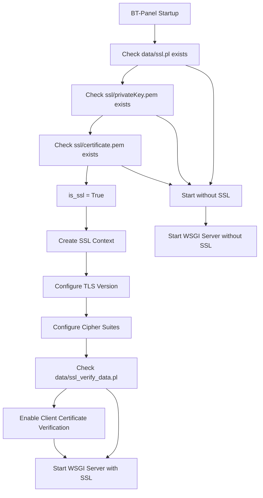
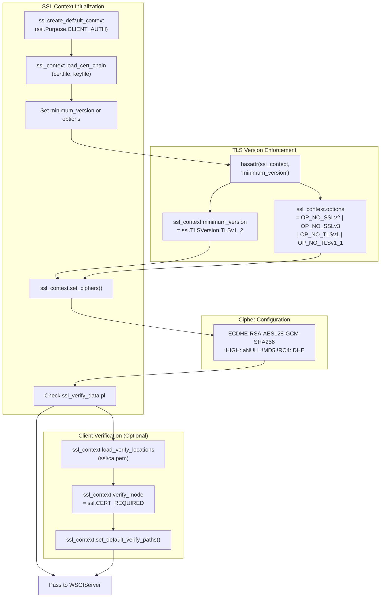
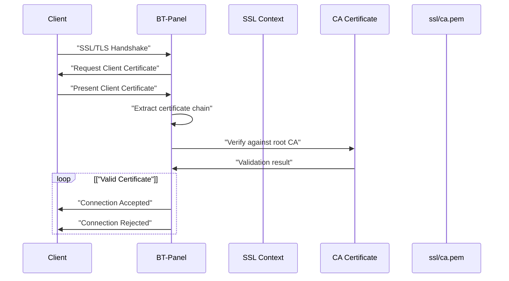
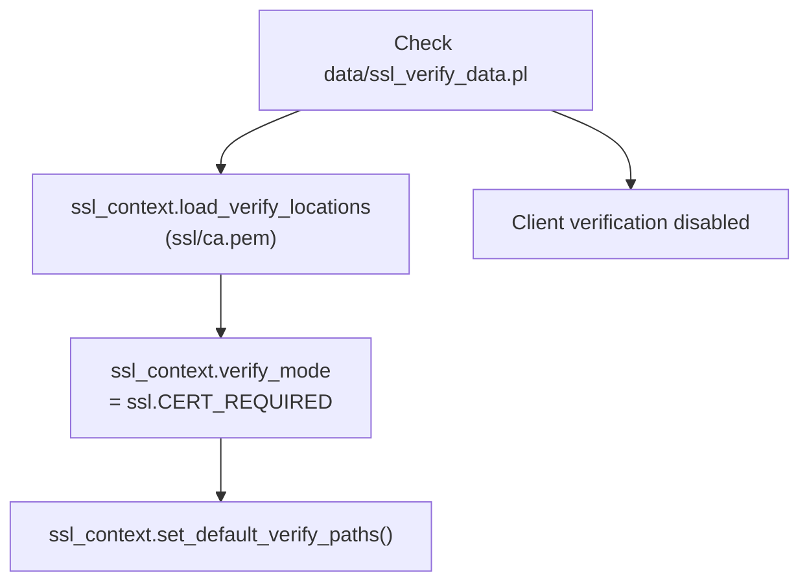
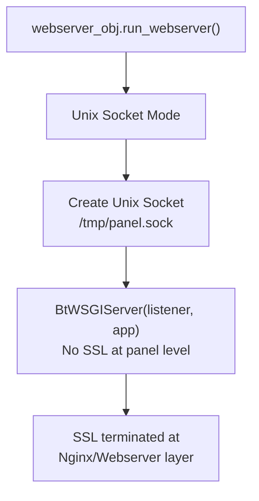
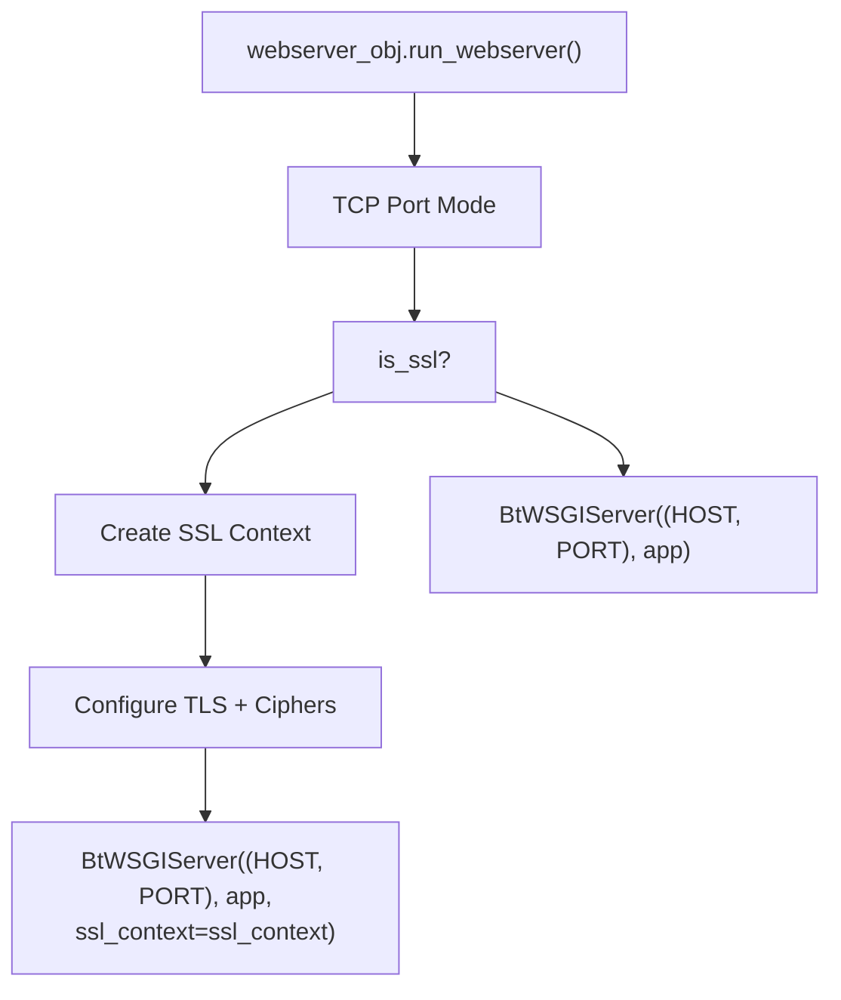
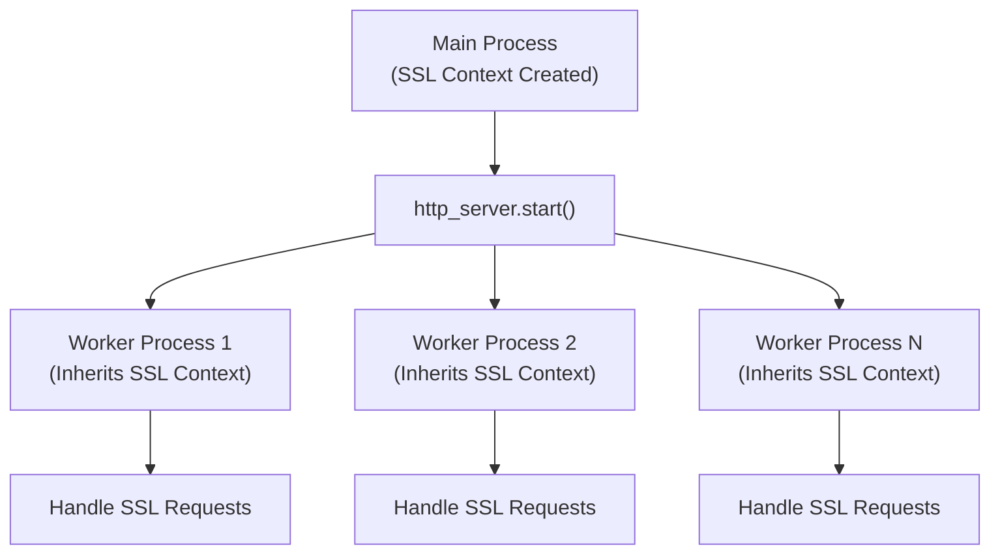
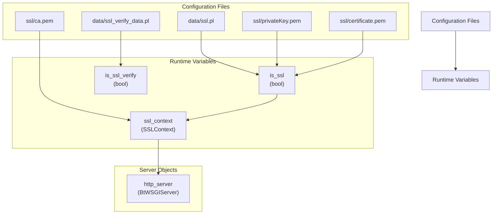

# SSL/TLS Configuration

> **Relevant source files**
> * [BT-Panel](https://github.com/aaPanel/aaPanel/blob/b6e4ab8b/BT-Panel)

This document covers the SSL/TLS security configuration for aaPanel, including certificate setup, protocol versions, cipher suites, and client certificate verification. SSL/TLS encryption protects panel access by encrypting all HTTP traffic between clients and the server.

For general deployment configuration, see [Deployment Guide](/aaPanel/aaPanel/10-deployment-guide). For network binding modes (Unix socket vs TCP port), see [Network Binding Modes](/aaPanel/aaPanel/10.2-network-binding-modes). For additional authentication layers, see [Basic Authentication Setup](/aaPanel/aaPanel/10.3-basic-authentication-setup).

---

## Purpose and Scope

aaPanel supports optional SSL/TLS encryption for securing web panel access. When enabled, the panel enforces TLSv1.2+ protocols with strong cipher suites. This document explains:

* How SSL/TLS is enabled and disabled
* Certificate and private key file requirements
* TLS protocol version enforcement
* Cipher suite configuration
* Client certificate verification (mutual TLS)
* Configuration file management

---

## SSL/TLS Enablement Logic

The panel determines whether to enable SSL/TLS during startup by checking three conditions:



**SSL Enablement Requirements:**

| File | Purpose | Required |
| --- | --- | --- |
| `data/ssl.pl` | SSL enable flag | Yes |
| `ssl/privateKey.pem` | Private key | Yes |
| `ssl/certificate.pem` | Server certificate | Yes |
| `data/ssl_verify_data.pl` | Client verification flag | Optional |
| `ssl/ca.pem` | Root CA certificate | Optional (for client verification) |
| `ssl/crl.pem` | Certificate Revocation List | Optional (for client verification) |

**Sources:** [BT-Panel L264-L268](https://github.com/aaPanel/aaPanel/blob/b6e4ab8b/BT-Panel#L264-L268)

 [BT-Panel L282-L301](https://github.com/aaPanel/aaPanel/blob/b6e4ab8b/BT-Panel#L282-L301)

---

## SSL Context Creation and Configuration

When SSL is enabled, the panel creates a default SSL context and applies security configurations:



**Sources:** [BT-Panel L282-L290](https://github.com/aaPanel/aaPanel/blob/b6e4ab8b/BT-Panel#L282-L290)

 [BT-Panel L348-L367](https://github.com/aaPanel/aaPanel/blob/b6e4ab8b/BT-Panel#L348-L367)

---

## Certificate Files

### Required Certificate Files

**Private Key:** `ssl/privateKey.pem`

* The server's private key in PEM format
* Must be readable by the panel process
* Should have restrictive permissions (600 or 400)

**Server Certificate:** `ssl/certificate.pem`

* The server's SSL/TLS certificate in PEM format
* Can be a self-signed certificate or issued by a CA
* Should include intermediate certificates if applicable

### Optional Certificate Files (Client Verification)

**Root CA Certificate:** `ssl/ca.pem`

* Root Certificate Authority for verifying client certificates
* Required when `data/ssl_verify_data.pl` exists
* Used to validate client certificate chains

**Certificate Revocation List:** `ssl/crl.pem`

* Lists revoked certificates
* Currently commented out in the codebase but file structure exists
* Can be enabled by uncommenting lines for CRL checking

**Sources:** [BT-Panel L264-L265](https://github.com/aaPanel/aaPanel/blob/b6e4ab8b/BT-Panel#L264-L265)

 [BT-Panel L293-L301](https://github.com/aaPanel/aaPanel/blob/b6e4ab8b/BT-Panel#L293-L301)

 [BT-Panel L359-L367](https://github.com/aaPanel/aaPanel/blob/b6e4ab8b/BT-Panel#L359-L367)

---

## TLS Protocol Version Support

The panel enforces a minimum TLS version of **TLSv1.2** to prevent downgrade attacks. The implementation differs based on Python version:

### Modern Python (3.7+)

Uses the `minimum_version` attribute:

```

```

This approach is cleaner and explicitly sets the minimum acceptable TLS version.

### Legacy Python (3.6 and earlier)

Uses option flags to disable older protocols:

```

```

**Supported Protocols:**

* ✅ TLSv1.2
* ✅ TLSv1.3 (if available in Python/OpenSSL)
* ❌ TLSv1.1 (disabled)
* ❌ TLSv1.0 (disabled)
* ❌ SSLv3 (disabled)
* ❌ SSLv2 (disabled)

**Sources:** [BT-Panel L285-L288](https://github.com/aaPanel/aaPanel/blob/b6e4ab8b/BT-Panel#L285-L288)

 [BT-Panel L351-L354](https://github.com/aaPanel/aaPanel/blob/b6e4ab8b/BT-Panel#L351-L354)

---

## Cipher Suite Configuration

The panel configures a strict cipher suite to ensure strong encryption:

```
ECDHE-RSA-AES128-GCM-SHA256:HIGH:!aNULL:!MD5:!RC4:!DHE
```

### Cipher Suite Breakdown

| Component | Purpose |
| --- | --- |
| `ECDHE-RSA-AES128-GCM-SHA256` | Preferred cipher with forward secrecy |
| `HIGH` | Include high-strength ciphers |
| `!aNULL` | Exclude anonymous authentication |
| `!MD5` | Exclude MD5-based ciphers |
| `!RC4` | Exclude RC4 stream cipher |
| `!DHE` | Exclude DHE key exchange |

**Key Features:**

* **Forward Secrecy:** ECDHE provides perfect forward secrecy
* **Authenticated Encryption:** GCM mode provides authentication and encryption
* **Strong Key Exchange:** RSA or ECDHE for key exchange
* **No Weak Ciphers:** Explicitly excludes MD5, RC4, and anonymous authentication

**Sources:** [BT-Panel L290](https://github.com/aaPanel/aaPanel/blob/b6e4ab8b/BT-Panel#L290-L290)

 [BT-Panel L356](https://github.com/aaPanel/aaPanel/blob/b6e4ab8b/BT-Panel#L356-L356)

---

## Client Certificate Verification (Mutual TLS)

The panel supports optional client certificate verification for enhanced security. When enabled, clients must present valid certificates signed by a trusted CA.

### Enabling Client Verification

Create the flag file to enable client certificate checking:

```

```

### Certificate Verification Flow



### Configuration Code Flow



**Verification Mode:** `ssl.CERT_REQUIRED`

* Client MUST provide a certificate
* Certificate MUST be signed by the CA in `ssl/ca.pem`
* Invalid or missing certificates result in connection rejection

**Sources:** [BT-Panel L291-L301](https://github.com/aaPanel/aaPanel/blob/b6e4ab8b/BT-Panel#L291-L301)

 [BT-Panel L357-L367](https://github.com/aaPanel/aaPanel/blob/b6e4ab8b/BT-Panel#L357-L367)

---

## Configuration Files Reference

### SSL Enable Flag

**File:** `data/ssl.pl`

**Purpose:** Signals the panel to enable SSL/TLS

**Content:** Typically empty or contains minimal flag data

**Enable SSL:**

```

```

**Disable SSL:**

```

```

### Client Verification Flag

**File:** `data/ssl_verify_data.pl`

**Purpose:** Enables mutual TLS (client certificate verification)

**Dependencies:** Requires `ssl/ca.pem` to be present

**Enable Client Verification:**

```

```

**Disable Client Verification:**

```

```

**Sources:** [BT-Panel L266-L268](https://github.com/aaPanel/aaPanel/blob/b6e4ab8b/BT-Panel#L266-L268)

 [BT-Panel L291](https://github.com/aaPanel/aaPanel/blob/b6e4ab8b/BT-Panel#L291-L291)

---

## SSL Initialization in Different Network Modes

The panel initializes SSL differently depending on whether it's using Unix socket mode or TCP port mode:

### Unix Socket Mode (with Webserver)



**Note:** When using Unix socket mode, SSL/TLS is typically handled by the frontend webserver (Nginx), not by the panel itself. The SSL configuration code is still executed but the Unix socket communication is unencrypted (localhost only).

### TCP Port Mode (Direct Access)



**Sources:** [BT-Panel L328-L380](https://github.com/aaPanel/aaPanel/blob/b6e4ab8b/BT-Panel#L328-L380)

---

## SSL and Multi-Process Mode

When multi-process mode is enabled (`data/is_process.pl` exists), the SSL context is shared across all worker processes:



The SSL context is created once in the main process before forking workers, so all workers share the same configuration.

**Sources:** [BT-Panel L390-L449](https://github.com/aaPanel/aaPanel/blob/b6e4ab8b/BT-Panel#L390-L449)

---

## Complete SSL Initialization Reference

### Key Code Locations

| Feature | Line Range | Description |
| --- | --- | --- |
| SSL detection | [BT-Panel L264-L268](https://github.com/aaPanel/aaPanel/blob/b6e4ab8b/BT-Panel#L264-L268) | Check for SSL files |
| SSL context creation (first instance) | [BT-Panel L282-L290](https://github.com/aaPanel/aaPanel/blob/b6e4ab8b/BT-Panel#L282-L290) | Initial SSL setup |
| Client verification (first instance) | [BT-Panel L291-L301](https://github.com/aaPanel/aaPanel/blob/b6e4ab8b/BT-Panel#L291-L301) | Configure client cert checking |
| SSL context creation (second instance) | [BT-Panel L348-L367](https://github.com/aaPanel/aaPanel/blob/b6e4ab8b/BT-Panel#L348-L367) | SSL setup for non-webserver mode |
| WSGI server with SSL | [BT-Panel L369-L380](https://github.com/aaPanel/aaPanel/blob/b6e4ab8b/BT-Panel#L369-L380) | Create server with SSL context |

### SSL Initialization Variables



**Sources:** [BT-Panel L264-L380](https://github.com/aaPanel/aaPanel/blob/b6e4ab8b/BT-Panel#L264-L380)

---

## Certificate Generation Examples

### Self-Signed Certificate

Generate a self-signed certificate for testing or internal use:

```

```

### CA-Signed Certificate

For production use with a Certificate Authority:

```

```

### Client Certificate Setup (Mutual TLS)

Generate client certificates for mutual TLS authentication:

```

```

---

## Troubleshooting

### SSL Not Enabling

**Symptoms:** Panel starts without SSL despite `data/ssl.pl` existing

**Checks:**

1. Verify `ssl/privateKey.pem` exists and is readable
2. Verify `ssl/certificate.pem` exists and is readable
3. Check certificate validity: `openssl x509 -in ssl/certificate.pem -noout -dates`
4. Check private key format: `openssl rsa -in ssl/privateKey.pem -check`
5. Review error logs: `tail -f /www/server/panel/logs/error.log`

### Certificate Mismatch Errors

**Symptoms:** SSL handshake failures, browser warnings

**Causes:**

* Certificate CN/SAN doesn't match hostname
* Certificate expired
* Private key doesn't match certificate

**Solutions:**

```

```

### Client Certificate Verification Failures

**Symptoms:** Clients cannot connect with error "certificate verify failed"

**Checks:**

1. Verify `ssl/ca.pem` contains the correct root CA
2. Ensure client certificate is signed by the CA in `ssl/ca.pem`
3. Check certificate validity dates
4. Verify certificate chain is complete

**Disable client verification temporarily:**

```

```

### TLS Version Errors

**Symptoms:** "protocol version" or "handshake failure" errors

**Causes:**

* Client using TLSv1.0 or TLSv1.1
* Client cipher suites incompatible

**Solutions:**

* Ensure clients support TLSv1.2 or higher
* Update client software/browsers
* Test with: `openssl s_client -connect localhost:7800 -tls1_2`

### Permission Errors

**Symptoms:** Panel fails to start with SSL enabled

**Solution:**

```

```

**Sources:** [BT-Panel L264-L380](https://github.com/aaPanel/aaPanel/blob/b6e4ab8b/BT-Panel#L264-L380)