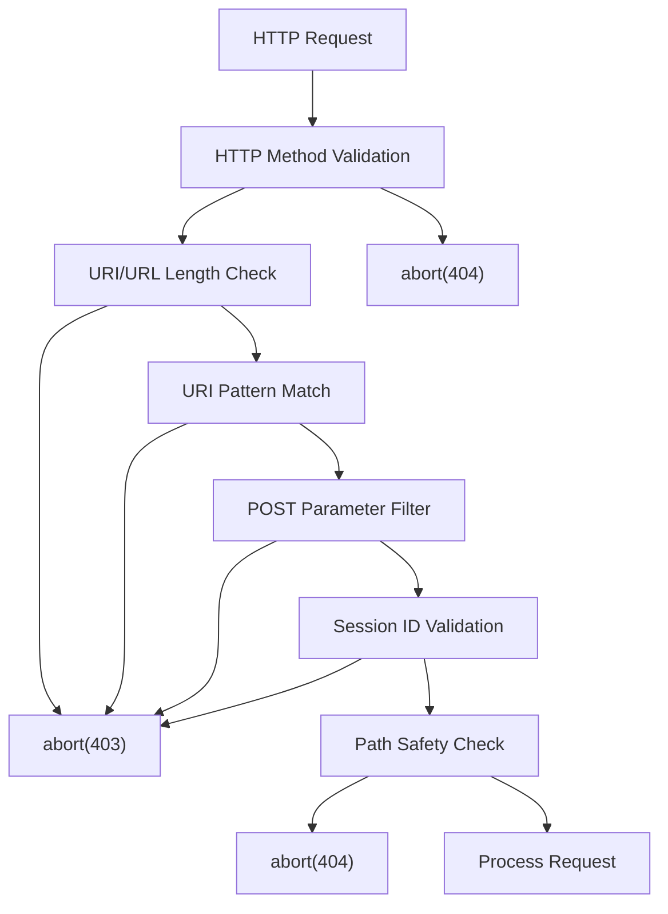
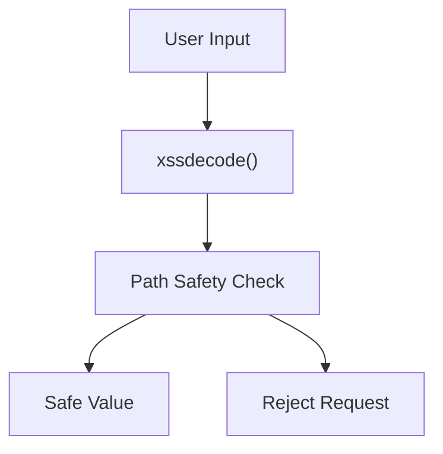
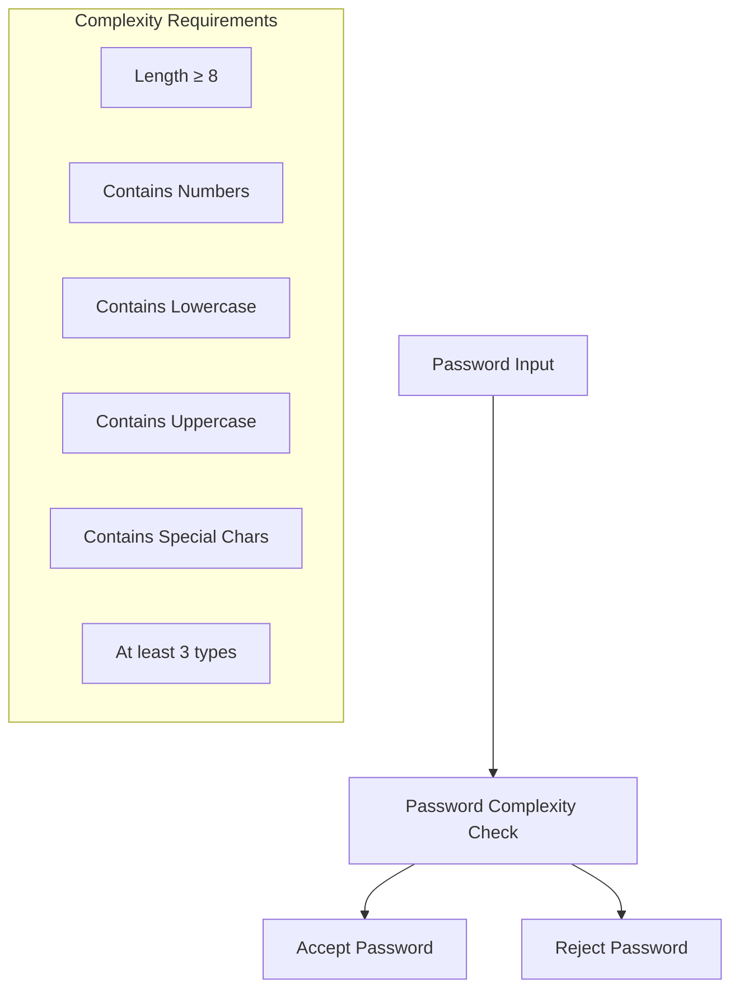
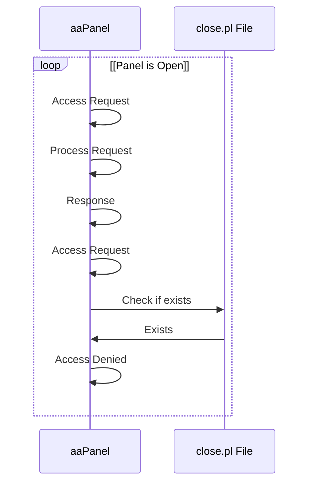
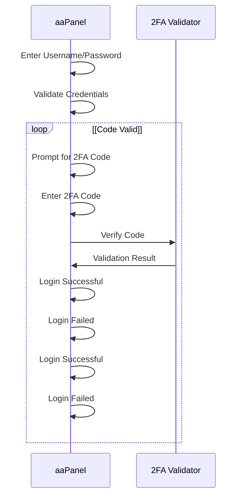
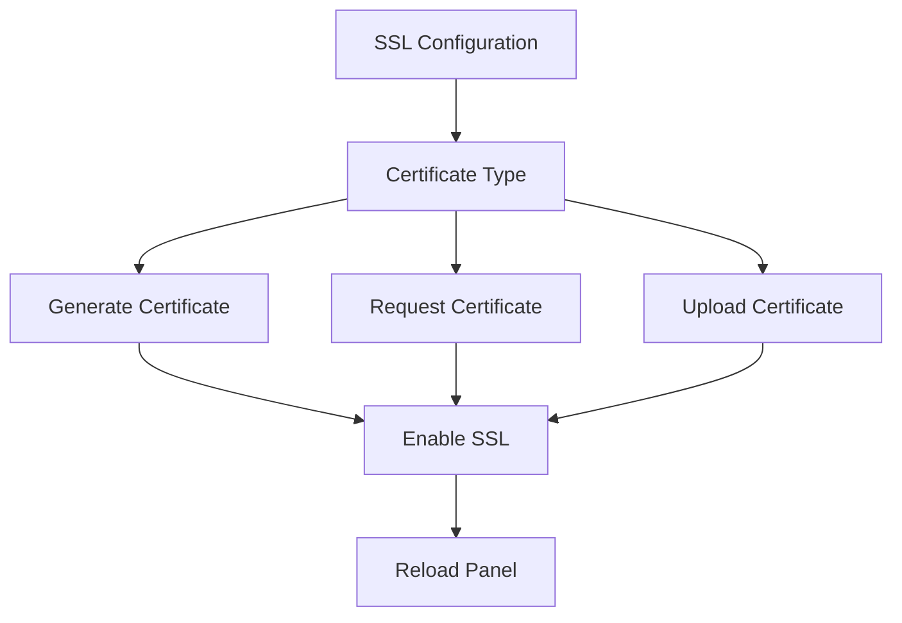
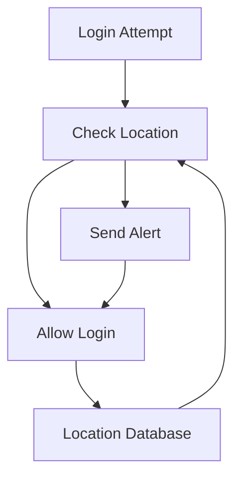
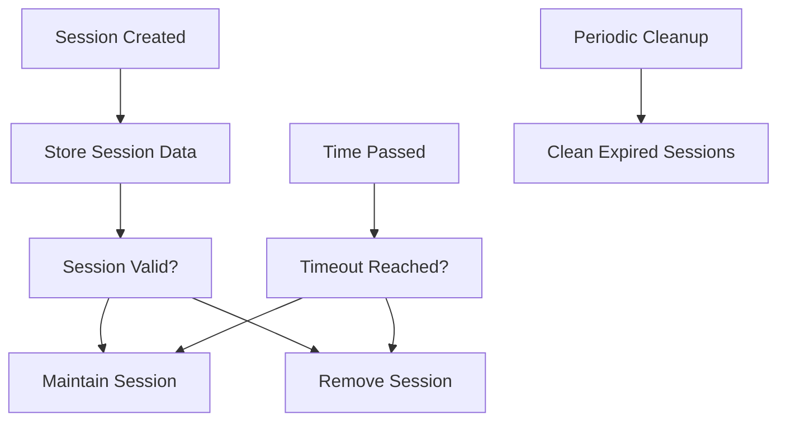

# Security and Input Validation

> **Relevant source files**
> * [BTPanel/__init__.py](https://github.com/aaPanel/aaPanel/blob/b6e4ab8b/BTPanel/__init__.py)
> * [BTPanel/app.py](https://github.com/aaPanel/aaPanel/blob/b6e4ab8b/BTPanel/app.py)

This page documents aaPanel's multi-layered approach to input validation and security. The system implements defense-in-depth with validation at multiple stages of request processing to prevent XSS, path traversal, SQL injection, and other common web vulnerabilities.

For authentication and session management, see page 3.1. For CSRF protection, see page 3.3.

## Security Validation Pipeline

Every request passes through multiple validation layers in the `request_check()` function before reaching application logic:



Sources: [BTPanel/__init__.py L266-L456](https://github.com/aaPanel/aaPanel/blob/b6e4ab8b/BTPanel/__init__.py#L266-L456)

## Request Method Validation

aaPanel restricts HTTP methods to only `GET`, `POST`, and `HEAD`. All other methods are rejected:

```

```

This prevents attackers from using methods like `PUT`, `DELETE`, `TRACE`, or `OPTIONS` which could expose vulnerabilities or bypass security controls.

Sources: [BTPanel/__init__.py L303](https://github.com/aaPanel/aaPanel/blob/b6e4ab8b/BTPanel/__init__.py#L303-L303)

## URI and URL Validation

### Length Restrictions

To prevent buffer overflow attacks and resource exhaustion, the system enforces strict length limits:

| Component | Maximum Length | Action on Violation |
| --- | --- | --- |
| URI Path | 256 characters | `abort(403)` |
| Full URL | 1024 characters | `abort(403)` |

Sources: [BTPanel/__init__.py L310-L311](https://github.com/aaPanel/aaPanel/blob/b6e4ab8b/BTPanel/__init__.py#L310-L311)

### URI Pattern Matching

All URIs must match a whitelist regex pattern that only allows specific characters and file extensions:

```

```

This pattern enforces:

* Static files must be in `/static/` and have whitelisted extensions
* All other paths must contain only alphanumeric characters, underscores, dots, slashes, and hyphens
* No special characters that could indicate injection attempts

If the URI doesn't match this pattern, the request is rejected with `abort(403)`:

```

```

Sources: [BTPanel/__init__.py L172-L174](https://github.com/aaPanel/aaPanel/blob/b6e4ab8b/BTPanel/__init__.py#L172-L174)

 [BTPanel/__init__.py L314](https://github.com/aaPanel/aaPanel/blob/b6e4ab8b/BTPanel/__init__.py#L314-L314)

## POST Parameter Filtering

For security-sensitive endpoints, POST parameters are strictly validated for both key names and values:

### Filtered Endpoints

The following endpoints have parameter filtering:

| Endpoint | Purpose |
| --- | --- |
| `/login` | User authentication |
| `/safe` | Security settings |
| `/hook` | Webhook handlers |
| `/public` | Public API |
| `/down` | File download |
| `/get_app_bind_status` | App binding status |
| `/check_bind` | App binding check |
| `/userRegister` | User registration |
| `/userLang` | Language settings |

### Parameter Validation Rules

For filtered endpoints:

```

```

| Validation | Limit | Action |
| --- | --- | --- |
| Parameter name length | 48 characters max | `abort(403)` |
| Parameter value length | 256 characters max | `abort(403)` |

This prevents attackers from submitting extremely long parameter names or values that could cause buffer overflows or DoS.

Sources: [BTPanel/__init__.py L317-L331](https://github.com/aaPanel/aaPanel/blob/b6e4ab8b/BTPanel/__init__.py#L317-L331)

## Session ID Validation

Session IDs are validated against a strict regex pattern to prevent session fixation and injection attacks:

```

```

The session ID must contain only:

* Alphanumeric characters (`\w`)
* Dots (`.`)
* Hyphens (`-`)

Any session ID containing other characters is rejected with `abort(403)`.

Sources: [BTPanel/__init__.py L175](https://github.com/aaPanel/aaPanel/blob/b6e4ab8b/BTPanel/__init__.py#L175-L175)

 [BTPanel/__init__.py L332-L334](https://github.com/aaPanel/aaPanel/blob/b6e4ab8b/BTPanel/__init__.py#L332-L334)

## Path Traversal Protection

aaPanel implements multiple layers of path traversal protection using the `path_safe_check()` function and additional validation.

### Static File Path Validation

When serving static files, the system checks for path traversal attempts:

```

```

Additional checks prevent common path traversal patterns:

```

```

### publicObject Path Sanitization

The `publicObject()` dispatcher applies additional path sanitization:

```

```

This sanitization:

* Normalizes slashes (converts backslashes to forward slashes)
* Removes double slashes
* Detects and rejects relative path references (`./`)
* Removes symbolic link arrows (`->`)
* Applies XSS decoding

Sources: [BTPanel/__init__.py L413](https://github.com/aaPanel/aaPanel/blob/b6e4ab8b/BTPanel/__init__.py#L413-L413)

 [BTPanel/__init__.py L443-L450](https://github.com/aaPanel/aaPanel/blob/b6e4ab8b/BTPanel/__init__.py#L443-L450)

 [BTPanel/__init__.py L353-L368](https://github.com/aaPanel/aaPanel/blob/b6e4ab8b/BTPanel/__init__.py#L353-L368)

## XSS Prevention

### Input Decoding and Sanitization

The system uses `public.xssdecode()` to decode and sanitize user inputs:



Key fields that are sanitized:

* `path` - File/directory paths
* `filename` - Filenames
* `sfile` - Source files
* `dfile` - Destination files

### Output Encoding

For output, the system uses `public.xsssec()` to encode data before sending it to clients:

```

```

This prevents XSS attacks by encoding potentially dangerous characters in:

* Request paths
* Form data
* User-agent strings
* Error messages

Sources: [BTPanel/__init__.py L353-L368](https://github.com/aaPanel/aaPanel/blob/b6e4ab8b/BTPanel/__init__.py#L353-L368)

 [BTPanel/__init__.py L595-L596](https://github.com/aaPanel/aaPanel/blob/b6e4ab8b/BTPanel/__init__.py#L595-L596)

## Site Path Boundary Enforcement

For operations that access site-specific files, modules can implement `site_path_check()` to ensure operations stay within site boundaries:

```

```

This prevents users from accessing or modifying files outside their designated site directories.

Sources: [BTPanel/__init__.py L370-L373](https://github.com/aaPanel/aaPanel/blob/b6e4ab8b/BTPanel/__init__.py#L370-L373)

## Additional Security Validations

### Download Token Validation

The file download system implements strict parameter validation:

```

```

This validation:

* Limits filename length to 256 characters
* Limits token length to 48 characters
* Blacklists dangerous shell characters
* Requires tokens to be alphanumeric with dots only

Sources: [BTPanel/__init__.py L2148-L2172](https://github.com/aaPanel/aaPanel/blob/b6e4ab8b/BTPanel/__init__.py#L2148-L2172)

### Plugin Parameter Validation

Plugin endpoints validate allowed parameters:

```

```

Only whitelisted parameters are accepted.

Sources: [BTPanel/__init__.py L2418-L2424](https://github.com/aaPanel/aaPanel/blob/b6e4ab8b/BTPanel/__init__.py#L2418-L2424)

## Validation Flow Summary

```mermaid
sequenceDiagram
  participant Client
  participant request_check()
  participant publicObject()
  participant Feature Module

  Client->>request_check(): HTTP Request
  request_check()->>request_check(): Validate HTTP Method
  request_check()->>request_check(): Check URI/URL Length
  request_check()->>request_check(): Match URI Pattern
  request_check()->>request_check(): Filter POST Parameters
  request_check()->>request_check(): Validate Session ID
  request_check()->>request_check(): Check Path Safety
  loop [Module Validation Fails]
    request_check()->>Client: abort(403/404)
    request_check()->>publicObject(): Forward Request
    publicObject()->>publicObject(): Sanitize Path Parameters
    publicObject()->>publicObject(): Apply XSS Decoding
    publicObject()->>publicObject(): Check Site Boundaries
    publicObject()->>Client: ReturnJson Error
    publicObject()->>Feature Module: Execute Action
    Feature Module->>Client: Response
  end
```

Sources: [BTPanel/__init__.py L266-L456](https://github.com/aaPanel/aaPanel/blob/b6e4ab8b/BTPanel/__init__.py#L266-L456)

 [BTPanel/__init__.py L342-L376](https://github.com/aaPanel/aaPanel/blob/b6e4ab8b/BTPanel/__init__.py#L342-L376)

## Security Best Practices

When developing modules or plugins for aaPanel:

1. **Never trust user input** - Always validate and sanitize
2. **Use path_safe_check()** - For any file system operations
3. **Apply xssdecode()** - To all user-provided strings
4. **Implement site_path_check()** - For site-specific operations
5. **Validate parameter names** - Not just values
6. **Use whitelist validation** - Rather than blacklist
7. **Enforce length limits** - On all user inputs
8. **Return proper error codes** - Use `abort(403)` or `abort(404)` appropriately

Sources: [BTPanel/__init__.py L266-L456](https://github.com/aaPanel/aaPanel/blob/b6e4ab8b/BTPanel/__init__.py#L266-L456)

 [BTPanel/__init__.py L342-L376](https://github.com/aaPanel/aaPanel/blob/b6e4ab8b/BTPanel/__init__.py#L342-L376)

## Password Security

aaPanel provides comprehensive password security features to ensure that panel accounts are protected against unauthorized access.

### Password Complexity

The system can enforce password complexity requirements:

1. Minimum password length of 8 characters
2. Must contain at least 3 of the following elements: * Numbers * Lowercase letters * Uppercase letters * Special characters



Sources: [class/config.py L247-L272](https://github.com/aaPanel/aaPanel/blob/b6e4ab8b/class/config.py#L247-L272)

 [class/config.py L397-L413](https://github.com/aaPanel/aaPanel/blob/b6e4ab8b/class/config.py#L397-L413)

### Password Expiration

aaPanel supports password expiration policies:

* Configurable expiration period (10-1825 days)
* Warning notifications when password is nearing expiration
* Forced password change upon expiration

Sources: [class/config.py L302-L394](https://github.com/aaPanel/aaPanel/blob/b6e4ab8b/class/config.py#L302-L394)

## User Management

The panel provides functionality to manage user accounts with different security considerations.

### User Operations

* Create users with secure password requirements
* Modify existing users (username and password)
* Delete users (except the initial admin account)
* List all users

Sources: [class/config.py L415-L481](https://github.com/aaPanel/aaPanel/blob/b6e4ab8b/class/config.py#L415-L481)

## Access Control

aaPanel implements several layers of access control to restrict who can access the panel and from where.

### IP Restrictions

Administrators can specify which IP addresses are allowed to access the panel. This is configured through a whitelist approach:

```markdown
# Example format of limitip.conf
192.168.1.100
192.168.1.0/24
```

### Admin Path Customization

For enhanced security, aaPanel allows changing the default admin access path:

* Default path is typically `/admin` or similar
* Can be customized to a non-standard path to prevent automated scanning
* Minimum length requirement of 6 characters
* Must start with a forward slash (e.g., `/my_secure_panel`)

Sources: [class/config.py L582-L596](https://github.com/aaPanel/aaPanel/blob/b6e4ab8b/class/config.py#L582-L596)

### Panel Closure

The panel can be temporarily closed to prevent any access:



Sources: [class/config.py L908-L917](https://github.com/aaPanel/aaPanel/blob/b6e4ab8b/class/config.py#L908-L917)

## Authentication Methods

aaPanel supports multiple authentication methods to enhance security.

### Two-Factor Authentication

Two-factor authentication using TOTP (Time-based One-Time Password) is supported:

1. Enable two-factor authentication
2. Scan QR code with an authenticator app (Google Authenticator, Authy, etc.)
3. Enter the generated code when logging in



Sources: [class/config.py L1884-L1954](https://github.com/aaPanel/aaPanel/blob/b6e4ab8b/class/config.py#L1884-L1954)

### Basic Authentication

aaPanel supports HTTP Basic Authentication as an additional layer of security:

* Can be enabled/disabled as needed
* Requires a separate username and password from the panel login
* Credentials are stored with MD5 hashing

Sources: [class/config.py L1732-L1772](https://github.com/aaPanel/aaPanel/blob/b6e4ab8b/class/config.py#L1732-L1772)

### Temporary Login URLs

For temporary access needs, aaPanel can generate time-limited login URLs:

* URLs expire after a configurable time period
* Sessions can be forcibly terminated by administrators
* Activity is logged for auditing purposes

Sources: [class/config.py L2028-L2121](https://github.com/aaPanel/aaPanel/blob/b6e4ab8b/class/config.py#L2028-L2121)

## SSL/TLS Management

aaPanel provides comprehensive SSL/TLS management for securing panel communications.

### Panel SSL Configuration

The panel supports HTTPS access through:

1. Self-signed certificates (automatically generated)
2. Let's Encrypt integration for trusted certificates
3. Manually uploaded certificates



Sources: [class/config.py L964-L1001](https://github.com/aaPanel/aaPanel/blob/b6e4ab8b/class/config.py#L964-L1001)

 [class/config.py L1024-L1110](https://github.com/aaPanel/aaPanel/blob/b6e4ab8b/class/config.py#L1024-L1110)

 [class/config.py L1482-L1548](https://github.com/aaPanel/aaPanel/blob/b6e4ab8b/class/config.py#L1482-L1548)

### Two-way Authentication

For enhanced security, aaPanel supports two-way SSL authentication:

* Client verification using CA certificates
* CRL (Certificate Revocation List) support

Sources: [class/config.py L2417-L2456](https://github.com/aaPanel/aaPanel/blob/b6e4ab8b/class/config.py#L2417-L2456)

## Login Security

aaPanel implements several mechanisms to monitor and alert on suspicious login activities.

### Login Alerts

The system can send alerts when logins occur through various channels:

* Email notifications
* DingDing (corporate messaging platform)
* Telegram messages
* WeChat messages

Sources: [class/config.py L2194-L2227](https://github.com/aaPanel/aaPanel/blob/b6e4ab8b/class/config.py#L2194-L2227)

### Location-based Alerts

The panel can detect and alert on logins from unusual geographic locations:

* Tracks common login locations
* Alerts when logins occur from new or unusual locations
* Maintains a history of login locations for reference



Sources: [class/config.py L2230-L2287](https://github.com/aaPanel/aaPanel/blob/b6e4ab8b/class/config.py#L2230-L2287)

### IP Whitelist for Alerts

To prevent alert fatigue, administrators can configure IP whitelists:

* Logins from whitelisted IPs won't trigger alerts
* Useful for known, trusted locations

Sources: [class/config.py L2358-L2409](https://github.com/aaPanel/aaPanel/blob/b6e4ab8b/class/config.py#L2358-L2409)

## Session Management

aaPanel provides tools to manage user sessions securely.

### Session Timeout

Administrators can configure session timeout periods:

* Default timeout can be set between 300 seconds (5 minutes) and 86400 seconds (24 hours)
* After timeout, users are required to re-authenticate

Sources: [class/config.py L494-L503](https://github.com/aaPanel/aaPanel/blob/b6e4ab8b/class/config.py#L494-L503)

### Session Cleanup

The panel automatically manages sessions:

* Expired sessions are cleaned up
* Invalid sessions are removed
* Sessions can be tracked and monitored



Sources: [class/config.py L201-L237](https://github.com/aaPanel/aaPanel/blob/b6e4ab8b/class/config.py#L201-L237)

 [class/config.py L1442-L1479](https://github.com/aaPanel/aaPanel/blob/b6e4ab8b/class/config.py#L1442-L1479)

## Best Practices for aaPanel Security

1. **Use strong passwords**: Enable password complexity requirements
2. **Enable two-factor authentication**: For all administrative accounts
3. **Customize the admin path**: Change from the default path
4. **Restrict IP access**: Limit panel access to trusted IPs only
5. **Enable SSL**: Configure HTTPS for panel access
6. **Set appropriate session timeouts**: Balance security and usability
7. **Enable login alerts**: Configure notifications for unusual login activities
8. **Regularly update the panel**: Keep the system updated with security patches
9. **Implement password expiration**: Force periodic password changes
10. **Monitor login locations**: Track and verify login geographic patterns