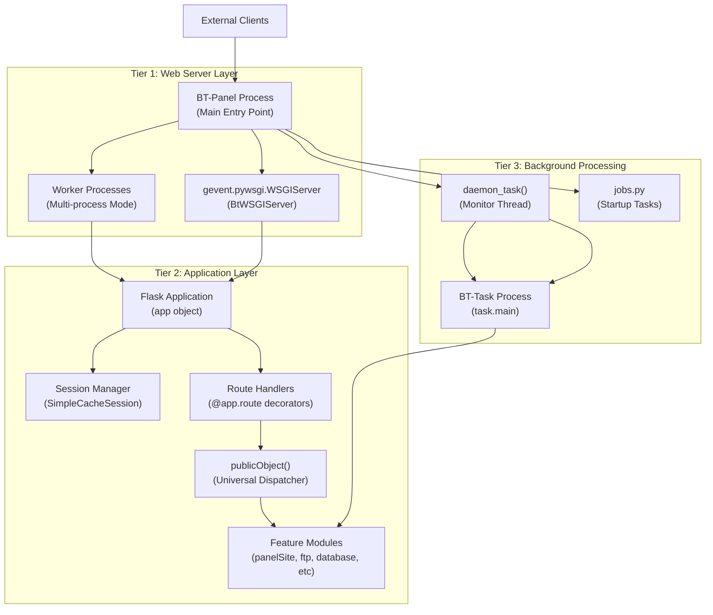
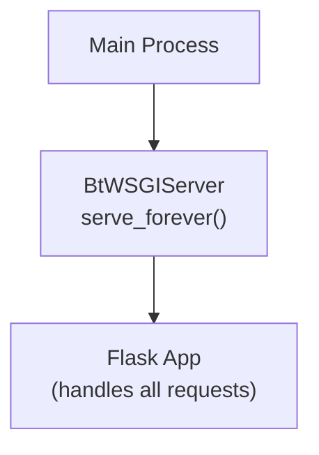
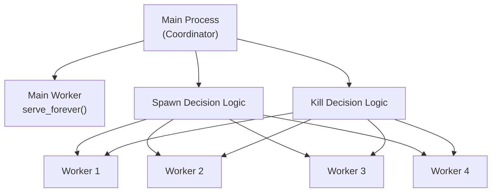
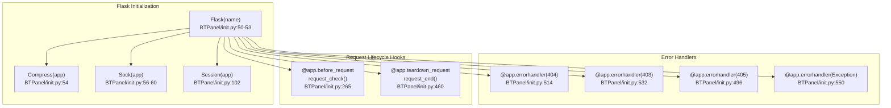
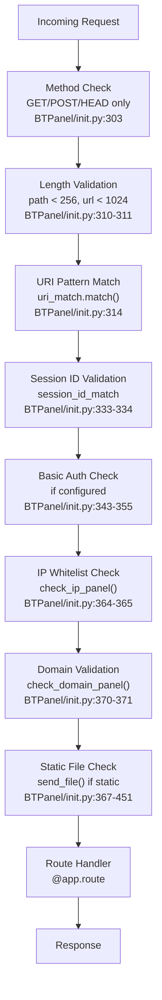
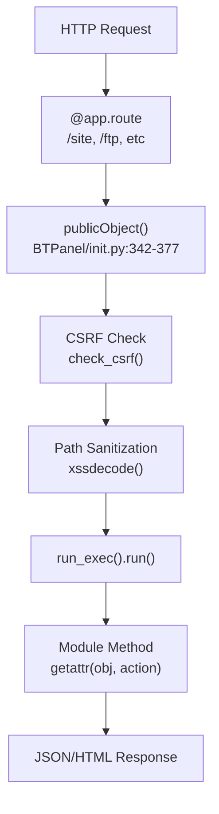
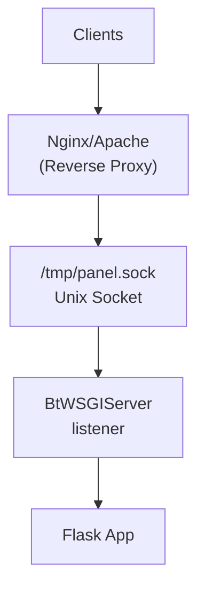
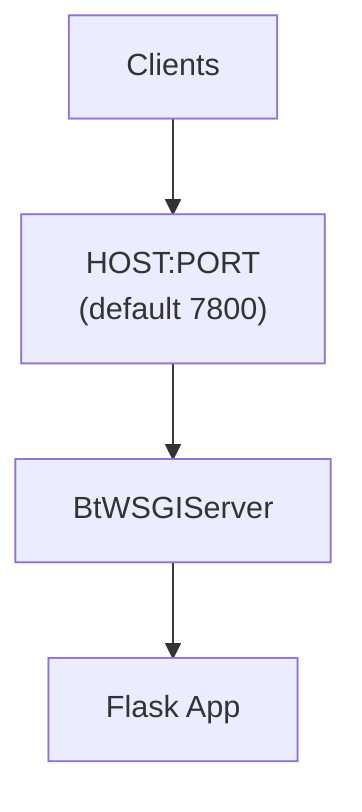

# System Architecture

> **Relevant source files**
> * [BT-Panel](https://github.com/aaPanel/aaPanel/blob/b6e4ab8b/BT-Panel)
> * [BT-Task](https://github.com/aaPanel/aaPanel/blob/b6e4ab8b/BT-Task)
> * [BTPanel/__init__.py](https://github.com/aaPanel/aaPanel/blob/b6e4ab8b/BTPanel/__init__.py)
> * [BTPanel/app.py](https://github.com/aaPanel/aaPanel/blob/b6e4ab8b/BTPanel/app.py)

This document provides a comprehensive overview of aaPanel's three-tier system architecture, explaining how the web server layer (BT-Panel), application layer (Flask), and background processing layer (BT-Task) work together to provide a complete server management platform. For detailed information about specific components, see [Web Server (BT-Panel)](/aaPanel/aaPanel/2.1-web-server-(bt-panel)), [Background Task System (BT-Task)](/aaPanel/aaPanel/2.2-background-task-system-(bt-task)), and [Flask Application Core](/aaPanel/aaPanel/2.3-flask-application-core).

## Architectural Overview

aaPanel implements a three-tier architecture that separates concerns between web serving, application logic, and background processing. This design enables scalability, maintainability, and robust error handling.

### Three-Tier Architecture



**Sources:** [BT-Panel L1-L450](https://github.com/aaPanel/aaPanel/blob/b6e4ab8b/BT-Panel#L1-L450)

 [BTPanel/__init__.py L37-L102](https://github.com/aaPanel/aaPanel/blob/b6e4ab8b/BTPanel/__init__.py#L37-L102)

### Component Interaction Flow

```mermaid
sequenceDiagram
  participant BT-Panel
  participant Main Process
  participant daemon_task()
  participant Monitor Thread
  participant BT-Task
  participant Background Process
  participant BtWSGIServer
  participant gevent.pywsgi
  participant Flask Application
  participant app object
  participant Feature Module
  participant Jobs
  participant Client

  BT-Panel->>BT-Panel: monkey.patch_all()
  BT-Panel->>BT-Panel: Import BTPanel.app
  BT-Panel->>BT-Panel: Fork daemon process
  BT-Panel->>Jobs: Launch jobs.py
  BT-Panel->>daemon_task(): Start monitoring thread
  BT-Panel->>BT-Task: Execute BT-Task
  BT-Panel->>BtWSGIServer: Create BtWSGIServer
  loop [Process Dead]
    BtWSGIServer->>Flask Application: Forward HTTP request
    Flask Application->>Flask Application: @before_request (validation)
    Flask Application->>Feature Module: Route to module
    Feature Module->>Flask Application: Return response
    Flask Application->>Flask Application: @teardown_request (logging)
    Flask Application->>BtWSGIServer: HTTP response
    BtWSGIServer->>Client: Send response
    daemon_task()->>daemon_task(): Check task.pid file
    daemon_task()->>BT-Task: Verify process exists
    daemon_task()->>BT-Task: Restart BT-Task
  end
```

**Sources:** [BT-Panel L10-L281](https://github.com/aaPanel/aaPanel/blob/b6e4ab8b/BT-Panel#L10-L281)

 [BTPanel/__init__.py L265-L493](https://github.com/aaPanel/aaPanel/blob/b6e4ab8b/BTPanel/__init__.py#L265-L493)

## Web Server Layer (BT-Panel)

The web server layer is implemented in the `BT-Panel` executable script, which serves as the main entry point for the entire system.

### Key Components

| Component | Location | Purpose |
| --- | --- | --- |
| `monkey.patch_all()` | [BT-Panel L10-L13](https://github.com/aaPanel/aaPanel/blob/b6e4ab8b/BT-Panel#L10-L13) | Patches standard library for gevent compatibility |
| `daemon_task()` | [BT-Panel L143-L169](https://github.com/aaPanel/aaPanel/blob/b6e4ab8b/BT-Panel#L143-L169) | Monitors BT-Task process health |
| `run_task()` | [BT-Panel L139-L141](https://github.com/aaPanel/aaPanel/blob/b6e4ab8b/BT-Panel#L139-L141) | Launches BT-Task process |
| `get_process_count()` | [BT-Panel L171-L192](https://github.com/aaPanel/aaPanel/blob/b6e4ab8b/BT-Panel#L171-L192) | Determines optimal worker process count |
| `BtWSGIServer` | [BT-Panel L313-L327](https://github.com/aaPanel/aaPanel/blob/b6e4ab8b/BT-Panel#L313-L327) | Custom WSGI server wrapping gevent |
| `check_system_restarted()` | [BT-Panel L195-L225](https://github.com/aaPanel/aaPanel/blob/b6e4ab8b/BT-Panel#L195-L225) | Detects system reboots |

### Startup Sequence

The startup process follows a specific sequence to ensure proper initialization:

1. **Gevent Monkey Patching** [BT-Panel L10-L13](https://github.com/aaPanel/aaPanel/blob/b6e4ab8b/BT-Panel#L10-L13) : Patches Python's standard library to make blocking operations non-blocking
2. **Plugin Loader Check** [BT-Panel L50-L64](https://github.com/aaPanel/aaPanel/blob/b6e4ab8b/BT-Panel#L50-L64) : Ensures the correct plugin loader binary is in place
3. **Debug Mode Detection** [BT-Panel L46-L137](https://github.com/aaPanel/aaPanel/blob/b6e4ab8b/BT-Panel#L46-L137) : Enables file watching if `data/debug.pl` exists
4. **Process Daemonization** [BT-Panel L237-L245](https://github.com/aaPanel/aaPanel/blob/b6e4ab8b/BT-Panel#L237-L245) : Double-fork to create daemon process
5. **PID File Creation** [BT-Panel L230-L244](https://github.com/aaPanel/aaPanel/blob/b6e4ab8b/BT-Panel#L230-L244) : Writes process ID to `logs/panel.pid`
6. **Jobs Initialization** [BT-Panel L251](https://github.com/aaPanel/aaPanel/blob/b6e4ab8b/BT-Panel#L251-L251) : Launches startup tasks via `jobs.py`
7. **Daemon Thread Start** [BT-Panel L278-L280](https://github.com/aaPanel/aaPanel/blob/b6e4ab8b/BT-Panel#L278-L280) : Spawns monitoring thread for BT-Task
8. **Server Creation** [BT-Panel L332-L380](https://github.com/aaPanel/aaPanel/blob/b6e4ab8b/BT-Panel#L332-L380) : Creates `BtWSGIServer` instance

**Sources:** [BT-Panel L229-L281](https://github.com/aaPanel/aaPanel/blob/b6e4ab8b/BT-Panel#L229-L281)

### Process Management Modes

aaPanel supports two distinct process management modes, determined by the presence of `data/is_process.pl`:

#### Single-Process Mode

When `data/is_process.pl` does **not** exist:



**Implementation:** [BT-Panel L390-L397](https://github.com/aaPanel/aaPanel/blob/b6e4ab8b/BT-Panel#L390-L397)

#### Multi-Process Mode

When `data/is_process.pl` exists:



**Process Scaling Algorithm:**

* **Spawn Trigger:** Main worker CPU usage > 90% [BT-Panel L422-L424](https://github.com/aaPanel/aaPanel/blob/b6e4ab8b/BT-Panel#L422-L424)
* **Spawn Condition:** All existing workers are busy AND count < max [BT-Panel L428-L439](https://github.com/aaPanel/aaPanel/blob/b6e4ab8b/BT-Panel#L428-L439)
* **Kill Trigger:** Worker idle for 5 seconds continuously AND age > 60 seconds [BT-Panel L442-L447](https://github.com/aaPanel/aaPanel/blob/b6e4ab8b/BT-Panel#L442-L447)
* **Max Workers:** Determined by `get_process_count()` based on RAM and CPU cores [BT-Panel L171-L192](https://github.com/aaPanel/aaPanel/blob/b6e4ab8b/BT-Panel#L171-L192)

**Sources:** [BT-Panel L390-L449](https://github.com/aaPanel/aaPanel/blob/b6e4ab8b/BT-Panel#L390-L449)

## Application Layer (Flask)

The application layer is a Flask-based web application that handles HTTP requests, authentication, routing, and module dispatch.

### Flask Application Structure



**Sources:** [BTPanel/__init__.py L37-L654](https://github.com/aaPanel/aaPanel/blob/b6e4ab8b/BTPanel/__init__.py#L37-L654)

### Key Application Components

| Component | Implementation | Purpose |
| --- | --- | --- |
| **Session Storage** | `SimpleCacheSession` [BTPanel/__init__.py L88](https://github.com/aaPanel/aaPanel/blob/b6e4ab8b/BTPanel/__init__.py#L88-L88) | In-memory session storage with 24-hour lifetime |
| **Session Cookie** | `app.config['SESSION_COOKIE_NAME']` [BTPanel/__init__.py L93](https://github.com/aaPanel/aaPanel/blob/b6e4ab8b/BTPanel/__init__.py#L93-L93) | MD5 hash of secret key for cookie name |
| **Secret Key** | `app.secret_key` [BTPanel/__init__.py L83-L85](https://github.com/aaPanel/aaPanel/blob/b6e4ab8b/BTPanel/__init__.py#L83-L85) | MD5 of machine ID and boot time |
| **CSRF Token** | `g.get_csrf_html_token_key` [BTPanel/__init__.py L341](https://github.com/aaPanel/aaPanel/blob/b6e4ab8b/BTPanel/__init__.py#L341-L341) | Generated per-request token for CSRF protection |
| **Admin Path** | `admin_path` [BTPanel/__init__.py L114-L171](https://github.com/aaPanel/aaPanel/blob/b6e4ab8b/BTPanel/__init__.py#L114-L171) | Customizable admin panel URL path |
| **Basic Auth** | `app.config['BASIC_AUTH_*']` [BTPanel/__init__.py L71-L80](https://github.com/aaPanel/aaPanel/blob/b6e4ab8b/BTPanel/__init__.py#L71-L80) | Optional HTTP basic authentication |

**Sources:** [BTPanel/__init__.py L71-L176](https://github.com/aaPanel/aaPanel/blob/b6e4ab8b/BTPanel/__init__.py#L71-L176)

### Request Processing Pipeline

The request pipeline implements defense-in-depth security through multiple validation stages:



**Validation Details:**

1. **Method Filtering** [BTPanel/__init__.py L303](https://github.com/aaPanel/aaPanel/blob/b6e4ab8b/BTPanel/__init__.py#L303-L303) : Only `GET`, `POST`, `HEAD` allowed
2. **Length Limits** [BTPanel/__init__.py L310-L311](https://github.com/aaPanel/aaPanel/blob/b6e4ab8b/BTPanel/__init__.py#L310-L311) : Path ≤ 256 chars, URL ≤ 1024 chars
3. **URI Pattern** [BTPanel/__init__.py L314](https://github.com/aaPanel/aaPanel/blob/b6e4ab8b/BTPanel/__init__.py#L314-L314) : Must match regex `uri_match`
4. **Session ID** [BTPanel/__init__.py L333-L334](https://github.com/aaPanel/aaPanel/blob/b6e4ab8b/BTPanel/__init__.py#L333-L334) : Must match `session_id_match` regex
5. **Basic Auth** [BTPanel/__init__.py L343-L355](https://github.com/aaPanel/aaPanel/blob/b6e4ab8b/BTPanel/__init__.py#L343-L355) : Optional HTTP authentication layer
6. **IP Whitelist** [BTPanel/__init__.py L364-L365](https://github.com/aaPanel/aaPanel/blob/b6e4ab8b/BTPanel/__init__.py#L364-L365) : IP-based access control
7. **Domain Filter** [BTPanel/__init__.py L370-L371](https://github.com/aaPanel/aaPanel/blob/b6e4ab8b/BTPanel/__init__.py#L370-L371) : Domain-based access control

**Sources:** [BTPanel/__init__.py L265-L456](https://github.com/aaPanel/aaPanel/blob/b6e4ab8b/BTPanel/__init__.py#L265-L456)

### Module Dispatch System

The `publicObject()` function provides a universal dispatch mechanism for routing requests to feature modules:



**Dispatch Parameters:**

* `toObject`: Instance of feature module (e.g., `panelSite.panelSite()`)
* `defs`: Tuple of allowed method names
* `action`: Method name to invoke (from `get.action`)
* `get`: Request parameters object
* `is_csrf`: Whether to enforce CSRF validation

**Example Usage:**

```javascript
import panelSite
siteObject = panelSite.panelSite()
defs = ('AddSite', 'DeleteSite', 'GetSiteLogs', ...)
return publicObject(siteObject, defs, None, pdata)
```

**Sources:** [BTPanel/app.py L342-L377](https://github.com/aaPanel/aaPanel/blob/b6e4ab8b/BTPanel/app.py#L342-L377)

 [BTPanel/__init__.py L855-L976](https://github.com/aaPanel/aaPanel/blob/b6e4ab8b/BTPanel/__init__.py#L855-L976)

## Background Processing Layer (BT-Task)

The background processing layer handles long-running operations asynchronously to avoid blocking the web interface.

### BT-Task Process

The `BT-Task` executable is a simple wrapper that imports and runs the task system:

```javascript
# BT-Task:1-14
#!/www/server/panel/pyenv/bin/python
import os,sys
os.chdir('/www/server/panel')
import task
task.main()
```

**Sources:** [BT-Task L1-L14](https://github.com/aaPanel/aaPanel/blob/b6e4ab8b/BT-Task#L1-L14)

### Daemon Monitoring System

The `daemon_task()` function runs in a separate thread within the BT-Panel process and continuously monitors the BT-Task process:

```css
#mermaid-3q9q1ss8jpo{font-family:ui-sans-serif,-apple-system,system-ui,Segoe UI,Helvetica;font-size:16px;fill:#333;}@keyframes edge-animation-frame{from{stroke-dashoffset:0;}}@keyframes dash{to{stroke-dashoffset:0;}}#mermaid-3q9q1ss8jpo .edge-animation-slow{stroke-dasharray:9,5!important;stroke-dashoffset:900;animation:dash 50s linear infinite;stroke-linecap:round;}#mermaid-3q9q1ss8jpo .edge-animation-fast{stroke-dasharray:9,5!important;stroke-dashoffset:900;animation:dash 20s linear infinite;stroke-linecap:round;}#mermaid-3q9q1ss8jpo .error-icon{fill:#dddddd;}#mermaid-3q9q1ss8jpo .error-text{fill:#222222;stroke:#222222;}#mermaid-3q9q1ss8jpo .edge-thickness-normal{stroke-width:1px;}#mermaid-3q9q1ss8jpo .edge-thickness-thick{stroke-width:3.5px;}#mermaid-3q9q1ss8jpo .edge-pattern-solid{stroke-dasharray:0;}#mermaid-3q9q1ss8jpo .edge-thickness-invisible{stroke-width:0;fill:none;}#mermaid-3q9q1ss8jpo .edge-pattern-dashed{stroke-dasharray:3;}#mermaid-3q9q1ss8jpo .edge-pattern-dotted{stroke-dasharray:2;}#mermaid-3q9q1ss8jpo .marker{fill:#999;stroke:#999;}#mermaid-3q9q1ss8jpo .marker.cross{stroke:#999;}#mermaid-3q9q1ss8jpo svg{font-family:ui-sans-serif,-apple-system,system-ui,Segoe UI,Helvetica;font-size:16px;}#mermaid-3q9q1ss8jpo p{margin:0;}#mermaid-3q9q1ss8jpo defs #statediagram-barbEnd{fill:#999;stroke:#999;}#mermaid-3q9q1ss8jpo g.stateGroup text{fill:#dddddd;stroke:none;font-size:10px;}#mermaid-3q9q1ss8jpo g.stateGroup text{fill:#333;stroke:none;font-size:10px;}#mermaid-3q9q1ss8jpo g.stateGroup .state-title{font-weight:bolder;fill:#333;}#mermaid-3q9q1ss8jpo g.stateGroup rect{fill:#ffffff;stroke:#dddddd;}#mermaid-3q9q1ss8jpo g.stateGroup line{stroke:#999;stroke-width:1;}#mermaid-3q9q1ss8jpo .transition{stroke:#999;stroke-width:1;fill:none;}#mermaid-3q9q1ss8jpo .stateGroup .composit{fill:#f4f4f4;border-bottom:1px;}#mermaid-3q9q1ss8jpo .stateGroup .alt-composit{fill:#e0e0e0;border-bottom:1px;}#mermaid-3q9q1ss8jpo .state-note{stroke:#e6d280;fill:#fff5ad;}#mermaid-3q9q1ss8jpo .state-note text{fill:#333;stroke:none;font-size:10px;}#mermaid-3q9q1ss8jpo .stateLabel .box{stroke:none;stroke-width:0;fill:#ffffff;opacity:0.5;}#mermaid-3q9q1ss8jpo .edgeLabel .label rect{fill:#ffffff;opacity:0.5;}#mermaid-3q9q1ss8jpo .edgeLabel{background-color:#ffffff;text-align:center;}#mermaid-3q9q1ss8jpo .edgeLabel p{background-color:#ffffff;}#mermaid-3q9q1ss8jpo .edgeLabel rect{opacity:0.5;background-color:#ffffff;fill:#ffffff;}#mermaid-3q9q1ss8jpo .edgeLabel .label text{fill:#333;}#mermaid-3q9q1ss8jpo .label div .edgeLabel{color:#333;}#mermaid-3q9q1ss8jpo .stateLabel text{fill:#333;font-size:10px;font-weight:bold;}#mermaid-3q9q1ss8jpo .node circle.state-start{fill:#999;stroke:#999;}#mermaid-3q9q1ss8jpo .node .fork-join{fill:#999;stroke:#999;}#mermaid-3q9q1ss8jpo .node circle.state-end{fill:#dddddd;stroke:#f4f4f4;stroke-width:1.5;}#mermaid-3q9q1ss8jpo .end-state-inner{fill:#f4f4f4;stroke-width:1.5;}#mermaid-3q9q1ss8jpo .node rect{fill:#ffffff;stroke:#dddddd;stroke-width:1px;}#mermaid-3q9q1ss8jpo .node polygon{fill:#ffffff;stroke:#dddddd;stroke-width:1px;}#mermaid-3q9q1ss8jpo #statediagram-barbEnd{fill:#999;}#mermaid-3q9q1ss8jpo .statediagram-cluster rect{fill:#ffffff;stroke:#dddddd;stroke-width:1px;}#mermaid-3q9q1ss8jpo .cluster-label,#mermaid-3q9q1ss8jpo .nodeLabel{color:#333;}#mermaid-3q9q1ss8jpo .statediagram-cluster rect.outer{rx:5px;ry:5px;}#mermaid-3q9q1ss8jpo .statediagram-state .divider{stroke:#dddddd;}#mermaid-3q9q1ss8jpo .statediagram-state .title-state{rx:5px;ry:5px;}#mermaid-3q9q1ss8jpo .statediagram-cluster.statediagram-cluster .inner{fill:#f4f4f4;}#mermaid-3q9q1ss8jpo .statediagram-cluster.statediagram-cluster-alt .inner{fill:#f8f8f8;}#mermaid-3q9q1ss8jpo .statediagram-cluster .inner{rx:0;ry:0;}#mermaid-3q9q1ss8jpo .statediagram-state rect.basic{rx:5px;ry:5px;}#mermaid-3q9q1ss8jpo .statediagram-state rect.divider{stroke-dasharray:10,10;fill:#f8f8f8;}#mermaid-3q9q1ss8jpo .note-edge{stroke-dasharray:5;}#mermaid-3q9q1ss8jpo .statediagram-note rect{fill:#fff5ad;stroke:#e6d280;stroke-width:1px;rx:0;ry:0;}#mermaid-3q9q1ss8jpo .statediagram-note rect{fill:#fff5ad;stroke:#e6d280;stroke-width:1px;rx:0;ry:0;}#mermaid-3q9q1ss8jpo .statediagram-note text{fill:#333;}#mermaid-3q9q1ss8jpo .statediagram-note .nodeLabel{color:#333;}#mermaid-3q9q1ss8jpo .statediagram .edgeLabel{color:red;}#mermaid-3q9q1ss8jpo #dependencyStart,#mermaid-3q9q1ss8jpo #dependencyEnd{fill:#999;stroke:#999;stroke-width:1;}#mermaid-3q9q1ss8jpo .statediagramTitleText{text-anchor:middle;font-size:18px;fill:#333;}#mermaid-3q9q1ss8jpo :root{--mermaid-font-family:"trebuchet ms",verdana,arial,sans-serif;}StartWait 60sFile exists?PID valid?Process exists?Is BT-TaskNo PID fileEmpty PIDNo processWrong processrun_task()SleepCheckPIDReadPIDCheckProcCheckCommRestart
```

**Monitoring Logic:**

1. **Cycle Interval:** 60 seconds [BT-Panel L144](https://github.com/aaPanel/aaPanel/blob/b6e4ab8b/BT-Panel#L144-L144)
2. **PID File Check:** Verify `logs/task.pid` exists [BT-Panel L150-L151](https://github.com/aaPanel/aaPanel/blob/b6e4ab8b/BT-Panel#L150-L151)
3. **PID Read:** Read PID from file [BT-Panel L154-L157](https://github.com/aaPanel/aaPanel/blob/b6e4ab8b/BT-Panel#L154-L157)
4. **Process Check:** Verify `/proc/{pid}/comm` exists [BT-Panel L160-L163](https://github.com/aaPanel/aaPanel/blob/b6e4ab8b/BT-Panel#L160-L163)
5. **Name Verification:** Ensure process is `BT-Task` [BT-Panel L166-L169](https://github.com/aaPanel/aaPanel/blob/b6e4ab8b/BT-Panel#L166-L169)
6. **Auto-Restart:** Call `run_task()` if any check fails [BT-Panel L156-L168](https://github.com/aaPanel/aaPanel/blob/b6e4ab8b/BT-Panel#L156-L168)

**Sources:** [BT-Panel L139-L169](https://github.com/aaPanel/aaPanel/blob/b6e4ab8b/BT-Panel#L139-L169)

### Task Communication

While the monitoring mechanism is in the BT-Panel process, the actual task queue and execution logic are implemented in the task system (documented separately in [Background Task System (BT-Task)](/aaPanel/aaPanel/2.2-background-task-system-(bt-task))).

## Network Binding Modes

aaPanel supports two distinct network binding modes for different deployment scenarios.

### Unix Socket Mode

Used when webserver integration is detected (typically with Nginx):



**Implementation:**

* **Detection:** `webserver_obj.run_webserver()` returns `True` [BT-Panel L329](https://github.com/aaPanel/aaPanel/blob/b6e4ab8b/BT-Panel#L329-L329)
* **Socket Path:** `/tmp/panel.sock` [BT-Panel L335](https://github.com/aaPanel/aaPanel/blob/b6e4ab8b/BT-Panel#L335-L335)
* **Permissions:** `0o777` [BT-Panel L340](https://github.com/aaPanel/aaPanel/blob/b6e4ab8b/BT-Panel#L340-L340)
* **Socket Type:** `AF_UNIX`, `SOCK_STREAM` [BT-Panel L334](https://github.com/aaPanel/aaPanel/blob/b6e4ab8b/BT-Panel#L334-L334)

**Sources:** [BT-Panel L332-L346](https://github.com/aaPanel/aaPanel/blob/b6e4ab8b/BT-Panel#L332-L346)

### TCP Port Mode

Direct HTTP/HTTPS access without reverse proxy:



**Configuration:**

* **Host:** `0.0.0.0` or `0:0:0:0:0:0:0:0` (IPv6) [BT-Panel L260-L262](https://github.com/aaPanel/aaPanel/blob/b6e4ab8b/BT-Panel#L260-L262)
* **Port:** Read from `data/port.pl`, default 7800 [BT-Panel L254-L259](https://github.com/aaPanel/aaPanel/blob/b6e4ab8b/BT-Panel#L254-L259)
* **SSL:** Enabled if `data/ssl.pl` exists [BT-Panel L267-L268](https://github.com/aaPanel/aaPanel/blob/b6e4ab8b/BT-Panel#L267-L268)

**SSL Configuration:**

* **Certificate:** `ssl/certificate.pem` [BT-Panel L265](https://github.com/aaPanel/aaPanel/blob/b6e4ab8b/BT-Panel#L265-L265)
* **Private Key:** `ssl/privateKey.pem` [BT-Panel L264](https://github.com/aaPanel/aaPanel/blob/b6e4ab8b/BT-Panel#L264-L264)
* **TLS Version:** Minimum TLSv1.2 [BT-Panel L286](https://github.com/aaPanel/aaPanel/blob/b6e4ab8b/BT-Panel#L286-L286)
* **Ciphers:** `ECDHE-RSA-AES128-GCM-SHA256:HIGH:!aNULL:!MD5:!RC4:!DHE` [BT-Panel L290](https://github.com/aaPanel/aaPanel/blob/b6e4ab8b/BT-Panel#L290-L290)

**Sources:** [BT-Panel L254-L380](https://github.com/aaPanel/aaPanel/blob/b6e4ab8b/BT-Panel#L254-L380)

## Configuration Management

The system uses simple `.pl` files for configuration, making it easy to modify behavior without code changes.

### Key Configuration Files

| File | Purpose | Default | Reference |
| --- | --- | --- | --- |
| `data/port.pl` | Panel port number | 7800 | [BT-Panel L254-L259](https://github.com/aaPanel/aaPanel/blob/b6e4ab8b/BT-Panel#L254-L259) |
| `data/ipv6.pl` | Enable IPv6 binding | Not exists | [BT-Panel L261-L262](https://github.com/aaPanel/aaPanel/blob/b6e4ab8b/BT-Panel#L261-L262) |
| `data/ssl.pl` | Enable SSL/TLS | Not exists | [BT-Panel L267](https://github.com/aaPanel/aaPanel/blob/b6e4ab8b/BT-Panel#L267-L267) |
| `data/admin_path.pl` | Custom admin URL | `/` | [BTPanel/__init__.py L114-L117](https://github.com/aaPanel/aaPanel/blob/b6e4ab8b/BTPanel/__init__.py#L114-L117) |
| `data/debug.pl` | Debug mode | Not exists | [BT-Panel L46](https://github.com/aaPanel/aaPanel/blob/b6e4ab8b/BT-Panel#L46-L46) |
| `data/is_process.pl` | Multi-process mode | Not exists | [BT-Panel L390](https://github.com/aaPanel/aaPanel/blob/b6e4ab8b/BT-Panel#L390-L390) |
| `data/process_count.pl` | Worker process count | Auto-detected | [BT-Panel L178-L183](https://github.com/aaPanel/aaPanel/blob/b6e4ab8b/BT-Panel#L178-L183) |
| `config/basic_auth.json` | HTTP basic auth | Not exists | [BTPanel/__init__.py L71-L80](https://github.com/aaPanel/aaPanel/blob/b6e4ab8b/BTPanel/__init__.py#L71-L80) |
| `logs/panel.pid` | Panel process ID | Runtime | [BT-Panel L230](https://github.com/aaPanel/aaPanel/blob/b6e4ab8b/BT-Panel#L230-L230) |
| `logs/task.pid` | BT-Task process ID | Runtime | [BT-Panel L145](https://github.com/aaPanel/aaPanel/blob/b6e4ab8b/BT-Panel#L145-L145) |

**Sources:** [BT-Panel L46-L268](https://github.com/aaPanel/aaPanel/blob/b6e4ab8b/BT-Panel#L46-L268)

 [BTPanel/__init__.py L71-L117](https://github.com/aaPanel/aaPanel/blob/b6e4ab8b/BTPanel/__init__.py#L71-L117)

## Security Architecture Integration

The system architecture implements multiple security layers:

1. **Network Layer:** Optional SSL/TLS, HTTP Basic Auth [BT-Panel L267-L301](https://github.com/aaPanel/aaPanel/blob/b6e4ab8b/BT-Panel#L267-L301)
2. **Request Layer:** Method/URI/length validation [BTPanel/__init__.py L303-L314](https://github.com/aaPanel/aaPanel/blob/b6e4ab8b/BTPanel/__init__.py#L303-L314)
3. **Application Layer:** CSRF tokens, session management [BTPanel/__init__.py L333-L356](https://github.com/aaPanel/aaPanel/blob/b6e4ab8b/BTPanel/__init__.py#L333-L356)
4. **Input Layer:** XSS prevention, path sanitization [BTPanel/app.py L353-L368](https://github.com/aaPanel/aaPanel/blob/b6e4ab8b/BTPanel/app.py#L353-L368)

For detailed security mechanisms, see [Security and Input Validation](/aaPanel/aaPanel/3.2-security-and-input-validation) and [CSRF Protection](/aaPanel/aaPanel/3.3-csrf-protection).

**Sources:** [BTPanel/__init__.py L265-L456](https://github.com/aaPanel/aaPanel/blob/b6e4ab8b/BTPanel/__init__.py#L265-L456)

 [BT-Panel L267-L301](https://github.com/aaPanel/aaPanel/blob/b6e4ab8b/BT-Panel#L267-L301)

## Performance Considerations

### Worker Process Scaling

The `get_process_count()` function determines optimal worker count based on system resources:

| RAM (MB) | CPU Cores | Workers |
| --- | --- | --- |
| < 4000 | Any | 1 |
| 4000-8000 | 4+ | 2 |
| 8000-14000 | 8+ | 3 |
| 14000-30000 | 16+ | 4 |
| > 30000 | 16+ | 4 |

**Override:** Create `data/process_count.pl` with desired number [BT-Panel L178-L183](https://github.com/aaPanel/aaPanel/blob/b6e4ab8b/BT-Panel#L178-L183)

**Sources:** [BT-Panel L171-L192](https://github.com/aaPanel/aaPanel/blob/b6e4ab8b/BT-Panel#L171-L192)

### Gevent Optimization

The system uses gevent for asynchronous I/O, allowing a single process to handle many concurrent connections:

* **Monkey Patching:** All blocking operations made async [BT-Panel L10-L13](https://github.com/aaPanel/aaPanel/blob/b6e4ab8b/BT-Panel#L10-L13)
* **WSGIServer:** Lightweight coroutine-based server [BT-Panel L310-L327](https://github.com/aaPanel/aaPanel/blob/b6e4ab8b/BT-Panel#L310-L327)
* **Socket Handling:** Custom error handling in `BtWSGIServer` [BT-Panel L313-L327](https://github.com/aaPanel/aaPanel/blob/b6e4ab8b/BT-Panel#L313-L327)

**Sources:** [BT-Panel L10-L327](https://github.com/aaPanel/aaPanel/blob/b6e4ab8b/BT-Panel#L10-L327)

## Summary

aaPanel's three-tier architecture provides:

1. **Scalability:** Multi-process mode with dynamic worker management
2. **Reliability:** Daemon monitoring with auto-restart for background tasks
3. **Flexibility:** Multiple deployment modes (Unix socket vs TCP, single vs multi-process)
4. **Security:** Multi-layered defense-in-depth approach
5. **Maintainability:** Clean separation between web serving, application logic, and background processing

For implementation details of each tier, see [Web Server (BT-Panel)](/aaPanel/aaPanel/2.1-web-server-(bt-panel)), [Background Task System (BT-Task)](/aaPanel/aaPanel/2.2-background-task-system-(bt-task)), and [Flask Application Core](/aaPanel/aaPanel/2.3-flask-application-core).