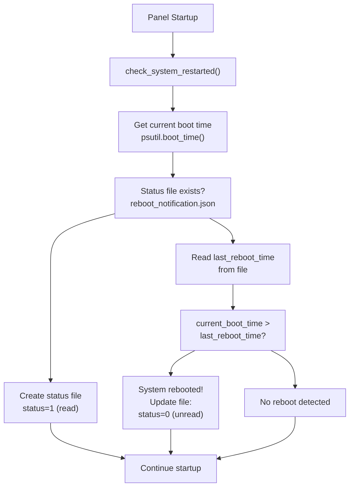
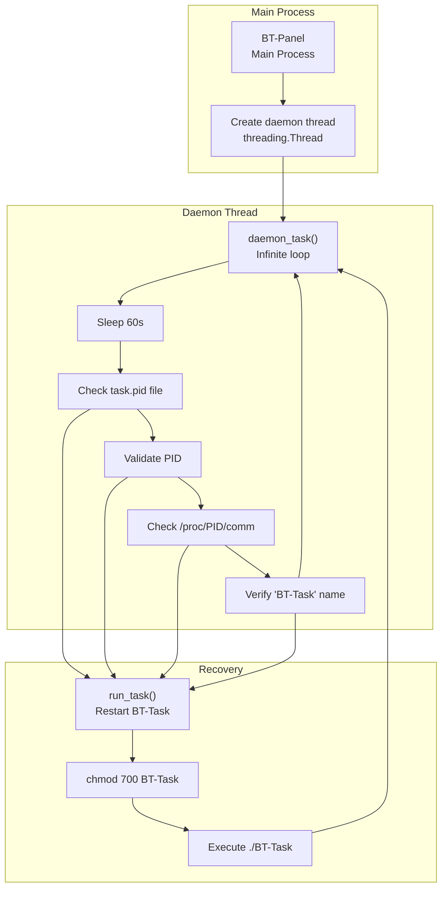
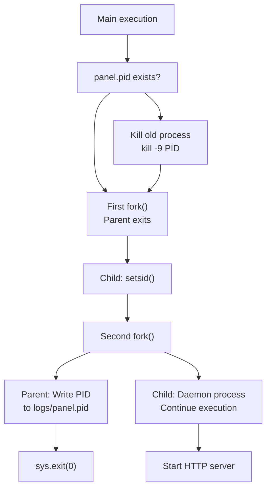
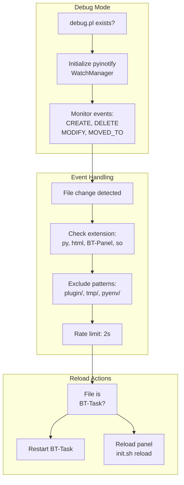
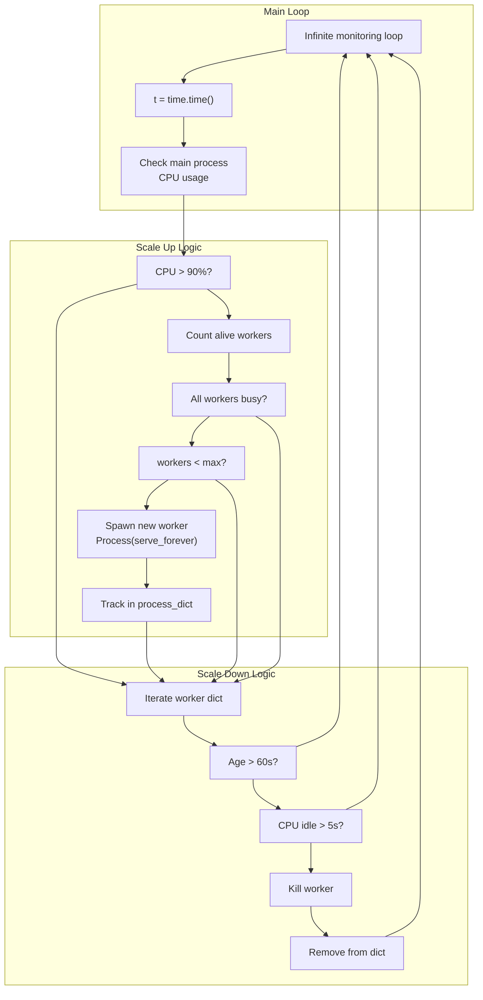

# System Monitoring

> **Relevant source files**
> * [BT-Panel](https://github.com/aaPanel/aaPanel/blob/b6e4ab8b/BT-Panel)

This document covers the monitoring systems within aaPanel that ensure continuous operation of critical components. It describes three primary monitoring mechanisms: system reboot detection, background task daemon monitoring, and health check procedures.

For information about process scaling and worker management, see [Worker Scaling](/aaPanel/aaPanel/7.1-worker-scaling). For information about the background task system itself, see [Background Task System (BT-Task)](/aaPanel/aaPanel/2.2-background-task-system-(bt-task)).

---

## Overview

aaPanel implements multiple layers of system monitoring to maintain service reliability:

| Monitoring Layer | Component | Check Interval | Action on Failure |
| --- | --- | --- | --- |
| System Reboot Detection | `check_system_restarted()` | On panel startup | Record reboot event |
| Background Task Monitoring | `daemon_task()` | 60 seconds | Restart BT-Task |
| Process Health Check | PID file validation | 60 seconds | Launch new process |
| Worker Process Monitoring | CPU usage tracking | 1 second | Scale workers |

---

## System Reboot Detection

### Purpose

The `check_system_restarted()` function detects when the server has rebooted by comparing the system boot time with a previously recorded timestamp. This enables the panel to track service interruptions and notify administrators of unexpected reboots.

### Implementation

**Reboot Detection Flow**



**Sources:** [BT-Panel L195-L226](https://github.com/aaPanel/aaPanel/blob/b6e4ab8b/BT-Panel#L195-L226)

### Status File Structure

The reboot notification status is stored in `data/reboot_notification.json`:

```json
{
  "last_reboot_time": 1234567890,
  "status": 0
}
```

| Field | Type | Description |
| --- | --- | --- |
| `last_reboot_time` | integer | Unix timestamp of system boot time |
| `status` | integer | 0 = unread notification, 1 = read/acknowledged |

### Code Details

The detection logic is invoked during panel initialization at [BT-Panel L235](https://github.com/aaPanel/aaPanel/blob/b6e4ab8b/BT-Panel#L235-L235)

:

```
check_system_restarted()
```

The function uses `psutil.boot_time()` to obtain the system boot timestamp and compares it against the stored value. If the current boot time is greater than the recorded time, a reboot has occurred and the status is reset to unread (0).

**Sources:** [BT-Panel L195-L226](https://github.com/aaPanel/aaPanel/blob/b6e4ab8b/BT-Panel#L195-L226)

 [BT-Panel L235](https://github.com/aaPanel/aaPanel/blob/b6e4ab8b/BT-Panel#L235-L235)

---

## Daemon Task Monitoring

### Overview

The `daemon_task()` function runs in a background thread to continuously monitor the BT-Task background processor. It performs health checks every 60 seconds and automatically restarts the process if it becomes unresponsive or terminates unexpectedly.

### Monitoring Loop

**Daemon Task Architecture**



**Sources:** [BT-Panel L143-L169](https://github.com/aaPanel/aaPanel/blob/b6e4ab8b/BT-Panel#L143-L169)

 [BT-Panel L279-L280](https://github.com/aaPanel/aaPanel/blob/b6e4ab8b/BT-Panel#L279-L280)

### Health Check Sequence

The daemon performs a multi-stage health check:

1. **PID File Existence Check** [BT-Panel L150-L151](https://github.com/aaPanel/aaPanel/blob/b6e4ab8b/BT-Panel#L150-L151) * Verifies `logs/task.pid` exists * If missing, cycle continues without action (BT-Task may not be started yet)
2. **PID Content Validation** [BT-Panel L154-L157](https://github.com/aaPanel/aaPanel/blob/b6e4ab8b/BT-Panel#L154-L157) * Reads PID from file * If empty or invalid, restarts BT-Task
3. **Process Existence Check** [BT-Panel L160-L163](https://github.com/aaPanel/aaPanel/blob/b6e4ab8b/BT-Panel#L160-L163) * Checks `/proc/{PID}/comm` file exists * If process doesn't exist, restarts BT-Task
4. **Process Name Verification** [BT-Panel L166-L169](https://github.com/aaPanel/aaPanel/blob/b6e4ab8b/BT-Panel#L166-L169) * Reads process name from `/proc/{PID}/comm` * Verifies name contains 'BT-Task' * If name doesn't match, restarts BT-Task (PID reused by another process)

### Thread Initialization

The daemon thread is launched during panel startup with daemon mode enabled:

```
task_thread = threading.Thread(target=daemon_task, daemon=True)
task_thread.start()
```

The `daemon=True` flag ensures the thread terminates when the main process exits, preventing zombie threads.

**Sources:** [BT-Panel L279-L280](https://github.com/aaPanel/aaPanel/blob/b6e4ab8b/BT-Panel#L279-L280)

---

## Process Recovery Mechanism

### run_task Function

**Process Restart Flow**

```mermaid
sequenceDiagram
  participant daemon_task()
  participant run_task()
  participant Shell Execution
  participant BT-Task Process
  participant logs/task.pid

  daemon_task()->>daemon_task(): Health check fails
  daemon_task()->>run_task(): Call run_task()
  run_task()->>Shell Execution: chmod 700 BT-Task
  Shell Execution-->>run_task(): Permissions set
  run_task()->>Shell Execution: Execute ./BT-Task
  Shell Execution->>BT-Task Process: Launch process
  BT-Task Process->>BT-Task Process: Daemonize
  BT-Task Process->>logs/task.pid: Write PID
  BT-Task Process-->>Shell Execution: Started
  Shell Execution-->>run_task(): Return
  run_task()-->>daemon_task(): Complete
  daemon_task()->>daemon_task(): Continue monitoring
```

**Sources:** [BT-Panel L139-L141](https://github.com/aaPanel/aaPanel/blob/b6e4ab8b/BT-Panel#L139-L141)

The `run_task()` function performs two operations:

1. Sets executable permissions on the BT-Task binary
2. Executes the BT-Task process

The function uses `public.ExecShell()` for shell command execution, ensuring proper error handling and logging.

---

## Monitoring Intervals and Timing

### Timing Configuration

| Parameter | Value | Code Reference |
| --- | --- | --- |
| Daemon check cycle | 60 seconds | [BT-Panel L144](https://github.com/aaPanel/aaPanel/blob/b6e4ab8b/BT-Panel#L144-L144) |
| Worker CPU check interval | 1 second | [BT-Panel L423](https://github.com/aaPanel/aaPanel/blob/b6e4ab8b/BT-Panel#L423-L423) |
| Worker idle timeout | 5 seconds | [BT-Panel L445](https://github.com/aaPanel/aaPanel/blob/b6e4ab8b/BT-Panel#L445-L445) |
| Worker minimum age | 60 seconds | [BT-Panel L444](https://github.com/aaPanel/aaPanel/blob/b6e4ab8b/BT-Panel#L444-L444) |

### Cycle Timing Diagram

```css
#mermaid-o2zupngr34{font-family:ui-sans-serif,-apple-system,system-ui,Segoe UI,Helvetica;font-size:16px;fill:#333;}@keyframes edge-animation-frame{from{stroke-dashoffset:0;}}@keyframes dash{to{stroke-dashoffset:0;}}#mermaid-o2zupngr34 .edge-animation-slow{stroke-dasharray:9,5!important;stroke-dashoffset:900;animation:dash 50s linear infinite;stroke-linecap:round;}#mermaid-o2zupngr34 .edge-animation-fast{stroke-dasharray:9,5!important;stroke-dashoffset:900;animation:dash 20s linear infinite;stroke-linecap:round;}#mermaid-o2zupngr34 .error-icon{fill:#dddddd;}#mermaid-o2zupngr34 .error-text{fill:#222222;stroke:#222222;}#mermaid-o2zupngr34 .edge-thickness-normal{stroke-width:1px;}#mermaid-o2zupngr34 .edge-thickness-thick{stroke-width:3.5px;}#mermaid-o2zupngr34 .edge-pattern-solid{stroke-dasharray:0;}#mermaid-o2zupngr34 .edge-thickness-invisible{stroke-width:0;fill:none;}#mermaid-o2zupngr34 .edge-pattern-dashed{stroke-dasharray:3;}#mermaid-o2zupngr34 .edge-pattern-dotted{stroke-dasharray:2;}#mermaid-o2zupngr34 .marker{fill:#999;stroke:#999;}#mermaid-o2zupngr34 .marker.cross{stroke:#999;}#mermaid-o2zupngr34 svg{font-family:ui-sans-serif,-apple-system,system-ui,Segoe UI,Helvetica;font-size:16px;}#mermaid-o2zupngr34 p{margin:0;}#mermaid-o2zupngr34 .mermaid-main-font{font-family:ui-sans-serif,-apple-system,system-ui,Segoe UI,Helvetica;}#mermaid-o2zupngr34 .exclude-range{fill:#eeeeee;}#mermaid-o2zupngr34 .section{stroke:none;opacity:0.2;}#mermaid-o2zupngr34 .section0{fill:#dddddd;}#mermaid-o2zupngr34 .section2{fill:#eaeaea;}#mermaid-o2zupngr34 .section1,#mermaid-o2zupngr34 .section3{fill:white;opacity:0.2;}#mermaid-o2zupngr34 .sectionTitle0{fill:#444;}#mermaid-o2zupngr34 .sectionTitle1{fill:#444;}#mermaid-o2zupngr34 .sectionTitle2{fill:#444;}#mermaid-o2zupngr34 .sectionTitle3{fill:#444;}#mermaid-o2zupngr34 .sectionTitle{text-anchor:start;font-family:ui-sans-serif,-apple-system,system-ui,Segoe UI,Helvetica;}#mermaid-o2zupngr34 .grid .tick{stroke:lightgrey;opacity:0.8;shape-rendering:crispEdges;}#mermaid-o2zupngr34 .grid .tick text{font-family:ui-sans-serif,-apple-system,system-ui,Segoe UI,Helvetica;fill:#333;}#mermaid-o2zupngr34 .grid path{stroke-width:0;}#mermaid-o2zupngr34 .today{fill:none;stroke:red;stroke-width:2px;}#mermaid-o2zupngr34 .task{stroke-width:2;}#mermaid-o2zupngr34 .taskText{text-anchor:middle;font-family:ui-sans-serif,-apple-system,system-ui,Segoe UI,Helvetica;}#mermaid-o2zupngr34 .taskTextOutsideRight{fill:#333;text-anchor:start;font-family:ui-sans-serif,-apple-system,system-ui,Segoe UI,Helvetica;}#mermaid-o2zupngr34 .taskTextOutsideLeft{fill:#333;text-anchor:end;}#mermaid-o2zupngr34 .task.clickable{cursor:pointer;}#mermaid-o2zupngr34 .taskText.clickable{cursor:pointer;fill:#003163!important;font-weight:bold;}#mermaid-o2zupngr34 .taskTextOutsideLeft.clickable{cursor:pointer;fill:#003163!important;font-weight:bold;}#mermaid-o2zupngr34 .taskTextOutsideRight.clickable{cursor:pointer;fill:#003163!important;font-weight:bold;}#mermaid-o2zupngr34 .taskText0,#mermaid-o2zupngr34 .taskText1,#mermaid-o2zupngr34 .taskText2,#mermaid-o2zupngr34 .taskText3{fill:#333;}#mermaid-o2zupngr34 .task0,#mermaid-o2zupngr34 .task1,#mermaid-o2zupngr34 .task2,#mermaid-o2zupngr34 .task3{fill:#eaeaea;stroke:#ccc;}#mermaid-o2zupngr34 .taskTextOutside0,#mermaid-o2zupngr34 .taskTextOutside2{fill:#333;}#mermaid-o2zupngr34 .taskTextOutside1,#mermaid-o2zupngr34 .taskTextOutside3{fill:#333;}#mermaid-o2zupngr34 .active0,#mermaid-o2zupngr34 .active1,#mermaid-o2zupngr34 .active2,#mermaid-o2zupngr34 .active3{fill:hsl(0, 0%, 100%);stroke:#eaeaea;}#mermaid-o2zupngr34 .activeText0,#mermaid-o2zupngr34 .activeText1,#mermaid-o2zupngr34 .activeText2,#mermaid-o2zupngr34 .activeText3{fill:#333!important;}#mermaid-o2zupngr34 .done0,#mermaid-o2zupngr34 .done1,#mermaid-o2zupngr34 .done2,#mermaid-o2zupngr34 .done3{stroke:grey;fill:lightgrey;stroke-width:2;}#mermaid-o2zupngr34 .doneText0,#mermaid-o2zupngr34 .doneText1,#mermaid-o2zupngr34 .doneText2,#mermaid-o2zupngr34 .doneText3{fill:#333!important;}#mermaid-o2zupngr34 .crit0,#mermaid-o2zupngr34 .crit1,#mermaid-o2zupngr34 .crit2,#mermaid-o2zupngr34 .crit3{stroke:#ff8888;fill:red;stroke-width:2;}#mermaid-o2zupngr34 .activeCrit0,#mermaid-o2zupngr34 .activeCrit1,#mermaid-o2zupngr34 .activeCrit2,#mermaid-o2zupngr34 .activeCrit3{stroke:#ff8888;fill:hsl(0, 0%, 100%);stroke-width:2;}#mermaid-o2zupngr34 .doneCrit0,#mermaid-o2zupngr34 .doneCrit1,#mermaid-o2zupngr34 .doneCrit2,#mermaid-o2zupngr34 .doneCrit3{stroke:#ff8888;fill:lightgrey;stroke-width:2;cursor:pointer;shape-rendering:crispEdges;}#mermaid-o2zupngr34 .milestone{transform:rotate(45deg) scale(0.8,0.8);}#mermaid-o2zupngr34 .milestoneText{font-style:italic;}#mermaid-o2zupngr34 .doneCritText0,#mermaid-o2zupngr34 .doneCritText1,#mermaid-o2zupngr34 .doneCritText2,#mermaid-o2zupngr34 .doneCritText3{fill:#333!important;}#mermaid-o2zupngr34 .vert{stroke:navy;}#mermaid-o2zupngr34 .vertText{font-size:15px;text-anchor:middle;fill:navy!important;}#mermaid-o2zupngr34 .activeCritText0,#mermaid-o2zupngr34 .activeCritText1,#mermaid-o2zupngr34 .activeCritText2,#mermaid-o2zupngr34 .activeCritText3{fill:#333!important;}#mermaid-o2zupngr34 .titleText{text-anchor:middle;font-size:18px;fill:#444;font-family:ui-sans-serif,-apple-system,system-ui,Segoe UI,Helvetica;}#mermaid-o2zupngr34 :root{--mermaid-font-family:"trebuchet ms",verdana,arial,sans-serif;}00153045001530450015304500Sleep 60s CPU Check CPU Check CPU Check CPU Check Continue... Health Check Sleep 60s Health Check Sleep 60s Health Check Daemon ThreadWorker MonitoringMonitoring Timeline (First 180 seconds)
```

**Sources:** [BT-Panel L143-L169](https://github.com/aaPanel/aaPanel/blob/b6e4ab8b/BT-Panel#L143-L169)

 [BT-Panel L420-L449](https://github.com/aaPanel/aaPanel/blob/b6e4ab8b/BT-Panel#L420-L449)

---

## PID File Management

### PID File Locations

| Process | PID File Path | Write Location | Read Location |
| --- | --- | --- | --- |
| BT-Panel | `logs/panel.pid` | [BT-Panel L244](https://github.com/aaPanel/aaPanel/blob/b6e4ab8b/BT-Panel#L244-L244) | [BT-Panel L231-L232](https://github.com/aaPanel/aaPanel/blob/b6e4ab8b/BT-Panel#L231-L232) |
| BT-Task | `logs/task.pid` | BT-Task binary | [BT-Panel L145](https://github.com/aaPanel/aaPanel/blob/b6e4ab8b/BT-Panel#L145-L145) |

### Panel PID Lifecycle

**Panel Process Fork and PID Management**



**Sources:** [BT-Panel L230-L245](https://github.com/aaPanel/aaPanel/blob/b6e4ab8b/BT-Panel#L230-L245)

The double-fork technique creates a proper daemon process:

1. **First Fork:** Creates child process and parent exits
2. **setsid():** Child becomes session leader
3. **Second Fork:** Creates grandchild (actual daemon) and child writes PID
4. **PID File:** Child writes grandchild PID to `logs/panel.pid` before exiting

This ensures the daemon has no controlling terminal and is properly detached from the parent session.

---

## Debug Mode Monitoring

### File Watching in Debug Mode

When debug mode is enabled (`data/debug.pl` exists), the panel activates file watching using `pyinotify` to automatically reload on code changes.

**Debug Event Monitoring Flow**



**Sources:** [BT-Panel L68-L127](https://github.com/aaPanel/aaPanel/blob/b6e4ab8b/BT-Panel#L68-L127)

 [BT-Panel L383-L388](https://github.com/aaPanel/aaPanel/blob/b6e4ab8b/BT-Panel#L383-L388)

### Monitored File Extensions

The `PanelEventHandler` class monitors files with these extensions:

* `.py` - Python source files
* `.html` - Template files
* `BT-Panel` - Main executable
* `.so` - Shared libraries

### Excluded Directories

The following paths are excluded from monitoring to prevent unnecessary reloads:

* `plugin/` - Plugin directory (changes don't affect core)
* `tmp/` and `temp/` - Temporary files
* `pyenv/` - Python environment
* `class/projectModel/` - Project models
* `class/databaseModel/` - Database models
* `panel/data/mail/in_bulk/content/` - Mail content

**Sources:** [BT-Panel L73-L82](https://github.com/aaPanel/aaPanel/blob/b6e4ab8b/BT-Panel#L73-L82)

---

## Integration with Multi-Process Mode

### Process Monitoring in Multi-Process Deployment

When running in multi-process mode (`data/is_process.pl` exists), the system monitors both main and worker processes.

**Multi-Process Monitoring Architecture**



**Sources:** [BT-Panel L418-L449](https://github.com/aaPanel/aaPanel/blob/b6e4ab8b/BT-Panel#L418-L449)

### Worker Process Dictionary Structure

The `process_dict` maintains metadata for each worker process:

```
process_dict[pid] = [Process_object, creation_time, psutil_Process_object]
```

| Index | Type | Description |
| --- | --- | --- |
| 0 | `multiprocessing.Process` | Process object for control operations |
| 1 | `float` | Creation timestamp from `time.time()` |
| 2 | `psutil.Process` | Process handle for CPU monitoring |

### Worker Lifecycle Rules

1. **Creation Conditions:** * Main process CPU > 90% * All existing workers have CPU activity * Worker count < `process_count` limit
2. **Termination Conditions:** * Worker age > 60 seconds * Worker CPU idle for 5 consecutive seconds * Allows graceful scaling during load drops

**Sources:** [BT-Panel L418-L449](https://github.com/aaPanel/aaPanel/blob/b6e4ab8b/BT-Panel#L418-L449)

---

## Monitoring State Files

### File System Structure

```java
/www/server/panel/
├── logs/
│   ├── panel.pid          # Main process PID
│   ├── task.pid           # Background task PID
│   └── error.log          # Error output log
├── data/
│   ├── reboot_notification.json  # System reboot status
│   ├── debug.pl           # Debug mode flag
│   └── is_process.pl      # Multi-process mode flag
└── ssl/
    ├── privateKey.pem     # SSL private key
    └── certificate.pem    # SSL certificate
```

### File Monitoring Summary

| File | Purpose | Check Method | Action |
| --- | --- | --- | --- |
| `logs/task.pid` | BT-Task PID | Read and validate | Restart if invalid |
| `/proc/{PID}/comm` | Process name | Read content | Restart if not 'BT-Task' |
| `data/reboot_notification.json` | Reboot detection | Compare boot time | Update status |
| `logs/panel.pid` | Panel PID | Check and kill | Clean restart |

**Sources:** [BT-Panel L145](https://github.com/aaPanel/aaPanel/blob/b6e4ab8b/BT-Panel#L145-L145)

 [BT-Panel L160](https://github.com/aaPanel/aaPanel/blob/b6e4ab8b/BT-Panel#L160-L160)

 [BT-Panel L166](https://github.com/aaPanel/aaPanel/blob/b6e4ab8b/BT-Panel#L166-L166)

 [BT-Panel L201-L223](https://github.com/aaPanel/aaPanel/blob/b6e4ab8b/BT-Panel#L201-L223)

 [BT-Panel L230-L232](https://github.com/aaPanel/aaPanel/blob/b6e4ab8b/BT-Panel#L230-L232)

---

## Monitoring Best Practices

### Recommended Monitoring Configuration

1. **PID File Monitoring:** The daemon_task thread automatically monitors BT-Task health every 60 seconds. No configuration needed.
2. **System Reboot Detection:** Automatically enabled on startup. Check `data/reboot_notification.json` to see reboot status programmatically.
3. **Debug Mode:** Enable only in development by creating `data/debug.pl`. Disable in production to avoid performance overhead from file watching.
4. **Multi-Process Mode:** Monitor worker process count and CPU usage in `logs/` to tune the `data/process_count.pl` setting.

### Error Log Monitoring

The panel redirects stderr to `logs/error.log` in non-SSL or debug modes [BT-Panel L272-L274](https://github.com/aaPanel/aaPanel/blob/b6e4ab8b/BT-Panel#L272-L274)

 Monitor this file for:

* Process crash information
* Python exceptions
* System errors
* Resource exhaustion warnings

---

## Summary

aaPanel's monitoring system provides comprehensive oversight of critical components:

* **System Reboot Detection:** Tracks server reboots using boot time comparison
* **Daemon Monitoring:** Ensures BT-Task remains operational with 60-second health checks
* **Process Health Validation:** Multi-stage checks including PID file, process existence, and process name verification
* **Automatic Recovery:** Restarts failed processes without manual intervention
* **Debug Mode Support:** File watching and auto-reload for development
* **Multi-Process Monitoring:** Dynamic worker scaling based on CPU load

These monitoring mechanisms work together to maintain service availability and provide administrators with visibility into system state changes.

**Sources:** [BT-Panel L143-L169](https://github.com/aaPanel/aaPanel/blob/b6e4ab8b/BT-Panel#L143-L169)

 [BT-Panel L195-L226](https://github.com/aaPanel/aaPanel/blob/b6e4ab8b/BT-Panel#L195-L226)

 [BT-Panel L279-L280](https://github.com/aaPanel/aaPanel/blob/b6e4ab8b/BT-Panel#L279-L280)

 [BT-Panel L418-L449](https://github.com/aaPanel/aaPanel/blob/b6e4ab8b/BT-Panel#L418-L449)