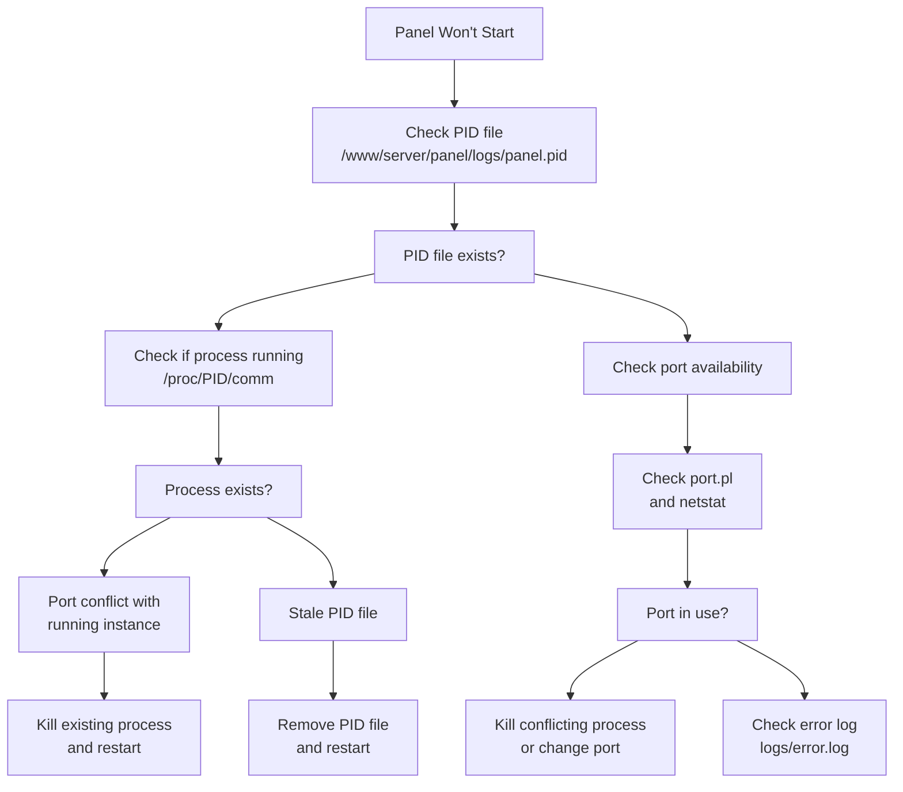
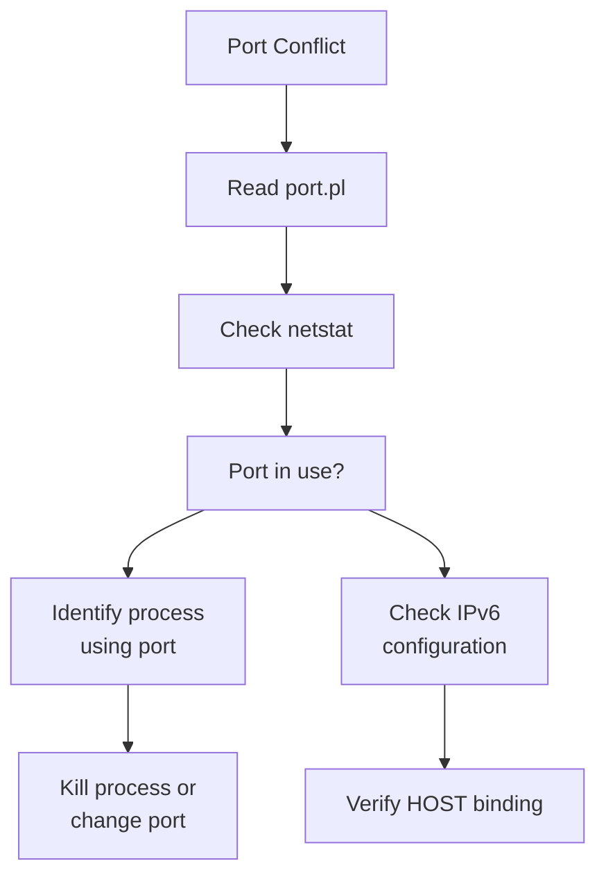
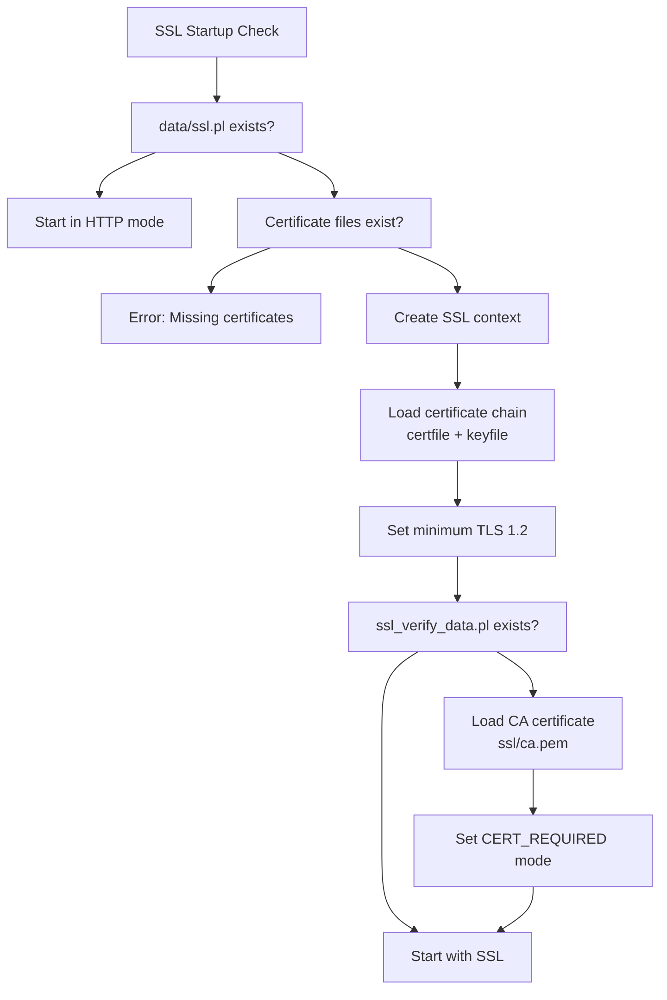
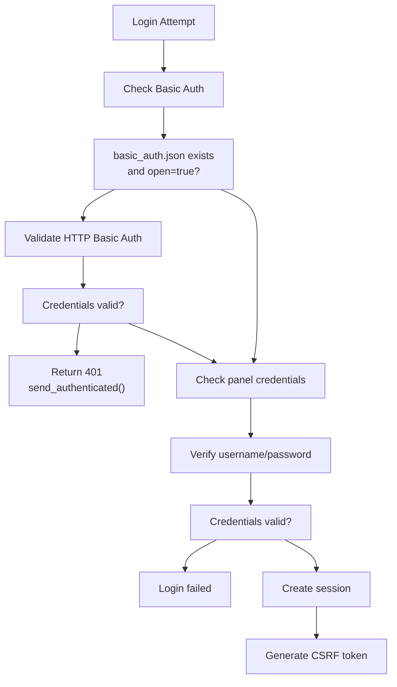
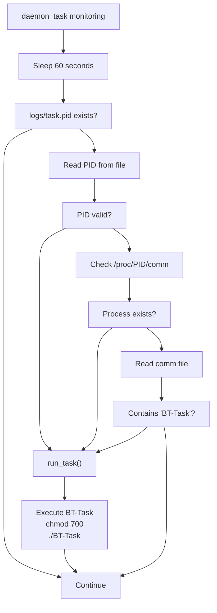
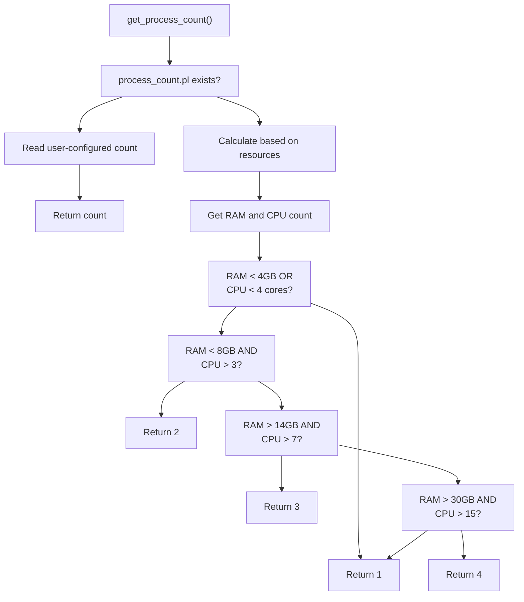
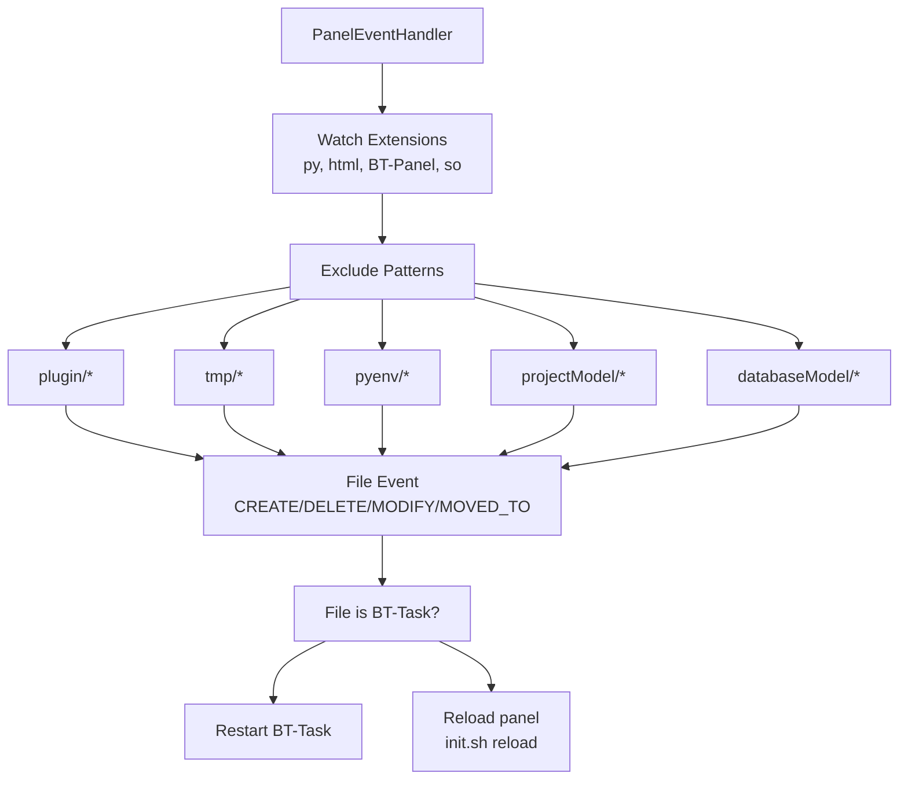
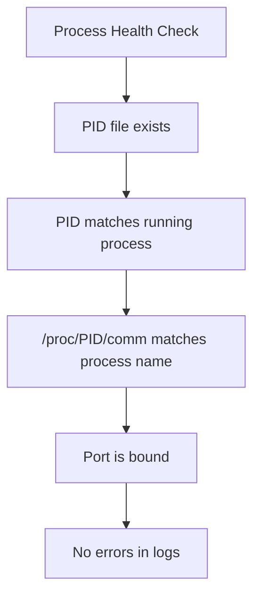

# Troubleshooting

> **Relevant source files**
> * [BT-Panel](https://github.com/aaPanel/aaPanel/blob/b6e4ab8b/BT-Panel)
> * [BTPanel/app.py](https://github.com/aaPanel/aaPanel/blob/b6e4ab8b/BTPanel/app.py)

This page provides solutions to common issues encountered when running aaPanel, diagnostic techniques for identifying problems, and recovery procedures. For initial setup guidance, see [Quick Start Guide](/aaPanel/aaPanel/1.1-quick-start-guide). For deployment configuration, see [Deployment Guide](/aaPanel/aaPanel/10-deployment-guide). For process management concepts, see [Process Management](/aaPanel/aaPanel/7-process-management).

## Overview

aaPanel troubleshooting involves three main areas:

1. **Startup and Process Management** - Issues preventing BT-Panel or BT-Task from starting or staying running
2. **Network and SSL/TLS** - Connection problems, certificate errors, port conflicts
3. **Authentication and Security** - Login failures, CSRF errors, session problems

This document provides systematic approaches to diagnose and resolve these issues using the panel's built-in monitoring, logging, and debugging facilities.

---

## Common Issues and Solutions

### Panel Won't Start

#### Symptom

BT-Panel process fails to start or exits immediately after starting.

#### Diagnostic Flow



**Sources:** [BT-Panel L229-L245](https://github.com/aaPanel/aaPanel/blob/b6e4ab8b/BT-Panel#L229-L245)

#### Solution Steps

1. **Check for running instance:** ``` ``` The startup sequence at [BT-Panel L230-L232](https://github.com/aaPanel/aaPanel/blob/b6e4ab8b/BT-Panel#L230-L232)  kills any existing process before starting, but manual verification is useful.
2. **Verify port availability:** ``` ``` The port is read from `data/port.pl` at [BT-Panel L254-L259](https://github.com/aaPanel/aaPanel/blob/b6e4ab8b/BT-Panel#L254-L259)  with a default of 7800.
3. **Check error logs:** ``` ``` Standard error is redirected to this file at [BT-Panel L272-L274](https://github.com/aaPanel/aaPanel/blob/b6e4ab8b/BT-Panel#L272-L274)  (unless in SSL mode).
4. **Check SSL certificate files:** ``` ``` If `data/ssl.pl` exists, these files must be present and valid [BT-Panel L264-L268](https://github.com/aaPanel/aaPanel/blob/b6e4ab8b/BT-Panel#L264-L268)
5. **Remove stale files and restart:** ``` ```

**Sources:** [BT-Panel L229-L276](https://github.com/aaPanel/aaPanel/blob/b6e4ab8b/BT-Panel#L229-L276)

---

### Port Conflicts

#### Symptom

Panel fails to bind to configured port. Error: "Address already in use".

#### Diagnosis



**Sources:** [BT-Panel L254-L262](https://github.com/aaPanel/aaPanel/blob/b6e4ab8b/BT-Panel#L254-L262)

#### Solutions

**Option 1: Change Panel Port**

Modify the port configuration:

```

```

The port is read at [BT-Panel L254-L259](https://github.com/aaPanel/aaPanel/blob/b6e4ab8b/BT-Panel#L254-L259)

 during startup.

**Option 2: Kill Conflicting Process**

Find and terminate the process using the port:

```

```

**Option 3: Verify IPv6 Configuration**

The HOST binding at [BT-Panel L260-L262](https://github.com/aaPanel/aaPanel/blob/b6e4ab8b/BT-Panel#L260-L262)

 uses IPv6 format if `data/ipv6.pl` exists:

```

```

**Sources:** [BT-Panel L254-L262](https://github.com/aaPanel/aaPanel/blob/b6e4ab8b/BT-Panel#L254-L262)

---

### SSL/TLS Errors

#### Common SSL Issues

| Issue | Cause | Solution |
| --- | --- | --- |
| Certificate file not found | Missing privateKey.pem or certificate.pem | Generate or restore certificates in `/www/server/panel/ssl/` |
| TLS handshake failure | Client using old TLS version | Server enforces TLS 1.2+ at [BT-Panel L285-L288](https://github.com/aaPanel/aaPanel/blob/b6e4ab8b/BT-Panel#L285-L288) |
| Certificate verification failure | Client certificate not trusted | Check CA certificate at `/www/server/panel/ssl/ca.pem` [BT-Panel L299-L301](https://github.com/aaPanel/aaPanel/blob/b6e4ab8b/BT-Panel#L299-L301) |
| SSL context error | Malformed certificate files | Validate certificate PEM format |

#### SSL Configuration Flow



**Sources:** [BT-Panel L264-L301](https://github.com/aaPanel/aaPanel/blob/b6e4ab8b/BT-Panel#L264-L301)

#### Diagnostic Steps

1. **Verify SSL configuration:** ``` ```
2. **Test certificate validity:** ``` ```
3. **Test TLS handshake:** ``` ```
4. **Disable SSL temporarily (for testing):** ``` ```

**Client Certificate Verification**

If `/www/server/panel/data/ssl_verify_data.pl` exists, the panel requires client certificates [BT-Panel L291-L301](https://github.com/aaPanel/aaPanel/blob/b6e4ab8b/BT-Panel#L291-L301)

:

* CA certificate must exist at `/www/server/panel/ssl/ca.pem`
* Client certificates must be signed by this CA
* Verification mode is set to `ssl.CERT_REQUIRED`

**Sources:** [BT-Panel L264-L301](https://github.com/aaPanel/aaPanel/blob/b6e4ab8b/BT-Panel#L264-L301)

 [BT-Panel L348-L367](https://github.com/aaPanel/aaPanel/blob/b6e4ab8b/BT-Panel#L348-L367)

---

### Authentication Problems

#### Login Failures



**Sources:** [BTPanel/app.py L94-L103](https://github.com/aaPanel/aaPanel/blob/b6e4ab8b/BTPanel/app.py#L94-L103)

 [BTPanel/app.py L519-L526](https://github.com/aaPanel/aaPanel/blob/b6e4ab8b/BTPanel/app.py#L519-L526)

#### CSRF Token Errors

**Symptom:** "INIT_CSRF_ERR" response when making requests after login.

**Cause:** The CSRF validation at [BTPanel/app.py L333-L348](https://github.com/aaPanel/aaPanel/blob/b6e4ab8b/BTPanel/app.py#L333-L348)

 requires the `x-http-token` header to match the session token.

**Solutions:**

1. **Check token in session:** * Token is generated using `public.get_csrf_sess_html_token_value()` * Must be sent in `x-http-token` header for POST/state-changing requests
2. **Verify debug mode:** ``` ``` CSRF checking is bypassed in debug mode [BTPanel/app.py L335](https://github.com/aaPanel/aaPanel/blob/b6e4ab8b/BTPanel/app.py#L335-L335)
3. **Clear browser session:** * Session cookies may be corrupted * Clear cookies and login again * Session cookie name is MD5 hash of secret key [BTPanel/app.py L116](https://github.com/aaPanel/aaPanel/blob/b6e4ab8b/BTPanel/app.py#L116-L116)
4. **Check same-site cookie settings:** * SSL mode sets `SESSION_COOKIE_SAMESITE='Lax'` [BTPanel/app.py L119](https://github.com/aaPanel/aaPanel/blob/b6e4ab8b/BTPanel/app.py#L119-L119) * Non-SSL uses `SESSION_COOKIE_SAMESITE=None` [BTPanel/app.py L122](https://github.com/aaPanel/aaPanel/blob/b6e4ab8b/BTPanel/app.py#L122-L122)

**Sources:** [BTPanel/app.py L333-L348](https://github.com/aaPanel/aaPanel/blob/b6e4ab8b/BTPanel/app.py#L333-L348)

 [BTPanel/app.py L106-L124](https://github.com/aaPanel/aaPanel/blob/b6e4ab8b/BTPanel/app.py#L106-L124)

#### Basic Authentication Issues

Basic Authentication is configured at [BTPanel/app.py L94-L103](https://github.com/aaPanel/aaPanel/blob/b6e4ab8b/BTPanel/app.py#L94-L103)

 via `config/basic_auth.json`:

```

```

**Troubleshooting:**

1. Verify file exists and is valid JSON
2. Check `open` field is `true` to enable
3. Test credentials match configuration
4. Remember: Basic Auth occurs BEFORE panel login

**Sources:** [BTPanel/app.py L94-L103](https://github.com/aaPanel/aaPanel/blob/b6e4ab8b/BTPanel/app.py#L94-L103)

---

### Process Management Issues

#### BT-Task Not Running

The daemon monitoring system at [BT-Panel L143-L169](https://github.com/aaPanel/aaPanel/blob/b6e4ab8b/BT-Panel#L143-L169)

 checks BT-Task every 60 seconds.

**Diagnostic Process:**



**Sources:** [BT-Panel L143-L169](https://github.com/aaPanel/aaPanel/blob/b6e4ab8b/BT-Panel#L143-L169)

**Manual Recovery:**

```

```

The daemon thread is started at [BT-Panel L278-L280](https://github.com/aaPanel/aaPanel/blob/b6e4ab8b/BT-Panel#L278-L280)

 when BT-Panel launches.

**Sources:** [BT-Panel L139-L169](https://github.com/aaPanel/aaPanel/blob/b6e4ab8b/BT-Panel#L139-L169)

 [BT-Panel L278-L280](https://github.com/aaPanel/aaPanel/blob/b6e4ab8b/BT-Panel#L278-L280)

---

### Worker Process Problems

#### Multi-Process Mode Issues

Worker scaling is controlled by [BT-Panel L390-L449](https://github.com/aaPanel/aaPanel/blob/b6e4ab8b/BT-Panel#L390-L449)

 when `data/is_process.pl` exists.

**Process Count Determination:**



**Sources:** [BT-Panel L171-L192](https://github.com/aaPanel/aaPanel/blob/b6e4ab8b/BT-Panel#L171-L192)

#### Worker Scaling Algorithm

The dynamic scaling at [BT-Panel L418-L447](https://github.com/aaPanel/aaPanel/blob/b6e4ab8b/BT-Panel#L418-L447)

 monitors main process CPU usage:

**Scaling Rules:**

* **Scale Up:** When main process CPU > 90% and no idle workers exist [BT-Panel L422-L439](https://github.com/aaPanel/aaPanel/blob/b6e4ab8b/BT-Panel#L422-L439)
* **Scale Down:** Kill workers idle for 5+ seconds that are older than 60 seconds [BT-Panel L441-L447](https://github.com/aaPanel/aaPanel/blob/b6e4ab8b/BT-Panel#L441-L447)

**Troubleshooting Steps:**

1. **Check if multi-process mode is enabled:** ``` ```
2. **Set custom worker count:** ``` ```
3. **Monitor worker processes:** ``` ```
4. **Disable multi-process mode:** ``` ```

**Sources:** [BT-Panel L390-L449](https://github.com/aaPanel/aaPanel/blob/b6e4ab8b/BT-Panel#L390-L449)

 [BT-Panel L171-L192](https://github.com/aaPanel/aaPanel/blob/b6e4ab8b/BT-Panel#L171-L192)

---

## Debugging Techniques

### Debug Mode

Debug mode is enabled when `data/debug.pl` exists [BT-Panel L46](https://github.com/aaPanel/aaPanel/blob/b6e4ab8b/BT-Panel#L46-L46)

**Features:**

* File watching with `pyinotify` [BT-Panel L69-L137](https://github.com/aaPanel/aaPanel/blob/b6e4ab8b/BT-Panel#L69-L137)
* Automatic reload on code changes [BT-Panel L94-L110](https://github.com/aaPanel/aaPanel/blob/b6e4ab8b/BT-Panel#L94-L110)
* Debug-level logging [BT-Panel L305-L306](https://github.com/aaPanel/aaPanel/blob/b6e4ab8b/BT-Panel#L305-L306)
* CSRF protection bypass [BTPanel/app.py L335](https://github.com/aaPanel/aaPanel/blob/b6e4ab8b/BTPanel/app.py#L335-L335)

**Activation:**

```

```

**File Watching Configuration:**



**Sources:** [BT-Panel L68-L137](https://github.com/aaPanel/aaPanel/blob/b6e4ab8b/BT-Panel#L68-L137)

**Debug Output:**

The handler logs at [BT-Panel L99-L110](https://github.com/aaPanel/aaPanel/blob/b6e4ab8b/BT-Panel#L99-L110)

:

* File changes detected
* Reload actions taken
* Current listening port

**Disable Debug Mode:**

```

```

**Sources:** [BT-Panel L46-L137](https://github.com/aaPanel/aaPanel/blob/b6e4ab8b/BT-Panel#L46-L137)

 [BT-Panel L305-L306](https://github.com/aaPanel/aaPanel/blob/b6e4ab8b/BT-Panel#L305-L306)

 [BT-Panel L383-L388](https://github.com/aaPanel/aaPanel/blob/b6e4ab8b/BT-Panel#L383-L388)

---

### Log Files

#### Log Locations and Purposes

| Log File | Purpose | Key Information |
| --- | --- | --- |
| `logs/error.log` | Standard error output | Exceptions, fatal errors, startup failures |
| `logs/panel.pid` | Main process PID | Current BT-Panel process ID |
| `logs/task.pid` | Task process PID | Current BT-Task process ID |
| `data/js_random.pl` | Frontend cache buster | Random string for asset versioning |
| `data/reboot_notification.json` | System reboot tracking | Boot time and notification status |

**Sources:** [BT-Panel L230](https://github.com/aaPanel/aaPanel/blob/b6e4ab8b/BT-Panel#L230-L230)

 [BT-Panel L145](https://github.com/aaPanel/aaPanel/blob/b6e4ab8b/BT-Panel#L145-L145)

 [BT-Panel L272-L274](https://github.com/aaPanel/aaPanel/blob/b6e4ab8b/BT-Panel#L272-L274)

 [BTPanel/app.py L568-L573](https://github.com/aaPanel/aaPanel/blob/b6e4ab8b/BTPanel/app.py#L568-L573)

 [BT-Panel L195-L225](https://github.com/aaPanel/aaPanel/blob/b6e4ab8b/BT-Panel#L195-L225)

#### Reading Error Logs

```

```

#### Error Response Format

When errors occur in the application, they are formatted by `error_500()` at [BTPanel/app.py L206-L241](https://github.com/aaPanel/aaPanel/blob/b6e4ab8b/BTPanel/app.py#L206-L241)

:

**Error Template Fields:**

* Request date and time
* Panel version
* OS version
* Remote address (client IP)
* Request method and URI
* Request form data (passwords redacted)
* User agent string
* Full error traceback

**Sources:** [BTPanel/app.py L206-L241](https://github.com/aaPanel/aaPanel/blob/b6e4ab8b/BTPanel/app.py#L206-L241)

---

### Process Status Checking

#### Verify Running Processes

```

```

#### Process Health Indicators



**Sources:** [BT-Panel L149-L169](https://github.com/aaPanel/aaPanel/blob/b6e4ab8b/BT-Panel#L149-L169)

#### Network Binding Verification

```

```

The panel uses Unix socket at [BT-Panel L332-L346](https://github.com/aaPanel/aaPanel/blob/b6e4ab8b/BT-Panel#L332-L346)

 when `webserver.run_webserver()` returns true, otherwise binds to TCP port at [BT-Panel L347-L380](https://github.com/aaPanel/aaPanel/blob/b6e4ab8b/BT-Panel#L347-L380)

**Sources:** [BT-Panel L328-L380](https://github.com/aaPanel/aaPanel/blob/b6e4ab8b/BT-Panel#L328-L380)

---

## Diagnostic Commands

### Quick Status Check

```

```

**Sources:** [BT-Panel L230](https://github.com/aaPanel/aaPanel/blob/b6e4ab8b/BT-Panel#L230-L230)

 [BT-Panel L145](https://github.com/aaPanel/aaPanel/blob/b6e4ab8b/BT-Panel#L145-L145)

 [BT-Panel L254-L262](https://github.com/aaPanel/aaPanel/blob/b6e4ab8b/BT-Panel#L254-L262)

### System Reboot Detection

The panel tracks system reboots at [BT-Panel L195-L225](https://github.com/aaPanel/aaPanel/blob/b6e4ab8b/BT-Panel#L195-L225)

 using `data/reboot_notification.json`.

**Check Reboot Status:**

```

```

**JSON Structure:**

```

```

* `status: 0` - Unread notification
* `status: 1` - Read or no recent reboot

The function `check_system_restarted()` compares `psutil.boot_time()` against the stored value to detect reboots.

**Sources:** [BT-Panel L195-L225](https://github.com/aaPanel/aaPanel/blob/b6e4ab8b/BT-Panel#L195-L225)

---

## Recovery Procedures

### Complete Panel Reset

```

```

**Sources:** [BT-Panel L229-L245](https://github.com/aaPanel/aaPanel/blob/b6e4ab8b/BT-Panel#L229-L245)

 [BT-Panel L254-L259](https://github.com/aaPanel/aaPanel/blob/b6e4ab8b/BT-Panel#L254-L259)

### SSL Certificate Recovery

```

```

**Sources:** [BT-Panel L264-L268](https://github.com/aaPanel/aaPanel/blob/b6e4ab8b/BT-Panel#L264-L268)

 [BT-Panel L282-L290](https://github.com/aaPanel/aaPanel/blob/b6e4ab8b/BT-Panel#L282-L290)

### Session Corruption Recovery

```

```

The session system is configured at [BTPanel/app.py L106-L124](https://github.com/aaPanel/aaPanel/blob/b6e4ab8b/BTPanel/app.py#L106-L124)

 using `SimpleCacheSession` with 1000 item capacity and 86400 second TTL.

**Sources:** [BTPanel/app.py L106-L124](https://github.com/aaPanel/aaPanel/blob/b6e4ab8b/BTPanel/app.py#L106-L124)

---

## Preventing Common Issues

### Best Practices

1. **Regular monitoring:** * Monitor `logs/error.log` for exceptions * Check process status with health check script * Verify worker scaling behavior under load
2. **Configuration management:** * Back up `.pl` configuration files * Document custom port/SSL changes * Keep SSL certificates up to date
3. **Resource planning:** * Ensure adequate RAM/CPU for worker count [BT-Panel L186-L191](https://github.com/aaPanel/aaPanel/blob/b6e4ab8b/BT-Panel#L186-L191) * Monitor disk space for logs * Consider multi-process mode for high-traffic deployments
4. **Security:** * Use SSL in production [BT-Panel L264-L301](https://github.com/aaPanel/aaPanel/blob/b6e4ab8b/BT-Panel#L264-L301) * Enable Basic Auth for additional protection [BTPanel/app.py L94-L103](https://github.com/aaPanel/aaPanel/blob/b6e4ab8b/BTPanel/app.py#L94-L103) * Regularly review `admin_path` configuration [BTPanel/app.py L136-L199](https://github.com/aaPanel/aaPanel/blob/b6e4ab8b/BTPanel/app.py#L136-L199)

**Sources:** [BT-Panel L171-L192](https://github.com/aaPanel/aaPanel/blob/b6e4ab8b/BT-Panel#L171-L192)

 [BT-Panel L264-L301](https://github.com/aaPanel/aaPanel/blob/b6e4ab8b/BT-Panel#L264-L301)

 [BTPanel/app.py L94-L103](https://github.com/aaPanel/aaPanel/blob/b6e4ab8b/BTPanel/app.py#L94-L103)

 [BTPanel/app.py L136-L199](https://github.com/aaPanel/aaPanel/blob/b6e4ab8b/BTPanel/app.py#L136-L199)