# Web Server (BT-Panel)

> **Relevant source files**
> * [BT-Panel](https://github.com/aaPanel/aaPanel/blob/b6e4ab8b/BT-Panel)

## Purpose and Scope

This document covers the **BT-Panel** main web server process, which serves as the primary entry point for the aaPanel control panel. The BT-Panel process handles HTTP/HTTPS requests, manages server initialization, configures network bindings, and monitors background services.

This page documents:

* Server startup sequence and process initialization
* Gevent integration and monkey patching
* Network binding modes (Unix socket vs TCP)
* SSL/TLS configuration and certificate handling
* Background daemon management for BT-Task monitoring
* Debug mode with file watching and auto-reload
* Dynamic worker process scaling in multi-process mode

For information about the Flask application layer that runs within BT-Panel, see [Flask Application Core](/aaPanel/aaPanel/2.3-flask-application-core). For background task processing, see [Background Task System (BT-Task)](/aaPanel/aaPanel/2.2-background-task-system-(bt-task)). For multi-process deployment strategies, see [Process Management](/aaPanel/aaPanel/7-process-management).

---

## Startup Sequence Overview

The BT-Panel server follows a well-defined startup sequence that establishes the runtime environment before accepting requests.

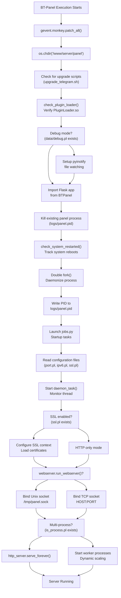

**Sources**: [BT-Panel L1-L450](https://github.com/aaPanel/aaPanel/blob/b6e4ab8b/BT-Panel#L1-L450)

---

## Gevent Integration

The BT-Panel server uses **gevent** for asynchronous I/O operations and concurrent request handling. The integration begins with monkey patching to make standard library components gevent-compatible.

### Monkey Patching

The first operation performed by BT-Panel is gevent monkey patching, which must occur before any other imports:

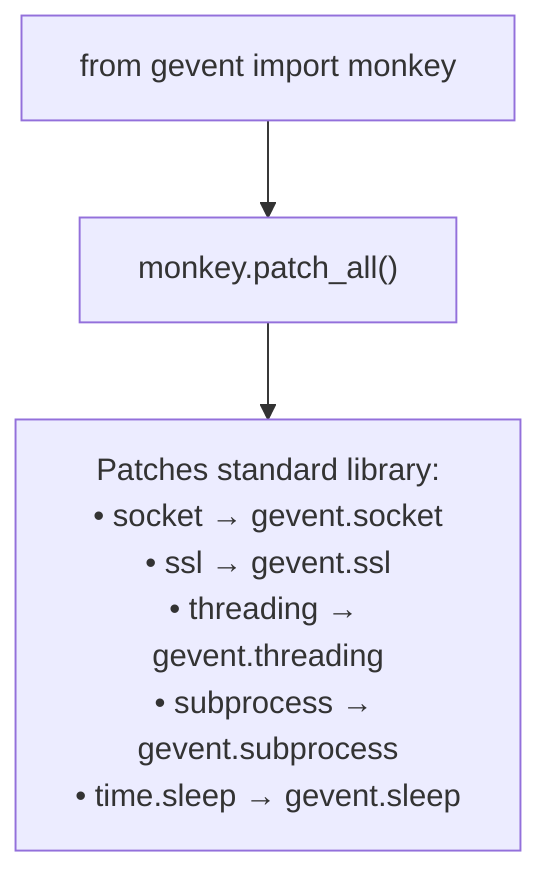

This occurs at [BT-Panel L10-L13](https://github.com/aaPanel/aaPanel/blob/b6e4ab8b/BT-Panel#L10-L13)

 and ensures all subsequent I/O operations use gevent's cooperative multitasking model rather than blocking operations.

### WSGIServer Implementation

BT-Panel uses a custom `BtWSGIServer` class that extends `gevent.pywsgi.WSGIServer`:

| Component | Implementation | Purpose |
| --- | --- | --- |
| Base Class | `gevent.pywsgi.WSGIServer` | Provides WSGI-compliant HTTP server |
| Custom Class | `BtWSGIServer` | Adds error handling for socket operations |
| Error Handling | Catches `OSError` in `wrap_socket_and_handle()` | Prevents crashes from client disconnects |
| Error Handling | Catches `OSError` in `do_read()` | Handles read errors gracefully |

The custom implementation is defined at [BT-Panel L313-L327](https://github.com/aaPanel/aaPanel/blob/b6e4ab8b/BT-Panel#L313-L327)

 and prevents the server from crashing when clients abruptly disconnect or send malformed requests.

**Sources**: [BT-Panel L10-L13](https://github.com/aaPanel/aaPanel/blob/b6e4ab8b/BT-Panel#L10-L13)

 [BT-Panel L310-L327](https://github.com/aaPanel/aaPanel/blob/b6e4ab8b/BT-Panel#L310-L327)

---

## Process Initialization and Daemonization

BT-Panel daemonizes itself using a double-fork pattern to run as a background service independent of the terminal session.

### Double Fork Process

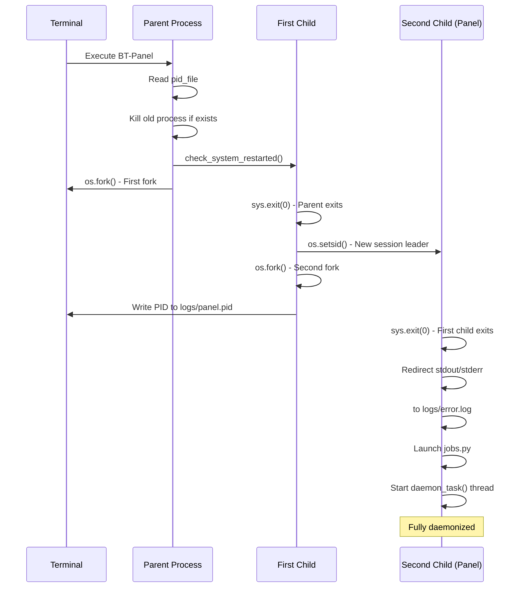

**Key Steps**:

1. **Kill existing process** [BT-Panel L231-L232](https://github.com/aaPanel/aaPanel/blob/b6e4ab8b/BT-Panel#L231-L232) : Reads PID from `logs/panel.pid` and kills any running panel process
2. **System reboot check** [BT-Panel L235](https://github.com/aaPanel/aaPanel/blob/b6e4ab8b/BT-Panel#L235-L235) : Calls `check_system_restarted()` to detect if system was rebooted
3. **First fork** [BT-Panel L237-L238](https://github.com/aaPanel/aaPanel/blob/b6e4ab8b/BT-Panel#L237-L238) : Parent process exits immediately, child continues
4. **New session** [BT-Panel L240](https://github.com/aaPanel/aaPanel/blob/b6e4ab8b/BT-Panel#L240-L240) : `os.setsid()` creates new session, detaching from controlling terminal
5. **Second fork** [BT-Panel L242-L245](https://github.com/aaPanel/aaPanel/blob/b6e4ab8b/BT-Panel#L242-L245) : Creates final daemon process, writes PID to file, first child exits
6. **Redirect streams** [BT-Panel L247-L248](https://github.com/aaPanel/aaPanel/blob/b6e4ab8b/BT-Panel#L247-L248) : Flushes stdout/stderr for clean separation

**Sources**: [BT-Panel L230-L248](https://github.com/aaPanel/aaPanel/blob/b6e4ab8b/BT-Panel#L230-L248)

---

## Configuration Loading

The server reads multiple configuration files during initialization to determine runtime behavior.

### Configuration Files

| File Path | Variable | Default Value | Purpose |
| --- | --- | --- | --- |
| `data/port.pl` | `PORT` | `7800` | TCP port number for server binding |
| `data/ipv6.pl` | `HOST` | `"0:0:0:0:0:0:0:0"` | IPv6 binding (when present) |
| `data/ssl.pl` | `is_ssl` | `False` | Enable SSL/TLS mode |
| `data/debug.pl` | `is_debug` | `False` | Enable debug mode with file watching |
| `data/is_process.pl` | `is_process` | `False` | Enable multi-process mode |
| `data/process_count.pl` | N/A | Calculated | Override worker process count |
| `ssl/privateKey.pem` | `keyfile` | N/A | SSL private key |
| `ssl/certificate.pem` | `certfile` | N/A | SSL certificate |

### Configuration Loading Flow

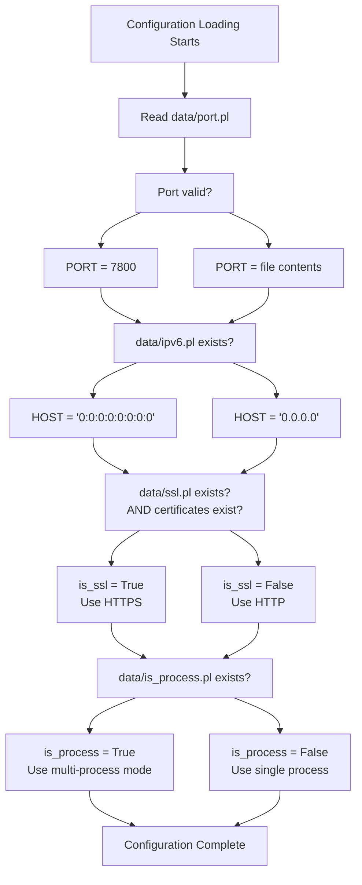

The configuration loading occurs at [BT-Panel L254-L268](https://github.com/aaPanel/aaPanel/blob/b6e4ab8b/BT-Panel#L254-L268)

 for initial settings and [BT-Panel L390](https://github.com/aaPanel/aaPanel/blob/b6e4ab8b/BT-Panel#L390-L390)

 for process mode detection.

**Sources**: [BT-Panel L254-L268](https://github.com/aaPanel/aaPanel/blob/b6e4ab8b/BT-Panel#L254-L268)

 [BT-Panel L390](https://github.com/aaPanel/aaPanel/blob/b6e4ab8b/BT-Panel#L390-L390)

---

## Network Binding Modes

BT-Panel supports two distinct network binding modes depending on deployment architecture.

### Binding Mode Selection

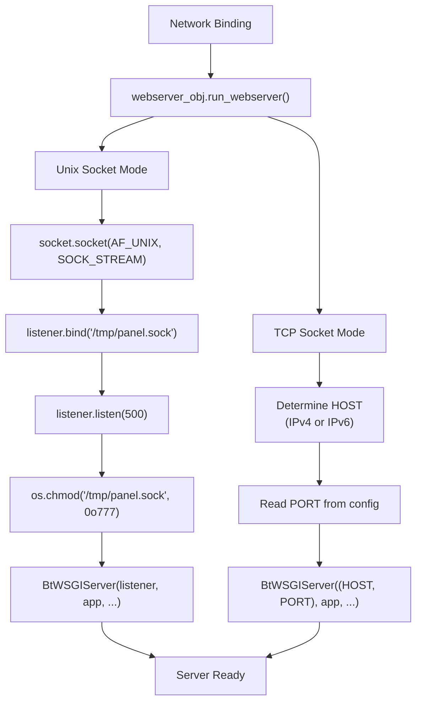

### Unix Socket Mode

Used when `webserver_obj.run_webserver()` returns `True` (typically when Nginx or another web server is configured as a frontend):

* **Socket path**: `/tmp/panel.sock`
* **Permissions**: `0o777` (world-readable/writable)
* **Backlog**: 500 connections
* **Protocol**: Unix domain socket (AF_UNIX)
* **Implementation**: [BT-Panel L332-L346](https://github.com/aaPanel/aaPanel/blob/b6e4ab8b/BT-Panel#L332-L346)

### TCP Socket Mode

Used for direct access without a frontend web server:

* **Host**: `0.0.0.0` (IPv4) or `0:0:0:0:0:0:0:0` (IPv6)
* **Port**: From `data/port.pl` (default: 7800)
* **Protocol**: TCP/IP
* **Implementation**: [BT-Panel L348-L380](https://github.com/aaPanel/aaPanel/blob/b6e4ab8b/BT-Panel#L348-L380)

**Sources**: [BT-Panel L328-L380](https://github.com/aaPanel/aaPanel/blob/b6e4ab8b/BT-Panel#L328-L380)

---

## SSL/TLS Configuration

When SSL/TLS is enabled via the `data/ssl.pl` file, BT-Panel configures comprehensive security settings.

### SSL Context Configuration

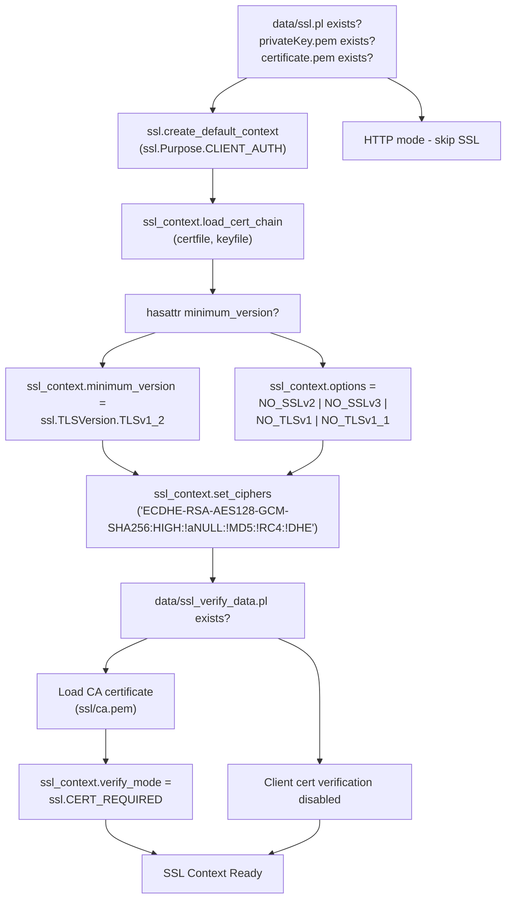

### SSL Configuration Table

| Setting | Value | Location |
| --- | --- | --- |
| **Minimum TLS Version** | TLSv1.2 | [BT-Panel L286](https://github.com/aaPanel/aaPanel/blob/b6e4ab8b/BT-Panel#L286-L286) <br>  or [BT-Panel L352](https://github.com/aaPanel/aaPanel/blob/b6e4ab8b/BT-Panel#L352-L352) |
| **Cipher Suite** | `ECDHE-RSA-AES128-GCM-SHA256:HIGH:!aNULL:!MD5:!RC4:!DHE` | [BT-Panel L290](https://github.com/aaPanel/aaPanel/blob/b6e4ab8b/BT-Panel#L290-L290) <br>  or [BT-Panel L356](https://github.com/aaPanel/aaPanel/blob/b6e4ab8b/BT-Panel#L356-L356) |
| **Private Key** | `ssl/privateKey.pem` | [BT-Panel L264](https://github.com/aaPanel/aaPanel/blob/b6e4ab8b/BT-Panel#L264-L264) |
| **Certificate** | `ssl/certificate.pem` | [BT-Panel L265](https://github.com/aaPanel/aaPanel/blob/b6e4ab8b/BT-Panel#L265-L265) |
| **CA Certificate** | `ssl/ca.pem` (optional) | [BT-Panel L294](https://github.com/aaPanel/aaPanel/blob/b6e4ab8b/BT-Panel#L294-L294) <br>  or [BT-Panel L360](https://github.com/aaPanel/aaPanel/blob/b6e4ab8b/BT-Panel#L360-L360) |
| **CRL File** | `ssl/crl.pem` (commented out) | [BT-Panel L293](https://github.com/aaPanel/aaPanel/blob/b6e4ab8b/BT-Panel#L293-L293) <br>  or [BT-Panel L359](https://github.com/aaPanel/aaPanel/blob/b6e4ab8b/BT-Panel#L359-L359) |

### Client Certificate Verification

When `data/ssl_verify_data.pl` exists, the server enables mutual TLS authentication:

1. **Load CA certificate** from `ssl/ca.pem`
2. **Set verify mode** to `ssl.CERT_REQUIRED`
3. **Validate client certificates** against the CA
4. **Reject** connections without valid certificates

Implementation at [BT-Panel L291-L301](https://github.com/aaPanel/aaPanel/blob/b6e4ab8b/BT-Panel#L291-L301)

 and [BT-Panel L357-L367](https://github.com/aaPanel/aaPanel/blob/b6e4ab8b/BT-Panel#L357-L367)

**Sources**: [BT-Panel L264-L290](https://github.com/aaPanel/aaPanel/blob/b6e4ab8b/BT-Panel#L264-L290)

 [BT-Panel L291-L301](https://github.com/aaPanel/aaPanel/blob/b6e4ab8b/BT-Panel#L291-L301)

 [BT-Panel L348-L367](https://github.com/aaPanel/aaPanel/blob/b6e4ab8b/BT-Panel#L348-L367)

---

## Daemon Task Monitor

The `daemon_task()` function runs in a background thread to monitor and restart the BT-Task process if it fails.

### Monitoring Architecture

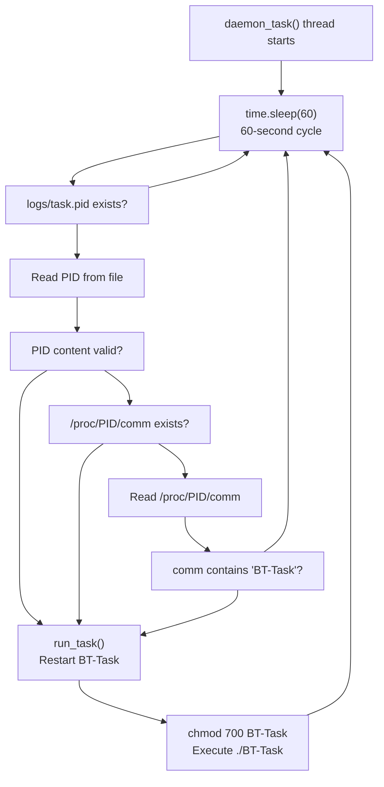

### Monitoring Logic

The `daemon_task()` function implements a continuous health check loop:

1. **Sleep interval**: 60 seconds between checks [BT-Panel L147](https://github.com/aaPanel/aaPanel/blob/b6e4ab8b/BT-Panel#L147-L147)
2. **PID file check**: Verifies `logs/task.pid` exists [BT-Panel L150-L151](https://github.com/aaPanel/aaPanel/blob/b6e4ab8b/BT-Panel#L150-L151)
3. **PID validation**: Ensures file contains valid PID [BT-Panel L154-L157](https://github.com/aaPanel/aaPanel/blob/b6e4ab8b/BT-Panel#L154-L157)
4. **Process verification**: Checks `/proc/[pid]/comm` exists [BT-Panel L160-L163](https://github.com/aaPanel/aaPanel/blob/b6e4ab8b/BT-Panel#L160-L163)
5. **Process name validation**: Confirms process is `BT-Task` [BT-Panel L166-L169](https://github.com/aaPanel/aaPanel/blob/b6e4ab8b/BT-Panel#L166-L169)
6. **Automatic restart**: Calls `run_task()` if any check fails [BT-Panel L139-L141](https://github.com/aaPanel/aaPanel/blob/b6e4ab8b/BT-Panel#L139-L141)

### Thread Initialization

The daemon thread is started during server initialization:

```markdown
# At line 279-280
task_thread = threading.Thread(target=daemon_task, daemon=True)
task_thread.start()
```

The `daemon=True` flag ensures the thread exits when the main process terminates.

**Sources**: [BT-Panel L139-L169](https://github.com/aaPanel/aaPanel/blob/b6e4ab8b/BT-Panel#L139-L169)

 [BT-Panel L279-L280](https://github.com/aaPanel/aaPanel/blob/b6e4ab8b/BT-Panel#L279-L280)

---

## Debug Mode and File Watching

When the `data/debug.pl` file exists, BT-Panel enables debug mode with automatic file watching and panel reload capabilities.

### Debug Mode Architecture

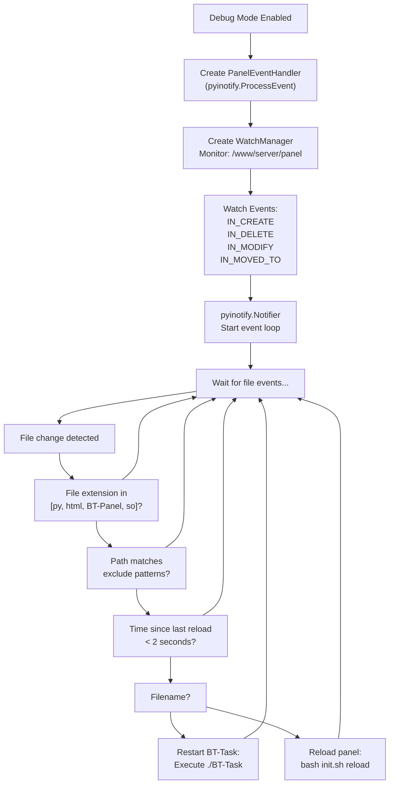

### File Watch Configuration

| Setting | Value | Purpose |
| --- | --- | --- |
| **Watched Extensions** | `py`, `html`, `BT-Panel`, `so` | File types that trigger reload |
| **Base Path** | `/www/server/panel` | Root directory to watch |
| **Recursive** | `True` | Watch all subdirectories |
| **Debounce Time** | 2 seconds | Prevent rapid reload cycles |

### Excluded Directories

The following patterns are excluded from file watching [BT-Panel L75-L82](https://github.com/aaPanel/aaPanel/blob/b6e4ab8b/BT-Panel#L75-L82)

:

* `plugin/*` - Plugin directories
* `tmp/*` and `temp/*` - Temporary files
* `pyenv/*` - Python virtual environment
* `class/projectModel/*` - Project models
* `class/databaseModel/*` - Database models
* `panel/data/mail/in_bulk/content/*` - Email content

### Event Handlers

The `PanelEventHandler` class [BT-Panel L73-L127](https://github.com/aaPanel/aaPanel/blob/b6e4ab8b/BT-Panel#L73-L127)

 implements four event handlers:

| Method | Event Type | Description |
| --- | --- | --- |
| `process_IN_CREATE` | File created | New file added to watched directory |
| `process_IN_DELETE` | File deleted | File removed from watched directory |
| `process_IN_MODIFY` | File modified | Existing file content changed |
| `process_IN_MOVED_TO` | File moved | File moved into watched directory |

All handlers call `panel_reload()` which determines whether to reload the panel or just restart BT-Task.

### Debug Thread Initialization

In debug mode, a separate thread runs the file watcher [BT-Panel L383-L388](https://github.com/aaPanel/aaPanel/blob/b6e4ab8b/BT-Panel#L383-L388)

:

```yaml
if is_debug:
    try:
        dev = threading.Thread(target=debug_event)
        dev.start()
    except:
        pass
```

**Sources**: [BT-Panel L68-L137](https://github.com/aaPanel/aaPanel/blob/b6e4ab8b/BT-Panel#L68-L137)

 [BT-Panel L383-L388](https://github.com/aaPanel/aaPanel/blob/b6e4ab8b/BT-Panel#L383-L388)

---

## Worker Process Management

When multi-process mode is enabled (`data/is_process.pl` exists), BT-Panel dynamically scales worker processes based on system load.

### Process Count Determination

The `get_process_count()` function [BT-Panel L171-L192](https://github.com/aaPanel/aaPanel/blob/b6e4ab8b/BT-Panel#L171-L192)

 calculates the optimal number of worker processes:

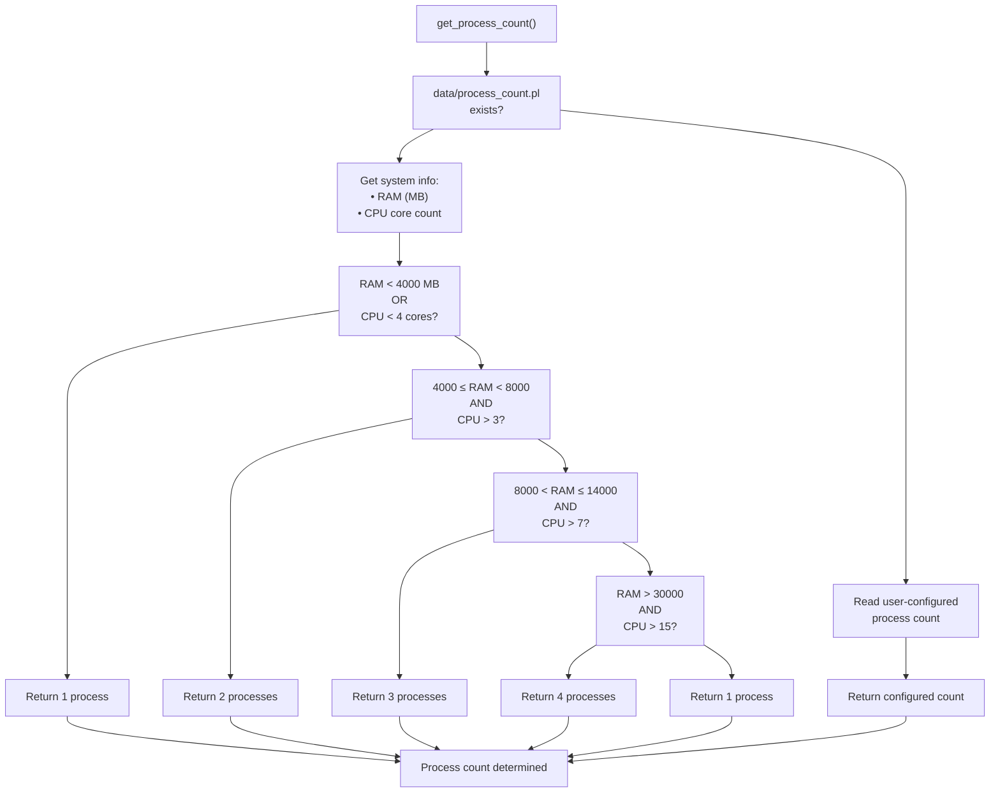

### Process Scaling Rules

| RAM (MB) | CPU Cores | Worker Processes |
| --- | --- | --- |
| < 4000 | Any | 1 |
| Any | < 4 | 1 |
| 4000-8000 | > 3 | 2 |
| > 14000 | > 7 | 3 |
| > 30000 | > 15 | 4 |

### Dynamic Scaling Algorithm

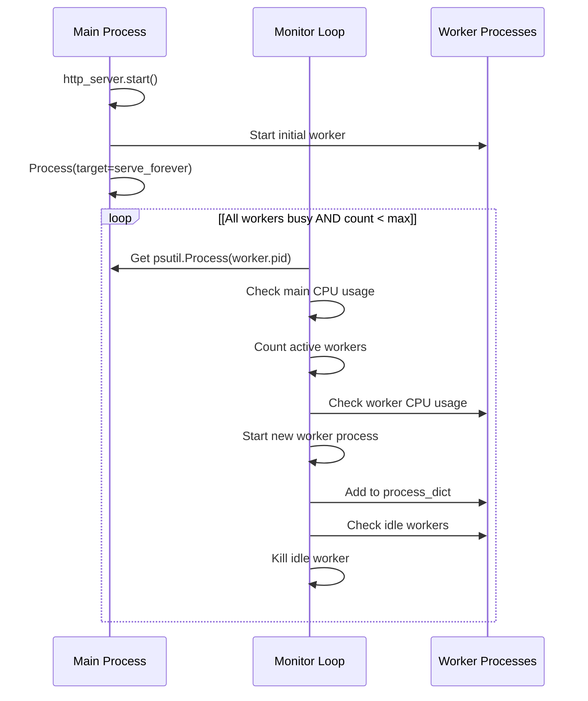

### Scaling Implementation Details

**Worker Spawn Criteria** [BT-Panel L422-L439](https://github.com/aaPanel/aaPanel/blob/b6e4ab8b/BT-Panel#L422-L439)

:

1. Main process CPU usage > 90%
2. All existing workers are active (CPU > 0%)
3. Current worker count < max process count
4. Spawns new worker immediately when conditions met

**Worker Termination Criteria** [BT-Panel L441-L447](https://github.com/aaPanel/aaPanel/blob/b6e4ab8b/BT-Panel#L441-L447)

:

1. Worker has been alive for at least 60 seconds
2. Worker CPU usage = 0% for continuous 5 seconds
3. Immediately terminated when both conditions met

**Process Dictionary Structure**:

```markdown
process_dict[pid] = [
    process_object,      # multiprocessing.Process instance
    creation_timestamp,  # time.time() when created
    psutil_object       # psutil.Process for CPU monitoring
]
```

### Multi-Process Server Loop

The main server loop [BT-Panel L398-L449](https://github.com/aaPanel/aaPanel/blob/b6e4ab8b/BT-Panel#L398-L449)

 continuously manages the worker pool:

1. **Initialize**: Start main worker process as daemon
2. **Monitor**: Check main process CPU every second
3. **Scale up**: Spawn workers when CPU > 90%
4. **Scale down**: Kill idle workers after 60s + 5s idle
5. **Repeat**: Continuous monitoring with 1-second interval

**Sources**: [BT-Panel L171-L192](https://github.com/aaPanel/aaPanel/blob/b6e4ab8b/BT-Panel#L171-L192)

 [BT-Panel L398-L449](https://github.com/aaPanel/aaPanel/blob/b6e4ab8b/BT-Panel#L398-L449)

---

## System Reboot Detection

The `check_system_restarted()` function [BT-Panel L195-L225](https://github.com/aaPanel/aaPanel/blob/b6e4ab8b/BT-Panel#L195-L225)

 tracks system reboots to notify administrators of unexpected restarts.

### Reboot Detection Logic

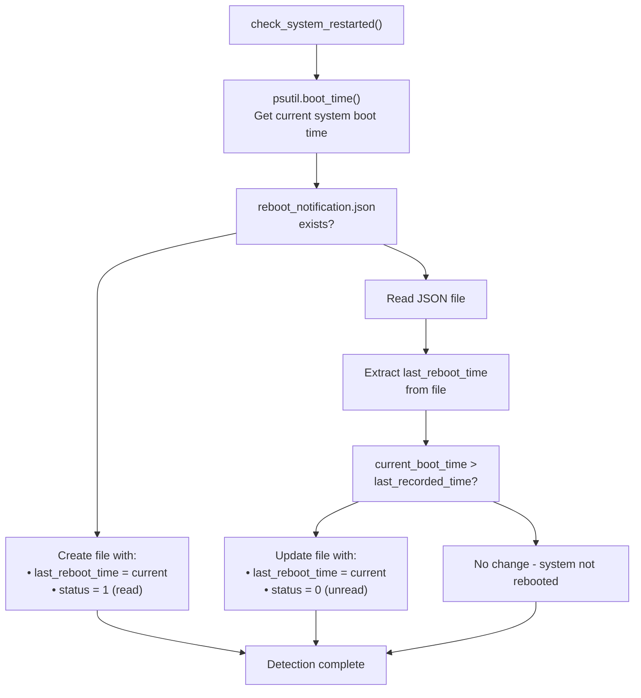

### Reboot Notification JSON Structure

```json
{
  "last_reboot_time": 1703001234,
  "status": 0
}
```

| Field | Type | Description |
| --- | --- | --- |
| `last_reboot_time` | integer | Unix timestamp of last recorded boot time |
| `status` | integer | `0` = unread notification, `1` = read/acknowledged |

### Detection Workflow

1. **Get boot time**: Use `psutil.boot_time()` to get current system boot timestamp
2. **Check history**: Read last recorded boot time from `data/reboot_notification.json`
3. **Compare times**: If current > recorded, system was rebooted
4. **Update status**: Set `status=0` to mark as unread notification
5. **Write file**: Persist current boot time for next check

This function is called early in the startup sequence [BT-Panel L235](https://github.com/aaPanel/aaPanel/blob/b6e4ab8b/BT-Panel#L235-L235)

 to detect if the server restart was due to a system reboot versus a manual panel restart.

**Sources**: [BT-Panel L195-L225](https://github.com/aaPanel/aaPanel/blob/b6e4ab8b/BT-Panel#L195-L225)

 [BT-Panel L235](https://github.com/aaPanel/aaPanel/blob/b6e4ab8b/BT-Panel#L235-L235)

---

## Plugin Loader Verification

The `check_plugin_loader()` function [BT-Panel L50-L65](https://github.com/aaPanel/aaPanel/blob/b6e4ab8b/BT-Panel#L50-L65)

 ensures the correct compiled plugin loader binary is present for the system architecture.

### Loader Selection Logic

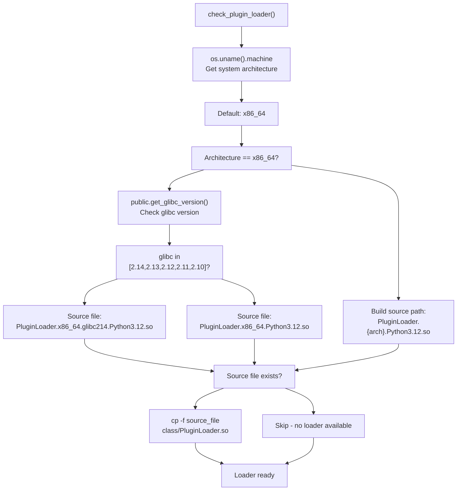

### Supported Architectures

The plugin loader has architecture-specific builds:

| Architecture | File Pattern | Notes |
| --- | --- | --- |
| x86_64 (glibc ≥ 2.15) | `PluginLoader.x86_64.Python3.12.so` | Modern systems |
| x86_64 (glibc ≤ 2.14) | `PluginLoader.x86_64.glibc214.Python3.12.so` | Older distributions |
| ARM64/AArch64 | `PluginLoader.aarch64.Python3.12.so` | ARM processors |
| Others | `PluginLoader.{machine}.Python3.12.so` | Architecture-specific builds |

### Target Location

All architecture-specific builds are copied to a single location:

* **Target**: `class/PluginLoader.so`
* **Source**: `class/PluginLoader.{arch}.{glibc}.Python3.12.so`
* **Command**: `\cp -f` (force overwrite without prompting)

This function runs immediately after the working directory is set [BT-Panel L65](https://github.com/aaPanel/aaPanel/blob/b6e4ab8b/BT-Panel#L65-L65)

 ensuring the correct loader is available before the Flask application imports any plugins.

**Sources**: [BT-Panel L50-L65](https://github.com/aaPanel/aaPanel/blob/b6e4ab8b/BT-Panel#L50-L65)

---

## Logging Configuration

The server configures structured logging based on debug mode and SSL status.

### Log Level Configuration

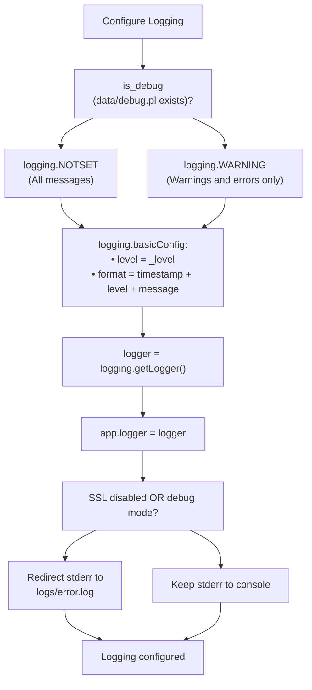

### Log Configuration Table

| Mode | Level | Output | Format |
| --- | --- | --- | --- |
| **Debug** | `NOTSET` (0) | `logs/error.log` | `[timestamp][level] - message` |
| **Production (HTTP)** | `WARNING` (30) | `logs/error.log` | `[timestamp][level] - message` |
| **Production (HTTPS)** | `WARNING` (30) | Console/systemd | `[timestamp][level] - message` |

### Error Stream Redirection

When running in HTTP mode or debug mode [BT-Panel L270-L276](https://github.com/aaPanel/aaPanel/blob/b6e4ab8b/BT-Panel#L270-L276)

:

1. Open `logs/error.log` in append mode
2. Duplicate file descriptor to `sys.stderr`
3. Close original file handle
4. All stderr output now goes to `error.log`

In HTTPS production mode, stderr remains attached to the console/systemd for easier debugging of SSL issues.

### Logger Assignment

The configured logger is assigned to the Flask app [BT-Panel L308](https://github.com/aaPanel/aaPanel/blob/b6e4ab8b/BT-Panel#L308-L308)

:

```
app.logger = logger
```

This ensures Flask uses the same logging configuration as the WSGI server.

**Sources**: [BT-Panel L270-L276](https://github.com/aaPanel/aaPanel/blob/b6e4ab8b/BT-Panel#L270-L276)

 [BT-Panel L304-L308](https://github.com/aaPanel/aaPanel/blob/b6e4ab8b/BT-Panel#L304-L308)

---

## WebSocket Handler Integration

BT-Panel integrates WebSocket support through either `flask_sock` or `geventwebsocket` depending on availability.

### WebSocket Handler Selection

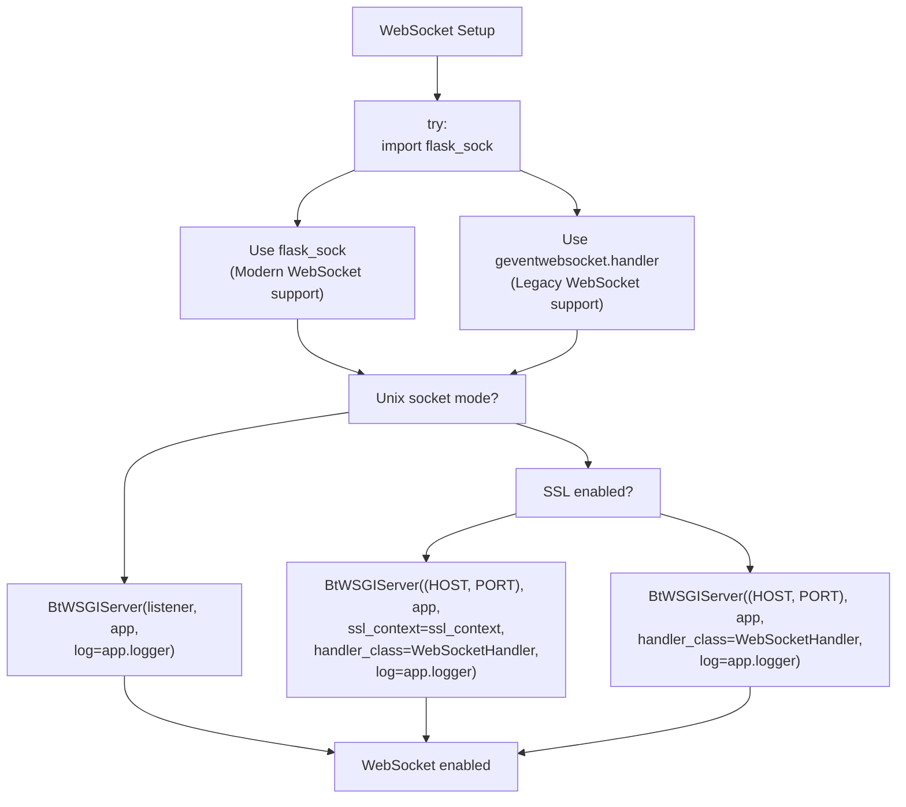

### Handler Implementation Matrix

| Condition | Library | Handler Class | Location |
| --- | --- | --- | --- |
| `flask_sock` available + Unix socket | `flask_sock` | None (built-in) | [BT-Panel L342-L343](https://github.com/aaPanel/aaPanel/blob/b6e4ab8b/BT-Panel#L342-L343) |
| `flask_sock` available + TCP | `flask_sock` | None (built-in) | [BT-Panel L372-L374](https://github.com/aaPanel/aaPanel/blob/b6e4ab8b/BT-Panel#L372-L374) |
| `flask_sock` unavailable + Unix socket | `geventwebsocket` | `WebSocketHandler` | [BT-Panel L345-L346](https://github.com/aaPanel/aaPanel/blob/b6e4ab8b/BT-Panel#L345-L346) |
| `flask_sock` unavailable + TCP | `geventwebsocket` | `WebSocketHandler` | [BT-Panel L376-L380](https://github.com/aaPanel/aaPanel/blob/b6e4ab8b/BT-Panel#L376-L380) |

### Import Fallback Pattern

The server attempts to use `flask_sock` first [BT-Panel L342-L370](https://github.com/aaPanel/aaPanel/blob/b6e4ab8b/BT-Panel#L342-L370)

:

```javascript
try:
    import flask_sock
    http_server = BtWSGIServer(listener, app, log=app.logger)
except:
    from geventwebsocket.handler import WebSocketHandler
    http_server = BtWSGIServer(listener, app, handler_class=WebSocketHandler, log=app.logger)
```

This provides compatibility with both modern Flask-Sock and legacy GeventWebSocket implementations.

For details on WebSocket endpoints and functionality, see [WebSocket Support](/aaPanel/aaPanel/6-websocket-support).

**Sources**: [BT-Panel L332-L380](https://github.com/aaPanel/aaPanel/blob/b6e4ab8b/BT-Panel#L332-L380)

---

## Server Start Methods

The server uses different start methods depending on process mode configuration.

### Start Method Selection

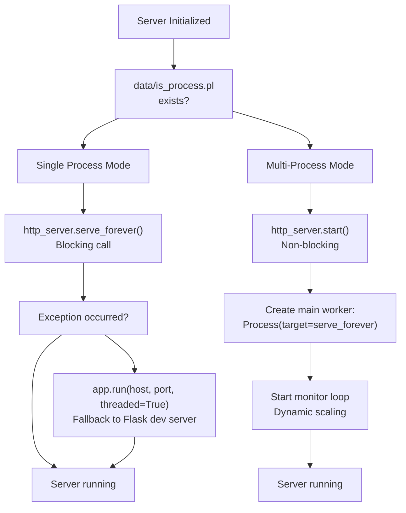

### Single Process Mode

Implementation [BT-Panel L391-L397](https://github.com/aaPanel/aaPanel/blob/b6e4ab8b/BT-Panel#L391-L397)

:

1. **Serve forever**: Call `http_server.serve_forever()` - blocks until error
2. **Exception handling**: Catch and log any exceptions
3. **Fallback**: Use Flask development server if WSGI server fails

This mode is simpler and suitable for low-traffic installations.

### Multi-Process Mode

Implementation [BT-Panel L399-L449](https://github.com/aaPanel/aaPanel/blob/b6e4ab8b/BT-Panel#L399-L449)

:

1. **Non-blocking start**: Call `http_server.start()` without blocking
2. **Create workers**: Spawn initial worker process with `serve_forever()` target
3. **Monitor loop**: Continuous monitoring and scaling (see Worker Process Management section)
4. **Dynamic scaling**: Add/remove workers based on load

The `serve_forever()` function [BT-Panel L403-L405](https://github.com/aaPanel/aaPanel/blob/b6e4ab8b/BT-Panel#L403-L405)

 for workers:

```python
def serve_forever():
    http_server.start_accepting()    # Begin accepting connections
    http_server._stop_event.wait()   # Block until stop event
```

### Process Mode Comparison

| Aspect | Single Process | Multi-Process |
| --- | --- | --- |
| **Configuration** | `is_process.pl` absent | `is_process.pl` present |
| **Worker Count** | 1 (main thread) | 2-4 (dynamic) |
| **Blocking** | Yes (`serve_forever`) | No (`start` + loop) |
| **Scaling** | None | Dynamic based on CPU |
| **Memory Usage** | Lower | Higher |
| **Concurrency** | Gevent greenlets only | Multiple processes + greenlets |
| **Suitable For** | < 4GB RAM, < 4 cores | ≥ 4GB RAM, ≥ 4 cores |

**Sources**: [BT-Panel L390-L449](https://github.com/aaPanel/aaPanel/blob/b6e4ab8b/BT-Panel#L390-L449)

---

## Startup Jobs Initialization

During the startup sequence, BT-Panel launches the `jobs.py` script to perform one-time initialization tasks.

### Jobs Launch Process

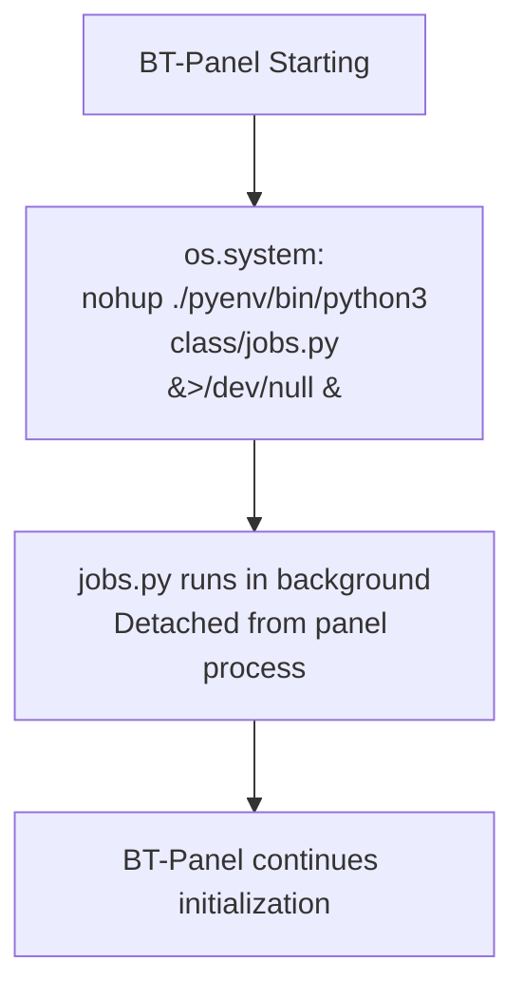

Implementation at [BT-Panel L251](https://github.com/aaPanel/aaPanel/blob/b6e4ab8b/BT-Panel#L251-L251)

:

```
os.system("nohup ./pyenv/bin/python3 class/jobs.py &>/dev/null &")
```

### Key Characteristics

| Property | Value | Purpose |
| --- | --- | --- |
| **Execution** | `nohup` | Prevents SIGHUP on terminal disconnect |
| **Output** | `&>/dev/null` | Suppresses stdout and stderr |
| **Background** | `&` | Non-blocking execution |
| **Python** | `./pyenv/bin/python3` | Uses panel's Python environment |
| **Timing** | After daemonization | Runs once per panel start |

The jobs system handles scheduled tasks and startup initialization. For detailed information about the jobs system, see [Background Task System (BT-Task)](/aaPanel/aaPanel/2.2-background-task-system-(bt-task)).

**Sources**: [BT-Panel L251](https://github.com/aaPanel/aaPanel/blob/b6e4ab8b/BT-Panel#L251-L251)

---

## Summary

The **BT-Panel** web server provides a robust, production-ready HTTP/HTTPS server with comprehensive features:

**Core Capabilities**:

* Gevent-based asynchronous I/O with monkey patching
* Daemonized process with double-fork pattern
* Flexible network binding (Unix socket or TCP)
* Comprehensive SSL/TLS configuration with client certificate support
* Dynamic worker process scaling (1-4 processes)
* Background daemon monitoring for BT-Task health
* Debug mode with automatic file watching and reload
* System reboot detection and notification

**Configuration-Driven**:
The server behavior is controlled through simple `.pl` configuration files, allowing runtime customization without code changes. Key settings include port numbers, IPv6 support, SSL enablement, process mode, and debug mode.

**Production Ready**:
Multi-layered error handling, graceful degradation, automatic restart mechanisms, and comprehensive logging make BT-Panel suitable for production deployments on servers ranging from small VPS instances to high-memory dedicated servers.

For information about the Flask application that runs within BT-Panel, see [Flask Application Core](/aaPanel/aaPanel/2.3-flask-application-core). For background task processing, see [Background Task System (BT-Task)](/aaPanel/aaPanel/2.2-background-task-system-(bt-task)).

**Sources**: [BT-Panel L1-L450](https://github.com/aaPanel/aaPanel/blob/b6e4ab8b/BT-Panel#L1-L450)