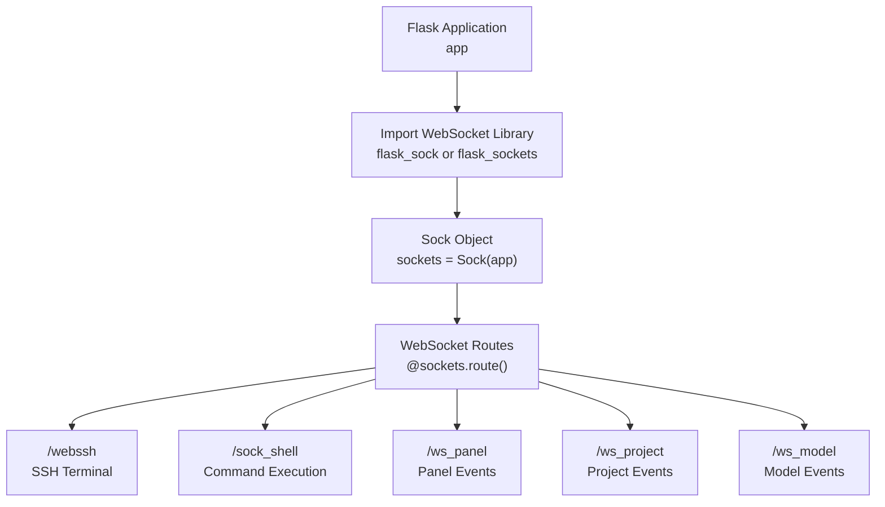
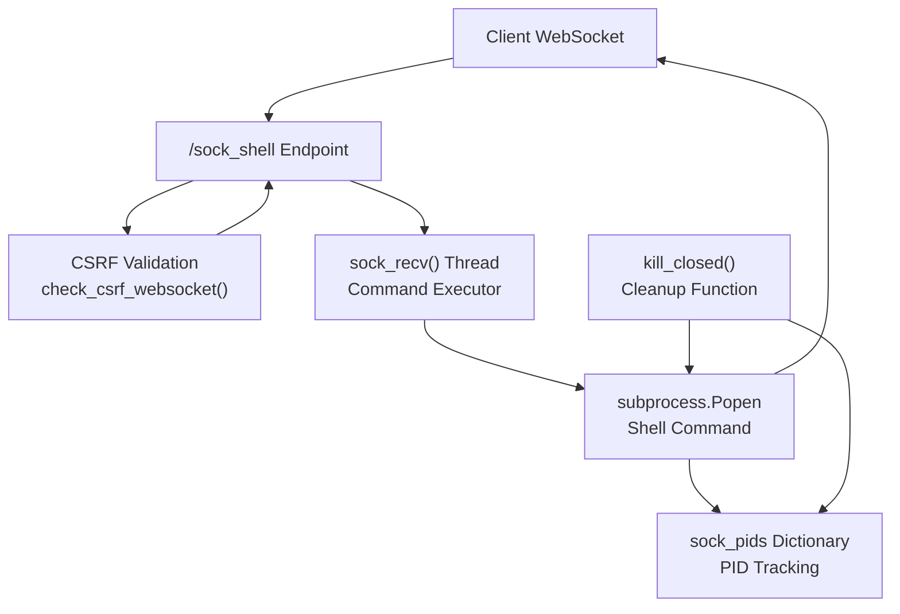
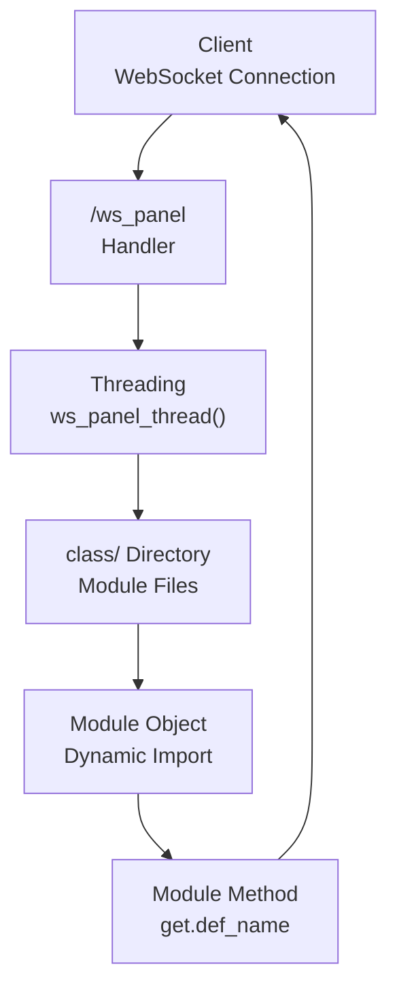
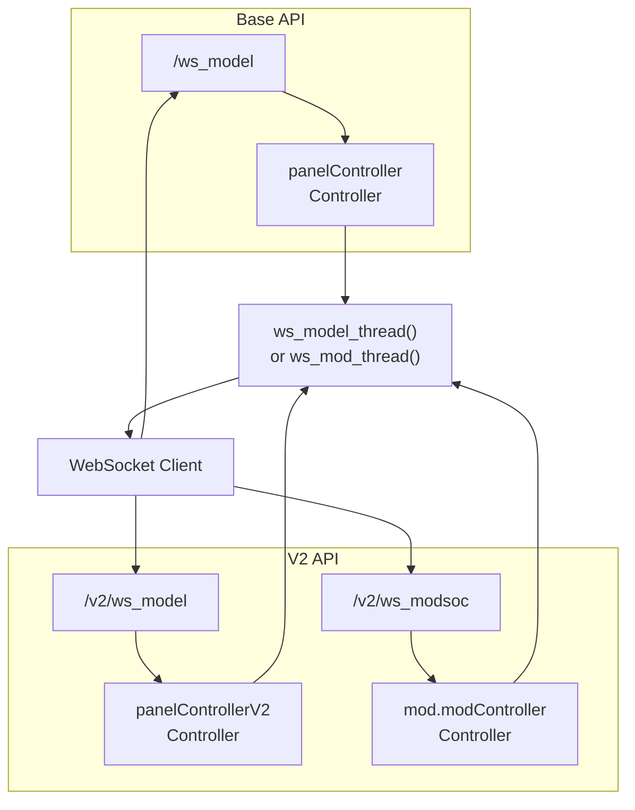
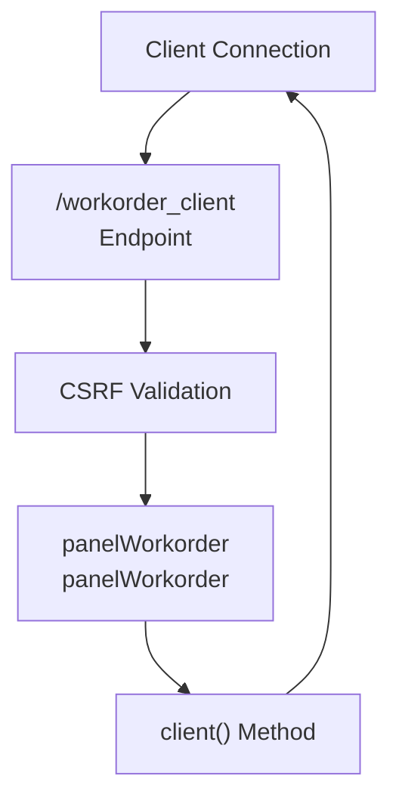
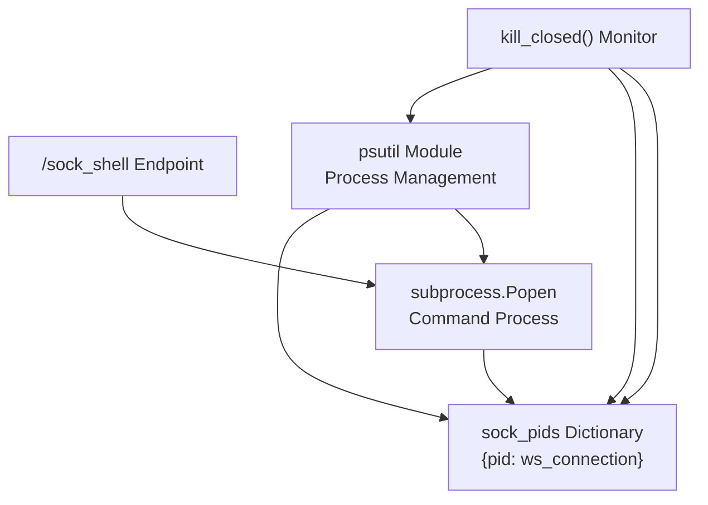
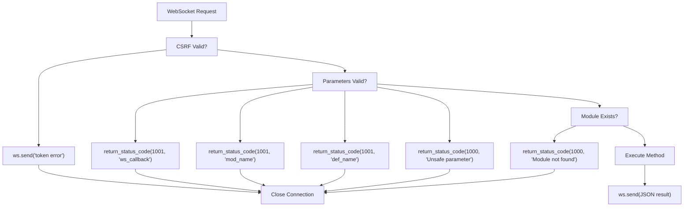

# WebSocket Support

> **Relevant source files**
> * [BTPanel/__init__.py](https://github.com/aaPanel/aaPanel/blob/b6e4ab8b/BTPanel/__init__.py)

aaPanel implements WebSocket support to provide real-time, bidirectional communication between the web interface and the server. This enables features like live terminal access, real-time panel updates, and streaming command execution output.

For information about the Flask application core and extension integration, see [Flask Application Core](/aaPanel/aaPanel/2.3-flask-application-core).

## Overview

The WebSocket implementation uses either `flask-sock` or `flask-sockets` (with automatic fallback) to provide full-duplex communication channels. WebSocket endpoints enable real-time features including SSH terminal access, live system monitoring, background task updates, and streaming command output.

**Supported WebSocket Endpoints:**

* `/webssh` - SSH terminal access
* `/sock_shell` - Real-time command execution
* `/ws_panel` - Panel event updates
* `/ws_project` - Project management events
* `/ws_model` - Model/Docker events
* `/workorder_client` - Workorder communication

Sources: [BTPanel/__init__.py L56-L60](https://github.com/aaPanel/aaPanel/blob/b6e4ab8b/BTPanel/__init__.py#L56-L60)

 [BTPanel/__init__.py L2870-L3303](https://github.com/aaPanel/aaPanel/blob/b6e4ab8b/BTPanel/__init__.py#L2870-L3303)

## WebSocket Initialization



**WebSocket Library Selection**

The system attempts to import `flask_sock` first, falling back to `flask_sockets` if unavailable. This provides compatibility across different deployment environments.

Sources: [BTPanel/__init__.py L55-L60](https://github.com/aaPanel/aaPanel/blob/b6e4ab8b/BTPanel/__init__.py#L55-L60)

## Terminal Access WebSockets

### SSH Terminal (/webssh)

The `/webssh` endpoint provides a fully-interactive SSH terminal session through WebSocket. It supports both local and remote host connections with configurable authentication methods.

```mermaid
sequenceDiagram
  participant Web Browser
  participant /webssh Endpoint
  participant CSRF Validation
  participant ssh_host_admin
  participant ssh_terminal
  participant SSH Server

  Web Browser->>/webssh Endpoint: Connect WebSocket
  /webssh Endpoint->>Web Browser: Request connection details
  Web Browser->>/webssh Endpoint: Send JSON with host info
  /webssh Endpoint->>CSRF Validation: {host, port, username, password/pkey}
  loop [CSRF Failed]
    CSRF Validation-->>Web Browser: check_csrf_websocket()
    CSRF Validation->>ssh_host_admin: "token error"
    ssh_host_admin->>ssh_terminal: Get or validate SSH info
    ssh_terminal->>SSH Server: Create ssh_terminal instance
    SSH Server-->>ssh_terminal: Establish SSH connection
    ssh_terminal->>Web Browser: Connection established
    Web Browser->>ssh_terminal: Terminal output stream
  end
```

**Connection Parameters:**

* `host` - Target hostname or IP address (defaults to 127.0.0.1 for local)
* `port` - SSH port (defaults to system SSH port)
* `username` - SSH username
* `password` - SSH password (optional if using key)
* `pkey` - Private key for authentication (optional)

**Special Handling for Localhost:**
When connecting to `127.0.0.1` or `localhost`, the endpoint retrieves saved SSH credentials from `ssh_host_admin` if credentials are not provided.

Sources: [BTPanel/__init__.py L3246-L3301](https://github.com/aaPanel/aaPanel/blob/b6e4ab8b/BTPanel/__init__.py#L3246-L3301)

### Command Execution Shell (/sock_shell)

The `/sock_shell` endpoint executes shell commands and streams output in real-time. Multiple concurrent command executions are supported with process tracking.



**Process Management:**

The system maintains a global `sock_pids` dictionary that maps subprocess PIDs to WebSocket connections. The `kill_closed()` function periodically cleans up processes associated with closed connections.

| Component | Purpose | Location |
| --- | --- | --- |
| `sock_pids` | Global PID to WebSocket mapping | Line 3099 |
| `sock_recv()` | Execute command and stream output | Lines 3168-3190 |
| `kill_closed()` | Cleanup orphaned processes | Lines 3135-3166 |
| `close_sock_shell` | HTTP endpoint to terminate command | Lines 3192-3219 |

Sources: [BTPanel/__init__.py L3099-L3190](https://github.com/aaPanel/aaPanel/blob/b6e4ab8b/BTPanel/__init__.py#L3099-L3190)

 [BTPanel/__init__.py L3192-L3219](https://github.com/aaPanel/aaPanel/blob/b6e4ab8b/BTPanel/__init__.py#L3192-L3219)

## Panel and Project WebSockets

### Panel Events (/ws_panel)

The `/ws_panel` endpoint provides a generic interface for invoking panel management methods with real-time responses. Requests are processed in separate threads to handle multiple concurrent operations.



**Request Structure:**

Each WebSocket message must include:

* `ws_callback` - Client-side callback identifier
* `mod_name` - Target module name (e.g., "files", "database")
* `def_name` - Target method name within the module
* Additional parameters specific to the method

**Response Structure:**

```

```

**Module Validation:**

The system validates that `mod_name` is not in the blacklist of protected modules: `['public', 'common', 'db', 'db_mysql', 'downloadFile', 'jobs']`

Sources: [BTPanel/__init__.py L2890-L2984](https://github.com/aaPanel/aaPanel/blob/b6e4ab8b/BTPanel/__init__.py#L2890-L2984)

### Project Events (/ws_project)

The `/ws_project` endpoint handles project-related operations, particularly for project management features.

```mermaid
sequenceDiagram
  participant Client
  participant /ws_project
  participant CSRF Validation
  participant ProjectController
  participant ws_project_thread()

  Client->>/ws_project: Connect WebSocket
  /ws_project->>Client: Request initial CSRF token
  Client->>/ws_project: Send CSRF token JSON
  /ws_project->>CSRF Validation: check_csrf_websocket()
  loop [For each operation]
    Client->>/ws_project: Send operation JSON
    /ws_project->>ws_project_thread(): {ws_callback, parameters}
    ws_project_thread()->>ProjectController: Start new thread
    ProjectController-->>ws_project_thread(): controller.model(get)
    ws_project_thread()->>Client: Result
  end
```

**Thread Processing:**

Each incoming message is processed in a separate thread via `ws_project_thread()` to prevent blocking. The thread instantiates `ProjectController` and invokes its `model()` method with the request parameters.

Sources: [BTPanel/__init__.py L2986-L3095](https://github.com/aaPanel/aaPanel/blob/b6e4ab8b/BTPanel/__init__.py#L2986-L3095)

### Model Updates (/ws_model)

The `/ws_model` endpoint provides WebSocket access to the Docker and model controller functionality. Both base and V2 versions are available.

**Endpoints:**

* `/ws_model` - Base version, uses `panelController.Controller`
* `/v2/ws_model` - V2 version, uses `panelControllerV2.Controller`
* `/v2/ws_modsoc` - New scene model controller, uses `mod.modController.Controller`



**Request Parameters:**

* `model_index` - Model index identifier (e.g., "btDocker")
* `mod_name` - Module name within the model
* `def_name` - Method name to execute
* `ws_callback` - Client callback identifier

Sources: [BTPanel/__init__.py L3012-L3078](https://github.com/aaPanel/aaPanel/blob/b6e4ab8b/BTPanel/__init__.py#L3012-L3078)

 [BTPanel/__init__.py L3420-L3499](https://github.com/aaPanel/aaPanel/blob/b6e4ab8b/BTPanel/__init__.py#L3420-L3499)

## Workorder Client WebSocket

The `/workorder_client` endpoint handles workorder communication functionality, enabling real-time support ticket interactions.



Sources: [BTPanel/__init__.py L2873-L2887](https://github.com/aaPanel/aaPanel/blob/b6e4ab8b/BTPanel/__init__.py#L2873-L2887)

## Security and CSRF Protection

All WebSocket endpoints implement CSRF protection through the `check_csrf_websocket()` function. This validation occurs immediately after connection establishment.

### CSRF Validation Flow

```mermaid
sequenceDiagram
  participant WebSocket Endpoint
  participant check_csrf_websocket()
  participant Session Token
  participant Request Token

  WebSocket Endpoint->>check_csrf_websocket(): Pass ws and args
  check_csrf_websocket()->>check_csrf_websocket(): Check g.is_aes
  check_csrf_websocket()->>check_csrf_websocket(): Check g.api_request
  check_csrf_websocket()->>check_csrf_websocket(): Check debug mode
  loop [Tokens Match]
    check_csrf_websocket()-->>WebSocket Endpoint: Return True (bypass)
    check_csrf_websocket()->>Request Token: Get 'x-http-token' from args
    check_csrf_websocket()->>WebSocket Endpoint: ws.send('token error')
    check_csrf_websocket()-->>WebSocket Endpoint: Return False
    check_csrf_websocket()->>Session Token: get_csrf_sess_html_token_value()
    check_csrf_websocket()->>check_csrf_websocket(): Compare tokens
    check_csrf_websocket()-->>WebSocket Endpoint: Return True
    check_csrf_websocket()->>WebSocket Endpoint: ws.send('token error')
    check_csrf_websocket()-->>WebSocket Endpoint: Return False
  end
```

**CSRF Token Validation:**

The first WebSocket message must be a JSON object containing the `x-http-token` field with a valid CSRF token. The token is validated against the session token using `public.get_csrf_sess_html_token_value()`.

**Bypass Conditions:**

* `g.is_aes` is True (AES encrypted API requests)
* `g.api_request` is True (API authentication mode)
* `public.is_debug()` returns True (debug mode enabled)

Sources: [BTPanel/__init__.py L3221-L3243](https://github.com/aaPanel/aaPanel/blob/b6e4ab8b/BTPanel/__init__.py#L3221-L3243)

## WebSocket Connection Lifecycle

### Standard Connection Pattern

```css
#mermaid-23u667wcelm{font-family:ui-sans-serif,-apple-system,system-ui,Segoe UI,Helvetica;font-size:16px;fill:#333;}@keyframes edge-animation-frame{from{stroke-dashoffset:0;}}@keyframes dash{to{stroke-dashoffset:0;}}#mermaid-23u667wcelm .edge-animation-slow{stroke-dasharray:9,5!important;stroke-dashoffset:900;animation:dash 50s linear infinite;stroke-linecap:round;}#mermaid-23u667wcelm .edge-animation-fast{stroke-dasharray:9,5!important;stroke-dashoffset:900;animation:dash 20s linear infinite;stroke-linecap:round;}#mermaid-23u667wcelm .error-icon{fill:#dddddd;}#mermaid-23u667wcelm .error-text{fill:#222222;stroke:#222222;}#mermaid-23u667wcelm .edge-thickness-normal{stroke-width:1px;}#mermaid-23u667wcelm .edge-thickness-thick{stroke-width:3.5px;}#mermaid-23u667wcelm .edge-pattern-solid{stroke-dasharray:0;}#mermaid-23u667wcelm .edge-thickness-invisible{stroke-width:0;fill:none;}#mermaid-23u667wcelm .edge-pattern-dashed{stroke-dasharray:3;}#mermaid-23u667wcelm .edge-pattern-dotted{stroke-dasharray:2;}#mermaid-23u667wcelm .marker{fill:#999;stroke:#999;}#mermaid-23u667wcelm .marker.cross{stroke:#999;}#mermaid-23u667wcelm svg{font-family:ui-sans-serif,-apple-system,system-ui,Segoe UI,Helvetica;font-size:16px;}#mermaid-23u667wcelm p{margin:0;}#mermaid-23u667wcelm defs #statediagram-barbEnd{fill:#999;stroke:#999;}#mermaid-23u667wcelm g.stateGroup text{fill:#dddddd;stroke:none;font-size:10px;}#mermaid-23u667wcelm g.stateGroup text{fill:#333;stroke:none;font-size:10px;}#mermaid-23u667wcelm g.stateGroup .state-title{font-weight:bolder;fill:#333;}#mermaid-23u667wcelm g.stateGroup rect{fill:#ffffff;stroke:#dddddd;}#mermaid-23u667wcelm g.stateGroup line{stroke:#999;stroke-width:1;}#mermaid-23u667wcelm .transition{stroke:#999;stroke-width:1;fill:none;}#mermaid-23u667wcelm .stateGroup .composit{fill:#f4f4f4;border-bottom:1px;}#mermaid-23u667wcelm .stateGroup .alt-composit{fill:#e0e0e0;border-bottom:1px;}#mermaid-23u667wcelm .state-note{stroke:#e6d280;fill:#fff5ad;}#mermaid-23u667wcelm .state-note text{fill:#333;stroke:none;font-size:10px;}#mermaid-23u667wcelm .stateLabel .box{stroke:none;stroke-width:0;fill:#ffffff;opacity:0.5;}#mermaid-23u667wcelm .edgeLabel .label rect{fill:#ffffff;opacity:0.5;}#mermaid-23u667wcelm .edgeLabel{background-color:#ffffff;text-align:center;}#mermaid-23u667wcelm .edgeLabel p{background-color:#ffffff;}#mermaid-23u667wcelm .edgeLabel rect{opacity:0.5;background-color:#ffffff;fill:#ffffff;}#mermaid-23u667wcelm .edgeLabel .label text{fill:#333;}#mermaid-23u667wcelm .label div .edgeLabel{color:#333;}#mermaid-23u667wcelm .stateLabel text{fill:#333;font-size:10px;font-weight:bold;}#mermaid-23u667wcelm .node circle.state-start{fill:#999;stroke:#999;}#mermaid-23u667wcelm .node .fork-join{fill:#999;stroke:#999;}#mermaid-23u667wcelm .node circle.state-end{fill:#dddddd;stroke:#f4f4f4;stroke-width:1.5;}#mermaid-23u667wcelm .end-state-inner{fill:#f4f4f4;stroke-width:1.5;}#mermaid-23u667wcelm .node rect{fill:#ffffff;stroke:#dddddd;stroke-width:1px;}#mermaid-23u667wcelm .node polygon{fill:#ffffff;stroke:#dddddd;stroke-width:1px;}#mermaid-23u667wcelm #statediagram-barbEnd{fill:#999;}#mermaid-23u667wcelm .statediagram-cluster rect{fill:#ffffff;stroke:#dddddd;stroke-width:1px;}#mermaid-23u667wcelm .cluster-label,#mermaid-23u667wcelm .nodeLabel{color:#333;}#mermaid-23u667wcelm .statediagram-cluster rect.outer{rx:5px;ry:5px;}#mermaid-23u667wcelm .statediagram-state .divider{stroke:#dddddd;}#mermaid-23u667wcelm .statediagram-state .title-state{rx:5px;ry:5px;}#mermaid-23u667wcelm .statediagram-cluster.statediagram-cluster .inner{fill:#f4f4f4;}#mermaid-23u667wcelm .statediagram-cluster.statediagram-cluster-alt .inner{fill:#f8f8f8;}#mermaid-23u667wcelm .statediagram-cluster .inner{rx:0;ry:0;}#mermaid-23u667wcelm .statediagram-state rect.basic{rx:5px;ry:5px;}#mermaid-23u667wcelm .statediagram-state rect.divider{stroke-dasharray:10,10;fill:#f8f8f8;}#mermaid-23u667wcelm .note-edge{stroke-dasharray:5;}#mermaid-23u667wcelm .statediagram-note rect{fill:#fff5ad;stroke:#e6d280;stroke-width:1px;rx:0;ry:0;}#mermaid-23u667wcelm .statediagram-note rect{fill:#fff5ad;stroke:#e6d280;stroke-width:1px;rx:0;ry:0;}#mermaid-23u667wcelm .statediagram-note text{fill:#333;}#mermaid-23u667wcelm .statediagram-note .nodeLabel{color:#333;}#mermaid-23u667wcelm .statediagram .edgeLabel{color:red;}#mermaid-23u667wcelm #dependencyStart,#mermaid-23u667wcelm #dependencyEnd{fill:#999;stroke:#999;stroke-width:1;}#mermaid-23u667wcelm .statediagramTitleText{text-anchor:middle;font-size:18px;fill:#333;}#mermaid-23u667wcelm :root{--mermaid-font-family:"trebuchet ms",verdana,arial,sans-serif;}Client Opens WebSocketSend Initial JSON with TokenToken ValidToken InvalidSend Operation MessagesReceive ResultsClient DisconnectsSend "{}" or "error" or "stop"Connection ClosedConnection ClosedConnectedCSRFCheckAuthenticatedTerminatedProcessingCleanup
```

**Connection States:**

| State | Description | Transition |
| --- | --- | --- |
| Connected | WebSocket established | Awaiting CSRF token |
| CSRFCheck | Validating authentication | Success → AuthenticatedFailure → Terminated |
| Authenticated | Ready for operations | Accepts operation messages |
| Processing | Executing operation | Returns to Authenticated |
| Cleanup | Closing resources | Kills subprocesses, closes connections |
| Terminated | Connection closed | End state |

### Termination Signals

WebSocket endpoints recognize several termination signals:

* Empty object: `"{}"`
* Error string: `"error"`
* Stop command: `"stop"`
* Client disconnect
* Empty/None message

Sources: [BTPanel/__init__.py L2905-L2913](https://github.com/aaPanel/aaPanel/blob/b6e4ab8b/BTPanel/__init__.py#L2905-L2913)

 [BTPanel/__init__.py L3002-L3009](https://github.com/aaPanel/aaPanel/blob/b6e4ab8b/BTPanel/__init__.py#L3002-L3009)

 [BTPanel/__init__.py L3123-L3133](https://github.com/aaPanel/aaPanel/blob/b6e4ab8b/BTPanel/__init__.py#L3123-L3133)

## V2 API WebSocket Enhancements

The V2 API provides enhanced WebSocket endpoints with improved error handling and response formatting.

### V2 Model Controller (/v2/ws_model)

Identical to the base `/ws_model` but uses `panelControllerV2.Controller` for improved functionality and consistency with V2 API patterns.

### New Scene Model Controller (/v2/ws_modsoc)

The `/v2/ws_modsoc` endpoint provides WebSocket access to the new modular controller architecture without default return values.

**Key Differences:**

* Uses `mod.modController.Controller` instead of panel controller
* Model index is hardcoded to `"mod"`
* Employs `ws_mod_thread()` which checks for None results
* Optimized for scenario-based modular operations

Sources: [BTPanel/__init__.py L3458-L3499](https://github.com/aaPanel/aaPanel/blob/b6e4ab8b/BTPanel/__init__.py#L3458-L3499)

## Implementation Examples

### Client-Side WebSocket Connection

**Establishing SSH Terminal Connection:**

```

```

**Executing Command via sock_shell:**

```

```

**Panel Method Invocation:**

```

```

Sources: [BTPanel/__init__.py L3102-L3133](https://github.com/aaPanel/aaPanel/blob/b6e4ab8b/BTPanel/__init__.py#L3102-L3133)

 [BTPanel/__init__.py L2890-L2913](https://github.com/aaPanel/aaPanel/blob/b6e4ab8b/BTPanel/__init__.py#L2890-L2913)

## Process Management and Cleanup

### Subprocess Tracking

The `sock_pids` global dictionary tracks all subprocess PIDs spawned by `/sock_shell` connections. This enables proper cleanup when WebSocket connections close.



**Cleanup Algorithm:**

1. Iterate over all PIDs in `sock_pids`
2. Check if WebSocket connection is closed (`ws.closed` or `not ws.connected`)
3. If closed and PID still exists: * Get process via `psutil.Process(pid)` * Kill all child processes * Kill parent process * Remove from `sock_pids` dictionary
4. If PID no longer exists in system, remove from dictionary

Sources: [BTPanel/__init__.py L3135-L3166](https://github.com/aaPanel/aaPanel/blob/b6e4ab8b/BTPanel/__init__.py#L3135-L3166)

 [BTPanel/__init__.py L3099](https://github.com/aaPanel/aaPanel/blob/b6e4ab8b/BTPanel/__init__.py#L3099-L3099)

## Error Handling

### WebSocket Error Responses



**Standard Error Codes:**

| Code | Message | Cause |
| --- | --- | --- |
| 1000 | General error | Invalid module, unsafe parameters, file not found |
| 1001 | Missing parameter | Required parameter not provided in request |

**Error Response Format:**

```

```

Sources: [BTPanel/__init__.py L2923-L2934](https://github.com/aaPanel/aaPanel/blob/b6e4ab8b/BTPanel/__init__.py#L2923-L2934)

 [BTPanel/__init__.py L3032-L3044](https://github.com/aaPanel/aaPanel/blob/b6e4ab8b/BTPanel/__init__.py#L3032-L3044)

## Threading Model

All WebSocket message handlers use threading to process requests concurrently without blocking other connections.

### Thread Functions

| Function | Purpose | Target WebSocket |
| --- | --- | --- |
| `ws_panel_thread()` | Panel method execution | `/ws_panel` |
| `ws_project_thread()` | Project operations | `/ws_project` |
| `ws_model_thread()` | Model controller operations | `/ws_model`, `/v2/ws_model` |
| `ws_mod_thread()` | Modular controller operations | `/v2/ws_modsoc` |
| `sock_recv()` | Command execution streaming | `/sock_shell` |

**Thread Creation Pattern:**

```

```

Each thread receives the request parameters and executes independently, sending results back through the WebSocket connection when complete.

Sources: [BTPanel/__init__.py L2911](https://github.com/aaPanel/aaPanel/blob/b6e4ab8b/BTPanel/__init__.py#L2911-L2911)

 [BTPanel/__init__.py L3007](https://github.com/aaPanel/aaPanel/blob/b6e4ab8b/BTPanel/__init__.py#L3007-L3007)

 [BTPanel/__init__.py L3044](https://github.com/aaPanel/aaPanel/blob/b6e4ab8b/BTPanel/__init__.py#L3044-L3044)

 [BTPanel/__init__.py L3128](https://github.com/aaPanel/aaPanel/blob/b6e4ab8b/BTPanel/__init__.py#L3128-L3128)