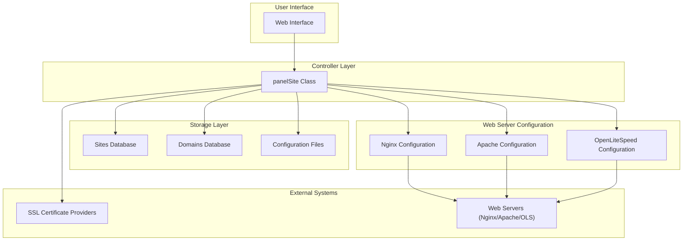
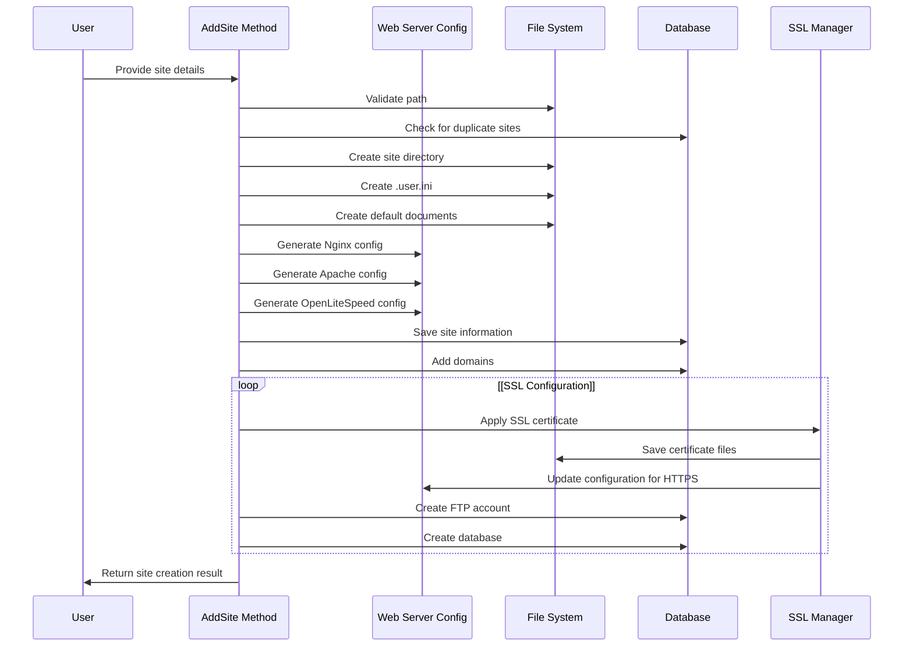
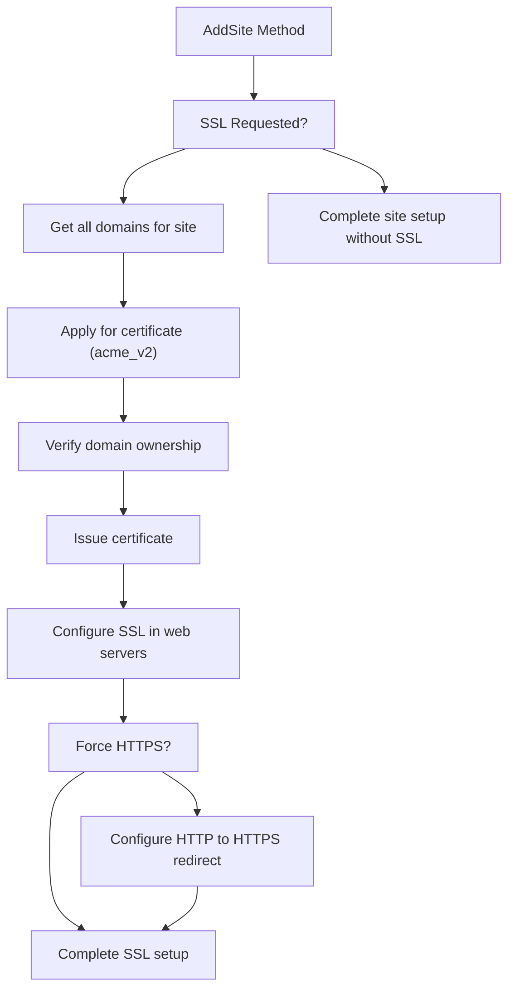
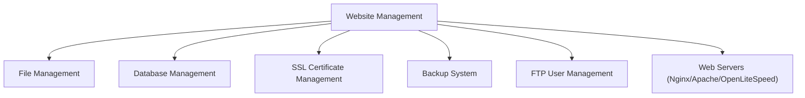

# Website Management

> **Relevant source files**
> * [BTPanel/__init__.py](https://github.com/aaPanel/aaPanel/blob/b6e4ab8b/BTPanel/__init__.py)

This page documents the website management functionality in aaPanel, which provides a comprehensive set of tools for creating, configuring, and managing websites on your server. Website management is one of the core features of aaPanel, allowing administrators to seamlessly deploy and maintain web applications with support for multiple web servers.

For information about file management within websites, see [File Management](/aaPanel/aaPanel/4-module-system-and-routing). For database configuration related to websites, see [Database Management](/aaPanel/aaPanel/5-feature-modules).

## Overview

The website management system provides the following key capabilities:

* Website creation, deletion, and configuration
* Domain management including primary domains and subdomains
* Web server configuration (Nginx, Apache, OpenLiteSpeed)
* SSL certificate management
* Website redirects and rewrites
* Batch operations for multiple websites

Sources: [class/panelSite.py L1-L76](https://github.com/aaPanel/aaPanel/blob/b6e4ab8b/class/panelSite.py#L1-L76)

## Website Architecture

The diagram below illustrates the architecture of the website management system in aaPanel:



Sources: [class/panelSite.py L30-L62](https://github.com/aaPanel/aaPanel/blob/b6e4ab8b/class/panelSite.py#L30-L62)

 [class/panelSite.py L184-L270](https://github.com/aaPanel/aaPanel/blob/b6e4ab8b/class/panelSite.py#L184-L270)

 [class/panelSite.py L121-L183](https://github.com/aaPanel/aaPanel/blob/b6e4ab8b/class/panelSite.py#L121-L183)

 [class/panelSite.py L280-L411](https://github.com/aaPanel/aaPanel/blob/b6e4ab8b/class/panelSite.py#L280-L411)

## Website Lifecycle Management

### Website Creation Process

The diagram below shows the website creation process:



When creating a website, aaPanel performs the following steps:

1. Validates the site parameters (domain, path, PHP version)
2. Creates the site directory structure
3. Creates default website files (index.html, 404.html, 502.html)
4. Generates web server configurations
5. Creates database and FTP accounts if requested
6. Applies SSL certificates if requested

The `AddSite` method is the main entry point for website creation and handles all these steps.

Sources: [class/panelSite.py L510-L716](https://github.com/aaPanel/aaPanel/blob/b6e4ab8b/class/panelSite.py#L510-L716)

### Website Configuration Files

aaPanel creates the following configuration files for each website:

| Web Server | Configuration Path | Purpose |
| --- | --- | --- |
| Nginx | `/www/server/panel/vhost/nginx/[siteName].conf` | Main site configuration |
| Nginx | `/www/server/panel/vhost/rewrite/[siteName].conf` | URL rewrite rules |
| Nginx | `/www/server/panel/vhost/open_basedir/nginx/[siteName].conf` | PHP open_basedir restrictions |
| Apache | `/www/server/panel/vhost/apache/[siteName].conf` | Main site configuration |
| OpenLiteSpeed | `/www/server/panel/vhost/openlitespeed/[siteName].conf` | Virtual host definition |
| OpenLiteSpeed | `/www/server/panel/vhost/openlitespeed/detail/[siteName].conf` | Detailed configuration |

Sources: [class/panelSite.py L260-L262](https://github.com/aaPanel/aaPanel/blob/b6e4ab8b/class/panelSite.py#L260-L262)

 [class/panelSite.py L179-L181](https://github.com/aaPanel/aaPanel/blob/b6e4ab8b/class/panelSite.py#L179-L181)

 [class/panelSite.py L396-L404](https://github.com/aaPanel/aaPanel/blob/b6e4ab8b/class/panelSite.py#L396-L404)

### Default Website Configuration Templates

aaPanel provides default configuration templates for new websites:

#### Nginx Default Configuration

The Nginx configuration template includes settings for:

* Server name and listen directives
* Document root path
* Index files
* PHP handling
* URL rewrite rules
* Static file caching
* Error pages
* Security rules (blocking access to sensitive files)

Sources: [class/panelSite.py L184-L257](https://github.com/aaPanel/aaPanel/blob/b6e4ab8b/class/panelSite.py#L184-L257)

 [vhost/nginx/0.default.conf L1-L7](https://github.com/aaPanel/aaPanel/blob/b6e4ab8b/vhost/nginx/0.default.conf#L1-L7)

#### Apache Default Configuration

The Apache configuration template includes:

* Virtual host definition
* Document root
* Directory permissions
* Error logs
* Custom logs
* Directory index
* Security rules

Sources: [class/panelSite.py L121-L181](https://github.com/aaPanel/aaPanel/blob/b6e4ab8b/class/panelSite.py#L121-L181)

 [vhost/apache/0.default.conf L1-L13](https://github.com/aaPanel/aaPanel/blob/b6e4ab8b/vhost/apache/0.default.conf#L1-L13)

#### OpenLiteSpeed Default Configuration

The OpenLiteSpeed configuration includes:

* Virtual host definition
* Document root
* Access logs and error logs
* PHP processing
* Rewrite rules
* Expires settings
* Memory limits

Sources: [class/panelSite.py L280-L411](https://github.com/aaPanel/aaPanel/blob/b6e4ab8b/class/panelSite.py#L280-L411)

### Deleting Websites

When deleting a website, aaPanel performs these operations:

1. Removes web server configuration files
2. Deletes rewrite and directory authentication files
3. Removes log files
4. Optionally deletes the website's root directory
5. Optionally deletes associated databases and FTP accounts
6. Removes the site from the database

The `DeleteSite` method handles the complete website removal process.

Sources: [class/panelSite.py L810-L963](https://github.com/aaPanel/aaPanel/blob/b6e4ab8b/class/panelSite.py#L810-L963)

## Domain Management

### Domain Structure

```css
#mermaid-5hbv92owc1b{font-family:ui-sans-serif,-apple-system,system-ui,Segoe UI,Helvetica;font-size:16px;fill:#333;}@keyframes edge-animation-frame{from{stroke-dashoffset:0;}}@keyframes dash{to{stroke-dashoffset:0;}}#mermaid-5hbv92owc1b .edge-animation-slow{stroke-dasharray:9,5!important;stroke-dashoffset:900;animation:dash 50s linear infinite;stroke-linecap:round;}#mermaid-5hbv92owc1b .edge-animation-fast{stroke-dasharray:9,5!important;stroke-dashoffset:900;animation:dash 20s linear infinite;stroke-linecap:round;}#mermaid-5hbv92owc1b .error-icon{fill:#dddddd;}#mermaid-5hbv92owc1b .error-text{fill:#222222;stroke:#222222;}#mermaid-5hbv92owc1b .edge-thickness-normal{stroke-width:1px;}#mermaid-5hbv92owc1b .edge-thickness-thick{stroke-width:3.5px;}#mermaid-5hbv92owc1b .edge-pattern-solid{stroke-dasharray:0;}#mermaid-5hbv92owc1b .edge-thickness-invisible{stroke-width:0;fill:none;}#mermaid-5hbv92owc1b .edge-pattern-dashed{stroke-dasharray:3;}#mermaid-5hbv92owc1b .edge-pattern-dotted{stroke-dasharray:2;}#mermaid-5hbv92owc1b .marker{fill:#999;stroke:#999;}#mermaid-5hbv92owc1b .marker.cross{stroke:#999;}#mermaid-5hbv92owc1b svg{font-family:ui-sans-serif,-apple-system,system-ui,Segoe UI,Helvetica;font-size:16px;}#mermaid-5hbv92owc1b p{margin:0;}#mermaid-5hbv92owc1b .entityBox{fill:#ffffff;stroke:#dddddd;}#mermaid-5hbv92owc1b .relationshipLabelBox{fill:#dddddd;opacity:0.7;background-color:#dddddd;}#mermaid-5hbv92owc1b .relationshipLabelBox rect{opacity:0.5;}#mermaid-5hbv92owc1b .labelBkg{background-color:rgba(221, 221, 221, 0.5);}#mermaid-5hbv92owc1b .edgeLabel .label{fill:#dddddd;font-size:14px;}#mermaid-5hbv92owc1b .label{font-family:ui-sans-serif,-apple-system,system-ui,Segoe UI,Helvetica;color:#333;}#mermaid-5hbv92owc1b .edge-pattern-dashed{stroke-dasharray:8,8;}#mermaid-5hbv92owc1b .node rect,#mermaid-5hbv92owc1b .node circle,#mermaid-5hbv92owc1b .node ellipse,#mermaid-5hbv92owc1b .node polygon{fill:#ffffff;stroke:#dddddd;stroke-width:1px;}#mermaid-5hbv92owc1b .relationshipLine{stroke:#999;stroke-width:1;fill:none;}#mermaid-5hbv92owc1b .marker{fill:none!important;stroke:#999!important;stroke-width:1;}#mermaid-5hbv92owc1b :root{--mermaid-font-family:"trebuchet ms",verdana,arial,sans-serif;}hashasSITEintidstringnamestringpathstringstatusstringpsstringtype_idstringaddtimestringproject_typeDOMAINintidintpidstringnamestringportstringaddtimeBINDINGintidintpidstringdomainstringpathstringaddtime
```

This diagram shows the relationship between sites, domains, and path bindings in the database.

Sources: [class/panelSite.py L273-L279](https://github.com/aaPanel/aaPanel/blob/b6e4ab8b/class/panelSite.py#L273-L279)

 [class/panelSite.py L666-L674](https://github.com/aaPanel/aaPanel/blob/b6e4ab8b/class/panelSite.py#L666-L674)

### Adding Domains

The domain addition process includes:

1. Validating domain format (supports wildcard domains)
2. Checking for domain existence in other sites
3. Updating web server configurations
4. Adding firewall exceptions for non-standard ports
5. Adding domain record to the database

The `AddDomain` method handles all domain addition operations.

Sources: [class/panelSite.py L1059-L1127](https://github.com/aaPanel/aaPanel/blob/b6e4ab8b/class/panelSite.py#L1059-L1127)

### Domain Import/Export

aaPanel allows importing and exporting domains in bulk:

* Export domains to a text file with `export_domains` method
* Import domains from a text file with `import_domains` method

Each domain entry includes the domain name and port (format: `domain:port`).

Sources: [class/panelSite.py L1017-L1057](https://github.com/aaPanel/aaPanel/blob/b6e4ab8b/class/panelSite.py#L1017-L1057)

## SSL Certificate Management

### SSL Implementation Workflow



The SSL implementation in aaPanel integrates with Let's Encrypt and other certificate providers through the acme_v2 module. The system supports:

* Automatic certificate issuance
* Domain verification (HTTP and DNS methods)
* Certificate installation
* HTTP to HTTPS redirection
* Automatic renewal

Sources: [class/panelSite.py L743-L768](https://github.com/aaPanel/aaPanel/blob/b6e4ab8b/class/panelSite.py#L743-L768)

## Batch Operations

### Batch Website Creation

aaPanel supports creating multiple websites in a single operation using either:

* Text format: `website|path|create_ftp|create_db|php_version`
* CSV format: `website,path,ftp,sql,version`

The system will:

1. Parse the input data
2. Create each website with specified parameters
3. Generate random passwords for FTP and database accounts
4. Return a summary of successful and failed operations

Sources: [class/panelSite.py L472-L492](https://github.com/aaPanel/aaPanel/blob/b6e4ab8b/class/panelSite.py#L472-L492)

 [class/panelSite.py L425-L471](https://github.com/aaPanel/aaPanel/blob/b6e4ab8b/class/panelSite.py#L425-L471)

### Batch Website Deletion

The batch deletion feature allows removing multiple websites at once with options to:

* Delete associated FTP accounts
* Delete associated databases
* Delete website files

This is implemented in the `delete_website_multiple` method.

Sources: [class/panelSite.py L782-L808](https://github.com/aaPanel/aaPanel/blob/b6e4ab8b/class/panelSite.py#L782-L808)

## Web Server Configuration Details

### Nginx Configuration Details

The Nginx configuration generated by aaPanel includes:

* Server block with domain and port listening directives
* Root directory configuration
* Index files definition
* PHP processing through FastCGI
* Static file caching rules
* Security rules to block access to sensitive files
* Log file paths
* Include statements for rewrite rules and SSL configuration

Sources: [class/panelSite.py L184-L268](https://github.com/aaPanel/aaPanel/blob/b6e4ab8b/class/panelSite.py#L184-L268)

### Apache Configuration Details

The Apache configuration includes:

* VirtualHost directive with domain and port
* Document root specification
* Server name and aliases
* Error log and access log paths
* Directory permissions and options
* PHP handler configuration
* Security rules

Sources: [class/panelSite.py L121-L181](https://github.com/aaPanel/aaPanel/blob/b6e4ab8b/class/panelSite.py#L121-L181)

### OpenLiteSpeed Configuration

The OpenLiteSpeed configuration consists of:

* Virtual host definition
* Document root and domain configuration
* PHP processing settings
* Memory and process limits
* Access control rules
* URL rewrite configuration
* Log file paths

Sources: [class/panelSite.py L280-L411](https://github.com/aaPanel/aaPanel/blob/b6e4ab8b/class/panelSite.py#L280-L411)

## User Interface Integration

The website management functionality is exposed through the aaPanel web interface, which uses JavaScript to interact with the backend API. The files.js script provides the client-side implementation for managing website files and directories.

Key user interface features include:

* File browsing and management within website directories
* Upload and download of website assets
* File editing capabilities
* Permission management
* File search and filtering

The UI is designed to be responsive and provide intuitive access to the website management functions.

Sources: [BTPanel/static/js/files.js L1-L100](https://github.com/aaPanel/aaPanel/blob/b6e4ab8b/BTPanel/static/js/files.js#L1-L100)

 [BTPanel/static/js/files.js L100-L200](https://github.com/aaPanel/aaPanel/blob/b6e4ab8b/BTPanel/static/js/files.js#L100-L200)

## Integration with Other Systems

The website management system integrates with several other components of aaPanel:



* **File Management**: For handling website files and directories
* **Database Management**: For creating and managing website databases
* **SSL Management**: For securing websites with SSL certificates
* **Backup System**: For creating website backups
* **FTP Management**: For setting up FTP access to website files

Sources: [class/panelSite.py L685-L710](https://github.com/aaPanel/aaPanel/blob/b6e4ab8b/class/panelSite.py#L685-L710)

## Troubleshooting and Common Operations

### Common Website Management Tasks

| Task | Implementation Method | Description |
| --- | --- | --- |
| Create website | `AddSite` | Creates a new website with specified parameters |
| Delete website | `DeleteSite` | Removes a website and optionally its files and associated services |
| Add domain | `AddDomain` | Adds a domain or subdomain to an existing website |
| Configure SSL | `_set_ssl` | Sets up SSL certificates for a website |
| Set up redirects | `_set_redirect` | Configures URL redirects for a website |
| Create multiple sites | `create_website_multiple` | Creates multiple websites in a batch |
| Delete multiple sites | `delete_website_multiple` | Deletes multiple websites in a batch |
| Import/export domains | `import_domains`, `export_domains` | Imports or exports domains in bulk |

Sources: [class/panelSite.py L510-L716](https://github.com/aaPanel/aaPanel/blob/b6e4ab8b/class/panelSite.py#L510-L716)

 [class/panelSite.py L810-L963](https://github.com/aaPanel/aaPanel/blob/b6e4ab8b/class/panelSite.py#L810-L963)

 [class/panelSite.py L1059-L1127](https://github.com/aaPanel/aaPanel/blob/b6e4ab8b/class/panelSite.py#L1059-L1127)

 [class/panelSite.py L743-L768](https://github.com/aaPanel/aaPanel/blob/b6e4ab8b/class/panelSite.py#L743-L768)

 [class/panelSite.py L718-L741](https://github.com/aaPanel/aaPanel/blob/b6e4ab8b/class/panelSite.py#L718-L741)

 [class/panelSite.py L472-L492](https://github.com/aaPanel/aaPanel/blob/b6e4ab8b/class/panelSite.py#L472-L492)

 [class/panelSite.py L782-L808](https://github.com/aaPanel/aaPanel/blob/b6e4ab8b/class/panelSite.py#L782-L808)

 [class/panelSite.py L1017-L1057](https://github.com/aaPanel/aaPanel/blob/b6e4ab8b/class/panelSite.py#L1017-L1057)

## Summary

The website management system in aaPanel provides a complete solution for deploying and managing websites on multiple web servers. Its key strengths include:

1. Support for multiple web servers (Nginx, Apache, OpenLiteSpeed)
2. Integrated SSL certificate management
3. Comprehensive domain handling
4. Batch operations for efficiency
5. Flexible PHP version selection per site
6. Integration with other aaPanel systems like file and database management

This system forms the core of aaPanel's web hosting capabilities, providing the foundation for deploying and managing web applications on your server.