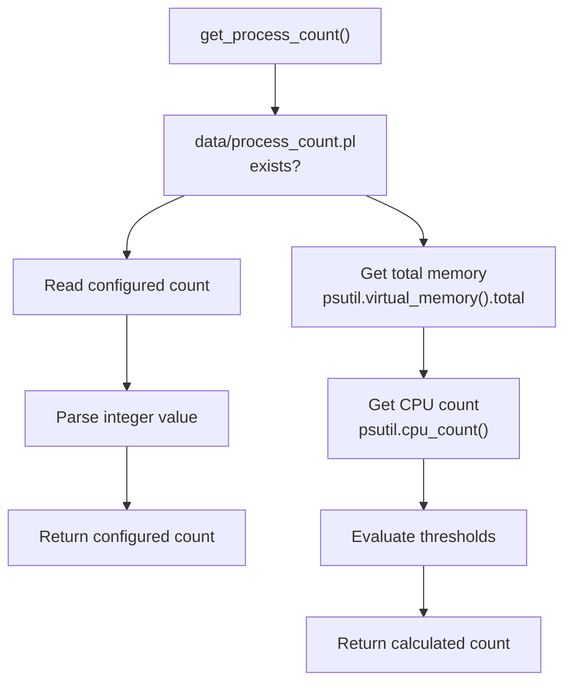
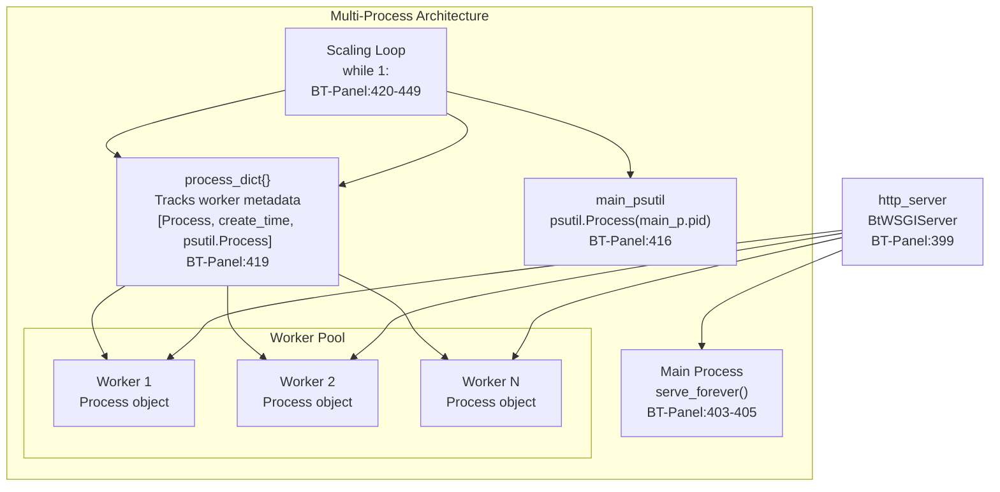
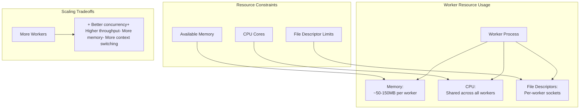

# Worker Scaling

> **Relevant source files**
> * [BT-Panel](https://github.com/aaPanel/aaPanel/blob/b6e4ab8b/BT-Panel)

## Purpose and Scope

This document details the dynamic worker scaling system in aaPanel's multi-process deployment mode. Worker scaling automatically adjusts the number of worker processes handling HTTP requests based on CPU usage and available system resources (RAM and CPU cores). The scaling algorithm is implemented in the main [BT-Panel](https://github.com/aaPanel/aaPanel/blob/b6e4ab8b/BT-Panel)

 script and is only active when multi-process mode is enabled.

For general information about process management modes, see [Process Management](/aaPanel/aaPanel/7-process-management). For details on process monitoring and health checks, see [Process Monitoring](/aaPanel/aaPanel/7.2-process-monitoring).

**Sources:** [BT-Panel L171-L449](https://github.com/aaPanel/aaPanel/blob/b6e4ab8b/BT-Panel#L171-L449)

---

## Worker Count Determination

### Resource-Based Calculation

The initial number of worker processes is determined by the `get_process_count()` function, which evaluates system resources to find an appropriate worker count. The function supports both manual configuration and automatic detection.

#### Configuration Priority



**Sources:** [BT-Panel L171-L192](https://github.com/aaPanel/aaPanel/blob/b6e4ab8b/BT-Panel#L171-L192)

#### Resource Threshold Table

The automatic calculation uses the following decision matrix:

| Memory (MB) | CPU Cores | Worker Count | Rationale |
| --- | --- | --- | --- |
| < 4000 | Any | 1 | Insufficient memory for multi-process |
| Any | < 4 | 1 | Insufficient CPU cores |
| 4000-7999 | ≥ 4 | 2 | Moderate resources |
| 8000-13999 | ≥ 8 | 3 | Good resources |
| ≥ 30000 | ≥ 16 | 4 | High-end resources |
| Default | - | 1 | Fallback case |

The logic prioritizes memory constraints first, then evaluates CPU availability. This ensures the system doesn't over-provision workers on memory-constrained environments.

**Sources:** [BT-Panel L185-L192](https://github.com/aaPanel/aaPanel/blob/b6e4ab8b/BT-Panel#L185-L192)

#### Code Implementation

The threshold evaluation occurs in this sequence:

```markdown
BT-Panel:178-183  # Check for manual configuration file
BT-Panel:186-188  # Retrieve memory and CPU count using psutil
BT-Panel:188      # Threshold 1: < 4GB RAM or < 4 cores → 1 worker
BT-Panel:189      # Threshold 2: 4-8GB RAM and > 3 cores → 2 workers
BT-Panel:190      # Threshold 3: > 14GB RAM and > 7 cores → 3 workers
BT-Panel:191      # Threshold 4: > 30GB RAM and > 15 cores → 4 workers
```

**Sources:** [BT-Panel L171-L192](https://github.com/aaPanel/aaPanel/blob/b6e4ab8b/BT-Panel#L171-L192)

---

## Dynamic Scaling Algorithm

### Main Process and Worker Architecture



**Sources:** [BT-Panel L399-L449](https://github.com/aaPanel/aaPanel/blob/b6e4ab8b/BT-Panel#L399-L449)

### Scaling Decision Logic

The scaling algorithm runs in a continuous loop, making decisions every 1-5 seconds based on CPU usage patterns:

```python
#mermaid-pcg95tqa699{font-family:ui-sans-serif,-apple-system,system-ui,Segoe UI,Helvetica;font-size:16px;fill:#333;}@keyframes edge-animation-frame{from{stroke-dashoffset:0;}}@keyframes dash{to{stroke-dashoffset:0;}}#mermaid-pcg95tqa699 .edge-animation-slow{stroke-dasharray:9,5!important;stroke-dashoffset:900;animation:dash 50s linear infinite;stroke-linecap:round;}#mermaid-pcg95tqa699 .edge-animation-fast{stroke-dasharray:9,5!important;stroke-dashoffset:900;animation:dash 20s linear infinite;stroke-linecap:round;}#mermaid-pcg95tqa699 .error-icon{fill:#dddddd;}#mermaid-pcg95tqa699 .error-text{fill:#222222;stroke:#222222;}#mermaid-pcg95tqa699 .edge-thickness-normal{stroke-width:1px;}#mermaid-pcg95tqa699 .edge-thickness-thick{stroke-width:3.5px;}#mermaid-pcg95tqa699 .edge-pattern-solid{stroke-dasharray:0;}#mermaid-pcg95tqa699 .edge-thickness-invisible{stroke-width:0;fill:none;}#mermaid-pcg95tqa699 .edge-pattern-dashed{stroke-dasharray:3;}#mermaid-pcg95tqa699 .edge-pattern-dotted{stroke-dasharray:2;}#mermaid-pcg95tqa699 .marker{fill:#999;stroke:#999;}#mermaid-pcg95tqa699 .marker.cross{stroke:#999;}#mermaid-pcg95tqa699 svg{font-family:ui-sans-serif,-apple-system,system-ui,Segoe UI,Helvetica;font-size:16px;}#mermaid-pcg95tqa699 p{margin:0;}#mermaid-pcg95tqa699 defs #statediagram-barbEnd{fill:#999;stroke:#999;}#mermaid-pcg95tqa699 g.stateGroup text{fill:#dddddd;stroke:none;font-size:10px;}#mermaid-pcg95tqa699 g.stateGroup text{fill:#333;stroke:none;font-size:10px;}#mermaid-pcg95tqa699 g.stateGroup .state-title{font-weight:bolder;fill:#333;}#mermaid-pcg95tqa699 g.stateGroup rect{fill:#ffffff;stroke:#dddddd;}#mermaid-pcg95tqa699 g.stateGroup line{stroke:#999;stroke-width:1;}#mermaid-pcg95tqa699 .transition{stroke:#999;stroke-width:1;fill:none;}#mermaid-pcg95tqa699 .stateGroup .composit{fill:#f4f4f4;border-bottom:1px;}#mermaid-pcg95tqa699 .stateGroup .alt-composit{fill:#e0e0e0;border-bottom:1px;}#mermaid-pcg95tqa699 .state-note{stroke:#e6d280;fill:#fff5ad;}#mermaid-pcg95tqa699 .state-note text{fill:#333;stroke:none;font-size:10px;}#mermaid-pcg95tqa699 .stateLabel .box{stroke:none;stroke-width:0;fill:#ffffff;opacity:0.5;}#mermaid-pcg95tqa699 .edgeLabel .label rect{fill:#ffffff;opacity:0.5;}#mermaid-pcg95tqa699 .edgeLabel{background-color:#ffffff;text-align:center;}#mermaid-pcg95tqa699 .edgeLabel p{background-color:#ffffff;}#mermaid-pcg95tqa699 .edgeLabel rect{opacity:0.5;background-color:#ffffff;fill:#ffffff;}#mermaid-pcg95tqa699 .edgeLabel .label text{fill:#333;}#mermaid-pcg95tqa699 .label div .edgeLabel{color:#333;}#mermaid-pcg95tqa699 .stateLabel text{fill:#333;font-size:10px;font-weight:bold;}#mermaid-pcg95tqa699 .node circle.state-start{fill:#999;stroke:#999;}#mermaid-pcg95tqa699 .node .fork-join{fill:#999;stroke:#999;}#mermaid-pcg95tqa699 .node circle.state-end{fill:#dddddd;stroke:#f4f4f4;stroke-width:1.5;}#mermaid-pcg95tqa699 .end-state-inner{fill:#f4f4f4;stroke-width:1.5;}#mermaid-pcg95tqa699 .node rect{fill:#ffffff;stroke:#dddddd;stroke-width:1px;}#mermaid-pcg95tqa699 .node polygon{fill:#ffffff;stroke:#dddddd;stroke-width:1px;}#mermaid-pcg95tqa699 #statediagram-barbEnd{fill:#999;}#mermaid-pcg95tqa699 .statediagram-cluster rect{fill:#ffffff;stroke:#dddddd;stroke-width:1px;}#mermaid-pcg95tqa699 .cluster-label,#mermaid-pcg95tqa699 .nodeLabel{color:#333;}#mermaid-pcg95tqa699 .statediagram-cluster rect.outer{rx:5px;ry:5px;}#mermaid-pcg95tqa699 .statediagram-state .divider{stroke:#dddddd;}#mermaid-pcg95tqa699 .statediagram-state .title-state{rx:5px;ry:5px;}#mermaid-pcg95tqa699 .statediagram-cluster.statediagram-cluster .inner{fill:#f4f4f4;}#mermaid-pcg95tqa699 .statediagram-cluster.statediagram-cluster-alt .inner{fill:#f8f8f8;}#mermaid-pcg95tqa699 .statediagram-cluster .inner{rx:0;ry:0;}#mermaid-pcg95tqa699 .statediagram-state rect.basic{rx:5px;ry:5px;}#mermaid-pcg95tqa699 .statediagram-state rect.divider{stroke-dasharray:10,10;fill:#f8f8f8;}#mermaid-pcg95tqa699 .note-edge{stroke-dasharray:5;}#mermaid-pcg95tqa699 .statediagram-note rect{fill:#fff5ad;stroke:#e6d280;stroke-width:1px;rx:0;ry:0;}#mermaid-pcg95tqa699 .statediagram-note rect{fill:#fff5ad;stroke:#e6d280;stroke-width:1px;rx:0;ry:0;}#mermaid-pcg95tqa699 .statediagram-note text{fill:#333;}#mermaid-pcg95tqa699 .statediagram-note .nodeLabel{color:#333;}#mermaid-pcg95tqa699 .statediagram .edgeLabel{color:red;}#mermaid-pcg95tqa699 #dependencyStart,#mermaid-pcg95tqa699 #dependencyEnd{fill:#999;stroke:#999;stroke-width:1;}#mermaid-pcg95tqa699 .statediagramTitleText{text-anchor:middle;font-size:18px;fill:#333;}#mermaid-pcg95tqa699 :root{--mermaid-font-family:"trebuchet ms",verdana,arial,sans-serif;}Every 1 secondYesNoCheck current vs maxYesNoAge > 60s ANDcpu_percent(interval=5) == 0Keep workerMonitor Main Process CPUcpu_percent(interval=1)CPU > 90%?Count active workerscpu_percent(interval=1) > 0Check worker age and CPUprocess_num < process_countAND all workers busy?Create new ProcessAdd to process_dictRecord timestampprocess.kill()Remove from process_dict
```

**Sources:** [BT-Panel L420-L449](https://github.com/aaPanel/aaPanel/blob/b6e4ab8b/BT-Panel#L420-L449)

### Worker Creation Conditions

Workers are created when all of the following conditions are met:

1. **High CPU Load:** Main process CPU usage exceeds 90%
2. **All Workers Busy:** All existing workers show non-zero CPU usage
3. **Under Capacity:** Current worker count is less than the maximum (from `get_process_count()`)

The code that implements this logic:

```sql
BT-Panel:423      # Monitor main process: cpu_percent = main_psutil.cpu_percent(interval=1)
BT-Panel:424      # Check threshold: if cpu_percent > 90:
BT-Panel:429-432  # Count busy workers: if process_dict[i][2].cpu_percent(interval=1) > 0
BT-Panel:435      # Capacity check: if process_num == is_alive and process_num < process_count:
BT-Panel:436-439  # Create worker: p = Process(target=serve_forever)
```

**Sources:** [BT-Panel L420-L439](https://github.com/aaPanel/aaPanel/blob/b6e4ab8b/BT-Panel#L420-L439)

### Worker Termination Conditions

Workers are terminated when both conditions are met:

1. **Minimum Age:** Worker has existed for at least 60 seconds
2. **Idle Duration:** Worker shows zero CPU usage for 5 consecutive seconds

The termination logic:

```markdown
BT-Panel:442-447  # Iterate through workers and check conditions
BT-Panel:444      # Age check: if t - process_dict[i][1] < 60: continue
BT-Panel:445      # CPU check: if process_dict[i][2].cpu_percent(interval=5) > 0: continue
BT-Panel:446      # Terminate: process_dict[i][0].kill()
BT-Panel:447      # Cleanup: process_dict.pop(i)
```

**Sources:** [BT-Panel L442-L447](https://github.com/aaPanel/aaPanel/blob/b6e4ab8b/BT-Panel#L442-L447)

---

## Worker Process Lifecycle

### Process Dictionary Structure

The `process_dict` dictionary tracks each worker using its PID as the key. The value is a list containing three elements:

| Index | Type | Description | Code Reference |
| --- | --- | --- | --- |
| 0 | `multiprocessing.Process` | Process object for control operations | [BT-Panel L436-L439](https://github.com/aaPanel/aaPanel/blob/b6e4ab8b/BT-Panel#L436-L439) |
| 1 | `float` | Creation timestamp from `time.time()` | [BT-Panel L421-L439](https://github.com/aaPanel/aaPanel/blob/b6e4ab8b/BT-Panel#L421-L439) |
| 2 | `psutil.Process` | psutil wrapper for monitoring CPU usage | [BT-Panel L439](https://github.com/aaPanel/aaPanel/blob/b6e4ab8b/BT-Panel#L439-L439) |

**Sources:** [BT-Panel L419-L439](https://github.com/aaPanel/aaPanel/blob/b6e4ab8b/BT-Panel#L419-L439)

### Worker Creation Sequence

```

```

**Sources:** [BT-Panel L436-L439](https://github.com/aaPanel/aaPanel/blob/b6e4ab8b/BT-Panel#L436-L439)

### Worker Termination Sequence

```

```

**Sources:** [BT-Panel L442-L447](https://github.com/aaPanel/aaPanel/blob/b6e4ab8b/BT-Panel#L442-L447)

---

## Configuration and Activation

### Enabling Multi-Process Mode

Multi-process mode with worker scaling is controlled by the presence of the `data/is_process.pl` file:

| File Exists | Mode | Worker Count | Code Path |
| --- | --- | --- | --- |
| No | Single process | 1 (main only) | [BT-Panel L392-L397](https://github.com/aaPanel/aaPanel/blob/b6e4ab8b/BT-Panel#L392-L397) |
| Yes | Multi-process | Dynamic (1-4+) | [BT-Panel L398-L449](https://github.com/aaPanel/aaPanel/blob/b6e4ab8b/BT-Panel#L398-L449) |

The check occurs at startup:

```markdown
BT-Panel:390      # Check file: is_process = os.path.exists('data/is_process.pl')
BT-Panel:391-397  # Single-process path: if not is_process:
BT-Panel:398-449  # Multi-process path: else:
```

**Sources:** [BT-Panel L390-L449](https://github.com/aaPanel/aaPanel/blob/b6e4ab8b/BT-Panel#L390-L449)

### Manual Worker Count Override

To manually specify the worker count, create `data/process_count.pl` with an integer value:

```markdown
# Example: Set to 3 workers regardless of system resources
echo "3" > /www/server/panel/data/process_count.pl
```

The minimum worker count in multi-process mode is enforced at 2:

```markdown
BT-Panel:409-410  # Enforce minimum: if process_count < 2: process_count = 2
```

**Sources:** [BT-Panel L178-L410](https://github.com/aaPanel/aaPanel/blob/b6e4ab8b/BT-Panel#L178-L410)

---

## Performance Characteristics

### Monitoring Intervals

The scaling algorithm uses different monitoring intervals for different decisions:

| Operation | Interval | Purpose | Code Reference |
| --- | --- | --- | --- |
| Main process CPU check | 1 second | Quick response to load spikes | [BT-Panel L423](https://github.com/aaPanel/aaPanel/blob/b6e4ab8b/BT-Panel#L423-L423) |
| Worker busy check | 1 second | Determine if workers are active | [BT-Panel L431](https://github.com/aaPanel/aaPanel/blob/b6e4ab8b/BT-Panel#L431-L431) |
| Worker idle check | 5 seconds | Confirm sustained idle state | [BT-Panel L445](https://github.com/aaPanel/aaPanel/blob/b6e4ab8b/BT-Panel#L445-L445) |
| Loop iteration delay | 1 second | Rate limiting and resource efficiency | [BT-Panel L449](https://github.com/aaPanel/aaPanel/blob/b6e4ab8b/BT-Panel#L449-L449) |

**Sources:** [BT-Panel L423-L449](https://github.com/aaPanel/aaPanel/blob/b6e4ab8b/BT-Panel#L423-L449)

### Scaling Behavior

#### Scale-Up Characteristics

* **Trigger:** Main process CPU > 90% and all workers busy
* **Response Time:** 1-2 seconds after condition met
* **Rate Limit:** One worker per iteration (1 second between spawns)
* **Maximum Workers:** Determined by `get_process_count()` (typically 1-4)

#### Scale-Down Characteristics

* **Trigger:** Worker idle (0% CPU) for 5 seconds
* **Cooldown Period:** 60 seconds from worker creation
* **Response Time:** 5-6 seconds after becoming idle
* **Rate:** Multiple workers can be terminated in same iteration

**Sources:** [BT-Panel L420-L449](https://github.com/aaPanel/aaPanel/blob/b6e4ab8b/BT-Panel#L420-L449)

### Resource Implications



**Sources:** [BT-Panel L171-L449](https://github.com/aaPanel/aaPanel/blob/b6e4ab8b/BT-Panel#L171-L449)

---

## Implementation Details

### Main Process vs Workers

All processes (main and workers) execute the same `serve_forever()` function, which starts accepting connections on the shared socket:

```markdown
BT-Panel:403-405  # serve_forever() definition
BT-Panel:404      # http_server.start_accepting()
BT-Panel:405      # http_server._stop_event.wait()
```

The operating system's kernel handles load balancing across processes listening on the same socket. When a connection arrives, the kernel wakes one available process to handle it.

**Sources:** [BT-Panel L403-L405](https://github.com/aaPanel/aaPanel/blob/b6e4ab8b/BT-Panel#L403-L405)

### Process Daemon Mode

All worker processes are started with `daemon=True`:

```markdown
BT-Panel:414, 437  # main_p.daemon = True, p.daemon = True
```

This ensures that worker processes automatically terminate when the main BT-Panel process exits, preventing orphaned processes.

**Sources:** [BT-Panel L414-L437](https://github.com/aaPanel/aaPanel/blob/b6e4ab8b/BT-Panel#L414-L437)

### Server Initialization

The HTTP server is started before worker creation:

```sql
BT-Panel:399      # http_server.start() - prepares socket binding
BT-Panel:413-415  # Create main process
BT-Panel:419      # Initialize empty process_dict
BT-Panel:420      # Enter scaling loop
```

This sequence ensures the socket is ready before any workers attempt to accept connections.

**Sources:** [BT-Panel L399-L420](https://github.com/aaPanel/aaPanel/blob/b6e4ab8b/BT-Panel#L399-L420)